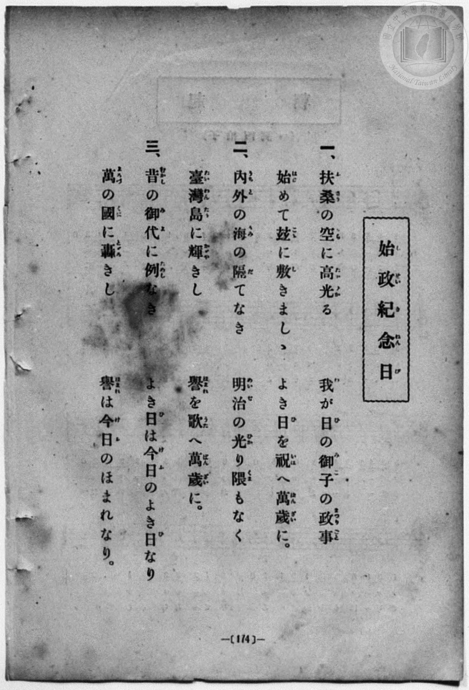
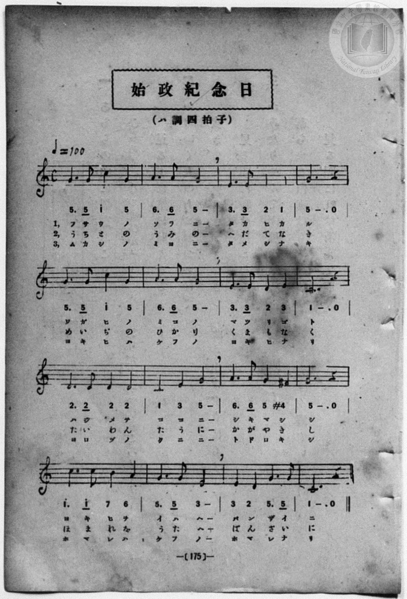

# 始政紀念日

> Re:Shōka 使用 AI 協助辨識與重建樂譜，可能會有錯誤。歡迎回報。

- **鋼琴伴奏版**：<br><audio controls src="shisei_kinenbi.mp3"></audio>
- **NEUTRINO 歌聲合成版**：<br><audio controls src="shisei_kinenbi_neutrino.mp3"></audio>

- 曲：宮島慎三郎
- book: 新編 小學校・公學校 唱歌教材集（尋常科三・四學年用）
- 一條慎三郎 編《新編 小學校・公學校 唱歌教材集》（大正十二年十二月，索書號 0725-41）
- 臺灣總督府《公學校唱歌集》（大正四年三月，索書號 0725 26）

## 說明

> [!NOTE]
> **原書資訊與歌詞全文**（對應 `P182.jpg`–`P183.jpg`，原書 p. 174–175，尋常科三・四學年第 27 首）：
> - **調性與拍號**：ハ調四拍子（C 大調 4/4 拍），速度 ♩= 100
> - **作曲**：臺灣總督府國語學校助教授 宮島慎三郎
> - **版面校勘**：本集（`P183.jpg`）第 1、5、9、11、13 小節首拍均記為附點四分音符加八分音符（`5. 5`、`2. 2`、`6. 6`、`1^. 1^`），且第 7 小節五線譜與簡譜均記為 `3. 3 2 3`（末拍為 E4 = `3`，異於大正四年《公學校唱歌集》之 `3. 3 2 1`）。均依本集圖檔忠實轉錄。
>
> **一、**
> 扶桑（ふさう）の空（そら）に高光（たかひか）る
> 我（わ）が日（ひ）の御子（みこ）の政事（まつりごと）
> 始（はじ）めて茲（こゝ）に敷（し）きましゝ
> よき日（ひ）を祝（いは）へ萬歳（ばんざい）に。
>
> **二、**
> 内外（うちと）の海（うみ）の隔（へだ）てなき
> 明治（めいぢ）の光（ひか）り隈（くま）もなく
> 臺灣島（たいわんたう）に輝（かゞや）きし
> 譽（ほまれ）を歌（うた）へ萬歳（ばんざい）に。
>
> **三、**
> 昔（むかし）の御代（みよ）に例（ためし）なき
> よき日（ひ）は今日（けふ）のよき日（ひ）なり
> 萬（よろづ）の國（くに）に轟（とゞろ）きし
> 譽（ほまれ）は今日（けふ）のほまれなり。


## 歌詞

```text
（TMD 檔案未包含歌詞註解）
```

## ABC

<div class="abc-score" data-abc-src="shisei_kinenbi.abc" aria-label="五線譜載入中"></div>

[下載 ABC 原始檔](shisei_kinenbi.abc)

## TMD 檔案連結

- [主旋律 TMD 檔案](shisei_kinenbi.tmd) [[在 TMD Studio 編輯](https://tmdlang.github.io/Tmd-TS/#tmd=s7IKdvYPcrWy4qpTUCpJTLdSSM7PyUlNLsnMz7MqzsjPTozPrsyvSsyML84ojTe0NDJWgqssy88pzU21Si9KTEmNN443QcgU55cWJadaFSdn5OfnxJekVpQk5edno8vHFySmp1oFGFoYIWQKivLLUvMS84C6C4oy80pSU8DaEQpSyzJTUkHSxcmJefFlqUWZaZmpKUiOSi0qBrsdYkVJUWJecXJRZgHIQwhV-UUlGflAhxdkVFplZBaX5BdlJifmxGcn5iUiFJVkpAK9l5lbALQkMQddPDm1KDU3Pw9FBmhMemaeVUliZjnQcflpaZnJYHktLYWny7ufTdn_fEvD0_1bn01fqqClxaVoq2BoYMBlb6vgzGVjom9iBzIHFFBWCs-mbXi-fYXC0w39T9fueLZg4ePm3U9b10DYCk-nbHy2tufZ1JnP5k54Obvt_Z6Opxu6n-7Y8Xz5xCc7OkFKZ88GKn26c8vzKSve7-kEu-_JjoZni-Y-a-0DKnnZ3KcANP5xQxcp9jxu6AZZtWT5s7WLn_Y2PtnVA7QBwng2p-P9np7nWxY9m73jxcz5CgbmRqa6JoYwu5_N3vR-z6yn69Y93bwN7gKwzIv2Xc8bFz_fsff53MVPd80BughuPcR2dHuBPtu5BWgANhsVjMzANnLpaynYUgtwKSgo2ClEK_r5h7jGQjhaWk_75oPs3dz-YkXXi452oDtfrJz3tHXFs2ntWlrg-Oh91t6pkABK23pZBekJjxomgzjGYA7Q4RADFAr0FAzNTYCShuamIFFc0bhmjYKRucLLZdOA_gOGJMQZukCHvFi1_1nDcpATunuBwQCyfNbj5n6gMFAzUOzp2glA5zgrAEMPKKYATGQKQFGwKT0vG-Y_3bVM4dHMlZB0CDf0yd45wBgDm4UWP0_ndL9YNQ8aP10rQUmjr0MBLWIRBj3v7Hg5dxFIbfcMsHHP5qyBJFjkwOgEec_wcUOjKRBbArEhiGNoDEqVz9c3AH0N8shcYFjPeN606-XMlpe754GCpqPt5fzNz9cse9q14GnrajgXZLqpnoJpAtCQBCM9BSMww0xPwQzMMIwDhnkcyFpgEDzZMQVkuTnUqie7pjzfPuvF2jnAAH2-YSGQAbdWIcFYT8FYwUjBGKi149mc1UA3gYRdTRRsgXKgOH0-dcOzaXuQ0ymu5PxkZzfcPEOQUx43NAFterJvLiSAns6Z9mzVlKf7Fzxdv-zF3s6XPS1ABeBghSVAYG4GegZYhoD5zzq3PVs4Eeiux41bHzdOfdwIDOLOx43rnq_cBRac-7gJ6FugyOqXq2c8bQWygYLzHzd2P27cBCRBUk3dUKM6wOY09YPV9wBLKrBiYP4FGfh030JIinrcuP9x42SIILBYe7ILlEUfN-573LjkcVPX48YpjxtBJQ_ETGDRB5Zd_7hxBtiuxseNy170AM0ECk5-3DQX4rZnU7eDRaaDub1g06YDZSGGPG4CSvWiuKdp0vOlQL1AbgvQcLCuHS8mrHm2djNYcMPjpsmPG6cBZSHmY4Thrh6kMHza1vp0CTB_ATW2PW5cCHE_yHdbIa4CCu6HiLycNQUssuNx4wKwyLLHjauAboMG4Iy-Z5t2g8MQ6E2gwxZBgw4a7PAA73o5C1iEAUX6gT4FizSBzemHmAPJecB8BYusFmCkgH0EZEPid_WLPRDvdz9umve4CeJNYLhNh5qwdi9YdjcoJJt6ICEGTIMw78wnPcSAxRJSqpsBDoemBnBCgsQaKIU82b0YmkKagB4EmfNkHyQBzAeHCUQlIsSwxGzj-ie7u2AiE4GpGmI4NpWrgCEJ9e-ENWD3ABEwEIBqwO6ZA7EaGMiroYG2F-hxoMgKcKCBykICgYbLMTA1EDdAw4ryCgcKFLT0ubiCgW2T1EzvzLzUvKRMq4DMxLx8hxqDmmqQTQo2FlrgmFHAVt0pAMs1YCHxYmGPgoYJtHjTUYCVuppYNADtAxlWo2AKLLt1gaRhHJjSBQqZgYXMoFIgEWMwDSrAdBUMwSIwORA0AImAjfMxrFEABhlYFFg0AXEbmLUOrAdYNEFkmjqB7NVw04FJBaqjG4g3QVlgmSYQDYPxCHuMQLpAZoPULgTiFSj2wGT2Q8Vg9uyAii8A4mVg1iqoTC92e4xBbmhAct10FHv2Q_3Tgd0_TY1wHbjtwR-pu3roEqkgdg04anFEalM_NBB64FGEFgiNk9ECex9UfAlQdxeYNQUqA4osHJEKDDKIrhYgXoRiD8hWaDSAzYPZA3PZPqB4E0pgQ2SwR2oHVFcv3D_robomQmW2ovoHiw6oPXDXEBupOzrJiVRQPOkCSRANwpD4AsUcIk6RY9lEHSyEL6eCvAzyyAxowENyBUhmMpgHIZFTNig1wwIBFMEQEYQM1kiF529gpIITErDmgeoCycBKCWR7IPkenNyaWqA24rUHOVKbQK5bCtYFSzxgW8E2oNoDSYqPG1eCdeG3B2-kAtuA5EQqOIcCC9U4YLMUFHGIGDOFZlBYVgVFOUwGf1bFSKhNk6B-AoUkJKnDykKI-AZ4nAAbBFA1LWAZWFhhi9XdUJWgjNeDYg-s_J1PqT2gWMW0h1BWBeuApk-wDkhmxZ5Va7m4dO0UUOpeBaCAMhcA)]
- [鋼琴伴奏 TMD 檔案](shisei_kinenbi_piano.tmd) [[在 TMD Studio 編輯](https://tmdlang.github.io/Tmd-TS/#tmd=s7IKdvYPcrWy4qpTUCpJTLdSSM7PyUlNLsnMz7MqzsjPTozPrsyvSsyML84ojTe0NDJWgqssy88pzU21Si9KTEmNN443QcgU55cWJadaFSdn5OfnxJekVpQk5edno8vHFySmp1oFGFoYIWQKivLLUvMS84C6C4oy80pSU8DaEQpSyzJTUkHSxcmJefFlqUWZaZmpKUiOSi0qBrsdYkVJUWJecXJRZgHIQwhV-UUlGflAhxdkVFplZBaX5BdlJifmxGcn5iUqcWlpKTxd3v1syv7nWxqe7t_6bPrS93s6Xs6e-ayz-2X3nucTtjzZs-Xp0v73ezoVtLS4FG0VDA0MuOxtFZy5bEz0TexAloC8a6XwbNqG59tXKDzd0P907Y5nCxY-bt79tHUNhK3wdMrGZ2t7nk2d-WzuhJez24BWPN3Q_XTHjufLJz7Z0QlSOns2UOnTnVueT1kBtAvs-Cc7Gp4tmvustQ-o5GVznwLQ-McNXaTY87ihG2TVkuXP1i5-2tv4ZFcP0AYI49mcjvd7ep5vWfRs9o4XM-crGJgbmeqaGMLsfjZ70_s9s56uW_d08za4C8AyL9p3PW9c_HzH3udzFz_dNQfoIrj1ENvR7QX6bOcWoAHYbFQwMgPbyBUMjJjUTO_MvNS8pEyrgMzEvPwgD4cag5pqLgUgsLHQsgMz9LUUbNGBwvM1a4Bh9WJhj4KGCShgnq9v0FEAJjVjvayCdE0sGrT0wYbVKJgq6AKhqYJhHJjSBQqZgYXMoFIgEWMwbaxgBCQNwSIwORA0AImAjfMxrFF43LgVLPq4cSoQt4FZ68B6HjfOhcg0dQLZq-GmP26cD9XRDcSboCywTBOIhsF4hD1GIF0gs0FqFwLxChR7YDL7oWIwe3ZAxRcA8TIwaxVUphe7PcYgNzQguW46ij37of7pwO6fpka4Dtz24I_UXT10iVQQuwYctTgitakfGgg98ChCC4TGyWiBvQ8qvgSouwvMmgKVAUUWjkgFBhlEVwsQL0KxB2QrNBrA5sHsgblsH1C8CSWwITLYI7UDqqsX7p_1UF0ToTJbUf2DRQfUHrhriI3UHZ3kRCoonnSBJIgGYUh8gWIOEafIsWyiDhbCl1NBXgZ5ZAY04CG5AiQzGcyDkMgpG5SaYYEAimCICEIGa6TC8zcwUsEJ6XETyGSYDKyUQLYHku_Bya2pBWojXnuQI7UJ5LqlYF2wxAO2FWwDqj2QpPi4cSVYF3578EYqsJAnJ1LBORRYqMYpmAMpUPQhci8kg8KyKijKYTL4sypGQm2aBPUTKCQhSR1WFkLEN8Dj5HHjNKiaFrAMLKywxepuqEpQxutBsQdW_s6n1B5QrGLaQyirgnVA0ydYBySzYs-qtVirXh_kqtcEUfW-6Ot62d4LjOxn3b1P1054OqnnReMmSAMJKVLjFaINY2FUjYIJkGGCxIcyTOOxCBhAvU6-KUAKYQhY1jQeqgzEwGmwEZAyAvFR9GC4B6oa0xhk96BbBDIFGNC6dgooYR3tYxgLNh1TwgiXhDFcQpkLAA)]

## 分析

```text
================================================================================
📊 TMD Song Profile: [ 始政紀念日 ]
================================================================================
⏱  Duration:       0:38 (38.4s), 16 measures total
🎼 Key & Tempo:    首調基準 C, != 100.0 BPM, <4/4>
   - 分析範圍：      由實際發聲的音符與和弦推測調性；播放脈絡另行呈現
🎤 人聲音域:    C4 (MIDI 60) – C5 (MIDI 72) [跨度: 12 個半音 / 1.0 個八度, 難度: easy]
   - 最低音:  C4 in [ShiseiKinenbi #1 @ m.3, 0:06]
   - 最高音: C5 in [ShiseiKinenbi #1 @ m.1, 0:01]
   - 適合: soprano, mezzo-soprano, contralto, tenor, baritone, bass
🏛  結構:      ShiseiKinenbi (38.4s)
⚡ 編曲密度:        Peak 1 軌道同時演奏
🗝  調性診斷：       G 大調（純淨自然大調，未偵測到可信轉調）
   - 風格氣質:    純淨自然大調（陽光明朗、易唱易記，無明顯調外色彩）
   - 轉調歷程:    全曲維持單一推測調性（未偵測到可信轉調）
   - 核心骨幹音:  G, C, E, D, A
   - 調性數值:    G 大調 [相關度: 0.85, 穩定度: Moderate, 自然音純度: 100.0%]
   - 候選調性 (K-S): G 大調 (0.85), C 大調 (0.79), E 小調 (0.66)
   - 五度圈歷程:   +1
   - 各段落調性細節:
     • [ShiseiKinenbi #1]: G 大調 (r: 0.85, 自然音純度: 100.0%)

  [ 五度圈游移軌跡 ]
               C  
         F           [G ]*
      Bb               D  
      Eb               A  
         Ab           E  
            Db       B  
               F# 
     (* = active key center)

  [ 十二半音累積音高分佈 ]
     C  : █████████████             20.0%
     C# :                            0.0%
     D  : ███████                   11.7%
     D# :                            0.0%
     E  : █████████                 15.0%
     F  :                            0.0%
     F# : █                          1.7%
     G  : ████████████████████████  38.3%
     G# :                            0.0%
     A  : ███████                   11.7%
     A# :                            0.0%
     B  : █                          1.7%
--------------------------------------------------------------------------------
Assignment 軌道音域：
  - Piano         : C4 – C5 (12 個半音 / 1.0 個八度, 48 個音符)
================================================================================
```


## 原書掃描頁






