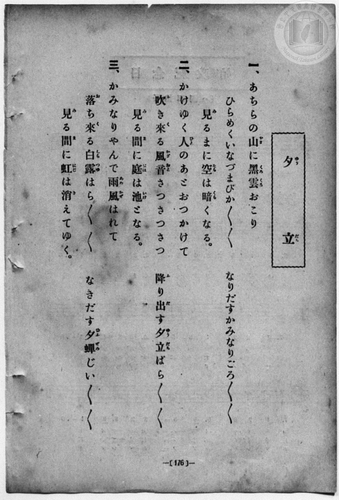
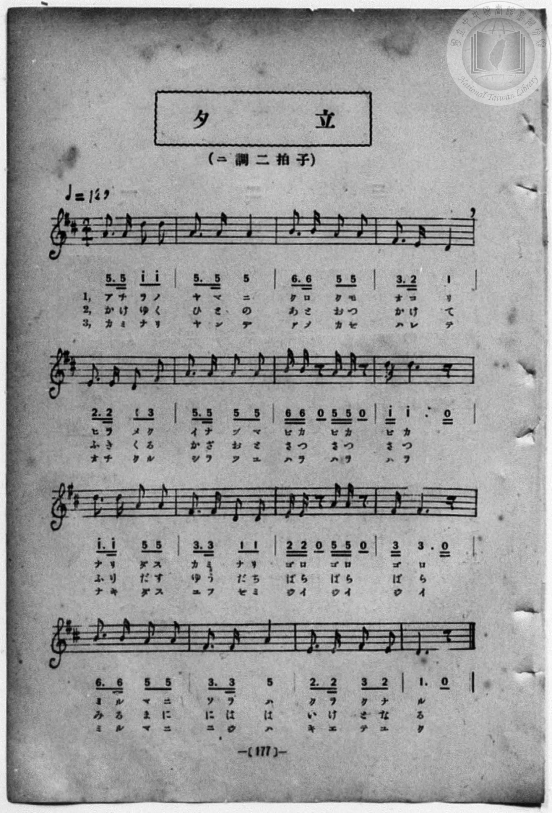

# 夕立

> Re:Shōka 使用 AI 協助辨識與重建樂譜，可能會有錯誤。歡迎回報。

<audio controls src="yudachi_2.mp3"></audio>

- 詞：公學校用國民讀本
- 曲：宮島慎三郎
- book: 新編 小學校・公學校 唱歌教材集（尋常科三・四學年用）
- 一條慎三郎 編《新編 小學校・公學校 唱歌教材集》（大正十二年十二月，索書號 0725-41）
- 臺灣總督府《公學校唱歌集》（大正四年三月，索書號 0725 26）

## 說明

> [!NOTE]
> **原書資訊與歌詞全文**（對應 `P184.jpg`–`P185.jpg`，原書 p. 176–177，尋常科三・四學年第 28 首）：
> - **作曲**：臺灣總督府國語學校助教授 宮島慎三郎
> - **調性與拍號**：ニ調二拍子（D 大調 2/4 拍），♩= 120
> - **假名表記**：本集（`P184.jpg`–`P185.jpg`）第二段印作「おつかけて」「さつさつさつ」「夕立（ゆうだち）ばら／＼／＼」，依原書歷史假名忠實記錄。
>
> **一、**
> あちらの山（やま）に黑雲（くろくも）おこり
> ひらめくいなづまぴか／＼／＼
> なりだすかみなりごろ／＼／＼
> 見（み）るまに空（そら）は暗（くら）くなる。
>
> **二、**
> かけゆく人（ひと）のあとおつかけて
> 吹（ふ）き來（く）る風音（かざおと）さつさつさつ
> 降（ふ）り出（だ）す夕立（ゆうだち）ばら／＼／＼
> 見（み）る間（ま）に庭（には）は池（いけ）となる。
>
> **三、**
> かみなりやんで雨風（あめかぜ）はれて
> 落（お）ち來（く）る白露（しらつゆ）はら／＼／＼
> なきだす夕蟬（ゆふぜみ）じい／＼／＼
> 見（み）る間（ま）に虹（にじ）は消（き）えてゆく。


## 歌詞

```text
（TMD 檔案未包含歌詞註解）
```

## ABC

```abc
X:1
T:夕立
C:曲：宮島慎三郎
M:2/4
L:1/16
Q:1/4=120
K:D
V:V1 name="Piano" snm="Pia"
[V:V1]
A3 A d2 d2 | A3 A A4 | B3 B A2 A2 | F3 E D4 |
w: 1.~あ ち ら の | や ま に | く ろ く も | お こ り
w: 2.~か け ゆ く | ひ と の | あ と お つ | か け て
w: 3.~か み な り | や ん で | あ め か ぜ | は れ て
E3 E D2 F2 | A3 A A2 A2 | B B z2 A A z2 | d d6 z |
w: 1.~ひ ら め く | い な づ ま | ぴ か ぴ か | ぴ か
w: 2.~ふ き く る | か ざ お と | さ つ さ つ | さ つ
w: 3.~お ち く る | し ら つ ゆ | は ら は ら | は ら
d3 d A2 A2 | F3 F D2 D2 | E E z2 A A z2 | F F6 z |
w: 1.~な り だ す | か み な り | ご ろ ご ろ | ご ろ
w: 2.~ふ り だ す | ゆ う だ ち | ば ら ば ら | ば ら
w: 3.~な き だ す | ゆ ふ ぜ み | じ い じ い | じ い
B3 B A2 A2 | F3 F A4 | E3 E F2 E2 | D6 z2 |
w: 1.~み る ま に | そ ら は | く ら く な | る
w: 2.~み る ま に | に は は | い け と な | る
w: 3.~み る ま に | に じ は | き え て ゆ | く
A3 A d2 d2 | A3 A A4 | B3 B A2 A2 | F3 E D4 |
w: 1.~あ ち ら の | や ま に | く ろ く も | お こ り
w: 2.~か け ゆ く | ひ と の | あ と お つ | か け て
w: 3.~か み な り | や ん で | あ め か ぜ | は れ て
E3 E D2 F2 | A3 A A2 A2 | B B z2 A A z2 | d d6 z |
w: 1.~ひ ら め く | い な づ ま | ぴ か ぴ か | ぴ か
w: 2.~ふ き く る | か ざ お と | さ つ さ つ | さ つ
w: 3.~お ち く る | し ら つ ゆ | は ら は ら | は ら
d3 d A2 A2 | F3 F D2 D2 | E E z2 A A z2 | F F6 z |
w: 1.~な り だ す | か み な り | ご ろ ご ろ | ご ろ
w: 2.~ふ り だ す | ゆ う だ ち | ば ら ば ら | ば ら
w: 3.~な き だ す | ゆ ふ ぜ み | じ い じ い | じ い
B3 B A2 A2 | F3 F A4 | E3 E F2 E2 | D6 z2 |
w: 1.~み る ま に | そ ら は | く ら く な | る
w: 2.~み る ま に | に は は | い け と な | る
w: 3.~み る ま に | に じ は | き え て ゆ | く
```

## TMD 檔案連結

- [主旋律 TMD 檔案](yudachi_2.tmd) [[在 TMD Studio 編輯](https://tmdlang.github.io/Tmd-TS/#tmd=s7IKdvYPcrWy4qpTUCpJTLdSSM7PyUlNLsnMz7MqzsjPTozPrsyvSsyML84ojTe0NDJWgqssy88pzU21Si9KTEmNN443QcgU55cWJadaFSdn5OfnxJekVpQk5edno8vHFySmp1oFGFog6Swoyi9LzUvMA-ouKMrMK0lNAWtHKEgty0xJBUkXJyfmxZelFmWmZaamIDkqtagY7HaIFSVFiXnFyUWZBSAPIVTlF5Vk5AMdXpBRaZWRWVySX5SZnJgTn52Yl4hQVJKRCvReeWoikFGkxKWlpfB0ydTnq7sVtLS4FG0VDI0MuOxtFVy4bIz0TexAukCetFJ4Nm3D8-0rFJ5u6H-6dsezBQsfN-9-2roGwlZ4OmXjs7U9z6bOfDZ3wsvZbe_3dDzd0P10x47nyyc-2dEJUjp7NlDp051bnk9Z8X5PJ9g1T3Y0PFs091lrH1DJy-Y-BaDxjxu6SLHncUM3yKoly5-tXfy0t_HJrh6gDRDGszkd7_f0PN-y6NnsHS9mzlcwMDcy1TUxhNn9YuW893tmwQ0GuurpnO5nGya-WNfwbM4asJJnszeBlKxb93TzNrgjIZrbdz1vXPx8x97ncxc_3TUH6Gi4QRAHojsN6PmdW4AGYHOUgpEZ2FFc-loKttQCXAoKCnYK0Yp-_iGusRCOltbTvvkgeze3v1jR9aKjHehOYCg8bV3xbFq7lhY4ynqftXcqJICSrl5WQXrCo4bJII4pmAN0OMQAhQI9BUNzM6Ckobk5SBRXTK9Zo2BkofBy2TSg_4AhCXGGLtAhT_bOAQYuyM5ZaEEJjIQXq-ZBg7JrJSii-zoU0OIAYdCLVfufNSwH-aW7FxieYBMfNwON2A9KAd29T9dOAPrLBZjAlwPFFIAJWgEoCnZOz6OZKyGJHW7a08b2pxN6Xyxc8WLFDLBRwJQAScw4g6QT6EmQVeu2Pu3dAPTW44aex41djxuXPG7sftw48XHjsscNvWDBqWBBJBIsDsl5QBseN7U9bgSiBY8bFwKNfdy44XET0JX97_fsgZBA9UBHP9k3FxIJz9Zuf9q_CeLip_sXPF2_DOjolz0tjxuawB6CxTkwjz1uaATmbDD_cWMT0HygyY8b1z3duBFsb8vjxn1gG1e_3D3xJSjNdzxu7H_c1Asmm8BSQB9NftzUBTNkE8iEpkaQgkag9lWPG5cCDXncuAXoa2Q3w9SvAuoFe20mOFj2w0SmAG3BVP9iGThAGveDrG4CqgeavPr5yl1gwbngYAE6af2zWdNhToWIAB0DNLYbIwR29aCEADheQKHd_2QXxMxNjxtBZRIwTMDhswItBiEan07YCVa8Fayy98k-ULoAGgJx5MtFK17O3wwWAeqaBjYBYiZ6vENMezkT6HGYaU1dT9shLlkA1jKT-FSBNcReTpsM5kKj9emutWDuamCgQYNuI9AioAgw7iaCRYBexhp0wAyNFnSwuAMmm6bJjxuXv5y9Auh3sGlN4CQBVDMHYsvjJmCyh4beiwl7wWq6wFIL0ULv-cy9L-dAEt50cOJcAvQ4zBAs_gUnOWD6BKUoYFi9mL8GFlZbgbZDw6FxBtCDpIbVi5mQWAaG1QxoWG0DFtlAEVCp8bgRyFgGSTzQsKK8qIYCBS19Lq7I0pTE5IxMq4DMxLx8hxqDmmqQHQo2hmZa4EhRwFZHKIDKoB0NLxb2KGiYgOrN5-sbdBRghZQmFg1Aq0CG1SiYAss9XSBpGAekwARCDEKDRMzAtBlYBIRrFIzBIkYKhjA1YPN8DGtAJQxYBBjJCsC4A7PWgfUAkwxUZh8Qr4abDgxLiHhTL5QNLHWgMl1QHZOBYhA23C4jkHw3VH4iUL4NzALpB8lsgsqsgNoPswvmOpA4yERgWoPKIJnVuAzVLmNk-f2g5Ad2JUg_kr-agK5sXI5pV1MjVDcwbUJl1kNlelDswh_Du3rIiWEjpJgCxRpq_EJi0wwIDaBiILoGlBTAqQEGDVBiGBq2wNgF-Q051GExvAqIl4JZ-6AyW8BhEA8WQ7ARMgi74lFieCvURETaAKlFjo9p8JhcAZWZCo5ViF0INkIGi13gGIalNmDKRbNrOsLHYP2Q1AaJSZAoxC4EGyGDaheBPNxJTgxDIwpIoedPY3CsgzAoHRihxbExVBW2GAalb0gKBxayYL_NRAt1jFzQOAWcgyEhgWAjZAjEMKZd4DAG8dvgMguhJm5ACnUEGyGDK4ah_gKnJux2bYXmUpAPISbOAKdriF0INkKGhBgGNo3JiWFc5a8xUhkNy-cgGRAbmC5QYhe1jAb5DZK-ITkUUh6DZOZCZUApHVJKoZbRIHFw3gCHJSjkUPMuavmM2x5I-Q_OJSj2wEoQUCkMys8E7QHHK2F7QHGFbA8kPQIrdCAGlcCIHA3xKbI9tVxcunYK0LpZAZWpzAUA)]
- [鋼琴伴奏 TMD 檔案](yudachi_2_piano.tmd) [[在 TMD Studio 編輯](https://tmdlang.github.io/Tmd-TS/#tmd=s7IKdvYPcrWy4qpTUCpJTLdSSM7PyUlNLsnMz7MqzsjPTozPrsyvSsyML84ojTe0NDJWgqssy88pzU21Si9KTEmNN443QcgU55cWJadaFSdn5OfnxJekVpQk5edno8vHFySmp1oFGFog6Swoyi9LzUvMA-ouKMrMK0lNAWtHKEgty0xJBUkXJyfmxZelFmWmZaamIDkqtagY7HaIFSVFiXnFyUWZBSAPIVTlF5Vk5AMdXpBRaZWRWVySX5SZnJgTn52Yl6jEpaWl8HTJ1Oeru9_v6Xg5e-azzu6X3XueT9jyZM-Wp0v73-_pVNDS4lK0VTA0MuCyt1Vw4bIx0jexA5kN8qWVwrNpG55vX6HwdEP_07U7ni1Y-Lh599PWNRC2wtMpG5-t7Xk2deazuRNezm4DWvF0Q_fTHTueL5_4ZEcnSOns2UClT3dueT5lBdAusJuf7Gh4tmjus9Y-oJKXzX0KQOMfN3SRYs_jBpBvni5Z_mzt4qe9jU929QBtgDCezel4v6fn-ZZFz2bveDFzvoKBuZGprokhzO4XK-e93zMLbjDQVU_ndD_bMPHFuoZnc9aAlTybvQmkZN26p5u3wR0J0dy-63nj4uc79j6fu_jprjlAR8MNgjgQ3WlAz-_cAjQAm6MUjMzAjuKKLE1JTM7ItArITMzLD_JwqDGoqeZSAAIbQzMtOzBLX0vBFh0oPF-zBhiSLxb2KGiYgILt-foGHQVg-jPVyypI18SiQUsfbFiNgqmCLhCaKhjGASkwgRCD0CARMzBtBhYB4RoFY7CIkYIhTA3YPB_DGoXHjU1gkceNCxUeN3WCWevAeh43tUBl9gHxarjpjxv7IeJNvVD24yaQGSCZLqiOyUAxCBtulxFIvhsqPxEo3wZmgfSDZDZBZVZA7YfZBXMdSBxk4uPGJVAZJLMal6HaZYwsvx-IV4FdCdKP5K8moCsbl2Pa1dQI1f24cQ5UZj1UpgfFLvwxvKuHnBg2QoopUKyhxi8kNs2A0AAqBqJrQEkBnBpg0AAlhqFhC4xdkN-QQx0Ww6uAeCmYtQ8qswUcBvFgMQQbIYOwKx4lhrdCTUSkDZBa5PiYBo_JFVCZqeBYhdiFYCNksNgFjmFYagOmXDS7piN8DNYPSW2QmASJQuxCsBEyqHYRyMOd5MQwNKKAFHr-NAbHOgiD0oERWhwbQ1Vhi2FQ-oak8MeNC8B-m4kW6hi5oHEKOAdDQgLBRsgQiGFMu8BhDOK3wWUWQk3cgBTqCDZCBlcMQ_0FTk3Y7doKzaUgH0JMnAFO1xC7EGyEDAkxDKwGyIlhXOWvMVIZDcvnIBkQG5guUGIXtYwG-Q2SviE5FFIeg2TmQmVAKR1SSqGW0SBxcN4AhyUo5FDzLmr5jNseSPkPziUo9sBKEFApDMrPBO0Bxythe0BxhWwPJD0-buwAYlAJjMjREJ8i21OLVjX7IFfNJtCaGRjg8QrRhrHIDBMYwzQeyoLVuzA-ilogG0zD8iI2I0E6QRgshFAItwlFYbRpPFQMpBLoDV07BahPon2AqpC5RqhcYzBXmQsA)]

## 分析

```text
================================================================================
📊 TMD Song Profile: [ 夕立 ]
================================================================================
⏱  Duration:       0:32 (32.0s), 32 measures total
🎼 Key & Tempo:    首調基準 D, != 120.0 BPM, <2/4>
   - 分析範圍：      由實際發聲的音符與和弦推測調性；播放脈絡另行呈現
🎤 人聲音域:    D4 (MIDI 62) – D5 (MIDI 74) [跨度: 12 個半音 / 1.0 個八度, 難度: easy]
   - 最低音:  D4 in [Yudachi #1 @ m.4, 0:03]
   - 最高音: D5 in [Yudachi #1 @ m.1, 0:00]
   - 適合: soprano, mezzo-soprano, contralto, tenor, baritone, bass
🏛  結構:      Yudachi (16.0s) -> Yudachi (16.0s)
⚡ 編曲密度:        Peak 1 軌道同時演奏
🗝  調性診斷：       D 大調（純淨自然大調，未偵測到可信轉調）
   - 風格氣質:    純淨自然大調（陽光明朗、易唱易記，無明顯調外色彩）
   - 轉調歷程:    全曲維持單一推測調性（未偵測到可信轉調）
   - 核心骨幹音:  A, D, F#, E, B
   - 調性數值:    D 大調 [相關度: 0.87, 穩定度: Moderate, 自然音純度: 100.0%]
   - 候選調性 (K-S): D 大調 (0.87), A 大調 (0.78), F# 小調 (0.67)
   - 五度圈歷程:   +2 -> +2
   - 各段落調性細節:
     • [Yudachi #1]: D 大調 (r: 0.87, 自然音純度: 100.0%)
     • [Yudachi #2]: D 大調 (r: 0.87, 自然音純度: 100.0%)

  [ 五度圈游移軌跡 ]
               C  
         F            G  
      Bb              [D ]*
      Eb               A  
         Ab           E  
            Db       B  
               F# 
     (* = active key center)

  [ 十二半音累積音高分佈 ]
     C  :                            0.0%
     C# :                            0.0%
     D  : ███████████████████       26.7%
     D# :                            0.0%
     E  : ████████                  11.2%
     F  :                            0.0%
     F# : █████████████             19.0%
     G  :                            0.0%
     G# :                            0.0%
     A  : ████████████████████████  34.5%
     A# :                            0.0%
     B  : ██████                     8.6%
--------------------------------------------------------------------------------
Assignment 軌道音域：
  - Piano         : D4 – D5 (12 個半音 / 1.0 個八度, 108 個音符)
================================================================================
```


## 原書掃描頁






