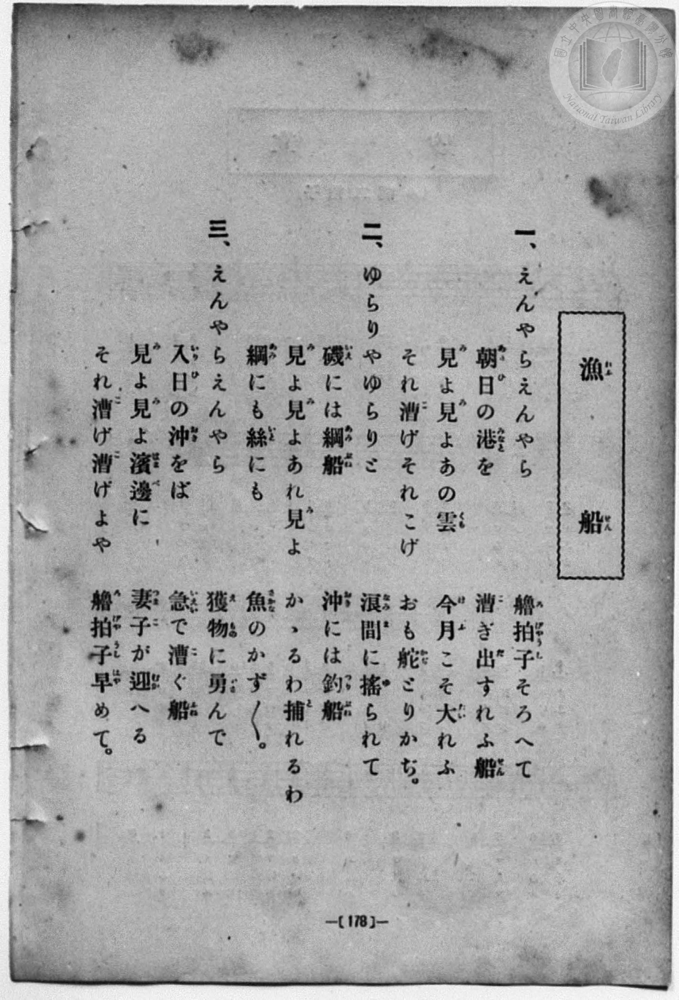
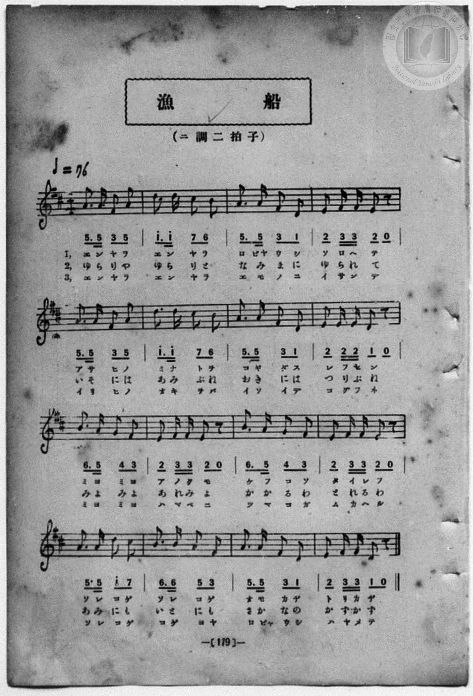

# 漁船

> Re:Shōka 使用 AI 協助辨識與重建樂譜，可能會有錯誤。歡迎回報。

<audio controls src="gyosen.mp3"></audio>

- book: 新編 小學校・公學校 唱歌教材集（尋常科三・四學年用）
- 一條慎三郎 編《新編 小學校・公學校 唱歌教材集》（大正十二年十二月，索書號 0725-41）
- 文部省《尋常小學唱歌》
- 臺灣總督府《公學校唱歌集》（大正四年三月，索書號 0725 26）

## 說明

> [!NOTE]
> **原書資訊與歌詞全文**（對應 `P186.jpg`–`P187.jpg`，原書 p. 178–179，尋常科三・四學年第 29 首）：
> - **調性與拍號**：ニ調二拍子（D 大調 2/4 拍），速度 ♩= 76
> - **版面校勘**：本集（`P187.jpg`）第 4、10、12 小節於五線譜及簡譜均記為 `2 33 2 0`（E4 八分、F#4–F#4 十六分、E4 八分、八分休止符），異於《公學校唱歌集》第 4 小節之 `2 23 2 0` 及第 10、12 小節之 `1 22 1 0`。此外 `P186.jpg` 第一段第三行「今日（けふ）こそ」原書活字印作「今月（けふ）こそ」。
>
> **一、**
> えんやらえんやら　艪拍子（ろびやうし）そろへて
> 朝日（あさひ）の港（みなと）を　漕（こ）ぎ出（だ）すれふ船（せん）
> 見（み）よ見（み）よあの雲（くも）　今月（けふ）こそ大（たい）れふ
> それ漕（こ）げそれこげ　おも舵（かぢ）とりかぢ。
>
> **二、**
> ゆらりやゆらりと　浪間（なみま）に搖（ゆ）られて
> 磯（いそ）には網船（あみぶね）　沖（おき）には釣船（つりぶね）
> 見（み）よ見（み）よあれ見（み）よ　かゝるわ捕（と）れるわ
> 網（あみ）にも絲（いと）にも　魚（さかな）のかず／＼。
>
> **三、**
> えんやらえんやら　獲物（えもの）に勇（いさ）んで
> 入日（いりひ）の沖（おき）をば　急（いそい）で漕（こ）ぐ船（ふね）
> 見（み）よ見（み）よ濱邊（はまべ）に　妻子（つまこ）が迎（むか）へる
> それ漕（こ）げ漕（こ）げよや　艪拍子（ろびやうし）早（はや）めて。


## 歌詞

```text
（TMD 檔案未包含歌詞註解）
```

## ABC

```abc
X:1
T:漁船
M:2/4
L:1/16
Q:1/4=76
K:D
V:V1 name="Piano" snm="Pia"
[V:V1]
A3 A F2 A2 | d3 d c2 B2 | A3 A F2 D2 | E2 F F E2 z2 |
w: え ん や ら | え ん や ら | ろ びゃ う し | そ ろ へ て
A3 A F2 A2 | d3 d c2 B2 | A3 A F2 D2 | E2 E E D2 z2 |
w: あ さ ひ の | み な と を | こ ぎ だ す | れ ふ せ ん
B3 A G2 F2 | E2 F F E2 z2 | B3 A G2 F2 | E2 F F E2 z2 |
w: み よ み よ | あ の く も | け ふ こ そ | た い れ ふ
A3 A d2 c2 | B3 B A2 F2 | A3 A F2 D2 | E2 F F D2 z2 |
w: そ れ こ げ | そ れ こ げ | お も か ぢ | と り か ぢ
A3 A F2 A2 | d3 d c2 B2 | A3 A F2 D2 | E2 F F E2 z2 |
w: ゆ ら り や | ゆ ら り と | な み ま に | ゆ ら れ て
A3 A F2 A2 | d3 d c2 B2 | A3 A F2 D2 | E2 E E D2 z2 |
w: い そ に は | あ み ぶ ね | お き に は | つ り ぶ ね
B3 A G2 F2 | E2 F F E2 z2 | B3 A G2 F2 | E2 F F E2 z2 |
w: み よ み よ | あ れ み よ | か か る わ | と れ る わ
A3 A d2 c2 | B3 B A2 F2 | A3 A F2 D2 | E2 F F D2 z2 |
w: あ み に も | い と に も | さ か な の | か ず か ず
A3 A F2 A2 | d3 d c2 B2 | A3 A F2 D2 | E2 F F E2 z2 |
w: え ん や ら | え ん や ら | え も の に | い さ ん で
A3 A F2 A2 | d3 d c2 B2 | A3 A F2 D2 | E2 E E D2 z2 |
w: い り ひ の | お き を ば | い そ い で | こ ぐ ふ ね
B3 A G2 F2 | E2 F F E2 z2 | B3 A G2 F2 | E2 F F E2 z2 |
w: み よ み よ | は ま べ に | つ ま こ が | む か へ る
A3 A d2 c2 | B3 B A2 F2 | A3 A F2 D2 | E2 F F D2 z2 |
w: そ れ こ げ | こ げ よ や | ろ びゃ う し | は や め て
```

## TMD 檔案連結

- [主旋律 TMD 檔案](gyosen.tmd) [[在 TMD Studio 編輯](https://tmdlang.github.io/Tmd-TS/#tmd=s7IKdvYPcrWy4qpTUCpJTLdSSM7PyUlNLsnMz7MqzsjPTozPrsyvSsyML84ojTe0NDJWgqssy88pzU21Si9KTEmNN443QcgU55cWJadaFSdn5OfnxJekVpQk5edno8vHFySmp1oFGFqYIWQKivLLUvMS84C6C4oy80pSU8DaEQpSyzJTUkHSxcmJefFlqUWZaZmpKUiOSi0qBrsdYkVJUWJecXJRZgHIQwhV-UUlGflAhxdkVFplZBaX5BdlJifmxGcn5iUiFJVkpAK9BzahAKhBiUtLS-HZnsYXHTsVtLS4FG0VzM247G0VXLhsjPRN7EDaQL60Ung2bcPz7SsUnm7of7p2x7MFCx83737augbCVng6ZeOztT3Pps58NnfCy9lt7_d0PN3Q_XTHjufLJz7Z0QlSOns2UOnTnVueT1nxfk8n2DlPdjQ8WzT3WWsfUMnL5j4FoPGPG7pIsedxQzfIqiXLn61d_LS38cmuHqANEMazOR3v9_Q837Lo2ewdL2bOVzAwNzLVNTGE2f1sWvvL5hXP5zQCbYQ4FWIhxAKguWBVL9p3PW9c_HzH3udzFz_dNQekFuYUiEJ0NwB9uXML0DvYbFcwMgPbzqWvpWBLLcCloKBgpxCt6Ocf4hoL4WhpPe2bD7J3c_uLFV0vOtqB7nyxct7T1hVAT2tpgeOm91l7p0ICKJHqZRWkJzxqmAzimIM5QIdDDFAo0FMwNLcAShqaW4JEcUXpmjUKRpYKL5dNA_rv_Z5ZEGfoAh3yYtX-Zw3LQU7o7gUGA8jyWY-bu4HCoBjq7n26dgLQOS4KwNADiikAE5wCUBRsSs_LhvlPdy1TeDRzJThJws183tnxcu4iUAx0zwAb-GzOGkiSQ_ZCJ8hRJo8bGg0NQIQRKD09X9_wbNqeJ7umPN8-68XaOU_7u55vWAhizAUG1IznTbsUEowUjI0VjBQMgCZ0uJooPG1d_bQDGMONbsomwGAAkgrA1PW0dS1EFFkFhPFkz8Rnaxc9X7MM4ofnUzcAbcSVbMBOhDrsyc5ukO1GENsVQG4DyqI6HqzGUMHISMEQqOZxQ9OztUueLpmGFI8KQE2gXLVuK5jR-WIhMCn3PNnd9Wz6UqCPHjdOfNy4Fei0x42THzfOfdzQC4noZ1t2P107_Wnvhid7gWkcrB6UfrGoB1oKjglYSgNaBnQhsNwA8x83djxumvy4qeVxE1ALEruh4UXnKnh8P27qfdy4GSTV2Pa4cTrY_LlgwR2PG5dBjHo2Zy7MzU2PG6c-btwEVrbu2Y71YMH9jxtXPW4EFSWPmyYBzX-2ZypYfDJYWd_T9l1g7gIwd-bjph6gR4BFHFhwNtBhQHGIRS-WgbIv0ECwUR1oXLDt617OBtoOZPc_bmoCiTc04AoiYEIGC85_3NgCNgFkLyxwgH7sQXXnJIggWC_IF48bu4BWvOgAGghU0_24cRFY2YrHTV0QLkb47wJGMCL8m9pAoQ1UDAp2GBuoHRg-W1e9nAa0FGgsMNyAobcPbPLqZxOAmRYYI8D8A1QMcTA0Cp4vhgQ1MJrmQhQ_blz_fNsmWDACQwZozrbHjWshYfJsE9gooBcaQVkYov5l-2KY-iVgx0DVExv4TT3ogqBQ6n7cBAw3INn_rBcSnpCU0AMRhLp_GyTWQO6Euqep6flWiCDQU2AtYEGgmS_XzgKLA1MaMJxXQRIbmA0U73-_B5iJ0VM-0M_EpPznvZued64EGw4UByUniL1Pu9thLgF6Aeh4YBpYDjHtaetSWOIHGgIMNFjiRwthYMpv3AAK-QaYYmBygiS8xuWoKW0CLBa2Eh_-z_ZvfNnUBRZZD0wwjxuBJoBDrKHh6TJgiQHOy8BoBUlBbOl5sb8PnJxAcQQW2QGMETzpHz07AOMXGG6Eiotn0yHhuR4oCHZqIzDRQiOI8ioVChS09Lm43Cvzi1PzrAIyE_PyHWoMaqpBVijYGJppgROCAraqHFoIA8teBQ1Y8a6jAKubNLFoANoEMqxGwRRYw-kCSWMwqQsUMYwDCwEpcyBlBhZDVmUIFjECksZACKINQCJg83wMa0AJE6wamLyAuAXM6gTrwSPT1AuRAYV6M5BqA3OmQ7XNBSvtBbJ2APEyIC8eYaURSDtIPcQ4YOoFs0DGY5VpXAE1dRXUyv1AvA_MWo2kB6KjB9M-YzK9CJdpArLXIdvXCFbXOBWiq3E53D78Eb6rh94RDmwtgHnoEd4EDUmgDxo3gVkg_4Fk9kNlVkHDHViAQGUmQ2X6gHgBmDUTGvo9YN5WIJ4NDhGM2AaHF0jNXGgYAvMl1FSYS0Bxug3MWguVAcU9iA9KRah6loDd1QXWAVGPHttQ-8BqUP2HZCrYZ8DSESlOYW6ExC8oXmE-BxaPUD8i7COQvUFNK5JjGxSboHg0AZKguMSScYlRgxTX0Bht6oCyQSxE2INCBthqAadyqL-A_InQsAD5F-J7UI4GycwH81qgOW0rlrgmYB9YHzC2waIw-7qh9nUDxUFsYAUNlYGkQaAeoDhEFD2ucdsHSi-gkgJYK0HTEMw-UAqCyUH8B0rDoLTcAHMHqOQCu4WIuAZ2cyjJ2eD8DMrKsKg1A0tBohZ3SY4tY4OiCRbIEI_Bsi9uGWiWABdz4MBvXIQS-KBMBAoQkCh6ZCNnX3AmBScj5Oy0AkNmKiKywUU6InNCbJ8FlZuFJbJx-wJWPE2CJgBEhYK3pgKnEaBSYAMByEPUHLVcXLp2CpC6PdrHMFYBiWeEwjMG85S5AA)]
- [鋼琴伴奏 TMD 檔案](gyosen_piano.tmd) [[在 TMD Studio 編輯](https://tmdlang.github.io/Tmd-TS/#tmd=s7IKdvYPcrWy4qpTUCpJTLdSSM7PyUlNLsnMz7MqzsjPTozPrsyvSsyML84ojTe0NDJWgqssy88pzU21Si9KTEmNN443QcgU55cWJadaFSdn5OfnxJekVpQk5edno8vHFySmp1oFGFqYIWQKivLLUvMS84C6C4oy80pSU8DaEQpSyzJTUkHSxcmJefFlqUWZaZmpKUiOSi0qBrsdYkVJUWJecXJRZgHIQwhV-UUlGflAhxdkVFplZBaX5BdlJifmxGcn5iUqcWlpKTzb0_iiY-f7PR0vZ8981tn9snvP8wlbnuzZ8nRp__s9nQpaWlyKtgrmZlz2tgouXDZG-iZ2IKNBnrRSeDZtw_PtKxSebuh_unbHswULHzfvftq6BsJWeDpl47O1Pc-mznw2d8LL2W1AG55u6H66Y8fz5ROf7OgEKZ09G6j06c4tz6esAFoFdvKTHQ3PFs191toHVPKyuU8BaPzjhi5S7Hnc0A2yasnyZ2sXP-1tfLKrB2gDhPFsTsf7PT3Ptyx6NnvHi5nzFQzMjUx1TQxhdj-b1v6yecXzOY1AGyFOhVgIsQBoLljVi_ZdzxsXP9-x9_ncxU93zQGphTkFohDdDUBf7twC9A422xWMzMC2c7lX5hen5lkFZCbm5Qd5ONQY1FRzKQCBjaGZlh2Ypa-lYIsOFJ6vWQMMsRcLexQ0TEDB83x9g44CMJmZ62UVpGti0aClDzasRsFUQRcITRWMwaQuUMQwDiwEpMyBlBlYDFmVIVjECEgaAyGINgCJgM3zMaxReNzYAVb9uGkyELeAWZ1gPXhkmnohMo2bHzc1A6k2MGc6VNtcsNJeIGsHEC8D8uIRVhqBtIPUQ4x73NQFZoGMxyrTuAJq6iqolfuBeB-YtRpJD0RHD6Z9xmR6ES7TBGSvQ7avEayucSpEV-NyuH34I3xXD70j3AgIQTz0CG-ChiTQB42bwCyQ_0Ay-6Eyq6Dh_rhpElRmMlSmD4gXgFkzoaHfA-ZtBeLZ4BDBiG1weIHUzIWG4ePG9VBTYS4Bxek2MGstVAYU9yA-KBWh6lkCdlcXWAdEPXpsQ-0Dq0H1H5KpYJ89btyAFKcwN0LiFxSvMJ8_bpwA9SPCPgLZu5Oc2AbFJigeTYAkKC6xZFxi1CDFNTRGmzqgbBALEfagkHnc2A9O5VB_AfkToWEB8i_E96AcDZKZD-a1QHPaVixxTcA-sD5gbINFYfZ1Q-3rBoqD2I-b-qEykDQI1AMUh4iixzVu-0DpBVRSPG7cCU1DMPtAKQgmB_EfKA2D0nIDzB2gkgvsFiLiGlhVUJKzwfkZlJVhUWsGloJELe6SHFvGBkUTLJAhHoNlX9wy0CwBLubAgd-4CCXwQZkIFCAgUfTIRs6-4EwKTkbI2WkFhsxURGSDi3RE5oTYPgsqNwtLZOP2Bax4mgRNAIgKBW9NBU4jQKWPmxqBPETNUYtatftgrdqBRTFINQhGG8ZCWciCpvHYRJGUmsbDRCEsRHxS02ywNLLRJlhNweoYUtSiO9wUxkA2BatnCDkbGB26dgqQGIn2MYwF24QkYoQhYgwXUeYCAA)]

## 分析

```text
================================================================================
📊 TMD Song Profile: [ 漁船 ]
================================================================================
⏱  Duration:       1:15 (75.8s), 48 measures total
🎼 Key & Tempo:    首調基準 D, != 76.0 BPM, <2/4>
   - 分析範圍：      由實際發聲的音符與和弦推測調性；播放脈絡另行呈現
🎤 人聲音域:    D4 (MIDI 62) – D5 (MIDI 74) [跨度: 12 個半音 / 1.0 個八度, 難度: easy]
   - 最低音:  D4 in [Gyosen[L1] #1 @ m.3, 0:04]
   - 最高音: D5 in [Gyosen[L1] #1 @ m.2, 0:01]
   - 適合: soprano, mezzo-soprano, contralto, tenor, baritone, bass
🏛  結構:      Gyosen[L1] (25.3s) -> Gyosen[L2] (25.3s) -> Gyosen[L3] (25.3s)
⚡ 編曲密度:        Peak 1 軌道同時演奏
🗝  調性診斷：       A 調性不明確（純淨自然大調，未偵測到可信轉調）
   - 風格氣質:    純淨自然大調（陽光明朗、易唱易記，無明顯調外色彩）
   - 轉調歷程:    全曲維持單一推測調性（未偵測到可信轉調）
   - 核心骨幹音:  A, F#, D, E, B
   - 調性數值:    A 調性不明確 [相關度: 0.85, 穩定度: Ambiguous, 自然音純度: 96.6%]
   - 候選調性 (K-S): A 大調 (0.85), D 大調 (0.82), F# 小調 (0.76)
   - 五度圈歷程:   +3 -> +3 -> +3
   - 各段落調性細節:
     • [Gyosen[L1] #1]: A 調性不明確 (r: 0.85, 自然音純度: 96.6%, 調外音: G)
     • [Gyosen[L2] #1]: A 調性不明確 (r: 0.85, 自然音純度: 96.6%, 調外音: G)
     • [Gyosen[L3] #1]: A 調性不明確 (r: 0.85, 自然音純度: 96.6%, 調外音: G)

  [ 五度圈游移軌跡 ]
               C  
         F            G  
      Bb               D  
      Eb              [A ]*
         Ab           E  
            Db       B  
               F# 
     (* = active key center)

  [ 十二半音累積音高分佈 ]
     C  :                            0.0%
     C# : █████                      5.1%
     D  : ███████████████           16.9%
     D# :                            0.0%
     E  : ██████████████            15.3%
     F  :                            0.0%
     F# : ██████████████████        20.3%
     G  : ███                        3.4%
     G# :                            0.0%
     A  : ████████████████████████  27.1%
     A# :                            0.0%
     B  : ███████████               11.9%
--------------------------------------------------------------------------------
Assignment 軌道音域：
  - Piano         : D4 – D5 (12 個半音 / 1.0 個八度, 192 個音符)
================================================================================
```


## 原書掃描頁






