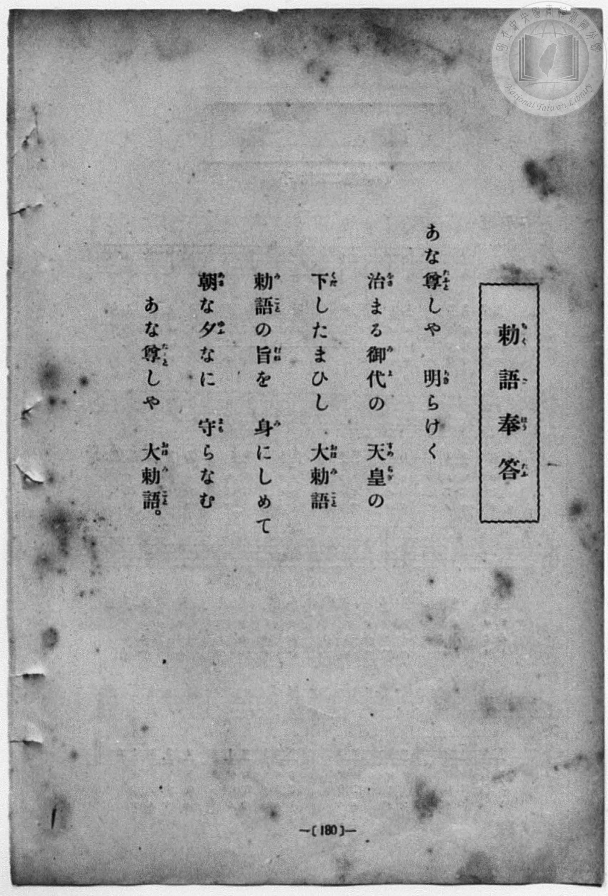
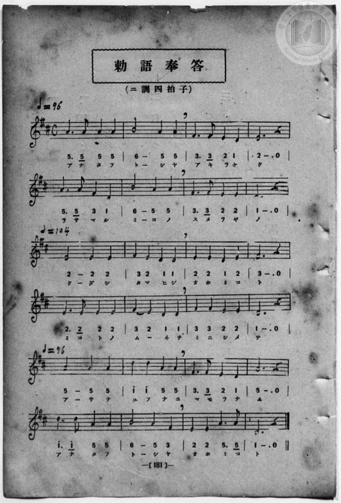

# 勅語奉答

> Re:Shōka 使用 AI 協助辨識與重建樂譜，可能會有錯誤。歡迎回報。

<audio controls src="chokugo_hoto.mp3"></audio>

- 曲：宮島慎三郎
- 一條慎三郎 編《新編 小學校・公學校 唱歌教材集》（大正十二年十二月，索書號 0725-41）
- 臺灣總督府《公學校唱歌集》（大正四年三月，索書號 0725 26）

## 說明

原書資訊與歌詞全文（對應 P036.jpg–P037.jpg，原書 p. 30–31，第三學年第 1 首）：
調性與拍號：ニ長調 4/4 拍子，速度 ♩=96 → ♩=104 → ♩=96
作曲：臺灣總督府國語學校助教授 宮島慎三郎


## 跨冊／重複收錄參照

> 同曲＋同名異曲（《公學校唱歌集》、《新定兒童唱歌》卷首與《唱歌帖》P122 為「あな尊しや」同曲；《唱歌帖》P121 為小山作之助曲「あやにかしこき」另一版本）

- **[同曲]** 《公學校唱歌集》（大正4年／1915，國臺圖 0725 26）：[**〈勅語奉答〉**](../../../kogakko_shokashu_1915/3_01_chokugo_hoto/index.md)（`D` / `4/4` — [原始 TMD](../../../kogakko_shokashu_1915/3_01_chokugo_hoto/chokugo_hoto.tmd)）
- **[同曲]** 《新定兒童唱歌》尋常科第一學年用（2020.006.0847.0001）：[**〈勅語奉答〉**](../../../shintei_jido_shoka/grade_1_2020.006.0847.0001/0_02_chokugo_hoto/index.md)（`D` / `4/4` — [原始 TMD](../../../shintei_jido_shoka/grade_1_2020.006.0847.0001/0_02_chokugo_hoto/chokugo_hoto.tmd)）
- **[同名異曲]** 楊金土手抄《唱歌帖》第 1 冊（2020.006.0843）：[**〈勅語奉答〉**](../../../shokacho/vol_01/p121_chokugo_hoto/index.md)（`D` / `4/4` — [原始 TMD](../../../shokacho/vol_01/p121_chokugo_hoto/chokugo_hoto.tmd)）
- **[同曲]** 楊金土手抄《唱歌帖》第 1 冊（2020.006.0843）：[**〈勅語奉答（あな尊しや）〉**](../../../shokacho/vol_01/p122_chokugo_hoto_2/index.md)（`D` / `4/4` — [原始 TMD](../../../shokacho/vol_01/p122_chokugo_hoto_2/chokugo_hoto_2.tmd)）
- 總表：[跨冊重複與同名歌曲總索引](../../../duplicate_songs.md)

## 歌詞

```text
あな尊（たふと）しや　明（あき）らけく
治（をさ）まる御代（みよ）の　天皇（すめらぎ）の
下（くだ）したまひし　大勅語（おほみこと）。
勅語（みこと）の旨（むね）を　身（み）にしめて、
朝（あさ）な夕（ゆふ）なに　守（まも）らなむ
あな尊（たふと）しや　大勅語（おほみこと）。
```

## ABC

```abc
X:1
T:勅語奉答
C:曲：宮島慎三郎
M:4/4
L:1/16
Q:1/4=96
K:D
V:V1 name="Vocal" snm="Voc"
[V:V1]
A6 A2 A4 A4 | B8 A4 A4 | F6 F2 E4 D4 | E12 z4 |
w: あ な た ふ | と し や | あ き ら け | く
A6 A2 F4 D4 | B8 A4 A4 | F6 F2 E4 E4 | D12 z4 |
w: を さ ま る | み よ の | す め ら ぎ | の
[Q:1/4=104] E8 E4 E4 | F4 E4 D4 D4 | E4 E4 D4 E4 | F12 z4 |
w: く だ し | た ま ひ し | お ほ み こ | と
E6 E2 E4 E4 | F4 E4 D4 D4 | F4 F4 E4 E4 | D12 z4 |
w: み こ と の | む _ ね を | み に し め | て
[Q:1/4=96] A8 A4 A4 | d4 d4 A4 A4 | F6 F2 E4 D4 | A12 z4 |
w: あ さ な | ゆ ふ な に | ま も ら な | む
d6 d2 A4 A4 | B8 A4 F4 | E4 E4 A6 A2 | D12 z4 |
w: あ な た ふ | と し や | お ほ み こ | と
```

## TMD 檔案連結

- [主旋律 TMD 檔案](chokugo_hoto.tmd) [[在 TMD Studio 編輯](https://tmdlang.github.io/Tmd-TS/#tmd=s7IKdvYPcrWy4qpTUCpJTLdSSM7PyUlNLsnMz7MqzsjPTozPrsyvSsyML84ojTe0NDJWgqssy88pzU21Si9KTEmNN443QcgU55cWJadaFSdn5OfnxJekVpQk5edno8vHFySmp1oFGFpYIGQKivLLUvMS84C6C4oy80pSU8DaEQpSyzJTUkHSqSmZJflFmYk5SA5KLSoGuxtifElRYl5xclFmAcgzCFX5RSUZ-UBHF2RUWmVkFoMMSU7Mic9OzEtEKCrJSAV6LTO3IBXVCoh4cmpRam5-HlhGS0vhaXfri1Xzni7tfL52ioKWFpeirYKlGZe9rYILl42JvokdSPeTHQ3PFs191tr3ZEfny-Y-hefbVzxu6Ho2bQOQofB0Q__TtTueLVj4uHn309Y1ELbC0ykbn63teTZ15rO5E17Obnvc0P1-T8fTJcufrV38tLfxya6epzu3QBjP5nS839PzfMuiZ7N3vJg5X8HA3MhU18Tw_Z5OsMufzd70fs-sp-vWPd28De4CsMyL9l3PGxc_37H3-dzFT3fNAboIbj3EdnR7Z88GWgo0AJuNCkZmYBu59LUUbKkFuBQUFJ72zQdZs7n9xYquFx3tQGe9WDnvaeuKZ9PaQS7b0PusvVMhwMDYTC-rIP1Rw2Qg0xzEBLoQolWhQE_B2AAoYwwMk57na9YAfQD0JdArQLaCocLLZdOALgeGEci2F6v2P2tYDrKnuxfoNaDo4-bul1O3A8UVgLGpABR-unYC0JyXDfOf7lqm8GjmSltLM4VHbZPATEMDEzgbmAqABj7ZOwcSA2ih_XRONyjZQEK7ayUoovs6FNCiiQtkwuPGpseNq55u6AJ693Hj_MeNWx83rgC6-HHj9MdNLY8bGp7N6ANLAZX1gsSbgFITHzf2gzQ_27QbJNc06XHjVLCefY-bup_uW_hk92Kwnv2Pm4BxCRRfBzTo6ZKVz2eBQvVx48zHTY1gg4BGg2TBXtkBSgtAgx83LoDaD3LOvseNm0BskP7lkNwAVtb1uHE3yILGyVD3NjSB4xOhAkmucd2z6UAG0KUNjxvXgn0xCWjii12rISrBalaDvdz4uHHZ44ZGsO_mzIX5HOK7VU-XABlAU9qAwQQRAWkDOm0d0JtAlUDvN8HCaBXQMqICmCh_UZ7aoUBBS5-LyxlY-pam53vkl-RbheUDiyiHGoOaapA9CjYWWnZgBracpgBO3w0vFvYoaJiAipbn6xt04NlDE4sGoG0gw2oUTBV0gdAUTINwjYIZWATCg4gYg_nGCkZA0hAsAmLBoAFIBGyaTw0oVMGCwKAF4vlg1lawFmCwQTUAQxhENrVAxWE6eoFinWDWRKhMP5I18WBr8AfBrh5KggDkTYj38AcBCNeAVWIPgqZJUA9NBeJ9YK92Qz20HxYETR1gFeug4jOhoo3wIOiDyoBUkBIEOzrJCYJqRVAhVguPV4Q3QR6HxTsi7mEiCDU4UgMsBoGFB5gExTxIHJIywIHTuAlFpgvM2w0mQcEFzHFQGVj6ITIogBUXOUEBCQIjvEEAEoGJEkoN0DgHeQPiBXisNzXAA2ctiASnG5gOYAEGDxZQuoDILCMtCJ7smkJmarA0q4XmC-RcYBgHCgIQga9wgOnDWThA8gakkICERBuYByooIGIQ34N0gJIIKASa4DkDpgcWesQmh9a1mGEBbjPgDQuwb8Gexl5CgryPyBOwogRvgiC9hETPE5DkhD1P1HJx6dopINUkCkCuMhcA)]
- [鋼琴伴奏 TMD 檔案](chokugo_hoto_piano.tmd) [[在 TMD Studio 編輯](https://tmdlang.github.io/Tmd-TS/#tmd=s7IKdvYPcrWy4qpTUCpJTLdSSM7PyUlNLsnMz7MqzsjPTozPrsyvSsyML84ojTe0NDJWgqssy88pzU21Si9KTEmNN443QcgU55cWJadaFSdn5OfnxJekVpQk5edno8vHFySmp1oFGFpYIGQKivLLUvMS84C6C4oy80pSU8DaEQpSyzJTUkHSqSmZJflFmYk5SA5KLSoGuxtifElRYl5xclFmAcgzSlxaWgpPu1tfrJr3dGnn87VT3u_peDl75rPO7pfde55P2PJkz5anS_vf7-lU0NLiUrRVsDTjsrdVcOGyMdE3sQPZ8GRHw7NFc5-19j3Z0fmyuU_h-fYVjxu6nk3bAGQoPN3Q_3TtjmcLFj5u3v20dQ2ErfB0ysZna3ueTZ35bO6El7PbHjd0Ay19umT5s7WLn_Y2PtnV83TnFgjj2ZyO93t6nm9Z9Gz2jhcz5ysYmBuZ6poYAp0D9t2z2Zve75n1dN26p5u3wV0AlnnRvut54-LnO_Y-n7v46a45QBfBrYfYjm7v7NlAS4EGYLNRwcgMbCOXMzDiS9PzPfJL8q0CMhPz8oM8HGoMaqq5FIDAxkLLDszQ11KwRQcKz9esAYbUi4U9ChomoGB5vr5BRyHAwNhML6sgXROLBi19sGE1CqYKukBoCqZBuEbBDCwC4UFEjMF8YwUjIGkIFgGxYNAAJAI2zadG4XFjE1jwceMqIJ4PZm0Fa3ncuAKq4XHjdBDZ1AIVh-noBYp1glkToTL9SNbEg63BHwS7eigJApA3Id7DHwQgXANWiT0ImiZBPTQViPeBvdoN9dB-WBA0dYBVrIOKz4SKNsKDoA8qA1JBShDs6CQnCKoVbQ0NTGrh8YrwJsjjsHhHxD1MBKEGR2qAxeDjxgVgEhTzIHFIygAHTuMmFJkuMG83mAQF1-PGyVAZWPohMiiAmY6coIAEgRHeIACJwEQJpQZonIO8AfECPNabGuCBsxZEgtMNTMfjxtXwYAGlC4jMMtKC4MmuKWSmBkuzWmi-QM4FhnGgIAAR-AoHmD6chQMkb0AKCUhItIF5oIICIgbxPUgHKImAQqAJnjNgemChR2xyaF2LGRbmBMMC7Fuwp7GXkCDvI_IErCjBmyBILyHR8wQkOWHPE7VYKhIf5IrEBFGRvOjretneC8woz7p7n66d8HRSz4vGTZA6GSkE4hWiDWNhVI2CCZBhEqtgGg-kTeNBIlApkAgIA1MATA7EMID6HadJcD6SOagmAymEKbCyCsUSDPUQE_GrQZhJjFlEuw6Ud3BoxmoYpkuJDzLCHgSmB107BaQkoQDkKnMBAA)]

## 分析

```text
================================================================================
📊 TMD Song Profile: [ 勅語奉答 ]
================================================================================
⏱  Duration:       0:58 (58.5s), 24 measures total
🎼 Key & Tempo:    首調基準 D, != 96.0 BPM, <4/4>
   - 分析範圍：      由實際發聲的音符與和弦推測調性；播放脈絡另行呈現
🎤 人聲音域:    D4 (MIDI 62) – D5 (MIDI 74) [跨度: 12 個半音 / 1.0 個八度, 難度: easy]
   - 最低音:  D4 in [ChokugoHoto #1 @ m.3, 0:06]
   - 最高音: D5 in [ChokugoHoto #1 @ m.18, 0:40]
   - 適合: soprano, mezzo-soprano, contralto, tenor, baritone, bass
🏛  結構:      ChokugoHoto (58.5s)
⚡ 編曲密度:        Peak 1 軌道同時演奏
🗝  調性診斷：       A 大調（純淨自然大調，未偵測到可信轉調）
   - 風格氣質:    純淨自然大調（陽光明朗、易唱易記，無明顯調外色彩）
   - 轉調歷程:    全曲維持單一推測調性（未偵測到可信轉調）
   - 核心骨幹音:  E, A, D, F#, B
   - 調性數值:    A 大調 [相關度: 0.83, 穩定度: Moderate, 自然音純度: 100.0%]
   - 候選調性 (K-S): A 大調 (0.83), D 大調 (0.77), F# 小調 (0.55)
   - 五度圈歷程:   +3
   - 各段落調性細節:
     • [ChokugoHoto #1]: A 大調 (r: 0.83, 自然音純度: 100.0%)

  [ 五度圈游移軌跡 ]
               C  
         F            G  
      Bb               D  
      Eb              [A ]*
         Ab           E  
            Db       B  
               F# 
     (* = active key center)

  [ 十二半音累積音高分佈 ]
     C  :                            0.0%
     C# :                            0.0%
     D  : █████████████████████     23.3%
     D# :                            0.0%
     E  : ████████████████████████  26.7%
     F  :                            0.0%
     F# : ███████████████           16.7%
     G  :                            0.0%
     G# :                            0.0%
     A  : ████████████████████████  26.7%
     A# :                            0.0%
     B  : ██████                     6.7%
--------------------------------------------------------------------------------
Assignment 軌道音域：
  - Vocal         : D4 – D5 (12 個半音 / 1.0 個八度, 73 個音符)
================================================================================
```


## 原書掃描頁






