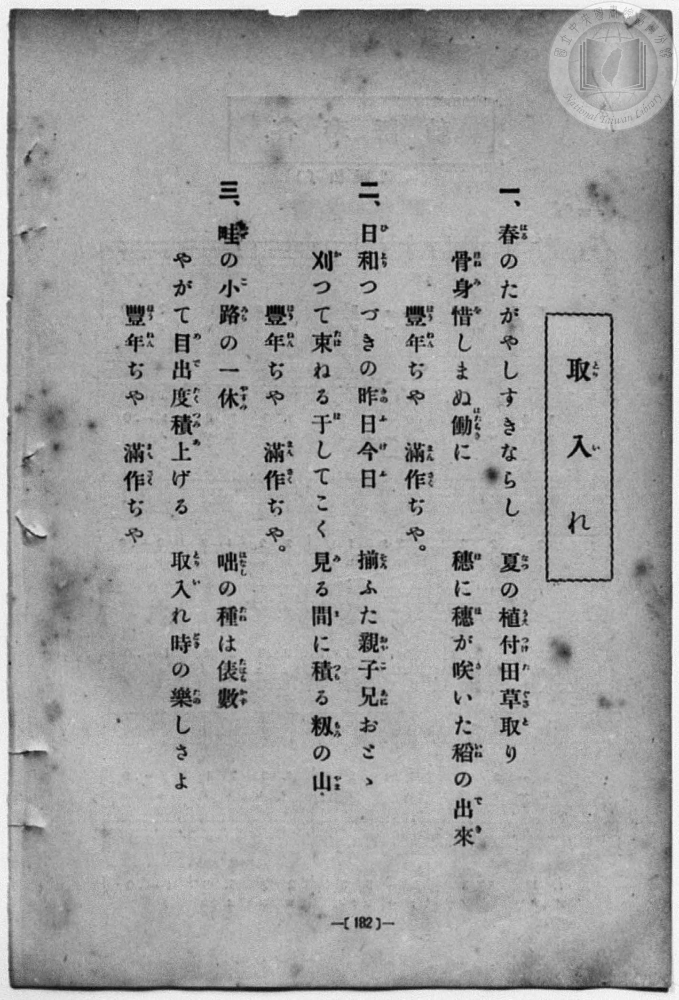
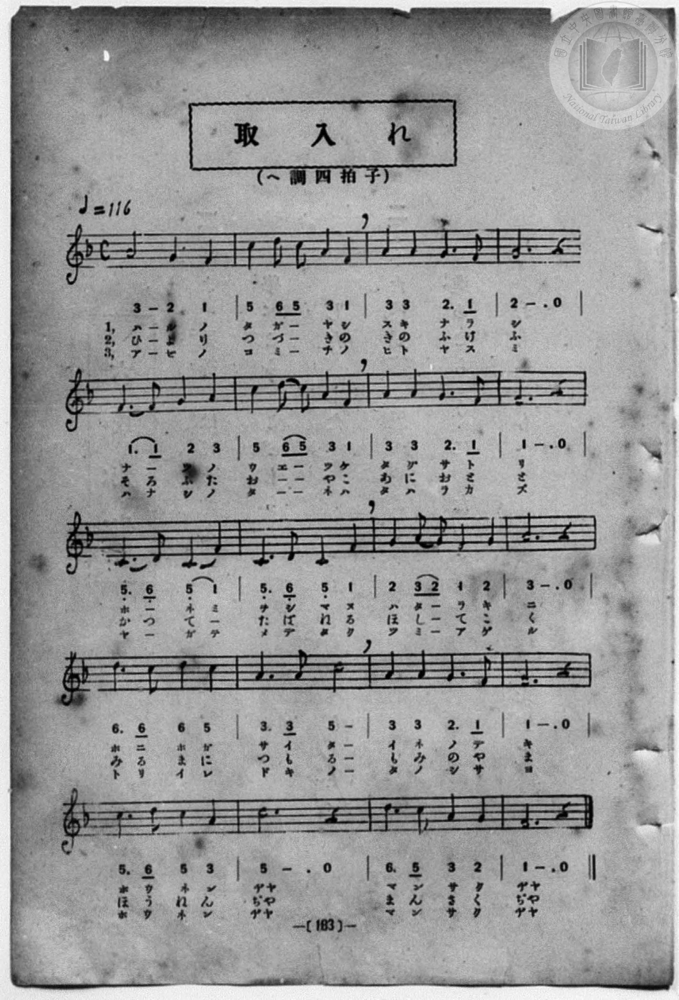

# 取入れ

> Re:Shōka 使用 AI 協助辨識與重建樂譜，可能會有錯誤。歡迎回報。

<audio controls src="toriire.mp3"></audio>

- 一條慎三郎 編《新編 小學校・公學校 唱歌教材集》（大正十二年十二月，索書號 0725-41）
- 臺灣教育會公認『新定兒童唱歌』尋常科第三學年用（第二學期・第6首）
- 國立臺灣歷史博物館典藏（典藏號：2020.006.0847.0003）

## 說明


- 出處：臺灣教育會公認、臺北新高堂發行《新定兒童唱歌》尋常科第三學年用（昭和6年／1931年），
第二學期第 6 首〈取入れ〉（秋收），原書第 20 頁（掃描檔 P043.jpg）。
- 出處原曲：文部省唱歌（1911年《尋常小學唱歌》第二學年）。
- 調性與拍號：ヘ調（F 大調），2/4 拍（原書副標題誤植為「へ調四拍子」，五線譜拍號與小節線實為 2/4 拍），
速度標示「嬉シゲニ != 116」。
- 背景與曲風：歌詠春耕、夏耘（插秧與除草）不辭辛勞，到了秋天稻穗結實纍纍、全家歡喜收割堆起穀山，
齊聲歡呼「豐年ぢや　滿作ぢや」的農家豐收之樂。
- 版本說明：本檔案為原書單聲部五線譜（附移動 Do 階名片假名）之忠實數位化版本。

### 編曲說明（鋼琴伴奏版）：

1. 前奏 (Intro, 4 小節)：引用第五段「豐年ぢや　滿作ぢや」歡慶豐收的明亮樂句開場。
2. 主歌伴奏 (Toriire, 20 小節 × 3 段)：右手演奏充滿農家喜悅的輕快旋律，左手以活潑的八分音符和弦伴奏。


## 跨冊／重複收錄參照

> 同曲（《新定兒童唱歌》、《新編 小學校・公學校 唱歌教材集》共同收錄教材）

- **[同曲]** 《新定兒童唱歌》尋常科第三學年用（2020.006.0847.0003）：[**〈取入れ（秋收）〉**](../../../shintei_jido_shoka/grade_3_2020.006.0847.0003/2_06_toriire/index.md)（`F` / `4/4` — [原始 TMD](../../../shintei_jido_shoka/grade_3_2020.006.0847.0003/2_06_toriire/toriire.tmd)）
- 總表：[跨冊重複與同名歌曲總索引](../../../duplicate_songs.md)

## 歌詞

```text
一　春（はる）のたがやし　鋤（す）きならし
夏（なつ）の植付（うゑつけ）　田草取（たぐさとり）
骨身惜（ほねみを）しまぬ　働（はたらき）に
穗（ほ）に穗（ほ）がさいた　稻（いね）の出來（でき）
豐年（ほうねん）ぢや　滿作（まんさく）ぢや

二　日和（ひより）つづきの　昨日今日（きのふけふ）
揃（そろ）ふた親子（おやこ）　兄弟（あにおとゝ）
刈（か）つて束（たば）ねる　干（ほ）して扱（こ）く
見（み）る間（ま）に積（つ）もる　籾（もみ）の山（やま）
豐年ぢや　滿作ぢや

三　畦（あぜ）の小道（こみち）の　一休（ひとやすみ）
咄（はなし）の種（たね）は　俵數（たはらかず）
やがてめでたく　積（つ）み上（あ）げる
取入（とりい）れ時（どき）の　樂（たの）しさよ
豐年ぢや　滿作ぢや
```

## ABC

```abc
X:1
T:取入れ
M:4/4
L:1/16
Q:1/4=116
K:F
V:V1 name="Piano" snm="Pia"
[V:V1]
A8 G4 F4 | c4 d2 c2 A4 F4 | A4 A4 G6 F2 | G12 z4 |
w: 1.~は る の | た が _ や し | す き な ら | し
w: 2.~ひ よ り | つ づ _ き の | き の ふ け | ふ
w: 3.~あ ぜ の | こ み _ ち の | ひ と や す | み
F6 F2 G4 A4 | c4 d2 c2 A4 F4 | A4 A4 G6 F2 | F12 z4 |
w: 1.~な _ つ の | う ゑ _ つ け | た ぐ さ と | り
w: 2.~そ ろ ふ た | お や _ こ _ | あ に お と | と
w: 3.~は な し の | た ね _ は _ | た は ら か | ず
C6 D2 C4 F4 | C6 D2 C4 F4 | G4 A2 G2 F6 G2 | A12 z4 |
w: 1.~ほ _ ね み | を し ま ぬ | は た _ ら き | に
w: 2.~か _ つ て | た ば ね る | ほ し _ て こ | く
w: 3.~や _ が て | め で た く | つ み _ あ げ | る
d6 c2 d4 c4 | A6 A2 c8 | A4 A4 G6 F2 | F12 z4 |
w: 1.~ほ に ほ が | さ い た | い ね の で | き
w: 2.~み る ま に | つ も る | も み の や | ま
w: 3.~と り い れ | ど き の | た の し さ | よ
C6 D2 C4 A4 | c12 z4 | d6 c2 c4 A4 | F12 z4 |
w: 1.~ほ う ね ん | ぢや | ま ん さ く | ぢや
w: 2.~ほ う ね ん | ぢや | ま ん さ く | ぢや
w: 3.~ほ う ね ん | ぢや | ま ん さ く | ぢや
```

## TMD 檔案連結

- [主旋律 TMD 檔案](toriire.tmd) [[在 TMD Studio 編輯](https://tmdlang.github.io/Tmd-TS/#tmd=s7IKdvYPcrWy4qpTUCpJTLdSSM7PyUlNLsnMz7MqzsjPTozPrsyvSsyML84ojTe0NDJWgqssy88pzU21Si9KTEmNN443QcgU55cWJadaFSdn5OfnxJekVpQk5edno8vHFySmp1oFGFoaIGQKivLLUvMS84C6C4oy80pSU8DaEQpSyzJTUkHSqSmZJflFmYk5SA5KLSoGuxtifElRYl5xclFmAcgzCFUlGalAV5fnFwEdpKWl8LR_2tPWpY-behS0tLgUbRUMDc247G0V3LhsTPRN7EC6nuxoeLZo7rPWvic7Ol829yk8377icUPXs2kbgAyFpxv6n67d8WzBwsfNu5-2roGwFZ5O2fhsbc-zqTOfzZ3wcnbb44bu93s6ni5Z_mzt4qe9jU929TzduQXCeDan4_2enudbFj2bvePFzPkKBuZGpromhu_3dIJd_KJ91_PGxUCDXjRtejanGWjDi1W9jxv6gLY_XTfraeuk56uXQix73ND_dEP30x07ni-f-HzNGqBbgW4BWvN8ygqg3SARoK1A182ZD3QpkGv2ctk0mC1P53Q_X90NtWvt9qf9m572znreufLlkhVPW3e8mN4Pcj2YAXTi-z2zjAyMDPQMDMz0DCxMzIEMA2OwSVz6Wgq21AJcCgoKjxsmPJu96fnsdS9WrXo2o-9xw0SwKDCk23e9mDkV6BIc4dMIFH_aMx0YSi9Xz3i6oOn5zD0vFgKDCBRrGOHWjSfcns1Y-3RSjxmQ_35Pv6GlsSGY1QmMMpBLFBSQwxXIVjBTAAbr44YOeKp63ABU3PF8efezKdsgGp_2zQfGNUixkYHCywWNIFv6mp_19z9bNUUhwMDEWC-rIB2o9HFDE4pvwfo2Af38bFr7y-YVz-c0QjwA1G9oaQhyGNB_EK9AEiXcf3BHQhyPMPjFqv3PGpa_6Gh_1t0LidnHzTOAgkAj3RSAyRXMBLnZSN9EAagGlAzArn_auf7ZipkvF_a8WLXk2ZLe5027Hjf0PG7cAdTwdPZsoMqnayc8bgCq73mya8rz7bNerJ0DsQJoF9Bxz9c3AAWfrl8G1KgANxsRqi8b5j_dtQxow_MlIIOfrul83LT9cdOmx83dCpAsCjQcyRvNPc9mrgd5Y_aml4uA0TYL6O8XKxc8m7H0RcNUYGp4uqT_RcMMUED3T3q-HOThlzOXvOgFWtj5ZEfvi31rX-yb_bR7HihyOjY82dUGjK6nS1Y-X7H7-crpz7dOADl0Vy8QgYxqXfF03bZnaxc-nTYHGKVPOzc9XdD2Yuv25ysbnm7ciPDB3q4XjZtAyibuAfrgxcYJoPhpXPS4qeVxQ8Oz3fuf7J0D4_Y-n9XyYt8moLFAZUAzn-zsfraiCeG9550dz-YA0zUoC4D8NmcNMKU8W9gBDDxobExbB7QMmCbggQ306suZLc-X737aPVXBJV_h5ay-pxN6n3e2P21sBzJA_t7Z_XT_AqDPnk3d8WRv79OeaRBrQNZCsx7EcHBQzgN6G5jsgAH3ZMdaEGPVvBdr1wPzIyhFbOh91t6JnHLBBgBLTZBPZywFKnncuP5xE7AI7HzcuO5x4_zHjT0gjzdOByp42b0ErGAmWLb3ceOqx01AxnSQEcBoA8utetwIVATSDExrT3aDIvJxY9vjpolA8ceNQDcAk3TD8ykbgDEKzHdgWaAdEx43Tn3cuOJxUxfISaA4WbXixa7Vz5pBofO4cffjxrWPG_c_bpoENnr648Z9jxuB3m942gxK5yAnA00BuQUUXI8bV4OMAKYHiGaIECoXmAGAFgL9NR_knBVAQaAUkLsW4nZgLn6yrw0suBxiKMhESMqAuagN5KimyWANKGkFrGAfUApsBzBYoApARgDlIPEBShwzloJSLjBBNUwFanvW1fV0zvynczY872p8unMzKIEv6YcogGcFYMC9nDYZliFmg6qo2QuAaQuYM4BhBckZQBOedi951t7-dPtSsGt6IJnjyY6up_0dL6d1Az0HdCgQQcRBGX93F6gUXbEbWBS8nLr96b7pz4EuWbr3_Z7GZzPWQ7z9dCowbnqAXFBZA077YBFgkQhNQ7uAxVfDs-lLgWUwOAQ2PW7qgEQoOOqXglPMOnA6WwFUBrQTSIJVgsUbtwKTB5CEhvWz_maw3NzHTZA4BUrPf7FsFdCFYPEucKoEhz4wGbS2PN0DLBKB4k3AqAbJghLTXKhZTzuA9TZQDpKqgW5Z9mwuRDUw6W0ACwJjshtk0E5goQ1PJMB0tuxZJ7CgAIpA4rkfnAyWgVoIwPQIEmrqBkYIJMZh6QySJMG5oKkJYu7zjUBZYGgAXQfWBUxhoAIIKAL0BEgjInlhLXgwk84KYMoARduSlS8bFr-YOB0YW0D2sw2LQfHdse3ZelCx_nTpZlAhDg4dUGE4eSGwzAQWd8CkAywMn-zohkT5s962Zx0TgGECLDOfzV7zZOe-p229L1pWP98EzG89L_Z2Pp-zB-jLJ_v2Q8pPYHHxdNdycOoBFaTAYoj4VLIDnP-nLoNFFjB9goNjQ_9LUBiDQhqU0xsXQkughgagbU_2gAovUJICRSswyGZCwhEcuZNaYEUAsOwBpmaQtucr1sHiF5KjgeVfw5P9W4EFKEwcWMoBxbsfN86CGgQ2GFguLHvc1AjO9kBF_SDHIkdo435gNoK4HcydBIxfsCvAbQiwBKgUA5Yl4OgH1nVAdUDBlbCiCZwBVkAEgRYAnQlJaFOBuYXERPB0zgpgefB0fhMw8F5sXw902LO17U_7F0MSwYtGUOIAlS4rNwIrf1ClAIyk5r0vFs99umTW0w0TgUXIi0XdQAXPNwILm9nwaAZVhEtWAqtMYEECbJGBG2WgWAclLHDTCOgnUKNgznxQNO9fDfQNJI6JSgRAP1De3oQCBS19Lq4QYMciswjYN8lMzMt3qDGoqQbX6jYmWnZgBrZ2LrgpCOwprNuqoGEC6hYA_aMDrxVBsgqGCsBGqCYWrUA7ocYCTbBSACYkcNrpBrLWKdQAyfkgfmMPsDWwB5SmwGLTgXgmEPcC8SqgaCdUFAaghtYoGCvoKhgBLa9RMFXQMFMw1VTV0NUEioJEjIFQwwioQFfBECQOlKgBKgbxDRRqwAb4GILMXQ8UQXWRBshBQPUg94DsBYlC3AOUWQU2AugokHkgWRA3HmaiEUhsE1hBBxB3gdUsAelbCjYR7CeIPRAWUGYrxMTGiRATIVy4icYgsSawgjlwvZNB-vZDTFwIF90ExCuAMkBnQ0ycCTERqBBqIv44BvbZ8MSxEdFxDIwzUGwC_Q1zWRs41ifCxUFiQB4wrIGtGSCeCnY5UBQYYhixrGGIEotGwIglOsIhWpEjHB6F4MBDdiIw4CYiRCdCEwPIgUA9U6FBugIcpEBnokc7UM1caNLoBZmxFawbZEYXNEpAopOBCiARCqz8QHogBsHMBQYCeuQD1YBSKEjNKpAJoMyBlFDXQswFKYG5dz3Ivk6onm6IubOITAI7OvElAWOik8BuaFSvBSc_UIhNgmZhYA0OxGvArloPcTE463eCswRIdDWWJGAaD_aAWTw0ZoF8UJzjEjdS0DBWMIKkDmjyAfPAaQJUamCkid2INAFzMzAUJ0FDcTpIHNndQB3zQaqRQhoY6xDXY0kZ3agpbhnYdJAJYJ0boLYCCyGQCbtBcsByBWQ6UClEzWSI6f1Y0gc0u4NNBxakUNObGqE6l4PEQemiH1EYgYsOIA0qV0BqJkFSNcSZBFMJqCOMJ5WYkJJKgOEFoXvArgMVBKBCF1QtgCIewgPFyDqQV6BivVhSiBnY7eASAeg3YNkAEoREtTEscYAzCfHlBCRNAJ0ICkGYG5HKghZIyEJyHsSdQNl1iHCHuBVLeoCUyMAAh6Wr1RCTl0DFm0CVDyg2QLECKiv2I5ncBLQXZPI-LGkBWoAACyiQyUA3AUf_wOIrEakUYhCstABXQZBaDOgzSDroIC4dADvl-NKBKUnpoA2aByaDXQZqwUFiGORPkJsmQ1NHPzxlINQQKCkg9QU0gtFTiilYGm_8t8HyJ5LboAEEUgaJB6AsSBnEiejKkOOe2qZC4p2KptZycenaKUBbimA7gFxlLgA)]
- [鋼琴伴奏 TMD 檔案](toriire_piano.tmd) [[在 TMD Studio 編輯](https://tmdlang.github.io/Tmd-TS/#tmd=s7IKdvYPcrWy4qpTUCpJTLdSSM7PyUlNLsnMz7MqzsjPTozPrsyvSsyML84ojTe0NDJWgqssy88pzU21Si9KTEmNN443QcgU55cWJadaFSdn5OfnxJekVpQk5edno8vHFySmp1oFGFoaIGQKivLLUvMS84C6C4oy80pSU8DaEQpSyzJTUkHSqSmZJflFmYk5SA5KLSoGuxtifElRYl5xclFmAcgzSlxaWgpP-6c9bV36uKnn_Z6Ol7NnPuvsftm95_mELU_2bHm6tP_9nk4FLS0uRVsFQ0MzLntbBTcuGxN9EzuQ-U92NDxbNPdZa9-THZ0vm_sUnm9f8bih69m0DUCGwtMN_U_X7ni2YOHj5t1PW9dA2ApPp2x8trbn2dSZz-ZOeDm77XFDN9DWp0uWP1u7-Glv45NdPU93boEwns3peL-n5_mWRc9m73gxc76CgbmRqa6JIdA9YL-9aN_1vHEx0KAXTZuezWkG2vBiVe_jhj6g7U_XzXraOun56qUQyx439D_d0P10x47nyyc-X7MG6FagW4DWPJ-yAmg3SARoK9B1c-YDXQrkmr1cNg1my9M53c9Xd0PtWrv9af-mp72znneufLlkxdPWHS-mA4OnA8IAOvH9nllGBkYGegYGZnoGFibmQIaBMdgkLn0tBVtqAS4FBYXHDROezd70fPa6F6tWPZvR97hhIlgUGNLtu17MnAp0CY7waQSKP-2ZDgyll6tnPF3Q9HzmnhcLgUEEijWMcOvGE27PZqx9OqnHDMh_v6ff0NLYEMzqBEYZyCUKCsjhCmQrmCkAg_VxQwc8tT1uACrueL68-9mUbRCNT_vmA-MapNjIQOHlgkaQLX3Nz_r7n62aohBgYGKsl1WQDlT6uKEJxbdgfZuAfn42rf1l84rncxphHoCpe7Fq_7OG5S862p9190Ii6nHzDKAg0AY3BWDqAzNBTjDSN1EAqgGyXjbMf7prmQIk3SNMAqZsoF2QUAflF6Sc8rwTmGCBhsyCBIChnsLTzl6guIKGZ15JUb6OggkoTzxf36AJVPN0z1RgOIIDacqzdVsfN_S82DgBGISPGxc9bmp53NDwbPf-J3vnwLi9z9YufNa6DagGGFrPZ7UAbX-ya92zFU1P-5e-nNb9dMEWqBMVFIz0FJ7s2A30PsRVChohwAIhsyhVBxSqEAcoHJ6uYKwAtBbskv7NwCz_bM8UoOKnra1Ae1_s2_R03ban0-Y8a2oF2vViz9Sn-1c_m979dB8ws_Y83b4MqP7J7qXPtux-tnciUMHT1tVPO9pezt_8fM0yYJp4umcZxGqokyhP8VCgoKXPxQUOS6uAzMS8_CAPhxqDmmqwt21MtOzAjBoF03gFs3gQaQziKOgCoRmYZaxgBGTXKBgCSQMQi6sWxTwf7OYZxitEG8aCDARRcL4JkDJB4oPkTZH4cBug4Y_HzdhKB3AGApav67YqaMASjg48F4Bkgf4AZl1NLFqB4QQ1FmiClcLjxvWgxNvUDWStAzrwceN8EL-xB5ig9wDFW8Bi04F4JhD3AvEqoGgnVBQGoIbWAINRFxiQhuAg1TBTMNVU1dDVBIqCRIyBUAMUyroKhiBxoEQNONRBIV4DNsDHEGTueqAIqos0QA4Cqge5B2QvSBTiHqDMKrARQEeBzAPJgrjxMBONQGKbwAo6gLgLrGYJSN9SsIlgP0HsgbCAMlshJjZOhJgI4cJNNAaJNYEVzIHrnQzStx9i4kK46CYgXgGUATobYuJMiIlAhVAT8ccxsKbDE8dGRMcxMM5AsQn0N8xlbeBYnwgXB4kBecCwftw4AYingl0OFAWGGEYsa4ByCSIWjaC5iagIh2hFjnB4FIIDD9mJwICbiBCdCE0MIAcC9UyFBukKcJACnYke7UA1c6FJoxdkxlawbpAZXdAoAYlOBmd7UIQ-blwN0gMxCGYuMBDQIx-oBpRCQWpWgUwAZQ6khLoWYi5ICcy960H2dUL1dEPMnUVkEtjRiS8JGBOdBHZDo3otOPmBQmwSNAs_btwHxGvArloPcTE463eCswRIdDWWJAAs0sClZzw0ZoF8UJzjEjdS0AAWsZDUAU0-YB44TYBKDYw0sRuRJmBuBobiJGgoTgeJI7sbqGM-SDVSSANjHeJ6LCmjGzXFLQObDjIBrHMD1FZgIQQyYTdIDliugEwHKoWomQwxvR9L-oBmd7DpwIIUanpTI1TncpA4KF30IwojcNEBpEHlCkjNJEiqhjiTYCp5Ons2vlRiQkoqAYYXhO4Buw5UEIAKXVC1AIp4CA8UI-tAXoGK9WJJIWZgt4NLBKDfgGUDSBAS1cawxAHOJMSXE5A0AXQiKARhbkQqC1ogIQvJeRB3AmXXIcId4lYs6QFSIgMDHJauVkNMXgIVbwJVPqDYAMUKqKzYj2RyE9BekMn7sKQFaAECLKBAJgPd1AR180pEKoUYBCstwFUQpBYD-gySDjqISweQBiPOdGBKUjpog-aByWCXgdqakBgG-RPkpsnQ1NEPTxkINQRKCkTrCxjB6CkF1BgjEP9tsPyJ5DZoAIGUQeIBKAtSBnEiujLkuKe2qZB4p6Kp6A1FrI1RYhuKeOIfZ3sWzoc2bKHC4PY0qGELac-S1JahhjOwN6tJqk_JcQawBxFtlovkfTLcgV5i43UH1LvYehWUBgdagUFOcBDd2dG1UwD3qBSADGh6jvYBKkDmGqFyjcFcZS4A)]

## 分析

```text
================================================================================
📊 TMD Song Profile: [ 取入れ ]
================================================================================
⏱  Duration:       0:41 (41.4s), 20 measures total
🎼 Key & Tempo:    首調基準 F, != 116.0 BPM, <4/4>
   - 分析範圍：      由實際發聲的音符與和弦推測調性；播放脈絡另行呈現
🎤 人聲音域:    C4 (MIDI 60) – D5 (MIDI 74) [跨度: 14 個半音 / 1.2 個八度, 難度: moderate]
   - 最低音:  C4 in [Toriire #1 @ m.9, 0:16]
   - 最高音: D5 in [Toriire #1 @ m.2, 0:02]
   - 適合: soprano, mezzo-soprano, contralto, tenor, baritone, bass
🏛  結構:      Toriire (41.4s)
⚡ 編曲密度:        Peak 1 軌道同時演奏
🗝  調性診斷：       F 大調（純淨自然大調，未偵測到可信轉調）
   - 風格氣質:    純淨自然大調（陽光明朗、易唱易記，無明顯調外色彩）
   - 轉調歷程:    全曲維持單一推測調性（未偵測到可信轉調）
   - 核心骨幹音:  F, C, A, G, D
   - 調性數值:    F 大調 [相關度: 0.86, 穩定度: High, 自然音純度: 100.0%]
   - 候選調性 (K-S): F 大調 (0.86), C 大調 (0.72), A 小調 (0.72)
   - 五度圈歷程:   -1
   - 各段落調性細節:
     • [Toriire #1]: F 大調 (r: 0.86, 自然音純度: 100.0%)

  [ 五度圈游移軌跡 ]
               C  
        [F ]*          G  
      Bb               D  
      Eb               A  
         Ab           E  
            Db       B  
               F# 
     (* = active key center)

  [ 十二半音累積音高分佈 ]
     C  : ███████████████████████   25.0%
     C# :                            0.0%
     D  : ████████                   8.8%
     D# :                            0.0%
     E  :                            0.0%
     F  : ████████████████████████  25.7%
     F# :                            0.0%
     G  : ███████████████           15.5%
     G# :                            0.0%
     A  : ███████████████████████   25.0%
     A# :                            0.0%
     B  :                            0.0%
--------------------------------------------------------------------------------
Assignment 軌道音域：
  - Piano         : C4 – D5 (14 個半音 / 1.2 個八度, 63 個音符)
================================================================================
```


## 原書掃描頁






