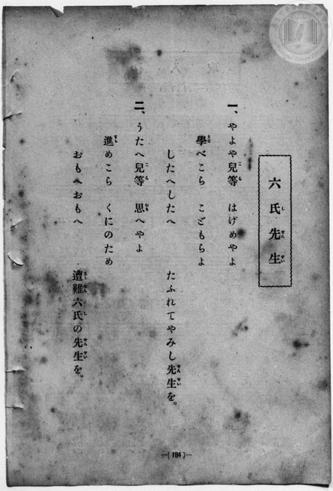
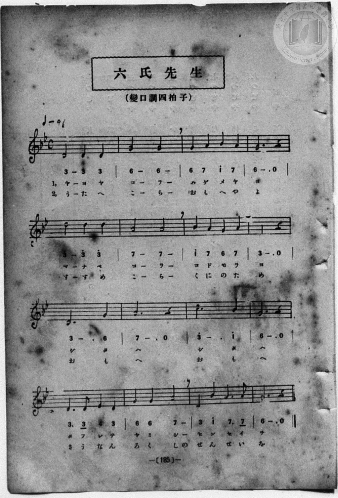

# 六氏先生

> Re:Shōka 使用 AI 協助辨識與重建樂譜，可能會有錯誤。歡迎回報。

<audio controls src="rokushi_sensei.mp3"></audio>

- 曲：宮島慎三郎
- book: 新編 小學校・公學校 唱歌教材集（尋常科三・四學年用）
- 一條慎三郎 編《新編 小學校・公學校 唱歌教材集》（大正十二年十二月，索書號 0725-41）
- 臺灣總督府《公學校唱歌集》（大正四年三月，索書號 0725 26）

## 說明

> [!NOTE]
> **原書資訊與歌詞全文**（對應 `P192.jpg`–`P193.jpg`，原書 p. 184–185，尋常科三・四學年第 32 首）：
> - **作曲**：臺灣總督府國語學校助教授 宮島慎三郎
> - **調性與拍號**：變ロ調四拍子（G 小調，2 個降記號，4/4 拍），♩= 96
>
> **一、**
> やよや兒等（こら）　はげめやよ
> 學（まな）べこら　こどもらよ
> したへしたへ
> たふれてやみし先生（せんせい）を。
>
> **二、**
> うたへ兒等（こら）　思（おも）へやよ
> 進（すゝ）めこら　くにのため
> おもへおもへ
> 遭難（さうなん）六氏（し）の先生（せんせい）を。


## 歌詞

```text
（TMD 檔案未包含歌詞註解）
```

## ABC

```abc
X:1
T:六氏先生
C:曲：宮島慎三郎
M:4/4
L:1/16
Q:1/4=96
K:Gm
V:V1 name="Piano" snm="Pia"
[V:V1]
d8 d4 d4 | g8 g8 | g4 a4 b4 a4 | g12 z4 |
w: 1.~や よ や | こ ら | は げ め や | よ
w: 2.~う た へ | こ ら | お も へ や | よ
d'8 d'4 d'4 | a8 a8 | b4 a4 g4 a4 | d12 z4 |
w: 1.~ま な べ | こ ら | こ ど も ら | よ
w: 2.~す す め | こ ら | く に の た | め
d12 g4 | a12 z4 | d'12 b4 | g12 z4 |
w: 1.~し た | へ | し た | へ
w: 2.~お も | へ | お も | へ
d6 d2 e4 d4 | g4 g4 a8 | d4 b4 a6 a2 | g12 z4 |
w: 1.~た ふ れ て | や み し | せ ん せ い | を
w: 2.~さ う な ん | ろ く しの | せ ん せ い | を
d8 d4 d4 | g8 g8 | g4 a4 b4 a4 | g12 z4 |
w: 1.~や よ や | こ ら | は げ め や | よ
w: 2.~う た へ | こ ら | お も へ や | よ
d'8 d'4 d'4 | a8 a8 | b4 a4 g4 a4 | d12 z4 |
w: 1.~ま な べ | こ ら | こ ど も ら | よ
w: 2.~す す め | こ ら | く に の た | め
d12 g4 | a12 z4 | d'12 b4 | g12 z4 |
w: 1.~し た | へ | し た | へ
w: 2.~お も | へ | お も | へ
d6 d2 e4 d4 | g4 g4 a8 | d4 b4 a6 a2 | g12 z4 |
w: 1.~た ふ れ て | や み し | せ ん せ い | を
w: 2.~さ う な ん | ろ く しの | せ ん せ い | を
```

## TMD 檔案連結

- [主旋律 TMD 檔案](rokushi_sensei.tmd) [[在 TMD Studio 編輯](https://tmdlang.github.io/Tmd-TS/#tmd=s7IKdvYPcrWy4qpTUCpJTLdSSM7PyUlNLsnMz7MqzsjPTozPrsyvSsyML84ojTe0NDJWgqssy88pzU21Si9KTEmNN443QcgU55cWJadaFSdn5OfnxJekVpQk5edno8vHFySmp1oFAA1FyBQU5Zel5iXmAXUXFGXmlaSmgLUjFKSWZaakgqSLkxPz4stSizLTMlNTkByVWlQMdjvEipKixLzi5KLMApCHEKryi0oy8oEOL8iotMrILC7JL8pMTsyJz07MS0QoKslIBXoPIl2JLgz1W05mWqoSl5aWwtPWtc829D9t7Xg-Zb6ClhaXoq2CpRmXva2Ckw5XdmqlrYJ7LpeNib6JHcgcUGhYKTybtuH59hUKT4Ha1u54tmDh4-bdT1vXQNgKT6dsfLa259nUmc_mTng5u-39no6nG7qf7tjxfPnEJzs6QUpnzwYqfbpzy_MpK97v6QS778mOhmeL5j5r7QMqedncpwA0_nFDFyn2PG7oBlm1ZPmztYuf9jY-2dUDtAHCeDan4_2enudbFj2bvePFzPkKBuZGpromhjC7n83e9H7PrKfr1j3dvA3uArDMi_ZdzxsXP9-x9_ncxU93zQG6CG49xHZ0e4E-27kFaAA2GxWMzMA2culrKdhSC3ApKCjYKUQr-vmHuMZCOFpaT_vmg-zd3P5iRdeLjnagO1-snPe0dcWzae1aWuD46H3W3qmQAErAelkF6QmPGiaDOMZgDtDhEAMUCvQUDC1MgJKGFqYgUVzRuGaNgrGRwstl04D-A4YkxBm6QIc82TsHGLggO2ehBeXTOd0vVs2DBmXXSlAs9nUooMUBwqAXq_Y_a1gO8kt3LzA8ISau63rcvBYoA3QIUPjp2glAr7mDEgtQDOhcI4WnDd0vZ_a-WDEDqAUoAEzDCkCFYEf2PJq5EpzOQVbAwg2YCB83NAKzAJj_uKnlcVMHkHzaOun5WqCejseNkx83ARmdjxsaHjeuf9w46XFTI0QZRAvQP2Bl-x43rgIpa9wJ0QJWP_lx48rHTU0gLkz948bpjxvnP27cAWfAxIHsrY-beh43LgOZ37gfqACSQ8Hmz37cBDRt9uPGFpAtTZMeNzShemRXD7JHGtsghmP1yLOGuWCRLqDbwG7egeyjlw3AvAGUnfm4CagMaFcjko_6Hzeufty4DmR4UyPMLpA5YB9BGVBzGte-nL0YbNRUsHtWAb0ANBBS-IDFp4NtX0fYm5TnGihQ0NLn4grKzy4tzsgMTs0rTs20CshMzMt3qDGoqQbZpGBjoQUOVAVseVYBmPCBSebFwh4FDRNQunu-vkFHAZaPNLFoANoHMqxGwRiYqkEQRINwjYIZVARGQ0TMgdgwDspAKAJBA5AI2DgfwxpQYoWKA6MOTIL4QPHGyXDxTrjRwMQLEmmcBBZvRFYP1g2D8Qg7jEC62mBmNc4Hkzvw2tEFFmmCq8RnB_5A3tVDViCDAg4cyiAGmKgBByQIwugaRPjCAhwRPVjCuXEfPAxWgcmdeMMAJArM94iQAMsSCueZcDtALEgM4bajH6xyNZhcByZBsQOyA6SPlHDe0UlJYoYlX0Qgw8MPERcgCA5xvKm5cTqSHNw_4FSE4h_iVSKFLihdwnWAYwWX2USqxB-qwOqJ_FA1VjABk7DwgqVRSNyDxOHJF0TiD1RQ4IACaSvQMz1g1jKIl8AZE1jLgElYgIJ0zAZ7HJKIQWwQ3QLWASo6cAXwVKjKNlgmAZsA0tULFockWGCNB0qt5FhVy8Wla6eAUnIrYBNQ5gIA)]
- [鋼琴伴奏 TMD 檔案](rokushi_sensei_piano.tmd) [[在 TMD Studio 編輯](https://tmdlang.github.io/Tmd-TS/#tmd=s7IKdvYPcrWy4qpTUCpJTLdSSM7PyUlNLsnMz7MqzsjPTozPrsyvSsyML84ojTe0NDJWgqssy88pzU21Si9KTEmNN443QcgU55cWJadaFSdn5OfnxJekVpQk5edno8vHFySmp1oFAA1FyBQU5Zel5iXmAXUXFGXmlaSmgLUjFKSWZaakgqSLkxPz4stSizLTMlNTkByVWlQMdjvEipKixLzi5KLMApCHEKryi0oy8oEOL8iotMrILC7JL8pMTsyJz07MS1Ti0tJSeNq69tmG_qetHc-nzH-_p-Pl7JnPOrtfdu95PmHLkz1bni7tf7-nU0FLi0vRVsHSjMveVsFJhys7tdJWwT2Xy8ZE38QOZBPIz1YKz6ZteL59hcJToHFrdzxbsPBx8-6nrWsgbIWnUzY-W9vzbOrMZ3MnvJzdBrTq6Ybupzt2PF8-8cmOTpDS2bOBSp_u3PJ8ygqgnWAfPNnR8GzR3GetfUAlL5v7FIDGP27oIsWexw3dIKuWLH-2dvHT3sYnu3qANkAYz-Z0vN_T83zLomezd7yYOV_BwNzIVNfEEGb3s9mb3u-Z9XTduqebt8FdAJZ50b7reePi5zv2Pp-7-OmuOUAXwa2H2I5uL9BnO7cADcBmo4KRGdhGrqD87NLijMzg1Lzi1EyrgMzEvPwgD4cag5pqLgUgsLHQsgMz9LUUbNGBwvM1a4Bh9WJhj4KGCShgnq9v0FEApjdjvayCdE0sGrT0wYbVKBgr6IIhiAbhGgUzqAiMhoiYA7FhHJSBUASCBiARsHE-hjUKj5taoOKPmzrAJIgPFG-cDBfvhBv9uHE9SKRxEli8EVk9WDcMxiPsMALpaoOZ1TgfTO7Aa0cXWKQJrhKfHfgDeVcPWYEMCjhwKIMYYKIGHJAgCKNrEOELC3BE9GAJ58Z98DBYBSZ34g0DkOjjxpWIkADLEgrnmXA7QCxIDOG2ox-scjWYXAcmQbEDsgOkj5Rw3tFJSWKGJV9EIMPDDxEXIAgOcbypuXE6khzcP-BUhOIf4lUihS4oXcJ1gGMFl9lEqsQfqsCCiPxQNVYwAZOw8IKlUUjcg8ThyRdE4g9UUOCAAmkr0DM9YNYyiJfAGfNx434wCQtQkI7ZYI9DEjGIDaJbwDpARQeuAJ4KVdkGyyRgE0C6esHikAQ7HZJaybGqFmvB7YNccJsgCu4XTa3PV7a92L_3WcPcJzu7gbHwYtV-YKw86-59unbC0-3LgHUvrNYF1hMNT_dvfdE19-nGjU-3T0OuqJHiJl4h2jg3Fk4Dgz0eyDSLB7IRLIgoUI0hmERXZAANM1yawYZD7QDxIaZAjUSWRhgEcw92Y4DqkGSAxkUbYjod0zAjDNfDnQRiAM2A8zGNAsaUrp0CSmRF-wC1YAoagQWVuQA)]

## 分析

```text
================================================================================
📊 TMD Song Profile: [ 六氏先生 ]
================================================================================
⏱  Duration:       1:20 (80.0s), 32 measures total
🎼 Key & Tempo:    首調基準 B,, != 96.0 BPM, <4/4>
   - 分析範圍：      由實際發聲的音符與和弦推測調性；播放脈絡另行呈現
🎤 人聲音域:    D5 (MIDI 74) – D6 (MIDI 86) [跨度: 12 個半音 / 1.0 個八度, 難度: easy]
   - 最低音:  D5 in [RokushiSensei #1 @ m.1, 0:00]
   - 最高音: D6 in [RokushiSensei #1 @ m.5, 0:10]
   - 適合: soprano, tenor
🏛  結構:      RokushiSensei (40.0s) -> RokushiSensei (40.0s)
⚡ 編曲密度:        Peak 1 軌道同時演奏
🗝  調性診斷：       D 大調（流行色彩大調，未偵測到可信轉調）
   - 風格氣質:    流行大調（略帶和弦色彩音與裝飾副屬和弦）
   - 轉調歷程:    全曲維持單一推測調性（未偵測到可信轉調）
   - 核心骨幹音:  D, G, A, A#, D#
   - 調性數值:    D 大調 [相關度: 0.78, 穩定度: Moderate, 自然音純度: 91.5%]
   - 候選調性 (K-S): D 大調 (0.78), G 大調 (0.70), G 小調 (0.68)
   - 五度圈歷程:   +2 -> +2
   - 各段落調性細節:
     • [RokushiSensei #1]: D 大調 (r: 0.78, 自然音純度: 91.5%, 調外音: D#, A#)
     • [RokushiSensei #2]: D 大調 (r: 0.78, 自然音純度: 91.5%, 調外音: D#, A#)

  [ 五度圈游移軌跡 ]
               C  
         F            G  
      Bb              [D ]*
      Eb               A  
         Ab           E  
            Db       B  
               F# 
     (* = active key center)

  [ 十二半音累積音高分佈 ]
     C  :                            0.0%
     C# :                            0.0%
     D  : ████████████████████████  35.6%
     D# : █                          1.7%
     E  :                            0.0%
     F  :                            0.0%
     F# :                            0.0%
     G  : █████████████████████     30.5%
     G# :                            0.0%
     A  : █████████████████         25.4%
     A# : █████                      6.8%
     B  :                            0.0%
--------------------------------------------------------------------------------
Assignment 軌道音域：
  - Piano         : D5 – D6 (12 個半音 / 1.0 個八度, 76 個音符)
================================================================================
```


## 原書掃描頁






