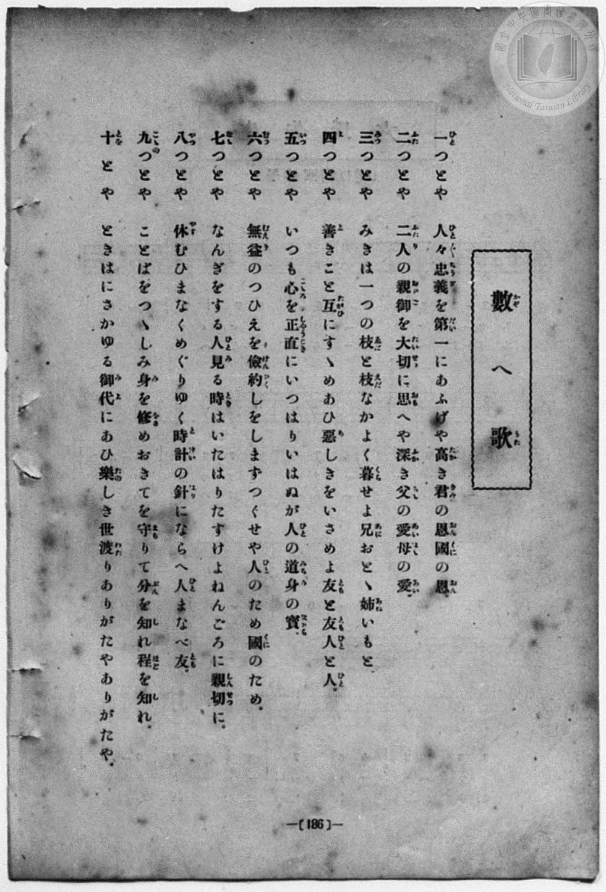
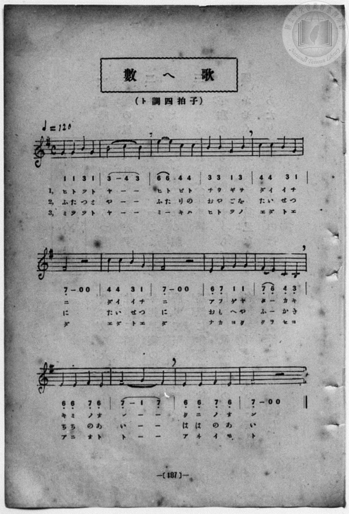

# 數へ歌

> Re:Shōka 使用 AI 協助辨識與重建樂譜，可能會有錯誤。歡迎回報。

- **鋼琴伴奏版**：<br><audio controls src="kazoeuta.mp3"></audio>
- **NEUTRINO 歌聲合成版**：<br><audio controls src="kazoeuta_neutrino.mp3"></audio>

- book: 新編 小學校・公學校 唱歌教材集（尋常科三・四學年用）
- 一條慎三郎 編《新編 小學校・公學校 唱歌教材集》（大正十二年十二月，索書號 0725-41）
- 文部省《尋常小學唱歌》

## 說明

> [!NOTE]
> **原書資訊與歌詞全文**（對應 `P194.jpg`–`P195.jpg`，原書 p. 186–187，尋常科三・四學年第 33 首）：
> - **出處原曲**：文部省編纂《尋常小學唱歌》第三學年〈かぞへ歌〉（明治 45 年／1912 年），臺灣總督府大正四年《公學校唱歌集》第四學年〈數へ歌〉改訂第五至十節歌詞
> - **調性與拍號**：ト調四拍子（G 調 4/4 拍），♩= 120
> - **版面校勘**：與《尋常小學唱歌》第三學年（`P025.jpg`）及大正四年《公學校唱歌集》（`P066.jpg`）旋律完全一致，皆在一個升記號五線譜上自第 2 線 G4（`1`）起音，譜下簡譜對應印作 `1 1 3 1 | 3 - 4 3 | 6 6 4 4 | 3 3 1 3 | 4 4 3 1 | 7_ - 0 0 ...`（構成 B–C–E–F#–G–B–C–E 之都節／陰音階形態）。
>
> **一（ひと）つとや**　人々忠義（ひと／＼ちうぎ）を第一（だいいち）にあふげや高（たか）き君（きみ）の恩（おん）國（くに）の恩（おん）。
> **二（ふた）つとや**　二人（ふたり）の親御（おやご）を大切（たいせつ）に思（おも）へや深（ふか）き父（ちゝ）の愛（あい）母（はゝ）の愛（あい）。
> **三（み）つとや**　みきは一（ひと）つの枝（えだ）と枝（えだ）なかよく暮（くら）せよ兄（あに）おとゝ姉（あね）いもと。
> **四（よ）つとや**　善（よ）きこと互（たがひ）にすゝめあひ惡（あ）しきをいさめよ友（とも）と友（とも）人（ひと）と人（ひと）。
> **五（いつ）つとや**　いつも心（こゝろ）を正直（しやうじき）にいつはりいはぬが人（ひと）の道（みち）身（み）の寶（たから）。
> **六（む）つとや**　無益（むえき）のつひえを儉約（けんやく）しをしまずつくせや人（ひと）のため國（くに）のため。
> **七（なゝ）つとや**　なんぎをする人（ひと）見（み）る時（とき）はいたはりたすけよねんごろに親切（しんせつ）に。
> **八（や）つとや**　休（やす）むひまなくめぐりゆく時計（とけい）の針（はり）にならへ人（ひと）まなべ友（とも）。
> **九（こゝの）つとや**　ことばをつゝしみ身（み）を修（をさ）めおきてを守（まも）りて分（ぶん）を知（し）れ程（ほど）を知（し）れ。
> **十（とを）とや**　ときはにさかゆる御代（みよ）にあひ樂（たの）しき世渡（よわた）りありがたやありがたや。


## 歌詞

```text
（TMD 檔案未包含歌詞註解）
```

## ABC

<div class="abc-score" data-abc-src="kazoeuta.abc" aria-label="五線譜載入中"></div>

[下載 ABC 原始檔](kazoeuta.abc)

## TMD 檔案連結

- [主旋律 TMD 檔案](kazoeuta.tmd) [[在 TMD Studio 編輯](https://tmdlang.github.io/Tmd-TS/#tmd=s7IKdvYPcrWy4qpTUCpJTLdSSM7PyUlNLsnMz7MqzsjPTozPrsyvSsyML84ojTe0NDJWgqssy88pzU21Si9KTEmNN443QcgU55cWJadaFSdn5OfnxJekVpQk5edno8vHFySmp1oFGFoi6Swoyi9LzUvMA-ouKMrMK0lNAWtHKEgty0xJBUkXJyfmxZelFmWmZaamIDkqtagY7HaIFSVFiXnFyUWZBSAPIVTlF5Vk5AMdXpBRaZWRWVySX5SZnJgTn52Yl4hQVJKRCvRebn5RYk5mSSWy5sz0zDygRF5SKTCIlLi0tBSeTd3xuHHHs7U9ClpaXIq2CoZGBlz2tgruXDYm-iZ2IK2gELBSeDZtw_PtKxSebuh_unbHswULHzfvftq6BsJWeDplI9CEZ1NnPps74eXstvd7Op5u6H66Y8fz5ROf7OgEKZ09G6j06c4tz6eseL-nE-ykJzsani2a-6y1D6jkZXOfAtD4xw1dpNjzuKEbZNWS5c_WLn7a2_hkVw_QBgjj2ZyO93t6nm9Z9Gz2jhcz5ysYmBuZ6poYwux-Nq39ZfOK53MagTZCnAqxEGIB0FwlLi59LQVbagEuBQUFO4VoRT__ENdYCEdL62nffJDrNre_WNH1oqMdaPGLlfOetq4AOk5LCxyGvc_aOxUSQAlNL6sgPeFRw2QQxxTMAXoPYoBCgZ6CoYUZUNLQwhwkiivo16xRMDZWeLlsGjAU3u-ZBXGGLsgh7btezJwKNm0TyOZZ8OABRsXzXU24AgloItAOiOmPGzoeN3Y_bpwHSU2PG4BWdDyb0fds024FE1MFoIr3e_oNLQ2NIEygbM-L9l3PGxc_37H3-dzFT3fNgcYj0Lkg07rgsQ6xDhLdQBvh_gHaCE-8QOueTdn5YkUTyEm7prxo3wxMBs_XN0DCFOHTF6v2P2tYDgrs7l5gsgB79nFzB1AYaCxQ7OnaCUBnuysABRSA6V8BKARx66OZKyF5A27U886Ol3MXgdzXPQNsDtBUYgIKaH5CgIERLBI7n_Z3EeNziDYzM5i2Z9O7n-7rfrquB5hggDnpRTvQ4J7ns9qezgFxnzZ0P-0FpqsZQE8Cw-P59lkv1s55sqPrRfsqUDIwAma2WQruJiBDDUGmvdi6_eX8zaA4ASnrfr5hIZABSX9Pezc82TtHIcFQwVDBGIhrgKSuggmQrFEwA0ITIASJgeRAYiA-RJ15PFChARDq6ekBLel4trz7WccEBSdgSnUGYlcgdlMGEu5ADBdUeLKz-2XzXmDcAdPLy5kbgM56Oavv6d5Fz1qBYdD5uKEJHAWwPAT0K9Dkx42bHjeCCpbHjUuAjMdNLVpajxsanuza9bih9en-Bc_3rURS1f9-z57HjQsfN7Y9buwDaWqaBI4giEkLHje2gNFCsHmrHzc2PW7c-rhxEtDUl6tngNXMByZ1sGzv0wmzwSK9jxv3g0XWPWuE2NX1uGkyKHrngKLucWM_0CisCmA-AnlmVw9YBmjbfCye6QH6By7_uKkLYtyLZaue7gO6FWIi0N1TIF4CJqqnHe0w5wLFZwPNg3jpWcNcmPomsMgOoMZn2zfCDIf67XnHNrDIwsdNQPVgp7dAfAsMkRZQGlwPzB1A7npcCpD9tgNUIMBCCdljQDFw-K3HFpfrns2DuBUUM2DBFRgiq0AFTxMojJ_NWgcN7CagbUCp2UDxp61Ap0DcBImBLrDlc58uh7gIKL4WLN4CDA6QFMLRwCwJUtIErEvQHP10GthQqAzQ9ZOBkk92TYKFdw_QG7D0MxNo2eOmRrBNm541Q-IKEvDTQXqbJoHjZypIDdC5_ZAEA7QKomYFmggsFcCDCWgvqghyigKmBqAM0HhI3KMGPEgYaOjT_c1gVZPBDgWVeEA3AUuk57NBpRXIlaB0BcwtM4DOhfkKrBcU9cDgBLLXP25cA_Q2huPWvWwEpnJQxENy1ItdwEiAp4N1T9dD0hgoR0EjDSn4W4ERAwxkYLJAc_rzloXPZwMzAEgSnBIgzloHVgW0Gyg-6WlL5_MtkKifCMxqYD8Asz441EFBDgz7fY8bZ4G1AHMnMKm0YLoenNMaMTMxRBwlfUPCcBUsL6CGNFAYmEL6wBYD00M3mk0vlkEsAIdKU_ezmcCIBsc41GPA0AW6HhhIkPAGMmaCfQVUsxZs8hRgvAEdByoMoJke6EmgOCLTo4QrOA6awFkUtZDZMxEiA7QA7BSg04FOBIYTMJMBcxUwEU8AuaAJmBj6ga58sQKYASAOnQjN8sAYb4dkUJBbYakF6H9QOYMRwBCTd6IneqRw3QkxDJw2G4HZGyNoQTnvceMGcNACUzNQFTBm96Oks6ZJT_aDSwaQmqlgEaBPgAEJDLNloKSyDuKNfVDrQWG87GkHqCH7uHEbtJwG1hLzl0KCFszteb4C4ujdj0ElOhYFyEHe2wjzILCMAGVahAdAsQyOYmA4TQXngzZgGgAW6k92L4ZmHWg5A6mMNj1bAUkewGQACRBQMfJkx7RnO8BlCzBVNAFTKrgKAfmkCUwCSyRgkgVGLCoX4kTKW7hQoKClz8XlnViVn1pakmgVkJmYl-9QY1BTDbJEwcZEC1xxK2BrWitA6uAXC3sUNIDtxQ39wCaAjgKsuauJRQPQKpBhNcDGBolNE7A-H8MaBWBgAvEKIF4CpoEiTS1AM0AQWXYzTLZxIRC3AXEfUOUksMgCIG6B4oUws41AMluBeD5Os6GyTV1Aeh1YBMgCqgBmZrjZIN0gkdlgU6BmG4Nk9gPxYpxm7wfSwDQBxOtR_AFSDbGrA-pykGgHzGQTkDkgGZwmg2VB5k6GhwjIjT1QO1aDRWZCcFMjkG6CmW0KkgH5BWQudldDZZuawOaDRIC2NAFtA4YGRAWwUGuGRsAMsEOghpuBjGrA63CQLMzxkCAAqQM5GigKDe6JQBbISpBD-mFmm4NkVkExdocDZUD6kBIFyPvd8ICHRhhYBBTgcHdbQEzC526QLMg0kPs3gU3aB3VLP1QFKJgnQBJSUxvMZEto8IExqF7E6nBILAJLT7jDYbEzHexkmMMnQXDjVHjeMQBJrQAlM7AEptEQf4ISICxZTAViYAgA3QgKCZjRoDhZDcSghIK_cNjVQ07hAO-FYO2aAAuKeBAPVISAhYFck3gF43iUQmI1UHU8EGLJ7miyoKQLytigAGuBZg9QVgTFPDzWwYUDsi60bI4mC4pXkLk74GZuxTQTXCgsQNKFlsHRZEHpBxQXIFXAlA4mgVU0xA1AUaQCAZjqEPrQsjaaLMiVoIQDybKwLA2Md5B6hKngogDZh5jZGk0BrNwAJiZgMoeJgJLWGiDuQS4GgA5A6EPL0Kiy4IQLci4oQ82Cp35gQIADARjUSAXAeiRT0bIymizILlCEItwK4oECDuQaeCCAsj44C8Ncg5aNUWXBdgH1g02HFF8Q8yHhhJTpgeaguhQp76LJgnSDsugyeHQBQwKU1MDmLkPN68jxjJZv0WRB3l0HTwkgS0ElLChYIdUdoXy-oxOcz01Iy-fAjAvJykASmsENQRRWGXDWR8rgoFAA1aggZ4PjDJhqEEUZyOkgr6LKgr2LlKFBLQMQBqmCBApycQhKqyCMKotkBjgDgzIQyCZQ-EOqDVARCzMDJLsWkgaAsQSTRTIDnF2BKQVcXIBSDKRYbkIyA9YSAGFIdYJmBjhzwlSBXAupBRYimQELKVBEgwtyYMGBYgY4HyKbMR-e9rCFKUIWyQxwrgP6FlyxglpEiFIBZgYwgYFlsRSbSHkMVDmDCjZg8YnkY5gZsMp0J0poIZkBrki3QcsRSIkBUtWDZMZuIF6JIYtkBiQHwTIWqLEE8TJyAsEuCzGklotL104B1qyO9jGMVUDhG6HxjdH4Jmh8UzS-GRrfHI1vgca3ROMbGoAFlLkA)]
- [鋼琴伴奏 TMD 檔案](kazoeuta_piano.tmd) [[在 TMD Studio 編輯](https://tmdlang.github.io/Tmd-TS/#tmd=s7IKdvYPcrWy4qpTUCpJTLdSSM7PyUlNLsnMz7MqzsjPTozPrsyvSsyML84ojTe0NDJWgqssy88pzU21Si9KTEmNN443QcgU55cWJadaFSdn5OfnxJekVpQk5edno8vHFySmp1oFGFoi6Swoyi9LzUvMA-ouKMrMK0lNAWtHKEgty0xJBUkXJyfmxZelFmWmZaamIDkqtagY7HaIFSVFiXnFyUWZBSAPIVTlF5Vk5AMdXpBRaZWRWVySX5SZnJgTn52Yl6jEpaWl8GzqjseNO56t7Xm_p-Pl7JnPOrtfdu95PmHLkz1bni7tf7-nU0FLi0vRVsHQyIDL3lbBncvGRN_EDmQ8yKNWCs-mbXi-fYXC0w39T9fueLZg4ePm3U9b10DYCk-nbASa_GzqzGdzJ7yc3Qa04umG7qc7djxfPvHJjk6Q0tmzgUqf7tzyfMoKoF1gZz_Z0fBs0dxnrX1AJS-b-xSAxj9u6CLFnscN3SCrlix_tnbx097GJ7t6gDZAGM_mdLzf0_N8y6Jns3e8mDlfwcDcyFTXxBBm97Np7S-bVzyf0wi0EeJUiIUQC4DmKnFxeSdW5aeWliRaBWQm5uUHeTjUGNRUcykAgY2Jlh2Yoa-lYIsOFJ6vWQP02ouFPQoapiB_PF_foKMATBOmelkF6ZpYNGjpgw2rUTAEQmMgrgGSugomQLJGwQwITYAQJAaSA4mB-GB1YH0-hjUKjxs3AfEKIF4CpoEiTS1AM0AQWXYzTLZxIRC3AXEfUOUksMgCIG6B4oUws41AMluBeD5Os6GyTV1Aeh1YBMgCqnjcOAVuNkg3SGQ22BSo2cYgmf1AvBin2fuB9OPGXiBej-IPkGqIXR1Ql4NEO2Amm4DMAcngNBksCzJ3MjxEQG7sgdqxGiwyE4KbGoF0E8xsU5AMyC8gc7G7Girb1AQ2HyQCtKUJaBswNCAqpj9uaoZGwAywQ6CGm4GMasDrcJAszPGQIACpAzkaKAoN7olAFshKkEP6YWabg2RWQTF2hwNlQPqQEgXI-93wgIdGGFgEFOBwd1tATMLnbpAsyDSQ-zeBTdoHdUs_VAUomCdAElJTG8xkS2jwgfE6XA6HxOLjxg1wh8NiZzrYyTCHT4LgxqnwvGMAkloBSmZgCUyjIf4EJUBYspgKxMAQALoRFBIwo0FxshqIQQkFf-Gwq4ecwsE8HuggAyBEyv_IgmbxIB6oCAELA7km8QrG8SiFxGqg6nggxJLd0WRBSReUsUEB1gLNHqCsCIp5eKyDCwdkXWjZHE0WFK8gc3fAzdyKaSa4UFiApAstg6PJgtIPKC5AqoApHUw-buqEuAEoilQgAFMdQh9a1kaTBbkSlHAgWRaWpYHxDlKPMBVcFCD7EDNboymAlRvAxARM5jARUNJaA8Q9yMUA0AEIfWgZGlUWnHBBzgVlqFnw1A8MCHAgAIMaqQBYj2QqWlZGkwXZBYpQhFtBPFDAgVwDDwRQ1gdnYZhr0LIxqizYLqB-sOmQ4gtiPiSckDI90BxUlyLlXTRZkG5QFl0Gjy5gSICSGtjcZah5HTme0fItmizIu-vgKQFkKaiEBQUrpLojlM93dILzuQlp-RyYcSFZGUhCM7ghiMIqA876SBkcFAqgGhXkbHCcAVMNoigDOR3kVVRZsHeRMjSoZQDCIFWQQEEuDkFpFYRRZZHMAGdgUAYC2QQKf0i1ASpiYWaAZNdC0gAwlmCySGaAsyswpYCLC1CKgRTLTUhmwFoCIAypTtDMAGdOmCqQayG1wEIkM2AhBYpocEEOLDhQzADnQ2Qz5sPTHrYwRcgimQHOdUDfgitWUIsIUSrAzAAmMLAslmITKY-BKmdQwQYsPpF8DDMDVpnuRAktJDPAFek2aDkCKTFAqnqQzNgNxCsxZJHMgOQgWMYCNZYgXkZOINhlIYbUoreqfXC0qp_2L3k5u_XJrikvGjc9X7kLyHi6axmkq4LUXI5XMAVXcUAGsHkMyhrwSg-YR8AMIBcmC6SBCCwJEYXqhNevYBEDsDdQFKBKgQwGCUCMg0iCxEzAihDmQR0Ak4abAtQEYuFUoA3M2GCbQKGla6cAC7BoH8NYBRS-ERrfGI1vgsY3ReObofHN0fgWaHxLNL6hAVhAmQsA)]

## 分析

```text
================================================================================
📊 TMD Song Profile: [ 數へ歌 ]
================================================================================
⏱  Duration:       4:40 (280.0s), 140 measures total
🎼 Key & Tempo:    首調基準 G, != 120.0 BPM, <4/4>
   - 分析範圍：      由實際發聲的音符與和弦推測調性；播放脈絡另行呈現
🎤 人聲音域:    B3 (MIDI 59) – E5 (MIDI 76) [跨度: 17 個半音 / 1.4 個八度, 難度: challenging]
   - 最低音:  B3 in [Kazoeuta[L1] #1 @ m.10, 0:19]
   - 最高音: E5 in [Kazoeuta[L1] #1 @ m.3, 0:04]
   - 適合: soprano, mezzo-soprano, contralto, tenor, baritone, bass
🏛  結構:      Kazoeuta[L1] (28.0s) -> Kazoeuta[L2] (28.0s) -> Kazoeuta[L3] (28.0s) -> Kazoeuta[L4] (28.0s) -> Kazoeuta[L5] (28.0s) -> Kazoeuta[L6] (28.0s) -> Kazoeuta[L7] (28.0s) -> Kazoeuta[L8] (28.0s) -> Kazoeuta[L9] (28.0s) -> Kazoeuta[L10] (28.0s)
⚡ 編曲密度:        Peak 1 軌道同時演奏
🗝  調性診斷：       E 小調（純淨自然小調，未偵測到可信轉調）
   - 風格氣質:    純淨自然小調（陰鬱抒情、旋律集中，無明顯調外色彩）
   - 轉調歷程:    全曲維持單一推測調性（未偵測到可信轉調）
   - 核心骨幹音:  F#, E, B, G, C
   - 調性數值:    E 小調 [相關度: 0.73, 穩定度: High, 自然音純度: 100.0%]
   - 候選調性 (K-S): E 小調 (0.73), B 大調 (0.48), B 小調 (0.46)
   - 五度圈歷程:   +4 -> +4 -> +4 -> +4 -> +4 -> +4 -> +4 -> +4 -> +4 -> +4
   - 各段落調性細節:
     • [Kazoeuta[L1] #1]: E 小調 (r: 0.73, 自然音純度: 100.0%)
     • [Kazoeuta[L2] #1]: E 小調 (r: 0.73, 自然音純度: 100.0%)
     • [Kazoeuta[L3] #1]: E 小調 (r: 0.73, 自然音純度: 100.0%)
     • [Kazoeuta[L4] #1]: E 小調 (r: 0.73, 自然音純度: 100.0%)
     • [Kazoeuta[L5] #1]: E 小調 (r: 0.73, 自然音純度: 100.0%)
     • [Kazoeuta[L6] #1]: E 小調 (r: 0.73, 自然音純度: 100.0%)
     • [Kazoeuta[L7] #1]: E 小調 (r: 0.73, 自然音純度: 100.0%)
     • [Kazoeuta[L8] #1]: E 小調 (r: 0.73, 自然音純度: 100.0%)
     • [Kazoeuta[L9] #1]: E 小調 (r: 0.73, 自然音純度: 100.0%)
     • [Kazoeuta[L10] #1]: E 小調 (r: 0.73, 自然音純度: 100.0%)

  [ 五度圈游移軌跡 ]
               C  
         F            G  
      Bb               D  
      Eb               A  
         Ab          [E ]*
            Db       B  
               F# 
     (* = active key center)

  [ 十二半音累積音高分佈 ]
     C  : ███████████████           16.0%
     C# :                            0.0%
     D  :                            0.0%
     D# :                            0.0%
     E  : ██████████████████        20.0%
     F  :                            0.0%
     F# : ████████████████████████  26.0%
     G  : █████████████████         18.0%
     G# :                            0.0%
     A  :                            0.0%
     A# :                            0.0%
     B  : ██████████████████        20.0%
--------------------------------------------------------------------------------
Assignment 軌道音域：
  - Piano         : B3 – E5 (17 個半音 / 1.4 個八度, 450 個音符)
================================================================================
```


## 原書掃描頁






