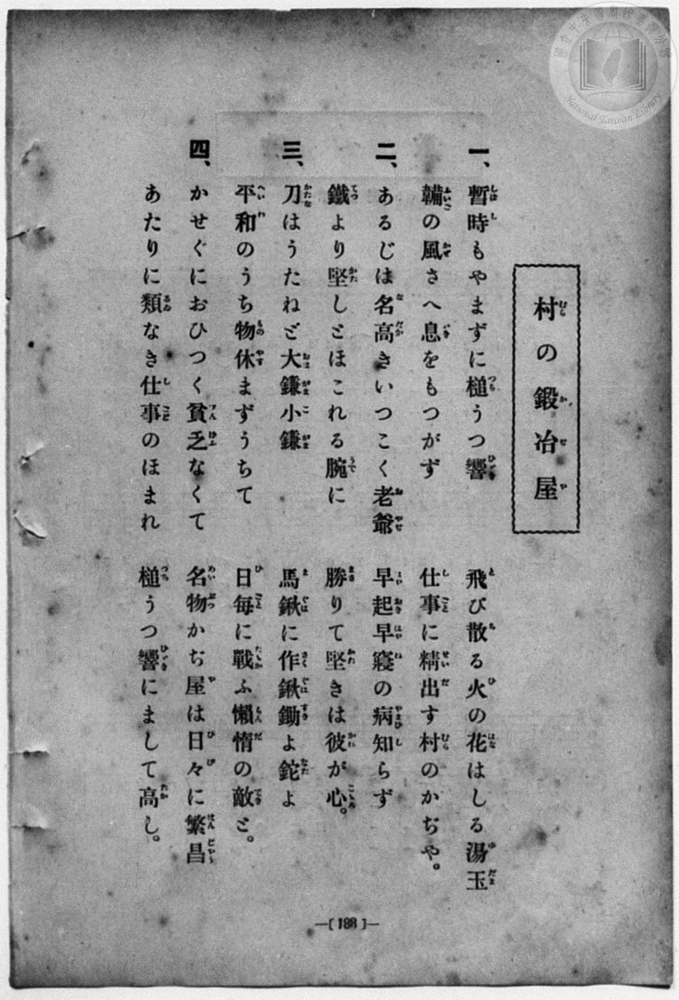
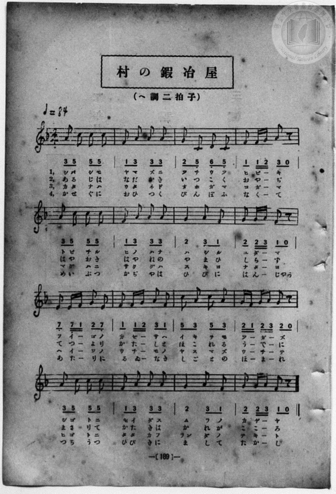

# 村の鍛冶屋

> Re:Shōka 使用 AI 協助辨識與重建樂譜，可能會有錯誤。歡迎回報。

<audio controls src="mura_no_kajiya.mp3"></audio>

- 詞：中村秋香
- 曲：田村虎藏
- book: 新編 小學校・公學校 唱歌教材集（尋常科三・四學年用）
- 一條慎三郎 編《新編 小學校・公學校 唱歌教材集》（大正十二年十二月，索書號 0725-41）
- 文部省唱歌

## 說明

> [!NOTE]
> **原書資訊與歌詞全文**（對應 `P196.jpg`–`P197.jpg`，原書 p. 188–189，尋常科三・四學年第 34 首）：
> - **調性與拍號**：ヘ調二拍子（F 大調 2/4 拍），速度 ♩= 84
> - **版面校勘**：本集（`P197.jpg`）第 7 小節及第 15 小節五線譜與簡譜均印作 `2 3 1`（G4 四分、A4 八分、F4 八分），異於昭和六年《新定兒童唱歌》之 `2 3 2`。依本集圖檔忠實轉錄。
>
> **一、**
> 暫時（しばし）もやまずに槌（つち）うつ響（ひゞき）
> 飛（と）び散（ち）る火（ひ）の花（はな）はしる湯玉（ゆだま）
> 鞴（ふいご）の風（かぜ）さへ息（いき）をもつかず
> 仕事（しごと）に精出（せいだ）す村（むら）のかぢや。
>
> **二、**
> あるじは名高（なだか）きいつこく老爺（おやぢ）
> 早起（はやおき）早寢（はやね）の病（やまひ）知（し）らず
> 鐵（てつ）より堅（かた）しとほこれる腕（うで）に
> 勝（まさ）りて堅（かた）きは彼（かれ）が心（こゝろ）。
>
> **三、**
> 刀（かたな）はうたねど大鎌（おほがま）小鎌（こがま）
> 馬鍬（まぐは）に作鍬（さくぐは）鋤（すき）よ鉈（なた）よ
> 平和（へいわ）のうち物（もの）休（やす）まずうちて
> 日毎（ひごと）に戰（たゝか）ふ懶惰（らんだ）の敵（てき）と。
>
> **四、**
> かせぐにおひつく貧乏（びんぼう）なくて
> 名物（めいぶつ）かぢ屋（や）は日々（ひび）に繁昌（はんじやう）
> あたりに類（るゐ）なき仕事（しごと）のほまれ
> 槌（つち）うつ響（ひゞき）にまして高（たか）し。


## 歌詞

```text
（TMD 檔案未包含歌詞註解）
```

## ABC

```abc
X:1
T:村の鍛冶屋
C:曲：田村虎藏
M:2/4
L:1/16
Q:1/4=84
K:F
V:V1 name="Piano" snm="Pia"
[V:V1]
A2 c2 c2 c2 | F2 A2 A2 A2 | G2 C2 D2 C2 | F2 F G A2 z2 |
w: し ば し も | や ま ず に | つ ち う つ | ひ び _ き
A2 c2 c2 c2 | F2 A2 A2 A2 | G4 A2 F2 | G2 G A F2 z2 |
w: と び ち る | ひ の は な | は し る | ゆ だ _ ま
E2 E F G2 E2 | F2 F G A2 F2 | c2 A2 c2 A2 | G F G A G2 z2 |
w: ふ い _ ご の | か ぜ _ さ へ | い き を も | つ _ か _ ず
A2 c2 c2 c2 | F2 A2 A2 A2 | G4 A2 F2 | G2 G A F2 z2 |
w: し ご と に | せ い だ す | む ら の | か ぢ _ や
A2 c2 c2 c2 | F2 A2 A2 A2 | G2 C2 D2 C2 | F2 F G A2 z2 |
w: あ る じ は | な だ か き | い つ こ く | お や _ ぢ
A2 c2 c2 c2 | F2 A2 A2 A2 | G4 A2 F2 | G2 G A F2 z2 |
w: は や お き | は や ね の | や ま ひ | し ら _ ず
E2 E F G2 E2 | F2 F G A2 F2 | c2 A2 c2 A2 | G F G A G2 z2 |
w: て つ _ よ り | か た _ し と | ほ こ れ る | う _ で _ に
A2 c2 c2 c2 | F2 A2 A2 A2 | G4 A2 F2 | G2 G A F2 z2 |
w: ま さ り て | か た き は | か れ が | こ こ _ ろ
A2 c2 c2 c2 | F2 A2 A2 A2 | G2 C2 D2 C2 | F2 F G A2 z2 |
w: か た な は | う た ね ど | お ほ が ま | こ が _ ま
A2 c2 c2 c2 | F2 A2 A2 A2 | G4 A2 F2 | G2 G A F2 z2 |
w: ま ぐ は に | さ く ぐ は | す き よ | な た _ よ
E2 E F G2 E2 | F2 F G A2 F2 | c2 A2 c2 A2 | G F G A G2 z2 |
w: へ い _ わ の | う ち _ も の | や す ま ず | う _ ち _ て
A2 c2 c2 c2 | F2 A2 A2 A2 | G4 A2 F2 | G2 G A F2 z2 |
w: ひ ご と に | た た か ふ | らん だ の | て き _ と
A2 c2 c2 c2 | F2 A2 A2 A2 | G2 C2 D2 C2 | F2 F G A2 z2 |
w: か せ ぐ に | お ひ つ く | び ん ぼ ふ | な く _ て
A2 c2 c2 c2 | F2 A2 A2 A2 | G4 A2 F2 | G2 G A F2 z2 |
w: め い ぶ つ | か ぢ や は | ひ び に | は ん _ じやう
E2 E F G2 E2 | F2 F G A2 F2 | c2 A2 c2 A2 | G F G A G2 z2 |
w: あ た _ り に | る ゐ _ な き | し ご と の | ほ _ ま _ れ
A2 c2 c2 c2 | F2 A2 A2 A2 | G4 A2 F2 | G2 G A F2 z2 |
w: つ ち う つ | ひ び き に | ま し て | た か _ し
```

## TMD 檔案連結

- [主旋律 TMD 檔案](mura_no_kajiya.tmd) [[在 TMD Studio 編輯](https://tmdlang.github.io/Tmd-TS/#tmd=s7IKdvYPcrWy4qpTUCpJTLdSSM7PyUlNLsnMz7MqzsjPTozPrsyvSsyML84ojTe0NDJWgqssy88pzU21Si9KTEmNN443QcgU55cWJadaFSdn5OfnxJekVpQk5edno8vHFySmp1oFGFqaIWQKivLLUvMS84C6C4oy80pSU8DaEQpSyzJTUkHSxcmJefFlqUWZaZmpKUiOSi0qBrsdYkVJUWJecXJRZgHIQwhV-UUlGflAhxdkVFplZBaX5BdlJifmxGcn5iUiFJVkpAK9V55fBHS5lpbCs7kTHzeue9k7-2nbtqcbuxW0tLgUbRUsTLjsbRXcuGyM9E3sQFpBPrVSeDZtw_PtKxSebuh_unbHswULHzfvftq6BsJWeDpl47O1Pc-mznw2d8LL2W3v93Q83dD9dMeO58snPtnRCVI6ezZQ6dOdW55PWfF-TyfYSU92NDxbNPdZax9QycvmPgWg8Y8bukix53FDN8iqJcufrV38tLfxya4eoA0QxrM5He_39DzfsujZ7B0vZs5XMDA3MtU1MYTZ_Wxa-8vmFc_nNEJMBIu9WDnv_Z5ZT3asBYbL8-XdL5fNhCidvQko_HzKBqDwi5l9L6b3K3Fx6Wsp2FILcCkoKNgpRCv6-Ye4xkI4WlpP--aDXL65_cWKrhcd7UA3Ap33tHUF0OFaWuDw7X3W3qmQAEpselkF6QmPGiaDOOZgDtDrEAMUCvQUDC0sgJKGFpYgUVzRsmaNgrGJwstl04AhBPQuxBm6QIe8WLX_WcNykBO6e4EBCbJ81uPmGUBhUCh39z5dOwHoHDcFYCwAxRSAiUYBKAo2pedlw_ynu5YpPJq5Epys4GY-7-x4OXcRMEKfds8AG_hszhpIskH2QifIUeaglPB8fcPT_i4Q19AUyn-ya8rz7bNerJ0DdNnzDQuBjKdz25_2bniyd45CgpGCsYIh0IQOdxMFkBc7gCml0RHIbl0NYbvB2BB3Pp-64dm0Pc9mrH06qedp61pgeEAS4tN1s562Tnq-eikklQCT25Od3RDjjRIeNzQ92TcX4vKnc6Y9WzXl6f4FT9cve7G382VPC1AW7F9YfAITO9BeYA4D85_NWv1sZhPQgY8bpz9u3AAkgQ553NT0uKnlceO-x42zHjeufra8B6xgyePGhSDZxjYg--X8_WDBTY-b5j1uBAUzxMCXi2eDxUGZ63Hj5mdTF4O5YI1N3c8bV0N0gWXXvejaCOauf9y4CiwCZEwHKnu2c_3zPmB4dDxuAtq1AOgShPnztoC1bH3cCHThFIg5LxcBrQMKdj9unAMWmfq4ccezxvVgQaAykPMeN00C-QvkC6AyaLp6snvqk12grAv2_hSYs1c_37TvafsusPhssAkLwOLA3D4R7KqGx01A54GsBpu2CBRc6OG8CxhN8HB-3AgMUqDKGUA_Pp3Q-3L1DLDhq8C-AzoAaFQv2CKg8yY_bux_0dD4vAPigC5wXCyCh8Cz6StfbN0ODTeQVBfEg0Dxp-uByuDiayEufD69FexmSISCQv75_KUQL4ODBagGGhovJ2wFiy8DOgMsBdTV9XQBWDvIm_PBBgIDasXjxt0gdzb1AD31onUqWAEwppZDQg9i2tPuuWBxoKVABUDTgO5chmEa0Nfrn-7dAxVsAqY0oGDP0_3NYBGgFXMfN4GjDyMZA4Xgwfu0owFuLFJaAjoJyF37uHElsFB42QdJxkBnAB3fA0lUwDwMEwcGO1QQGhrL1rzsXQPzwgSggRDfATM2TByYzPrhUi-7gYEGFJwJS28dLzuBRT8klsGebeqAunbnZmD-BkvtAEV6Uz8sLQEdvPB550pwfAHT6jqg-JM9kCQHjL6ZYGWQXAlSCQxPWJJY-mx9HzQ_IiXjZx0bwILzQcEITWZbn7Vve9YMFgdGfRPQ15C0ve7ZVHjsg90PjGW0MAeWYChJGhjawNwB9P5qcKgCrQam3v4Xm5Y_2Qn0EdCozWDz9wBdCzYQGA7A4IK6GZgLYD5tBKf8bdBUB85QwFYAxNeQqAR68HEDJOUAbdkMzaQ7G5_NgAQjMMEDLZoBDiWQXYhMB_I70G2rXy4E1qlAA4FpDFhNQBzTiyP7AyMCmEL2AVMjNHiJKwDB4QCMHaBRy2AZHJj8IME-HRqYlNfSUKCgpc_F5VtalOiX752YlVmZaBWQmZiX71BjUFMNskjBxtBMCxx1CtjaCArASgxYFbxY2KOgAayDwFWZjgKs0tPEogFoH8iwGmCdo6tgioRrFAyBJEgUhmsUjEBy8UDCDESAWRBlhkApkBIDkAjYQB_DGmBMTQfygRUQmASzm5rAeoBRChbbByZngcnVEJnGJWDeQjDZBiZBIiCZTWDeZjDZCyTB9kNsMwLJg8wGpgWw_AwwuR6qcxWYtwBMQuRB-kEyEHdA7JwMJvuhMl1g0yDyi1BtMwbJQ8yZDyYh5sNsg7gaIrMWTK5ENrNxN5jsgYcASAZiN0IMyTYThG2zweQElPCCmAkJG4g_YD4Ah1QTxOQ9YHIrSniA1AFTNdw2_MlqVw8tkxUIgnggWYgIuJUFpNHT1AqwqyGpAJxKwDGOSB_r4HEB8SdIBsQDQVgqhOpogsQUJF2ghTo4RYFNgaYBSDjD0g2yDCSOQfbCUjbELkjqBrkKnheaOsFioBSPnp4gqiFxC3E9LIanIsUWQh4kMxNuF8hdwKoIKg6JX3AKBIuhpaamRrA8xPXbwCQsj0HSGSi9w3wHswvkD4hdkLCHuQ4SEpBUBi2r4TYSKKg6yUlR5iCjgQSozAEz0AshSBICJTZY4oMlM4gKkDb0RAXKGLAAmYIcndAAmQMmIRGxAyoDUQ0J-ElgElq4QbMhRCdaVIOTFSjLQVWBowdYmaHYBik6IIUnKLmDZCCFBjiYm8DFBDzZQxLxcnikoCcskHuhrm2CJCKY3yA6IZkIXHiiJGJI8kIupNH0IBUdiIIKYg4k6UGyDDShQArmJkgChiRQWGaC-BQS7pDsDXMhxNdgF4B9TUSyArZnBkdBhekrWJaBFOOQMIYUPqCQBoVRA9QGWEGBmgoR2RI9RUHiCJw-oaEOihv0FAVOq_AMDZKB2AWpdkAkoiqCpDS0ahacniDFLDZ_QWyBkBB7oRUOuE0Ksw7qZZjXIJkB4jSQcegJivj2AMIhoOBAKu_hgYHsNJAMxK5aLi5dOwXkVle0j2GsAoaYERYxYyxiJmAxZS4A)]
- [鋼琴伴奏 TMD 檔案](mura_no_kajiya_piano.tmd) [[在 TMD Studio 編輯](https://tmdlang.github.io/Tmd-TS/#tmd=s7IKdvYPcrWy4qpTUCpJTLdSSM7PyUlNLsnMz7MqzsjPTozPrsyvSsyML84ojTe0NDJWgqssy88pzU21Si9KTEmNN443QcgU55cWJadaFSdn5OfnxJekVpQk5edno8vHFySmp1oFGFqaIWQKivLLUvMS84C6C4oy80pSU8DaEQpSyzJTUkHSxcmJefFlqUWZaZmpKUiOSi0qBrsdYkVJUWJecXJRZgHIQwhV-UUlGflAhxdkVFplZBaX5BdlJifmxGcn5iUqcWlpKTybO_Fx47qXvbOftm17urH7_Z6Ol7NnPuvsftm95_mELU_2bHm6tP_9nk4FLS0uRVsFCxMue1sFNy4bI30TO5AdIN9aKTybtuH59hUKTzf0P12749mChY-bdz9tXQNhKzydsvHZ2p5nU2c-mzvh5ew2oA1PN3Q_3bHj-fKJT3Z0gpTOng1U-nTnludTVgCtArv9yY6GZ4vmPmvtAyp52dynADT-cUMXKfY8bgB55umS5c_WLn7a2_hkVw_QBgjj2ZyO93t6nm9Z9Gz2jhcz5ysYmBuZ6poYwux-Nq39ZfOK53MaISaCxV6snPd-z6wnO9YCw-v58u6Xy2ZClM7eBBR-PmUDUPjFzL4X0_uVuLh8S4sS_fK9E7MyKxOtAjIT8_KDPBxqDGqquRSAwMbQTMsOzKpRMFbQVTBFwjUKhkASJArDNQpGILl4IGEGIsAsiDJDoBRIiQFIBGygj2GNwuPG6UD-48YNYBLMbmoC63nc1AIW2wcmZ4HJ1RCZxiVg3kIw2QYmQSIgmU1g3mYw2QskwfZDbDMCyYPMftzUDZafASbXQ3WuAvMWgEmIPEg_SAbiDoidk8FkP1SmC2waRH4Rqm3GIHmIOfPBJMR8mG0QV0Nk1oLJlchmNu4Gkz3wEADJQOxGiCHZZoKwbTaYnIASXhAzIWED8QfMB-CQaoKYvAdMbkUJD5C6x43LUGwjPiGAIIgHkoWIgNIAiIeeClaA7YHEGzhewXGEiNF18NCDuAwkA-KBICzdQHU0QcIWEpNo4QROA2BToLEGCRlYTCPLQGIFZC8sLULsgqRHkKvgqbepEywGSqPoKQCiGhIbENfD4mQqUvgi5EEyM-F2gdz1uKkDKg6JEXCaAYuhxX9TI1ge4vptYBKWKyApA5RCYb6D2QXyB8QuSNjDXAcJCUi6mAHUBEmxyGnAHMQBEqB8DWagZ3RIpIOSByy5wBIGRAVIG3oyACU-mBemIEcA1AtzwCQk6HZAZSCqIUE1CUxCCxBoUofoRIsccEIAJWuoKnCAPm4CJQf0jAspoEAJFCQDyZjggGkCZ0V4QoUku-XwYERPCiD3Ql3bBIl2mN8gOiHJHlxAoSQ7SIJALgjR9KBlT0hhADEHklggiRwatZDCrwmS5CBJCpb8IT6FhDskQ8JcCPE12AVgX9O2MMB0ByxZQgo3SKhAMjgobEC-aoDaAMuMqOkGkfTR0wAkVMEpChpOoNBETwPg1AXPNCAZiF2QwhhEIgpoSNpAq3zAKQBSlGHzF8QWCAmxF1oMN3VCciEkj0K8DPMaJPlCnAYyDj0JEF9LIhwCCg6kMhUeGMhOA8lA7KrF1nrwQW49mMAbD4bxCtGGscgM03ggyzQeKmYAT1A4VMKEEApRDcCihyQzgZ7RtVNA9k-0D1AeQ8wIi5gxFjETsJgyFwA)]

## 分析

```text
================================================================================
📊 TMD Song Profile: [ 村の鍛冶屋 ]
================================================================================
⏱  Duration:       1:31 (91.4s), 64 measures total
🎼 Key & Tempo:    首調基準 F, != 84.0 BPM, <2/4>
   - 分析範圍：      由實際發聲的音符與和弦推測調性；播放脈絡另行呈現
🎤 人聲音域:    C4 (MIDI 60) – C5 (MIDI 72) [跨度: 12 個半音 / 1.0 個八度, 難度: easy]
   - 最低音:  C4 in [MuraNoKajiya[L1] #1 @ m.3, 0:03]
   - 最高音: C5 in [MuraNoKajiya[L1] #1 @ m.1, 0:00]
   - 適合: soprano, mezzo-soprano, contralto, tenor, baritone, bass
🏛  結構:      MuraNoKajiya[L1] (22.9s) -> MuraNoKajiya[L2] (22.9s) -> MuraNoKajiya[L3] (22.9s) -> MuraNoKajiya[L4] (22.9s)
⚡ 編曲密度:        Peak 1 軌道同時演奏
🗝  調性診斷：       A 小調（純淨自然小調，未偵測到可信轉調）
   - 風格氣質:    純淨自然小調（陰鬱抒情、旋律集中，無明顯調外色彩）
   - 轉調歷程:    全曲維持單一推測調性（未偵測到可信轉調）
   - 核心骨幹音:  A, C, F, G, E
   - 調性數值:    A 小調 [相關度: 0.79, 穩定度: Moderate, 自然音純度: 100.0%]
   - 候選調性 (K-S): A 小調 (0.79), F 大調 (0.71), C 大調 (0.69)
   - 五度圈歷程:   +3 -> +3 -> +3 -> +3
   - 各段落調性細節:
     • [MuraNoKajiya[L1] #1]: A 小調 (r: 0.79, 自然音純度: 100.0%)
     • [MuraNoKajiya[L2] #1]: A 小調 (r: 0.79, 自然音純度: 100.0%)
     • [MuraNoKajiya[L3] #1]: A 小調 (r: 0.79, 自然音純度: 100.0%)
     • [MuraNoKajiya[L4] #1]: A 小調 (r: 0.79, 自然音純度: 100.0%)

  [ 五度圈游移軌跡 ]
               C  
         F            G  
      Bb               D  
      Eb              [A ]*
         Ab           E  
            Db       B  
               F# 
     (* = active key center)

  [ 十二半音累積音高分佈 ]
     C  : ████████████████          21.7%
     C# :                            0.0%
     D  : █                          1.7%
     D# :                            0.0%
     E  : ███                        4.2%
     F  : ███████████████           20.0%
     F# :                            0.0%
     G  : ███████████████           20.0%
     G# :                            0.0%
     A  : ████████████████████████  32.5%
     A# :                            0.0%
     B  :                            0.0%
--------------------------------------------------------------------------------
Assignment 軌道音域：
  - Piano         : C4 – C5 (12 個半音 / 1.0 個八度, 260 個音符)
================================================================================
```


## 原書掃描頁






