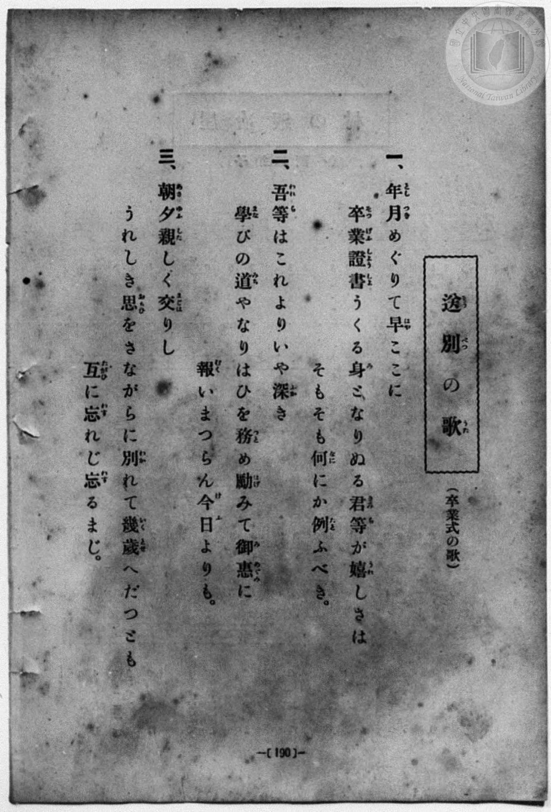
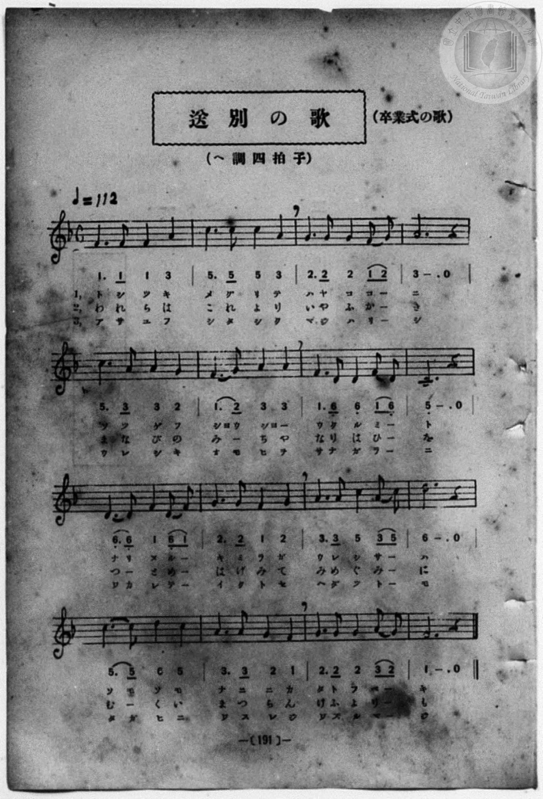

# 送別の歌（卒業式の歌）

> Re:Shōka 使用 AI 協助辨識與重建樂譜，可能會有錯誤。歡迎回報。

- **NEUTRINO 歌聲合成版**：<br><audio controls src="sobetsu_no_uta_neutrino.mp3"></audio>
- **鋼琴伴奏版**：<br><audio controls src="sobetsu_no_uta.mp3"></audio>


- book: 新編 小學校・公學校 唱歌教材集（尋常科三・四學年用）
- 一條慎三郎 編《新編 小學校・公學校 唱歌教材集》（大正十二年十二月，索書號 0725-41）

## 說明

> [!NOTE]
> **原書資訊與歌詞全文**（對應 `P198.jpg`–`P199.jpg`，原書 p. 190–191，尋常科三・四學年第 35 首）：
> - **曲名與副題**：送別の歌（卒業式の歌）
> - **調性與拍號**：ヘ調四拍子（F 大調 4/4 拍），速度 ♩= 112
> - **曲目辨析**：本曲並非《小學唱歌集》／《公學校唱歌集》第六學年之〈卒業の歌〉（うれし、うれしや…），而係「年月めぐりて早ここに…」之畢業式送別歌（全 16 小節）。
>
> **一、**
> 年月（としつき）めぐりて早（はや）ここに
> 卒業證書（そつげふしようしよ）うくる身（み）となりぬる君等（きみら）が嬉（うれ）しさは
> そもそも何（なに）にか例（たと）ふべき。
>
> **二、**
> 吾等（われら）はこれよりいや深（ふか）き
> 學（まな）びの道（みち）やなりはひを務（つと）め勵（はげ）みて御惠（みめぐみ）に
> 報（むく）いまつらん今日（けふ）よりも。
>
> **三、**
> 朝夕（あさゆふ）親（した）しく交（まじは）りし
> うれしき思（おもひ）をさながらに別（わか）れて幾歲（いくとせ）へだつとも
> 互（たがひ）に忘（わす）れじ忘（わす）るまじ。


## 歌詞

```text
（TMD 檔案未包含歌詞註解）
```

## ABC

```abc
X:1
T:送別の歌（卒業式の歌）
M:4/4
L:1/16
Q:1/4=112
K:F
V:V1 name="Piano" snm="Pia"
[V:V1]
F6 F2 F4 A4 | c6 c2 c4 A4 | G6 G2 G4 F2 G2 | A12 z4 |
w: 1.~と し つ き | め ぐ り て | は や こ こ _ | に
w: 2.~わ れ ら は | こ れ よ り | い や ふ か _ | き
w: 3.~あ さ ゆ ふ | し た し く | ま じ は り _ | し
c6 A2 A4 G4 | F6 G2 A4 A4 | F6 D2 D4 F2 D2 | C12 z4 |
w: 1.~そ つ げ ふ | しよ う しよ _ | う く る み _ | と
w: 2.~ま な び の | み _ ち や | な り は ひ _ | を
w: 3.~う れ し き | お も ひ を | さ な が ら _ | に
D6 D2 F4 D2 F2 | G6 G2 F4 G4 | A6 A2 c4 A2 c2 | d12 z4 |
w: 1.~な り ぬ る _ | き み ら が | う れ し さ _ | は
w: 2.~つ _ と め _ | は げ み て | み め ぐ み _ | に
w: 3.~わ か れ て _ | い く と せ | へ だ つ と _ | も
c6 c2 d4 c4 | A6 A2 G4 F4 | G6 G2 G4 A2 G2 | F12 z4 |
w: 1.~そ も そ も | な に に か | た と ふ べ _ | き
w: 2.~む _ く い | ま つ ら ん | け ふ よ り _ | も
w: 3.~た が ひ に | わ す れ じ | わ す る ま _ | じ
F6 F2 F4 A4 | c6 c2 c4 A4 | G6 G2 G4 F2 G2 | A12 z4 |
w: 1.~と し つ き | め ぐ り て | は や こ こ _ | に
w: 2.~わ れ ら は | こ れ よ り | い や ふ か _ | き
w: 3.~あ さ ゆ ふ | し た し く | ま じ は り _ | し
c6 A2 A4 G4 | F6 G2 A4 A4 | F6 D2 D4 F2 D2 | C12 z4 |
w: 1.~そ つ げ ふ | しよ う しよ _ | う く る み _ | と
w: 2.~ま な び の | み _ ち や | な り は ひ _ | を
w: 3.~う れ し き | お も ひ を | さ な が ら _ | に
D6 D2 F4 D2 F2 | G6 G2 F4 G4 | A6 A2 c4 A2 c2 | d12 z4 |
w: 1.~な り ぬ る _ | き み ら が | う れ し さ _ | は
w: 2.~つ _ と め _ | は げ み て | み め ぐ み _ | に
w: 3.~わ か れ て _ | い く と せ | へ だ つ と _ | も
c6 c2 d4 c4 | A6 A2 G4 F4 | G6 G2 G4 A2 G2 | F12 z4 |
w: 1.~そ も そ も | な に に か | た と ふ べ _ | き
w: 2.~む _ く い | ま つ ら ん | け ふ よ り _ | も
w: 3.~た が ひ に | わ す れ じ | わ す る ま _ | じ
```

## TMD 檔案連結

- [主旋律 TMD 檔案](sobetsu_no_uta.tmd) [[在 TMD Studio 編輯](https://tmdlang.github.io/Tmd-TS/#tmd=s7IKdvYPcrWy4qpTUCpJTLdSSM7PyUlNLsnMz7MqzsjPTozPrsyvSsyML84ojTe0NDJWgqssy88pzU21Si9KTEmNN443QcgU55cWJadaFSdn5OfnxJekVpQk5edno8vHFySmp1oFGFpaIGQKivLLUvMS84C6C4oy80pSU8DaEQpSyzJTUkHSxcmJefFlqUWZaZmpKUiOSi0qBrsdYkVJUWJecXJRZgHIQwhV-UUlGflAhxdkVFplZBaX5BdlJifmxGcn5iUiFJVkpAK9B_VETmZaKrpUcmpRam5-XmZiDrLJmemZeValeSBnlkAdp6Wl8LKh8WnH0seN656t7Xm_p-Np76RnS9c-3dMPE-lU0NLiUrRVMDQ04rK3VXDjsjHRN7EDGQsKOiuFZ9M2PN--QuHphv6na3c8W7DwcfPup61rIGyFp1M2Ag15NnXms7kTXs5uA5m_ofvpjh3Pl098sqMTpHT2bKDSpzu3PJ-yAmgX2LlPdjQ8WzT3WWsfUMnL5j4FoPGPG7pIsedxQzfIqiXLn61d_LS38cmuHqANEMazOR3v9_Q837Lo2ewdL2bOVzAwNzLVNTEE282lr6VgSy3ApaCgYKcQrejnH-IaC-FoaT3tmw-yd3P7ixVdLzragW5-sXLe09YVz6a1a2mBQ6f3WXunQgIo7ellFaQnPGqYDOJYgjlAh0MMUCjQUzC0NABKGloCnd6DM1DXrFEwNlV4uWwa0H_v98yCOEMX6JBnszc9ndALdMLTzvUvF_aALJ9FMCUgtL9Ytf9Zw3KQD7p7gaEI1v64eQZQGGg3UOzp2glAE9wUgFEAFFMAphgFoCjYET0vG-Y_3bVM4dHMlZBEheym57PXvdi34tm8CWATn81ZAxR7smPZy7nzgCkAEvWQqIZFcj9IHJYMkKWAXn_auhYSDE92dj9ugPoH4pnHDUCXdDxubHvc1PO4cfrjhkYEu6nlUcMyiFNfNPQ82d_0uAGUfIAJ53ETUNmEx01djxuXPZu-8nHjZDBaDVT_uKEXaMvzqYsgQQYJSmg4tq5QMDQDJdzn6xuA5j5uaAL7GZYmgMkdaD8wk4H5EJvAjlsBck3jkseNoIBDsxusYD3QrSApmDugJoD9-WJtJzChgJXNBRsy6XHjVrD3wN4GM8B6gez-x03dL3atBiveDxYEWr0KbNcaoNTTCbOfr4WEVy9QweMmIBuopufpGkQggkWArp0KdBXEGSB7m5og5JO9U8EqVwEdCVa5-nFj95N9oEz6uHE-0DqwINB5O0FWoIfPLmB0IcJnwj6oY5qAzu6BOWY9KARAXKA40NktwJB5tn0j2HygsUCLgGp6oSashQTLPqB7wOKbgWniZeNkiPcfNy4Eh3YLLASAJm963DTpafdMsAJgSIJd29T4tHsrNBYaJ4HNAepd9nTfwmfNC6BGQaIMGqSw2FkAdlVTAzDYweJAi4AuWQL0yOOmyU92dz2bvhSsfSLQ5WCLwD4ChiRGsgGmJHiwPJsz9-kSSCADw3zq4yZgtIK0v1gG9CNQEBg182Fx1P9k1xJYCMwAuh9sC9Cn02ERB8sJjb3PGuaCVYId0LgJrBKYkICxDIxKUOAD_QVM6NDogIQzSO-ypzv3PVsLVA_UC_QgUAqYomaDHbDjceMCSDACzYTY-GQXMAAhKQGoF2wL0Nj9M2DGAkMeYuwMDMFuqC8ggUN5qQ0FClr6XFzB-UmpJcWlfvmhJYlWAZmJefkONQY11SCLFGwstMAxoYCtylAAFj7AXP1iYY-Chgk04-sowIpxTSwagNaBDKtRMASWhLpAEkQbA3GNgilYxBRMQ0SMwCJGYNoQSNaAxWHQAKQGbJqPYQ0wMleARYHRCcRLwKxesCnA1AmVmQBkd4FZyyAyjeshMk0tQPZksAyIBMmsRrIpHmGTEci8fqiuHiDuBOsCmQPSBdINk-kAs0D2gWRakGzaCtbTDZUBuRKLTcYguSaoy6cCdbaBWSC9IJnpUJn5UDYw7UFl9kFlZkDdhXADRA-yTfhjdlcPOTELiUdjcFyBYg4W10ZgEUjMQkTM4kEIFLdACqgRxMYVu3OhvloCxJNQQwIS1CChNmQuRBYUapDQAeYhMGs_VAaSXrDGMDwMVwHxZjBrHVQXSDdEbiE4bEHxChJfBREFhjU01Bs3QWSaQK7FFb9Q14HSCzQWoWm2ERRnIJkmqEkQc0AyU5Hc1gOWAaVB7GmWQM7tJCd-wVEGjjxQLIIpRFYFCUEiHZJVjaHZ2RSkEcl56NGLHHxrwCzU7AEKeFhmA3kae-CBggaRrbFHLahogJgISgCQwgGpKAAmLkgkIwoJSJSDVIKKEOQkhKOQAEUtrJAAZnOQC5HNgxYFoCQJcUPjbKjMDqjMAqg7IfIg0yAFAdFRC2yckp91TcExBWIjYhFSBKMXyiBxWGbGm23ByRjEhvgEKcaBYQgJR0SBOB8eP7CicidUBpIWsMZrUwNUHFIQQkIZOSsDCw5I-mmCFfEToTJb0QtrLKGNyLIw14FSHThjgl2PHOMz4TE-A4sMpBACuQpkGkgFqk21XFy6dgrIVbICFr4yFwA)]
- [鋼琴伴奏 TMD 檔案](sobetsu_no_uta_piano.tmd) [[在 TMD Studio 編輯](https://tmdlang.github.io/Tmd-TS/#tmd=s7IKdvYPcrWy4qpTUCpJTLdSSM7PyUlNLsnMz7MqzsjPTozPrsyvSsyML84ojTe0NDJWgqssy88pzU21Si9KTEmNN443QcgU55cWJadaFSdn5OfnxJekVpQk5edno8vHFySmp1oFGFpaIGQKivLLUvMS84C6C4oy80pSU8DaEQpSyzJTUkHSxcmJefFlqUWZaZmpKUiOSi0qBrsdYkVJUWJecXJRZgHIQwhV-UUlGflAhxdkVFplZBaX5BdlJifmxGcn5iUqcWlpKbxsaHzasfRx47pna3ve7-l4OXvms87ul917nk_Y8mTPlqdL-9_v6VTQ0uJStFUwNDTisrdVcOOyMdE3sQPZAPKrlcKzaRueb1-h8HRD_9O1O54tWPi4effT1jUQtsLTKRuBJj-bOvPZ3AkvZ7cBrXi6ofvpjh3Pl098sqMTpHT2bKDSpzu3PJ-yAmgX2OVPdjQ8WzT3WWsfUMnL5j4FoPGPG7pIsedxQzfIqiXLn61d_LS38cmuHqANEMazOR3v9_Q837Lo2ewdL2bOVzAwNzLVNTEE280VnJ-UWlJc6pcfWpJoFZCZmJcf5OFQY1BTzaUABDYWWnZghr6Wgi06UHi-Zg3Q4S8W9ihomIBc-Xx9g44CMNIt9bIK0jWxaNDSBxtWo2CooAuEhmDaGIhrFEzBIqZgGiJiBBYxAtOGQLIGLA6DBiA1YNN8DGsUHjeuAIs-bpwOxEvArF6wKY-bGqEyE4DsLjBrGUSmcT1EpqkFyJ4MlgGRIJnVSDbFI2wyApnXD9XVA8SdYF0gc0C6QLphMh1gFsg-kEwLkk1bwXq6oTIgV2KxyRgk1wR1-VSgzjYwC6QXJDMdKjMfyn7cCHIVSGYfVGYG1F0IN0D0INuEP2Z39ZATs5B4NAbHFSjmYHFtBBaBxCxExCwehEBxC6SAGkFsXLE7F-qrJUA8CTUkIEENEmpD5kJkQaEGCZ3HTaAQf9y4HyoDSS9YYxgehquAeDOYtQ6qC6QbIrcQHLageAWJr4KIAsMaGuqNmyAyTSDX4opfqOtA6QUai9A02wiKM5BME9QkiDkgmalIbusBy4DSIPY0SyDndpITv-AoA0ceKBbBFCKrgoQgkQ7JqsbQ7GwK0ojkPPToRQ6-NWAWavYABTwss4E8jT3wQEGDyNbYoxZUNEBMBCUASOGAVBQAExckkhGFBCTKQSpBRQhyEsJRSICiFlZIALM5yIXI5kGLAlCShLihcTZUZgdUZgHUnRB5kGmQgoDoqAXWMORnXVNwTIHYiFiEFMHohTJIHJaZ8WZbcDIGsSE-QYpxYBhCwhFRIM6Hxw-sqNwJlYGkBazx2tQAFYcUhJBQRs7KwIIDkn6aYEX8RKjMVvTCGktoI7IszHWgVAfOmGDXI8f4THiMz8AiAymEQK4CmQZSgWpTLbYa2Qe5RjZB1MjPdq1-uWzFi76ul-29T3Z2P5-66NnStU9bdzxftg6YBJ519z5dOwHSpkGqeeMVog1jYRQm3zQeyDKNj0UwkNUYQAMDLoZVFcQkM5CUWXxurIIRiGUEVoRiPMI0hFoEi5BbILaYABkmsSAKw21QKTifeKNBRgFjQtdOATkyon2AshhiRljEjMFiylwA)]

## 分析

```text
================================================================================
📊 TMD Song Profile: [ 送別の歌（卒業式の歌） ]
================================================================================
⏱  Duration:       1:08 (68.6s), 32 measures total
🎼 Key & Tempo:    首調基準 F, != 112.0 BPM, <4/4>
   - 分析範圍：      由實際發聲的音符與和弦推測調性；播放脈絡另行呈現
🎤 人聲音域:    C4 (MIDI 60) – D5 (MIDI 74) [跨度: 14 個半音 / 1.2 個八度, 難度: moderate]
   - 最低音:  C4 in [SobetsuNoUta #1 @ m.8, 0:15]
   - 最高音: D5 in [SobetsuNoUta #1 @ m.12, 0:23]
   - 適合: soprano, mezzo-soprano, contralto, tenor, baritone, bass
🏛  結構:      SobetsuNoUta (34.3s) -> SobetsuNoUta (34.3s)
⚡ 編曲密度:        Peak 1 軌道同時演奏
🗝  調性診斷：       F 大調（純淨自然大調，未偵測到可信轉調）
   - 風格氣質:    純淨自然大調（陽光明朗、易唱易記，無明顯調外色彩）
   - 轉調歷程:    全曲維持單一推測調性（未偵測到可信轉調）
   - 核心骨幹音:  F, A, G, C, D
   - 調性數值:    F 大調 [相關度: 0.80, 穩定度: Moderate, 自然音純度: 100.0%]
   - 候選調性 (K-S): F 大調 (0.80), C 大調 (0.73), A 小調 (0.63)
   - 五度圈歷程:   -1 -> -1
   - 各段落調性細節:
     • [SobetsuNoUta #1]: F 大調 (r: 0.80, 自然音純度: 100.0%)
     • [SobetsuNoUta #2]: F 大調 (r: 0.80, 自然音純度: 100.0%)

  [ 五度圈游移軌跡 ]
               C  
        [F ]*          G  
      Bb               D  
      Eb               A  
         Ab           E  
            Db       B  
               F# 
     (* = active key center)

  [ 十二半音累積音高分佈 ]
     C  : █████████████████████     20.0%
     C# :                            0.0%
     D  : ███████████████           14.2%
     D# :                            0.0%
     E  :                            0.0%
     F  : ████████████████████████  22.5%
     F# :                            0.0%
     G  : ██████████████████████    20.8%
     G# :                            0.0%
     A  : ████████████████████████  22.5%
     A# :                            0.0%
     B  :                            0.0%
--------------------------------------------------------------------------------
Assignment 軌道音域：
  - Piano         : C4 – D5 (14 個半音 / 1.2 個八度, 114 個音符)
================================================================================
```


## 原書掃描頁






