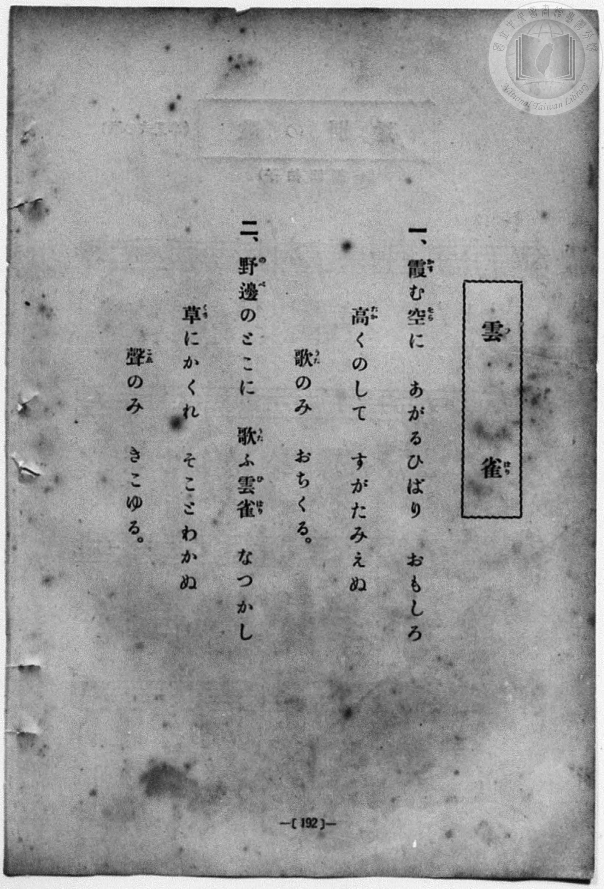
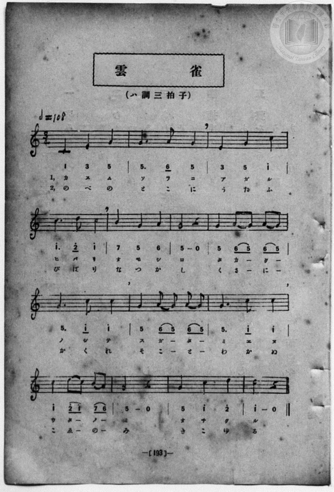

# 雲雀

> Re:Shōka 使用 AI 協助辨識與重建樂譜，可能會有錯誤。歡迎回報。

- **NEUTRINO 歌聲合成版**：<br><audio controls src="hibari_neutrino.mp3"></audio>
- **鋼琴伴奏版**：<br><audio controls src="hibari.mp3"></audio>


- 詞：桑田春風
- 曲：德國曲（Alle Vögel sind schon da 變體）
- book: 新編 小學校・公學校 唱歌教材集（尋常科三・四學年用）
- 一條慎三郎 編《新編 小學校・公學校 唱歌教材集》（大正十二年十二月，索書號 0725-41）

## 說明

> [!NOTE]
> **原書資訊與歌詞全文**（對應 `P200.jpg`–`P201.jpg`，原書 p. 192–193，尋常科三・四學年第 36 首）：
> - **調性與拍號**：ハ調三拍子（C 大調 3/4 拍），速度 ♩= 108
> - **版面校勘**：本集（`P201.jpg`）五線譜與簡譜一致，旋律為 `1 3 5 | 5. 6 5 | 3 5 1^ | 1^. 2^ 1^ | 7 5 6 | 5 - 0 | 5 65 65 | 5. 1^ 1^ | 5 65 65 | 5. 1^ 1^ | 1^ 2^1^ 76 | 5 - 0 | 5 1^ 2^ | 1^ - 0`（全 14 小節）。
>
> **一、**
> 霞（かす）む空（そら）に　あがるひばり　おもしろ
> 高（たか）くのして　すがたみえぬ
> 歌（うた）のみ　おちくる。
>
> **二、**
> 野邊（のべ）のとこに　歌（うた）ふ雲雀（ひばり）　なつかし
> 草（くさ）にかくれ　そことわかぬ
> 聲（こゑ）のみ　きこゆる。


## 歌詞

```text
（TMD 檔案未包含歌詞註解）
```

## ABC

```abc
X:1
T:雲雀
C:曲：德國曲（Alle Vögel sind schon da 變體）
M:3/4
L:1/16
Q:1/4=108
K:C
V:V1 name="Piano" snm="Pia"
[V:V1]
C4 E4 G4 | G6 A2 G4 | E4 G4 c4 | c6 d2 c4 |
w: 1.~か す む | そ ら に | あ が る | ひ ば り
w: 2.~の べ の | と こ に | う た ふ | ひ ば り
B4 G4 A4 | G8 z4 | G4 A2 G2 A2 G2 | G6 c2 c4 |
w: 1.~お も し | ろ | た か _ く _ | の し て
w: 2.~な つ か | し | く さ _ に _ | か く れ
G4 A2 G2 A2 G2 | G6 c2 c4 | c4 d2 c2 B2 A2 | G8 z4 |
w: 1.~す が _ た _ | み え ぬ | う た _ の _ | み
w: 2.~そ こ _ と _ | わ か ぬ | こ ゑ _ の _ | み
G4 c4 d4 | c8 z4 | C4 E4 G4 | G6 A2 G4 |
w: 1.~お ち く | る | か す む | そ ら に
w: 2.~き こ ゆ | る | の べ の | と こ に
E4 G4 c4 | c6 d2 c4 | B4 G4 A4 | G8 z4 |
w: 1.~あ が る | ひ ば り | お も し | ろ
w: 2.~う た ふ | ひ ば り | な つ か | し
G4 A2 G2 A2 G2 | G6 c2 c4 | G4 A2 G2 A2 G2 | G6 c2 c4 |
w: 1.~た か _ く _ | の し て | す が _ た _ | み え ぬ
w: 2.~く さ _ に _ | か く れ | そ こ _ と _ | わ か ぬ
c4 d2 c2 B2 A2 | G8 z4 | G4 c4 d4 | c8 z4 |
w: 1.~う た _ の _ | み | お ち く | る
w: 2.~こ ゑ _ の _ | み | き こ ゆ | る
```

## TMD 檔案連結

- [主旋律 TMD 檔案](hibari.tmd) [[在 TMD Studio 編輯](https://tmdlang.github.io/Tmd-TS/#tmd=s7IKdvYPcrWy4qpTUCpJTLdSSM7PyUlNLsnMz7MqzsjPTozPrsyvSsyML84ojTe0NDJWgqssy88pzU21Si9KTEmNN443QcgU55cWJadaFSdn5OfnxJekVpQk5edno8vHFySmp1oFGBkYIGQKivLLUvMS84C6C4oy80pSU8DaEQpSyzJTUkHSxcmJefFlqUWZaZmpKUiOSi0qBrsdYkVJUWJecXJRZgHIQwhV-UUlGflAhxdkVFplZBaX5BdlJifmxGcn5iUiFJVkpAK9l5iXmZuYg6w1Mz0zzyo3Py-pFBhAGBIliZlAYWBw5ZcnxucmZublJOYB3aelpfBy9qaXsxsUtLS4FG0VDA0suOxtFZy5bIz1TexAhoCCyErh2bQNz7evUHi6of_p2h3PFix83Lz7aesaCFvh6ZSNz9b2PJs689ncCS9nt73f0_F0Q_fTHTueL5_4ZEcnSOns2UClT3dueT5lxfs9nWDHPdnR8GzR3GetfUAlL5v7FIDGP27oIsWexw3dIKuWLH-2dvHT3sYnu3qANkAYz-Z0vN_T83zLomezd7yYOV_BwNzIVNfEEGb3i5Xz3u-Z9WzhxOdTNjybsfTlohVg4WezNwGFn-7b_nRON5jd4QhMdAphh7elp-YoFGfmpSiA0k6eQkqiwot1XS9XTwEbyKWvpWBLLcCloKBgpxCt6Ocf4hoL4WhpPe2bD_LI5vYXK7pedLQDAwHog6etK55Na9fSAgd377P2ToUEUKLVyypIT3jUMBnEMQRzgCEBMUChQE8BmFeAkoaWxiBRXLG0Zo2CsZnCy2XTgP4DhgjEGbpAh7xYtf9Zw3KQE7p7geEKsnzW4-Z-oDDQCKDY07UTgM5xVgBGClBMAZiGFICiYFN6XjbMf7prmcKjmSshyQxu6PPOjpdzFwEj-Gn3DLCJz-asgSQjZD90Ptk15fn2WS_WzgFa_3zDQiADmIRetG8BGv1sevfTfd3Pm3YpJBgqGCuYKtQomOopmIEZIK5hHJBhGKenYBQHYZsDBc1AqoAOMADTZmAE1gdUAVaEVRBIGMUBCXNU7WBhiDRQCOjcDmD0KBiagFLy8_UNQOc_bmgCexkWp0DHP25oBOY6MP_lHGCK7Hjc2P24cSZIcVPD85W7wCJzHzcBQ6_zcePqxw0NjxubHjf2PG4CKtv0uHHD46YusGDX4yag-PTHTb1Q01bPAOudDzQQrLf_ceM6kILGZWD1M0GGgGT3P24EKlsD0QVMVmBdbUApsC6glv1Q8xsXggwB2ovui109yL5o73vZ1AU2BKh3J8yQFY8bJ0Pcj2HFVkjpAxaE-ggcVkBLVz1uXAIOkOkQw1_0AsMBqAzol6nQAAHJAl0FdAJQ_VywLSseNwEVAMWhnnrRCMrHIKmmiaie6gULtiE8RXnmhQIFLX0uLo_MpMSiTKuAzMS8fIcag5pqkBUKNhZa4LBTwFZmKAAzHihNL-xR0DCGphwdBVge0MSiAWgRyDBgugMmO2MgBqVISLrUBad_EA8mDk6bNWANPoY1CsBQAvKBiQFENjWAlQJDEawVmOaA7NVQsSawuh6wOEgP1AwjkNw6sNxOMAlig8RWQMxonIxkRhtYZD6Y3Ao2A38w7OoBBwMsAxEbDCAv6kKzOchic6jfzZDCBZRnYTxQGIHLCaRg2QR1_gagd7ugzgfRwEwGFp8OEWvqhZoWD1UD8RwkUPvRggmbmavAIkvgukBiILORzQSZA0zvYBIclASCbUcnOakHEi6QIg4jZNBlkUIKFOGQEAGWLFAXg5MTJLGAQwQkth-qrgOI16CFDMjnkBADZmSoelAiBCUfEAlKTKDQBoUEJKRgZuANCWBlRnYCgiQfc3gNgZpkYEpAfGh6g0ojhQxycodlC0goIOIWnKYaFyLSCzR7wdUghRI4LJom4jUPlB5hKkH2Y5pXy8Wla6cAKZkUUFjKXAA)]
- [鋼琴伴奏 TMD 檔案](hibari_piano.tmd) [[在 TMD Studio 編輯](https://tmdlang.github.io/Tmd-TS/#tmd=s7IKdvYPcrWy4qpTUCpJTLdSSM7PyUlNLsnMz7MqzsjPTozPrsyvSsyML84ojTe0NDJWgqssy88pzU21Si9KTEmNN443QcgU55cWJadaFSdn5OfnxJekVpQk5edno8vHFySmp1oFGBkYIGQKivLLUvMS84C6C4oy80pSU8DaEQpSyzJTUkHSxcmJefFlqUWZaZmpKUiOSi0qBrsdYkVJUWJecXJRZgHIQwhV-UUlGflAhxdkVFplZBaX5BdlJifmxGcn5iUqcWlpKbycvenl7Ib3ezpezp75rLP7Zfee5xO2PNmz5enS_vd7OhW0tLgUbRUMDSy47G0VnLlsjPVN7EBmg3xppfBs2obn21coPN3Q_3TtjmcLFj5u3v20dQ2ErfB0ysZna3ueTZ35bO6El7PbgFY83dD9dMeO58snPtnRCVI6ezZQ6dOdW55PWQG0C-zmJzsani2a-6y1D6jkZXOfAtD4xw1dpNjzuKEbZNWS5c_WLn7a2_hkVw_QBgjj2ZyO93t6nm9Z9Gz2jhcz5ysYmBuZ6poYwux-sXLe-z2zni2c-HzKhmczlr5ctAIs_Gz2JqDw033bn87pBrM7HIHpRiHs8Lb01ByF4sy8FAVQ9OcppCQqvFjX9XL1FLCBXB6ZSYlFmVYBmYl5-UEeDjUGNdVcCkBgY6FlB2boaynYogOF52vWAMPgxcIeBQ1jkIefr2_QUQCmHEO9rIJ0TSwatPTBhtUoGCroKhgDsSkQ14BJXQUzKA8mbhgH4oI1-BjWKDxu7AbyHzfOBJFNDWCljxvngrU-buoEsldDxZrA6nrA4iA9UDOMQHLrwHI7wSSIDRJbATGjcTKSGW1gkflgcivYDPzBsKsHHAwmJAYDyIu6CkZxUM8qmEP9boYULroKBnAeKIxAGDlYNkGdvwHo3S6o80H04yZIQEyHiDX1Qk2Lh6qBeA4SqP1owYTNzFVgkSVwXSAxkNnIZoLMedw4FUyCg5JAsO3oJCf1QMIFGGTQUEMJGXRZpJACRTgkRB43LoO6GJycIIkFHCIgsf1QdR1AvAYtZEA-h4TY4yaQLlgiBCUfEAlKTKDQBoUEJKRgZuANCWD5QnYCgiQfc6D3sSUZmBIQH5reoNJIIYOc3GHZAhIKiLgFp6nGhYj0As1ecDVIoQQOi6aJeM0DpUeYSpD9mObVohZMPsgFkwmiYHrasur5vr6ncya_6JgHLPSAZeGzBXuASetZd-_TtROebl8GrCtgtUTPs_7-5ztXAYvM5yt3QeqTl6tnvFw8--nUPS83b3mys_vZzPVI4RuvEG0YC8YQjgkyByaDTbFpPJBnGg_kmgAJuKQBihSIIKAbrASfbUAX4TMdSQoUnrp2CpAgjfYBCiLxjMA8ZS4A)]

## 分析

```text
================================================================================
📊 TMD Song Profile: [ 雲雀 ]
================================================================================
⏱  Duration:       0:46 (46.7s), 28 measures total
🎼 Key & Tempo:    首調基準 C, != 108.0 BPM, <3/4>
   - 分析範圍：      由實際發聲的音符與和弦推測調性；播放脈絡另行呈現
🎤 人聲音域:    C4 (MIDI 60) – D5 (MIDI 74) [跨度: 14 個半音 / 1.2 個八度, 難度: moderate]
   - 最低音:  C4 in [Hibari #1 @ m.1, 0:00]
   - 最高音: D5 in [Hibari #1 @ m.4, 0:05]
   - 適合: soprano, mezzo-soprano, contralto, tenor, baritone, bass
🏛  結構:      Hibari (23.3s) -> Hibari (23.3s)
⚡ 編曲密度:        Peak 1 軌道同時演奏
🗝  調性診斷：       C 大調（純淨自然大調，未偵測到可信轉調）
   - 風格氣質:    純淨自然大調（陽光明朗、易唱易記，無明顯調外色彩）
   - 轉調歷程:    全曲維持單一推測調性（未偵測到可信轉調）
   - 核心骨幹音:  G, C, A, D, E
   - 調性數值:    C 大調 [相關度: 0.81, 穩定度: Moderate, 自然音純度: 100.0%]
   - 候選調性 (K-S): C 大調 (0.81), G 大調 (0.76), C 小調 (0.56)
   - 五度圈歷程:   +0 -> +0
   - 各段落調性細節:
     • [Hibari #1]: C 大調 (r: 0.81, 自然音純度: 100.0%)
     • [Hibari #2]: C 大調 (r: 0.81, 自然音純度: 100.0%)

  [ 五度圈游移軌跡 ]
              [C ]*
         F            G  
      Bb               D  
      Eb               A  
         Ab           E  
            Db       B  
               F# 
     (* = active key center)

  [ 十二半音累積音高分佈 ]
     C  : ████████████████          30.8%
     C# :                            0.0%
     D  : ███                        5.1%
     D# :                            0.0%
     E  : ███                        5.1%
     F  :                            0.0%
     F# :                            0.0%
     G  : ████████████████████████  44.9%
     G# :                            0.0%
     A  : █████                     10.3%
     A# :                            0.0%
     B  : ██                         3.8%
--------------------------------------------------------------------------------
Assignment 軌道音域：
  - Piano         : C4 – D5 (14 個半音 / 1.2 個八度, 84 個音符)
================================================================================
```


## 原書掃描頁






