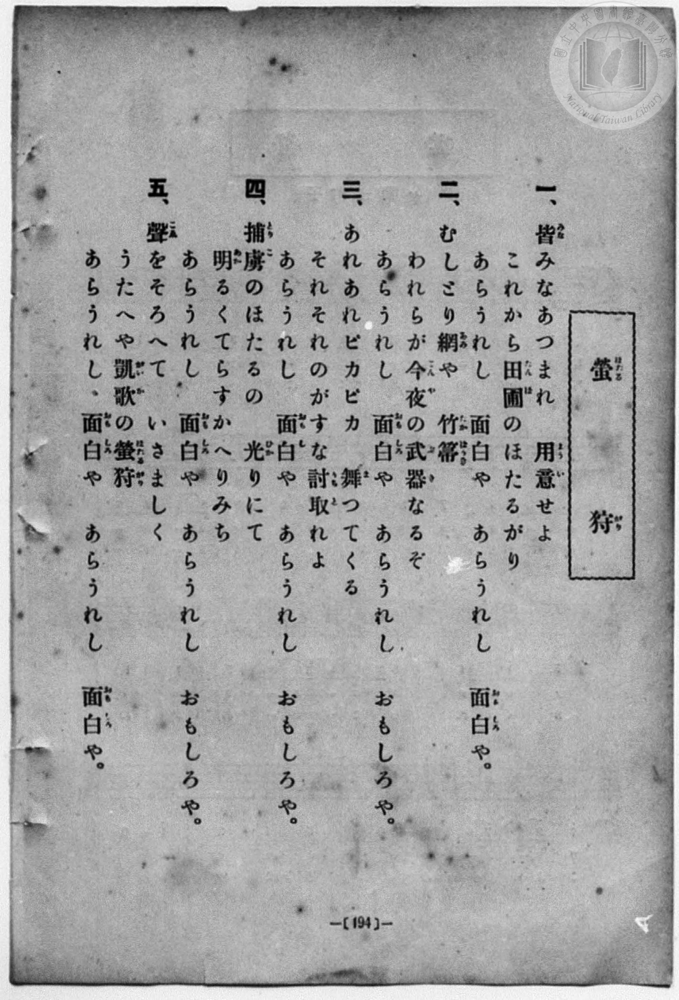
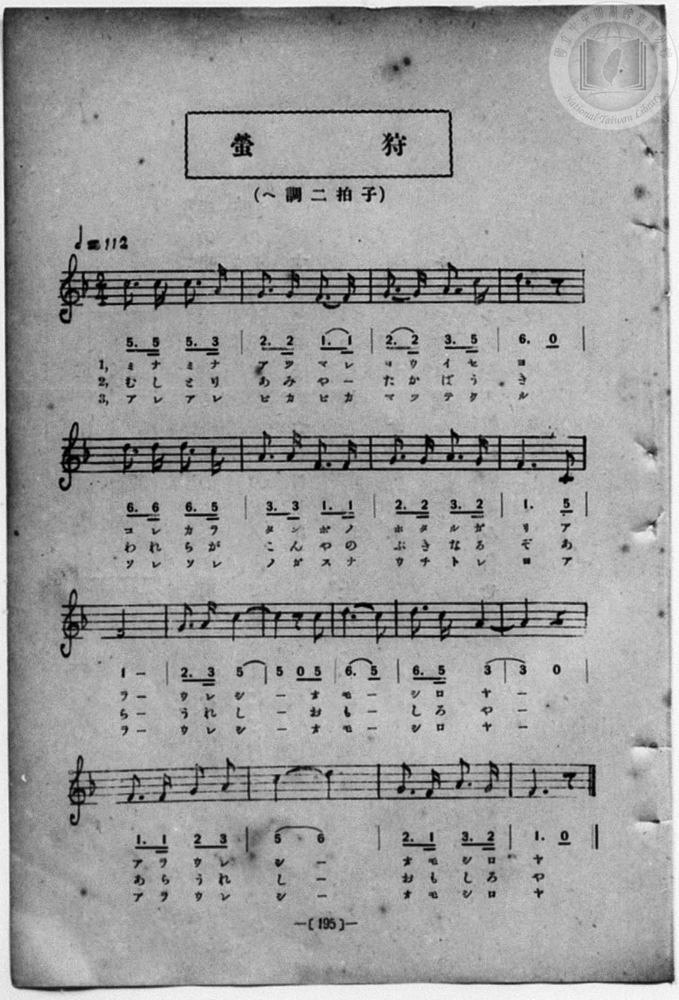

# 螢狩

> Re:Shōka 使用 AI 協助辨識與重建樂譜，可能會有錯誤。歡迎回報。

<audio controls src="hotarugari.mp3"></audio>

- book: 新編 小學校・公學校 唱歌教材集（尋常科三・四學年用）
- 一條慎三郎 編《新編 小學校・公學校 唱歌教材集》（大正十二年十二月，索書號 0725-41）
- 對照：唱歌帖 P221（195頁 / 昭2.7.28）

## 說明

> [!NOTE]
> **原書資訊與歌詞全文**（對應 `P202.jpg`–`P203.jpg`，原書 p. 194–195，尋常科三・四學年第 37 首）：
> - **調性與拍號**：ヘ調二拍子（F 大調 2/4 拍），速度 ♩= 112
> - **與《唱歌帖》P221（`docs/shokacho/vol_10/p221_hotarugari`）比較校勘**：
>   1. 《唱歌帖》P221 頁邊註記「195頁」，即對應本集第 195 頁（`P203.jpg`）。
>   2. 本集（`P202.jpg`–`P203.jpg`）第一段首句為「皆みなあつまれ　用意せよ」（`ヨ ウ イ セ | ヨ`），而《唱歌帖》手抄作「ヨウイハ ヨキカ」；第三段首句本集為「あれあれピカピカ　舞つてくる」（`マ ツ テ ク ル`），《唱歌帖》誤抄為「マツラクル」；各段副歌本集均為「あらうれし　面白や」。
>   3. 節奏方面，本集（`P203.jpg`）第 1–3、5–7、17 小節兩拍均為附點八分加十六分音符（如 `5_. 5_ 5_. 3_`），第 8 小節為 `1_. 5_`，第 10–13 小節為 `2. 3 5 | 5 0 0 5 | 6. 5 | 6. 5 3`。均依本集圖檔忠實轉錄。
>
> **一、**
> 皆（みな）みなあつまれ　用意（ようい）せよ
> これから田圃（たんぼ）のほたるがり
> あらうれし　面白（おもしろ）や　あらうれし　面白（おもしろ）や。
>
> **二、**
> むしとり網（あみ）や　竹箒（たかばうき）
> われらが今夜（こんや）の武器（ぶき）なるぞ
> あらうれし　面白（おもしろ）や　あらうれし　おもしろや。
>
> **三、**
> あれあれピカピカ　舞（ま）つてくる
> それぞれのがすな討取（うちと）れよ
> あらうれし　面白（おもしろ）や　あらうれし　おもしろや。
>
> **四、**
> 捕虜（とりこ）のほたるの　光（ひか）りにて
> 明（あか）るくてらすかへりみち
> あらうれし　面白（おもしろ）や　あらうれし　おもしろや。
>
> **五、**
> 聲（こゑ）をそろへて　いさましく
> うたへや凱歌（がいか）の螢狩（ほたるがり）
> あらうれし　面白（おもしろ）や　あらうれし　面白（おもしろ）や。


## 歌詞

```text
（TMD 檔案未包含歌詞註解）
```

## ABC

```abc
X:1
T:螢狩
M:2/4
L:1/16
Q:1/4=112
K:F
V:V1 name="Piano" snm="Pia"
[V:V1]
C3 C C3 A, | G,3 G, F,3 F, | G,3 G, A,3 C | D6 z2 |
w: 1.~み な み な | あ つ ま れ | よ う い せ | よ
w: 2.~む し と り | あ み や _ | た か ば う | き
w: 3.~あ れ あ れ | ピ カ ピ カ | ま っ て く | る
w: 4.~と り こ の | ほ た る の | ひ か り に | て
w: 5.~こ ゑ を そ | ろ へ て _ | い さ ま し | く
D3 D D3 C | A,3 A, F,3 F, | G,3 G, A,3 G, | F,6 C2 |
w: 1.~こ れ か ら | た ん ぼ の | ほ た る が | り あ
w: 2.~わ れ ら が | こ ん や の | ぶ き な る | ぞ あ
w: 3.~そ れ そ れ | の が す な | う ち と れ | よ あ
w: 4.~あ か る く | て ら す _ | か へ り み | ち あ
w: 5.~う た へ や | が い か の | ほ た る が | り あ
F8 | G3 A c4 | c2 z2 z2 c2 | d6 c2 |
w: 1.~ら | う れ し | _ お | も _
w: 2.~ら | う れ し | _ お | も _
w: 3.~ら | う れ し | _ お | も _
w: 4.~ら | う れ し | _ お | も _
w: 5.~ら | う れ し | _ お | も _
d3 c A4 | A4 z4 | F3 F G2 A2 | c4 d4 |
w: 1.~し ろ や | _ | あ ら う れ | し _
w: 2.~し ろ や | _ | あ ら う れ | し _
w: 3.~し ろ や | _ | あ ら う れ | し _
w: 4.~し ろ や | _ | あ ら う れ | し _
w: 5.~し ろ や | _ | あ ら う れ | し _
G3 F A3 G | F6 z2 | C3 C C3 A, | G,3 G, F,3 F, |
w: 1.~お も し ろ | や | み な み な | あ つ ま れ
w: 2.~お も し ろ | や | む し と り | あ み や _
w: 3.~お も し ろ | や | あ れ あ れ | ピ カ ピ カ
w: 4.~お も し ろ | や | と り こ の | ほ た る の
w: 5.~お も し ろ | や | こ ゑ を そ | ろ へ て _
G,3 G, A,3 C | D6 z2 | D3 D D3 C | A,3 A, F,3 F, |
w: 1.~よ う い せ | よ | こ れ か ら | た ん ぼ の
w: 2.~た か ば う | き | わ れ ら が | こ ん や の
w: 3.~ま っ て く | る | そ れ そ れ | の が す な
w: 4.~ひ か り に | て | あ か る く | て ら す _
w: 5.~い さ ま し | く | う た へ や | が い か の
G,3 G, A,3 G, | F,6 C2 | F8 | G3 A c4 |
w: 1.~ほ た る が | り あ | ら | う れ し
w: 2.~ぶ き な る | ぞ あ | ら | う れ し
w: 3.~う ち と れ | よ あ | ら | う れ し
w: 4.~か へ り み | ち あ | ら | う れ し
w: 5.~ほ た る が | り あ | ら | う れ し
c2 z2 z2 c2 | d6 c2 | d3 c A4 | A4 z4 |
w: 1.~_ お | も _ | し ろ や | _
w: 2.~_ お | も _ | し ろ や | _
w: 3.~_ お | も _ | し ろ や | _
w: 4.~_ お | も _ | し ろ や | _
w: 5.~_ お | も _ | し ろ や | _
F3 F G2 A2 | c4 d4 | G3 F A3 G | F6 z2 |
w: 1.~あ ら う れ | し _ | お も し ろ | や
w: 2.~あ ら う れ | し _ | お も し ろ | や
w: 3.~あ ら う れ | し _ | お も し ろ | や
w: 4.~あ ら う れ | し _ | お も し ろ | や
w: 5.~あ ら う れ | し _ | お も し ろ | や
```

## TMD 檔案連結

- [主旋律 TMD 檔案](hotarugari.tmd) [[在 TMD Studio 編輯](https://tmdlang.github.io/Tmd-TS/#tmd=s7IKdvYPcrWy4qpTUCpJTLdSSM7PyUlNLsnMz7MqzsjPTozPrsyvSsyML84ojTe0NDJWgqssy88pzU21Si9KTEmNN443QcgU55cWJadaFSdn5OfnxJekVpQk5edno8vHFySmp1oFGBkYIWQKivLLUvMS84C6C4oy80pSU8DaEQpSyzJTUkHSxcmJefFlqUWZaZmpKUiOSi0qBrsdYkVJUWJecXJRZgHIQwhV-UUlGflAhxdkVFplZBaX5BdlJifmxGcn5iUiFJVkpAK9l5iXmZuYgy5akJNYqcSlpaXwYt6i590rFbS0uBRtFQwNjbjsbRXcuGyM9E3sQFpA_rZSeDZtw_PtKxSebuh_unbHswULHzfvftq6BsJWeDpl47O1Pc-mznw2d8LL2W3v93Q83dD9dMeO58snPtnRCVI6ezZQ6dOdW55PWfF-TyfYKU92NDxbNPdZax9QycvmPgWg8Y8bukix53FDN8iqJcufrV38tLfxya4eoA0QxrM5He_39DzfsujZ7B0vZs5XMDA3MtU1MYTZ_XRD7_PW5e_3zIKY-HTHNIUAIyOgdIehpenLBY0K-grPZqw10jPXM7IA6-HS11KwpRbgUlBQsFOIVvTzD3GNhXC0tJ72zQe5dXP7ixVdLzraga56sXLe09YVz6a1a2mBQ7T3WXunQgIosellFaQnPGqYDOIYgzlAz0IMUCjQUzC0NAFKAn0CEsUVEWvWKBibK7xcNg3oP2BAQJyhC3TIi1X7nzUsBzmhuxcYdCDLZz1ungEUBoVrd-_TtROAznFTAIY7UEwBmEwUgKJgU3peNsx_umuZwqOZKyEpCWFoRzswcuGhDYw5aHgnpOQnF-uDsykwq-kDM2S8oYF-AVAyPiO_JLGoND2xKBPovc5n66e82NMMTAVPu2eA3QQxXEHBUE8Bi9EKwFh82dT1YsXuFytmPG7ogcTr4wagQ3ue9m6GhOazOWuAyQgUFEBpkA6Qg5DCtPNxQxPMGiM9BYhyqBqskdAJNAuUrtdtBQbs0_6lz5t2Ae1-PqvtceP-x42rHjc2PW5c8rhx3-OmnscNDcDM8Kyl_3Hj7MdNHWCXdSQ8bl6h8LhpGRAvAeLdCjUKQBGQwUBnv2gAakLx6LPO7mddLU_2zgFaAlQH1AjU97i5H6TpcdPax02rwcbOBruqE-4qqLfBbgM5CegYCNk8BaQFQjY0vOiYB3btsseN_Y-buuEunAc0vgWI24AuXA-kV0Pdh-a4F6uWAB0HtaV5HlDP4-aVQB1ADRBXPZ3QAnTS0871oDwNdtLTue1Irup83NgGdtt0oGNezl30fObex00tQL1IsWKsp_B8fcPTpf3Ppu0EKgG6AiWSkONFwRAYWcaPGxpNgbQ5kDY0BxUzIO2tK0HpGmz5y5ktL3cD893qpx1tT7sWAEuTp61rgeyX8zc_X7MMlA-XNSkkmMbrKZjGA5GegnE81PsgKyygJgINUkgwBCsCZU2w7QagPGmMrACYpIwVTIFxbKpgAIQglhlQC4wyTgB6FOiqJ_vmQoNnzrRnq6Y83b_g6fplL_Z2vuwBBgYkJGCFCDDtAT0GLMnBfGC6AzoYkvRAiRl3GgQpA6ZBYHg3toBVgpIkxJDHjZPBkdANjJDnUzY8ndMMNnP-46bJjxv3gBWve9y4GyzS_bix53FTF0wj9jgEa-963AR0xvTHTaCCAxyrDSSqR_P4LqBn4B5_3AQ0bfrjRmAm6Hq-bRPYBKD2_XC7nq_e-XzdJKhHgF5r3AD2O8hwmAnAJA_0C9A9PU92dz1dMgesGBgUQAQJonXP1i57OhNYnQHFt0H0goIXFAjzqBUCyMqw-RpYpiP5Gm9WBlu6D-xIRJ6GaZwL1jgPTAJjE0jOBPrlxYq-p_3A-gGSMBYCwxPsVGCwwNMGjT0IrK6QPPisd-qLmZCIAMUsMDowkt86oJlPW4HZEahmEzBmwVYDVa4GehlqyIw-WHqAyAJ1ActgYMkJNAroayB3B1gLMLMspFc87pqC5M0XjZAUC0xpE8FmTgJHUC_IYUB3gkxredw4FZSFQYm8H-ZIYBwBEzPQ8S1P20HFMNgQoAOAisE-bVwHaemBxVEyLCLZ0yHPUt5-ggIFLX0uLg94I8EqIDMxL9-hxqBGoRpkj4KNoZkWOIgVsDXeFCBV9YuFPQoaJtBSWQfYCoTUGZpYNACtAxkGLK7jgW0aXUgFAGYZxwNFjSBsIGUIYQEpZFGgIqguYPkOYUOgARDXgI32MQTW9437waLA_IfCBsk0QXnAtkHjPgi7qQck09QBlQHWyY0tUPZsJBkIBNkKtckIJNcAVTkdiFdAzetCsWk_UARiHlAnkD8fKt4NxBvgdoJkerHbY4xkGtCtyGxQ22YKlLcahQ3SA_Vf42IgXgZl94N91I3dJhOQLoQvgPkHqmsd2LzdUN58uAkwmU0IPwH1QdgQN0DsxbDJFCQHNb1pIhBPguqaC3YfJCSAORHJBJAOWLxMRfLddLBMP4Y9-JPtrh5yki000QEpKAucFKHJEkjhTbZAVg1MBQSC0z5yuoWFCCiWoSHc1ImcapomA9l7CMYKJEVDYgICIakGOeVCQgxsF9AOJH1wVwDtgqZcmF3boLxecH6CqOoGy8zDZRc49c5F8heCDZJZB7cZWHVA2ZCc2gblLURKk8g5FYtd4PQLy3egtAgLD3Cqh-UBoG9hdkFSFUwVMLXBU-9-sMxCXDaB0y_MhcCQB-qFmN0C1tcDlQG28eGmkxNbBIreTnAaNiMtDRsi2QMJASMwDWpHw0RALFCZCsIgNjDlI-lAFgG2seG6YCyQLrAIImVDUxiyrfDwA6eK6XBxEAnKFyAMrAEhapsgsYqqH6IHVFogl7AwFbCMhpzmB9wVoNww8K4A5ZOBdwUoDw2oK_DmLmC7mZwaApK7DMF5CpQfIHkJBGE5CJbfDKH5xQgtT6K3ZWC1PajUAoUMKFyQ_Ynqd2j5BQwX5HAAhRQsJGBhgJQvaG0HSguGRnYgl_20sgNc6tPOjlouLl07BURzXAGDp8wFAA)]
- [鋼琴伴奏 TMD 檔案](hotarugari_piano.tmd) [[在 TMD Studio 編輯](https://tmdlang.github.io/Tmd-TS/#tmd=s7IKdvYPcrWy4qpTUCpJTLdSSM7PyUlNLsnMz7MqzsjPTozPrsyvSsyML84ojTe0NDJWgqssy88pzU21Si9KTEmNN443QcgU55cWJadaFSdn5OfnxJekVpQk5edno8vHFySmp1oFGBkYIWQKivLLUvMS84C6C4oy80pSU8DaEQpSyzJTUkHSxcmJefFlqUWZaZmpKUiOSi0qBrsdYkVJUWJecXJRZgHIQwhV-UUlGflAhxdkVFplZBaX5BdlJifmxGcn5iUqcWlpKbyYt-h598r3ezpezp75rLP7Zfee5xO2PNmz5enS_vd7OhW0tLgUbRUMDY247G0V3LhsjPRN7EBmg3xppfBs2obn21coPN3Q_3TtjmcLFj5u3v20dQ2ErfB0ysZna3ueTZ35bO6El7PbgFY83dD9dMeO58snPtnRCVI6ezZQ6dOdW55PWQG0C-zmJzsani2a-6y1D6jkZXOfAtD4xw1dpNjzuKEbZNWS5c_WLn7a2_hkVw_QBgjj2ZyO93t6nm9Z9Gz2jhcz5ysYmBuZ6poYwux-uqH3eevy93tmQUx8umOaQoCREVC6w9DS9OWCRgV9hWcz1hrpmesZWYD1cHnklyQWlaYnFmVaBWQm5uUHeTjUGNQoVHMpAIGNoZmWHZilr6Vgiw4Unq9ZA_Tsi4U9ChomIJ89X9-gA7TPwFgvqyBdE4sGLX2wYUDjc9NqFUzjFXSBEEhBWcbxQCkjCBtIGUJYQApZFKgIqqtGwQzChkADIK4Bm-9jWKPwuHE_WPRx4yoUNkimCcpbAsT7IOymHpBMUwdUpg2IW6Ds2UgyEAiyFWqTEUiuAapyOhCvgJrXhWLTfqAIxDygTiB_PlS8G4g3wO0EyfRit8cYyTSgW5HZQJnmKVDeahQ2SA_Uf42LgXgZlN0P9lE3dptMQLoQvnjcOBmqax3YvN1Q3ny4CTCZTQg_AfVB2BA3QOzFsMkUJAc1vWkiEE-C6poLdh8kJB437kAyAaQDFi9TkXw3HSzTj2EP_rS7q4ectAtNdEAKygInRWiyBFJ4ky2QVQNTAYHgtI-cbmEhAoplaAg3dSKnmqbJQPYegrECSdGQmIBASKpBTrmQEAPbBbQDSR_cFUC7oCkXZtc2KK8XnJ8gqrrBMvNw2QVOvXOR_IVgg2TWwW1-3DgTyobk1DYobyFSmkTOqVjsAqdfWL4DpUVYeIBTPSwPAH0LswuSqmCqgKkNnnr3g2UW4rIJnH5hLgSGPFAvxOwWsL4eqEwLkunkxBaB8rcTnIbNSEvDhkj2QELACEwbK5jCRUAsUJkKwiA2MOUj6UAWMQXqg-mCsUC6wCKIlA1NYci2wsMPnCqmw8VBJChfgPDjRlCogPRDYhVVP0QPqLRALmFhKmAZDTnND7grQLlh4F0ByicD7wpQHhpQV-DNXcDmHTk1BCR3GYLzFCg_QPISCMJyECy_GULzixFankRvy8Bqe1CpBQoZULgg-xPV79DyCxguyOEACilYSMDCAClf0NoOlBYMjexALvtpZQe41KedHbWYTXIflCa5BbRFDm5GmMaD2xsgCpjIgCQuAXDT2gzIBjJAlAHUOzUKJhAFMDVQzSA14BYMzAwYRrYWYQhYDEqC9CDzwApBEGQX1CqISWhcnAbDxcF8oDMhGgk7DhiYunYKiPCM9jGMVUATMcIQMcYQMcEQMQWLKHMBAA)]

## 分析

```text
================================================================================
📊 TMD Song Profile: [ 螢狩 ]
================================================================================
⏱  Duration:       0:38 (38.6s), 36 measures total
🎼 Key & Tempo:    首調基準 F, != 112.0 BPM, <2/4>
   - 分析範圍：      由實際發聲的音符與和弦推測調性；播放脈絡另行呈現
🎤 人聲音域:    F3 (MIDI 53) – D5 (MIDI 74) [跨度: 21 個半音 / 1.8 個八度, 難度: difficult]
   - 最低音:  F3 in [Hotarugari #1 @ m.2, 0:01]
   - 最高音: D5 in [Hotarugari #1 @ m.12, 0:11]
   - 適合: mezzo-soprano, contralto, tenor, baritone, bass
🏛  結構:      Hotarugari (19.3s) -> Hotarugari (19.3s)
⚡ 編曲密度:        Peak 1 軌道同時演奏
🗝  調性診斷：       F 大調（純淨自然大調，未偵測到可信轉調）
   - 風格氣質:    純淨自然大調（陽光明朗、易唱易記，無明顯調外色彩）
   - 轉調歷程:    全曲維持單一推測調性（未偵測到可信轉調）
   - 核心骨幹音:  F, C, D, A, G
   - 調性數值:    F 大調 [相關度: 0.83, 穩定度: Moderate, 自然音純度: 100.0%]
   - 候選調性 (K-S): F 大調 (0.83), D 小調 (0.74), C 大調 (0.68)
   - 五度圈歷程:   -1 -> -1
   - 各段落調性細節:
     • [Hotarugari #1]: F 大調 (r: 0.83, 自然音純度: 100.0%)
     • [Hotarugari #2]: F 大調 (r: 0.83, 自然音純度: 100.0%)

  [ 五度圈游移軌跡 ]
               C  
        [F ]*          G  
      Bb               D  
      Eb               A  
         Ab           E  
            Db       B  
               F# 
     (* = active key center)

  [ 十二半音累積音高分佈 ]
     C  : ███████████████████       19.7%
     C# :                            0.0%
     D  : ███████████████████       19.7%
     D# :                            0.0%
     E  :                            0.0%
     F  : ████████████████████████  25.0%
     F# :                            0.0%
     G  : ████████████████          16.7%
     G# :                            0.0%
     A  : ██████████████████        18.9%
     A# :                            0.0%
     B  :                            0.0%
--------------------------------------------------------------------------------
Assignment 軌道音域：
  - Piano         : F3 – D5 (21 個半音 / 1.8 個八度, 100 個音符)
================================================================================
```


## 原書掃描頁






