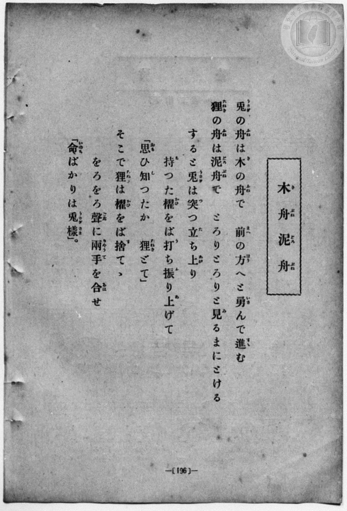
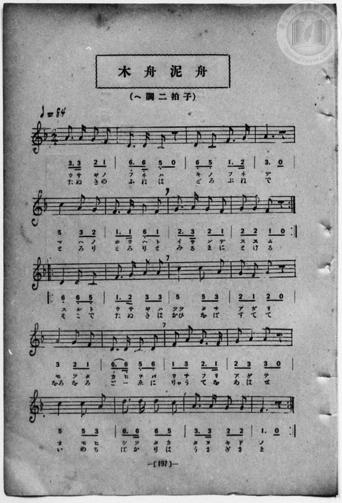

# 木舟泥舟

> Re:Shōka 使用 AI 協助辨識與重建樂譜，可能會有錯誤。歡迎回報。

- **鋼琴伴奏版**：<br><audio controls src="kibune_dorobune.mp3"></audio>
- **NEUTRINO 歌聲合成版**：<br><audio controls src="kibune_dorobune_neutrino.mp3"></audio>

- book: 新編 小學校・公學校 唱歌教材集（尋常科三・四學年用）
- 一條慎三郎 編《新編 小學校・公學校 唱歌教材集》（大正十二年十二月，索書號 0725-41）

## 說明

> [!NOTE]
> **原書資訊與歌詞全文**（對應 `P204.jpg`–`P205.jpg`，原書 p. 196–197，尋常科三・四學年第 38 首）：
> - **調性與拍號**：ヘ調二拍子（F 大調 2/4 拍），速度 ♩= 84
> - **曲式結構**：全曲共 20 小節，分為前後兩段反覆：
>   - 前段（第 1–8 小節，末附反覆記號 `:||`）：雙層歌詞（第一遍片假名唱「兎の舟は…」、第二遍平假名唱「狸の舟は…」）。
>   - 後段（第 9–20 小節，首尾附反覆記號 `||: ... :||`）：雙層歌詞（第一遍片假名唱「すると兎は…」、第二遍平假名唱「そこで狸は…」）。
> - **版面校勘**：`P204.jpg` 歌詞頁印作「思ひ知つたか　狸どて」（「どて」為活字誤植），而 `P205.jpg` 樂譜頁譜下歌詞印作「タ ヌ キ ド モ」（狸ども）；また `P204.jpg`「前の方（はう）へと」於 `P205.jpg` 譜下印作「ホ ウ ヘ ト」。
>
> 兎（うさぎ）の舟（ふね）は木（き）の舟（ふね）で　前（まへ）の方（はう）へと勇（いさ）んで進（すゝ）む
> 狸（たぬき）の舟（ふね）は泥舟（どろぶね）で　とろりとろりと見（み）るまにとける
> すると兎（うさぎ）は突（つ）つ立（た）ち上（あが）り　持（も）つた櫂（かひ）をば打（う）ち振（ふ）り上（あ）げて
> 「思（おも）ひ知（し）つたか　狸（たぬき）どて（ども）」
> そこで狸（たぬき）は櫂（かひ）をば捨（す）てゝ　をろをろ聲（こゑ）に兩手（りやうて）を合（あは）せ
> 「命（いのち）ばかりは兎樣（うさぎさま）」。


## 歌詞

```text
（TMD 檔案未包含歌詞註解）
```

## ABC

<div class="abc-score" data-abc-src="kibune_dorobune.abc" aria-label="五線譜載入中"></div>

[下載 ABC 原始檔](kibune_dorobune.abc)

## TMD 檔案連結

- [主旋律 TMD 檔案](kibune_dorobune.tmd) [[在 TMD Studio 編輯](https://tmdlang.github.io/Tmd-TS/#tmd=s7IKdvYPcrWy4qpTUCpJTLdSSM7PyUlNLsnMz7MqzsjPTozPrsyvSsyML84ojTe0NDJWgqssy88pzU21Si9KTEmNN443QcgU55cWJadaFSdn5OfnxJekVpQk5edno8vHFySmp1oFGBkg6Swoyi9LzUvMA-ouKMrMK0lNAWtHKEgty0xJBUkXJyfmxZelFmWmZaamIDkqtagY7HaIFSVFiXnFyUWZBSAPIVTlF5Vk5AMdXpBRaZWRWVySX5SZnJgTn52Yl4hQVJKRCvReYl5mbmIOumhafk52SWJOKrKRmemZeValeSD3lUBdpaWl8GzOihcd859tXgokFbS0uBRtFSxMuOxtFdy4bIz0TexABoBCx0rh2bQNz7evUHi6of_p2h3PFix83Lz7aesaCFvh6ZSNz9b2PJs689ncCS9nt73f0_F0Q_fTHTueL5_4ZEcnSOns2UClT3dueT5lxfs9nWCHPdnR8GzR3GetfUAlL5v7FIDGP27oIsWexw3dIKuWLH-2dvHT3sYnu3qANkAYz-Z0vN_T83zLomezd7yYOV_BwNzIVNfEEGw3l76Wgi21AJeCgoKdQrSin3-IayyEo6X1tG8-yN7N7S9WdL3oaAe6-cXKeU9bVzyb1q6lBQ6d3mftnQoJoOSll1WQnvCoYTKIYwrmAB0OMUChQE_B0NIMKGloaQ4SxRWoa9YoGFsovFw2Dei_93tmQZyhC3TIi1X7nzUsBzmhuxcYDCDLZz1ungEUBoVRd-_TtROAznFTAIYhUEwBGOUKQFGwKT0vG-Y_3bVM4dHMleBEATfz2exNT_f0P9864dnybrCBII8BxVo3KhgZgCLu-foGkGM72p437Xra2ft0X8_T1pXP1m192t_7YhkwcUDdpwA0DSgNlAA6AeQFQ6BHLRAGPJuz-uXMFoimFytmgGIxwaqmBhg8ID--nD3z6cYlkJCF6Aemp5eNvc872582tj-d0AtMK48bgDb3PW5cB0zdjxvXP2pY9rih93FDI0jxrh6g4qc7NyMrft69A00x0K7HDU1I7t3Xg3CvJdC9yD4Ghv_TDfsw3FxTY6Wgp6enQLLbHzfOfNzU_bhxBdgThJ3_uHHu48bJjxuXg_2BxQeg2Hve2fFy7iJgZnraPQMce4hEqABx0csFjU97NzzZOwdo5LMGoJGbns9f-rhxyeNGYLh0P25oABu_8nEjxPgOsM1QLjDGn23Z_XTt9BerljxbAk1ILxp6wEkdkroVnq1oerF2DtAWIPlkRzc0c8BsfNy0X-Fxc4_C46a1QLoTiBdBrIHa2tQENnT248Z9QAchZSFQZHf2AuPv2bSdIFc1rn_cCExsnY8bgfqAJUvvs2l7kJ0BsR1hb_NsoJ3LgPbNAGKgp4AhDQk2SNgB4wBsatvjxqmPG4FsoMGgpAIW3Pq4cS1YZD2wQAWLgMMdi4LlwPADOhMsCPTADogyrE5-2t0OFmwB2ggSbAJF7cuGTWBBYMqYCxZsgDgPGDpgcWAUrcFt-3pISQ8WBAYlMLS2ITsMFE5AwaYuZMaLZaBC9nHjfrB1wOQIdPZqkILGiUAuxHbklIoRSuufr2oECy4Bc5c8Xw0xEOgMIHfhkx1dYG7T48YesBVdQJc86wFrAUc2JOk9Ww1kA5UBbQGGAFDZpMeNG551ToZYBzHqWc96iH8h5sBNBssC1S-DuhacrsFSXTArQGkcLDIdbiM8sWMELCixw8IQrL2hFxYOiByIoWs9di_0QhLMTLCaZcBoBUUEUAoU_iDyBUgxUMHkx00TwWpWg0rTTnAYAsOqCZg8gKENdA_IwKcTgNUeJDCBQQFUPBvu5acT98KS0zpgWIFlN4AcA4rl9cCIe7ZiMXLcgcl9EN9BswLltSUUKGjpc3EFJBaVOFoFZCbm5TvUGNRUg2xQsDE00wLnOAVslbQCpKh8sbBHQcMEWvDqKMDytCYWDUCLQIbVKBgDSz9dIGkEJA2BuEbBLB4sBKRMQSwDhCCYD1KkC1QO0wqBYFVgI30Ma4Dx3QYWBYYVEPeBWevA5gATIVQGWIw1rgeyQGaCxHvhqpDVgGSWI9kDVg2xxwgkNx-qcg2KCfjsWQkSbYKo3UbAHvwBvqsHR4DrANuPGHU0sJrDGxGmUJtBoQqKjBpoSBtCwh4SNyAJ1NgCsWA89EjYBzUSWG6iBM1uqGgbXGYFVKYFEW1Nk8EsUKCAZGaCeWCyqQFLRIBMAOuFBG1TF1QfRBwkChFD2LUfKtMNdSkwByPpARajUFmYXbWQrOFETtboxBlTwMYJekwBGyZ4YwqaQcBZBJopYJFlBI4-EEZEKIiGiMDiCUSjxxUoZGHhgRxKmBkJlJhBMsCyeDE8gkH5AFh6QaWawLweeESgR9ZcuD7USMbMTTDLQGUz3IWTwFIboFKQlLEMThKRdYAtdPLLKkR6xyirwFxIXMCyEUglJORhMYMW8k2gwIJ4GxSckEAAexkqugnDx6A4gQQ2vJgBBjMi4CGqEWEBD3hwxYUajGA-SOsUuDg44cMyA6gqawYLQGwFmQrRjLAPFEnAKo24sH-yawotii1EKjeDRAmYBomi1jHIRRsEosUHsFEMbH_AAwPiQ1DaA_l3OjymYEkeFEvYky6ooEeOX7B8Qy96nIDtg5R7sDISkZFAMQ6xBVZ6wTIEZr6cCpWBlbqo9gFLL107BXDdroDOcAIxlLkA)]
- [鋼琴伴奏 TMD 檔案](kibune_dorobune_piano.tmd) [[在 TMD Studio 編輯](https://tmdlang.github.io/Tmd-TS/#tmd=s7IKdvYPcrWy4qpTUCpJTLdSSM7PyUlNLsnMz7MqzsjPTozPrsyvSsyML84ojTe0NDJWgqssy88pzU21Si9KTEmNN443QcgU55cWJadaFSdn5OfnxJekVpQk5edno8vHFySmp1oFGBkg6Swoyi9LzUvMA-ouKMrMK0lNAWtHKEgty0xJBUkXJyfmxZelFmWmZaamIDkqtagY7HaIFSVFiXnFyUWZBSAPIVTlF5Vk5AMdXpBRaZWRWVySX5SZnJgTn52Yl4hQlFgE1JyempuaV2JVkJmYlx-fmJycn1uQmJcJElPi0tJSeDZnxYuO-c82LwWS7_d0vJw981ln98vuPc8nbHmyZ8vTpf3v93QqaGlxKdoqWJhw2dsquHHZGOmb2IEsAYWJlcKzaRueb1-h8HRD_9O1O54tWPi4effT1jUQtsLTKRufre15NnXms7kTXs5uA9rwdEP30x07ni-f-GRHJ0jp7NlApU93bnk-ZQXQKrDjn-xoeLZo7rPWPqCSl819CkDjHzd0kWLP44ZukFVLlj9bu_hpb-OTXT1AGyCMZ3M63u_peb5l0bPZO17MnK9gYG5kqmtiCLabKyCxqMTRKgAUVkEeDjUGNdVcCkBgY2imZQdm6Wsp2KIDhedr1gCd_GJhj4KGCch9z9c36CgAk4WpXlZBuiYWDVr6YMNqFIwVdIHQWMEISBoCcY2CWTxYCEiZglgGCEEwH6RIF6gcphUCwarARvoY1ig8bmwDiz5unArEfWDWOrA5jxu3QmXWAvF6IAtkJki8F64KWQ1IZjmSPWDVEHuMQHLzoSrXoJiAz56VINEmiNptBOzBH-C7enAEuA4wTa9-ObPlaX_vi2VtL1bMAMWyVU0N3ogwhdoMClVQZNRAQ9oQEvaQuAFJoMYWiAXjoUfCPqiRjxt3oATNbqhoG1xmBVSmBRFtTZPBLFCggGRmgnlgsqkBS0SATADrhQRtUxdUH0QcJAoRQ9i1HyrTDXXp48bVSHoeN06EysLsqkXJHD7ImcMCmjeAYQZKtfEwqkbBBMIBIgMUHkQWoRooi8MEKAOqFRhPQAYyRohAjYG604m8TNyJM029XDYNPU3V1FjhTVPQrAzOzNDsC0tWRuCEBsKIpAeiISKwFAWi0VMVKA3AYg45PjGzPCjbgWSWPG5cDE-KoBz7uHEhVKoJzOuBJxn0ZDUXrg81OWLme5hl3Y8bN8FdOAkstQEqBUnDy-AkEZkcWDmQX6oiciZGqQrmQuICluFBKiEhD4sZtJBvAgUWxNug4IQEAtjLUNFNGD4GxQkksOEFIjCYEQEPUY0IC3jAN02CZGSkYATzQVqnwMXBWRSWbZu6Hjc1gwUgtoJMhWhG2AeKpMeNs4kL-ye7ptCigEWkcjNIlIBpkChqbYhcCEMgWnw09AD9Akq0EH9CfAhKeyD_TofHFCzJg2IJe9IFVUnI8QuWb-hFjxOwfZASGlaaIzISKMYhtsDKWViGwMyXU6EysPoB1T7U8gtHOQstDuGlIo5SE85HLjFxl7WI8hnEAssbo5e08NIcvxnoLkMYglroA32ra6cArliifQxjFRAcIzjHCVkGyIHIKHMBAA)]

## 分析

```text
================================================================================
📊 TMD Song Profile: [ 木舟泥舟 ]
================================================================================
⏱  Duration:       0:40 (40.0s), 28 measures total
🎼 Key & Tempo:    首調基準 F, != 84.0 BPM, <2/4>
   - 分析範圍：      由實際發聲的音符與和弦推測調性；播放脈絡另行呈現
🎤 人聲音域:    C4 (MIDI 60) – D5 (MIDI 74) [跨度: 14 個半音 / 1.2 個八度, 難度: moderate]
   - 最低音:  C4 in [PartA #1 @ m.2, 0:02]
   - 最高音: D5 in [PartB #1 @ m.26, 0:35]
   - 適合: soprano, mezzo-soprano, contralto, tenor, baritone, bass
🏛  結構:      PartA (11.4s) -> PartA (11.4s) -> PartB (17.1s)
⚡ 編曲密度:        Peak 1 軌道同時演奏
🗝  調性診斷：       F 大調（純淨自然大調，未偵測到可信轉調）
   - 風格氣質:    純淨自然大調（陽光明朗、易唱易記，無明顯調外色彩）
   - 轉調歷程:    全曲維持單一推測調性（未偵測到可信轉調）
   - 核心骨幹音:  A, F, G, C, D
   - 調性數值:    F 大調 [相關度: 0.76, 穩定度: Moderate, 自然音純度: 100.0%]
   - 候選調性 (K-S): F 大調 (0.76), D 小調 (0.68), C 大調 (0.67)
   - 五度圈歷程:   -1 -> -1 -> -1
   - 各段落調性細節:
     • [PartA #1]: F 大調 (r: 0.76, 自然音純度: 100.0%)
     • [PartA #2]: F 大調 (r: 0.76, 自然音純度: 100.0%)
     • [PartB #1]: F 調性不明確 (r: 0.73, 自然音純度: 100.0%)

  [ 五度圈游移軌跡 ]
               C  
        [F ]*          G  
      Bb               D  
      Eb               A  
         Ab           E  
            Db       B  
               F# 
     (* = active key center)

  [ 十二半音累積音高分佈 ]
     C  : █████████████████         16.5%
     C# :                            0.0%
     D  : █████████████████         16.5%
     D# :                            0.0%
     E  :                            0.0%
     F  : ███████████████████████   22.3%
     F# :                            0.0%
     G  : ██████████████████████    21.4%
     G# :                            0.0%
     A  : ████████████████████████  23.3%
     A# :                            0.0%
     B  :                            0.0%
--------------------------------------------------------------------------------
Assignment 軌道音域：
  - Piano         : C4 – D5 (14 個半音 / 1.2 個八度, 91 個音符)
================================================================================
```


## 原書掃描頁






