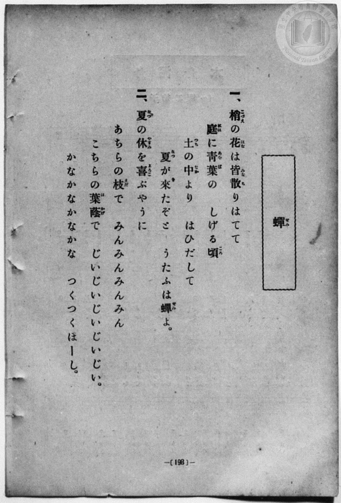
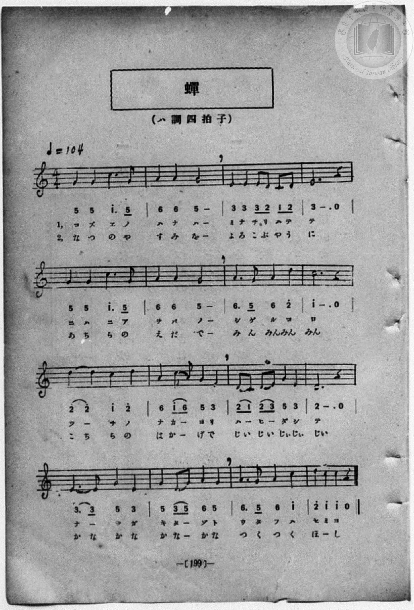

# 蟬

> Re:Shōka 使用 AI 協助辨識與重建樂譜，可能會有錯誤。歡迎回報。

<audio controls src="semi.mp3"></audio>

- 一條慎三郎 編《新編 小學校・公學校 唱歌教材集》（大正十二年十二月，索書號 0725-41）
- 日治時期公學校唱歌（第三學年・第六課）
- 國立臺灣歷史博物館典藏

## 說明


- 出處：臺灣總督府編《公學校唱歌》第三學年用，第六課〈せみ〉（蟬），原書第 14–15 頁。
- 調性與拍號：ハ調（C 大調），4/4 拍，速度 != 96。
- 背景與曲風：描寫農家收割小米（粟刈り／あはかり）的日子，家人們都到遙遠的山上田地工作，
孩童獨自一人看家（おるすばん）；傍晚時分寒蟬（かなかなぜみ）鳴叫，走到家門前仰望暮色天空，
蟬聲漸歇，天邊升起一顆明亮的晚星（よひのほし）。曲調溫柔恬靜，充滿鄉村向晚的詩意與思親之情。
- 版本說明：本檔案為原書單聲部簡譜（數字譜）之忠實數位化版本。

### 編曲說明（鋼琴伴奏版）：

1. 前奏 (Intro, 4 小節)：以「かなかな」寒蟬鳴叫動機結合結尾樂句，營造寧靜向晚的氛圍。
2. 主歌伴奏 (Semi, 12 小節 × 4 段)：右手 (PianoRH) 演奏柔和起伏的主旋律；
左手 (PianoLH) 採用溫暖平穩的四拍低音與和聲伴奏，襯托暮色與晚星的靜謐感。


## 跨冊／重複收錄參照

> 同曲＋同名異曲（《公學校唱歌》第一學年〈セミ〉與《うたのほん》下卷〈せみ〉為同曲；《公學校唱歌》第三學年〈せみ〉為另曲）

- **[同曲]** 《公學校唱歌》第三學年（昭和10年／1935）：[**〈せみ（蟬）〉**](../../../kogakko_shoka/grade_3/6_semi/index.md)（`C` / `4/4` — [原始 TMD](../../../kogakko_shoka/grade_3/6_semi/semi.tmd)）
- **[同名異曲]** 《うたのほん》（唱歌課本）下卷（2006.006.0878）：[**〈せみ（蟬）〉**](../../../utanohon/ge_2006.006.0878/6_semi/index.md)（`F` / `2/4` — [原始 TMD](../../../utanohon/ge_2006.006.0878/6_semi/semi.tmd)）
- 總表：[跨冊重複與同名歌曲總索引](../../../duplicate_songs.md)

## 歌詞

```text
一　かなかなぜみがなき出した。
かなかなぜみがかなかなと、
なけばまもなく日がくれる。

二　今日はおうちのあはかりで、
みなの出られたそのあとを、
ぼくは一人でおるすばん。

三　かなかなぜみはなくけれど、
山のはたけがとほいので、
みなのかへりはまだおそい。

四　いへのまへまで出て見たら、
かなかなぜみはなきやんで、
そらには一つよひのほし。
```

## ABC

```abc
X:1
T:蟬
M:4/4
L:1/16
Q:1/4=96
K:C
V:V1 name="Piano" snm="Pia"
[V:V1]
G6 A2 G4 E4 | D4 C2 D2 E4 E4 | G4 E2 F2 E4 D2 C2 | D12 z4 |
w: 1.~カ ナ カ ナ | ゼ ミ _ ガ _ | ナ キ _ ダ シ _ | タ
w: 2.~け ふ _ は | お う _ ち の | あ は _ か り _ | で
w: 3.~カ ナ カ ナ | ゼ ミ _ ハ _ | ナ ク _ ケ レ _ | ド
w: 4.~い _ へ の | ま へ _ ま で | で て _ み た _ | ら
E6 G2 A4 G4 | A6 c2 A4 G4 | c6 A2 G2 E2 D2 E2 | G12 z4 |
w: 1.~カ ナ カ ナ | ゼ _ ミ ガ | カ ナ カ _ ナ _ | ト
w: 2.~み _ な の | で ら れ た | そ の あ _ と _ | を
w: 3.~ヤ _ マ ノ | ハ タ ケ ガ | ト ホ イ _ ノ _ | デ
w: 4.~か な か な | ぜ _ み は | な き や _ ん _ | で
c6 d2 c4 A4 | G4 E2 A2 G4 E4 | G4 E2 D2 C4 D4 | C12 z4 |
w: 1.~ナ _ ケ バ | マ モ _ ナ ク | ヒ ガ _ ク レ | ル
w: 2.~ぼ _ く は | ひ と _ り で | お る _ す ば | ん
w: 3.~ミ _ ナ ノ | カ ヘ _ リ ハ | マ ダ _ オ ソ | イ
w: 4.~そ ら に は | ひ _ _ と つ | よ ひ _ の ほ | し
```

## TMD 檔案連結

- [主旋律 TMD 檔案](semi.tmd) [[在 TMD Studio 編輯](https://tmdlang.github.io/Tmd-TS/#tmd=s7IKdvYPcrWy4qpTUCpJTLdSSM7PyUlNLsnMz7MqzsjPTozPrsyvSsyML84ojTe0NDJWgqssy88pzU21Si9KTEmNN443QcgU55cWJadaFSdn5OfnxJekVpQk5edno8vHFySmp1oFGBmYIWQKivLLUvMS84C6C4oy80pSU8DaEQpSyzJTUkHSqSmZJflFmYk5SA5KLSoGuxtifElRYl5xclFmAcgzCFUlGalAVyfmZeaC9GppKbyYv0ZBS4tL0VbB0ozL3lbBmcvGRN_EDqThyY6GZ4vmPmvte7Kj82Vzn8Lz7SseN3Q9m7YByFB4uqH_6dodzxYsfNy8-2nrGghb4emUjc_W9jybOvPZ3AkvZ7c9buh-v6fj6ZLlz9Yuftrb-GRXz9OdWyCMZ3M63u_peb5l0bPZO17MnK9gYG5kqmti-H5PJ9ixz6YvfbZp97OZTc_mzIcbDzEdaOLzNWuAbgIKAo0D2g_kPm1d-2LVJpjup3O6n6_uftG-63nj4mdrtz_t3_S0d9bzzpUvl6x42rrjxfR-JS4ufS0FW2oBLgUFhccNE57N3vR89roXq1Y9m9H3uGEiWBQYOu27Xsyc-n7PLIh7nu_Y-3zu4qe75kCCE81zwBBD9tzzKStAoQTz3-OGjseNsx837n_c0AkMBmDcAX0MVPC0bz4wGIHKFAxNHjVMNjRVeLmg8XFDE9QFL1btf9aw_EVH-7PuXmBYA53yuLkfKAg0wlkBGDtgJsgcYMwrANUAWS8b5j_dtUwBnCyQDGrueTZzPcig2ZteLgI6bdaz_v6n61e_2Lfp6bptz6Zse9q5CZgwnm_cDIqkTfOfdnQ8bup6v6f_cWPT48b1jxu7wdzO57NagBH8dO0EkNvXbXuya9fThokvm_c-7djwsnHmy8YFQAVPN258sqPr-ZQNT-dseLp96ZO9c4CKQe5QUHi6duXz1Uuf96540b4KmEiB2p_P6QaaA7T0cWPX46bux40zHzdueNw0Geyt2U-bep_NnAVMTE872p6unwQONqBKoLJVMHIOMFCBil9u3vK0fzXQohdbNwAdAzTz5bSGp529T3ZveDZn9rNZ614APbhk5fOVu-COAZr2onHTsz07nq1tB3lnycqXTV1Pe9tfbN0OdNvLhW3AxPBk1zqQl4FumAEMfWCYAG3f9Lhx3ePG3Y8bpwPtBQYxMEhB8bRr9bP5U541rnk5F-Tfp62tz3bvf9nS-WzuxKcTJgJNAJrzYuXKZy39oFhomPti2aonO7ufNbciIul5Z8ezOWsgqRAUQ3PWPFs15dnCjudNuyDp5Om0dUAXv2xe8XzDwhdrgdZ0PJu64-na6WB2J9C4p_sXPF2_DCj4ZG_v055pEANBFkDTOcQYYGp9sXLe09YVz6a1Ax3zZMdaEGPVvBdr1wMTPyjfb-h91t6pACxq0lON9LIKUtMV9BUCDAwtgbaAjQKGz-OGBsyIeNzYA2b3ArMOMHweN86H-Q67UmRBYJ5qhCgFciaCUkHjvsdNwNQH5PYDEx1YQ__jph5QMoGYCspJYGcDQwuSPF5O6366vBuSGJ7sAhZjTc-nboNIPW7oedq78OmEbRDycUMvMH1CVAITGCjl7O18PmfPy2mTny5Z9XLm3qcbNr5Y1vhkRzcoPYONgvt-FzC3NzzZ3QV2FTBzdD1ubHvcuBCcLhDZ5XHjcriXgN4FemMdKFiaOkF-AIZM41yYhhWPmybBle4B-bJxPSR7gMxAzRhYvA50CTDxPpuxHpjqXyxeiJybUfLrkuVABUAngHIGOF-CUsw-YLHc86xjImamRPbxDmBCxxrfQL-C4gcUYyBfrYR6AxhmYM8BpYEeBcYmUG4FONO0gMUxQgZs6g5wqAH17HvcuAAcrMAgasHi45ezpz1vgcbr0-2bnm-b_HTOCnisAz30ZG_b09kLQBkHUhjNaoGWR_s6gIUUIjBmzwOS4BzeBIz4l00tz-Y0A9UAsyuS75_Ong32PdDpO8BOBToPyACSy8HpfNmLZUDHzwfFLMxXuAKq93FTCygSkQJgLkhf42pIlD9uXIJWxmDxPXoRt6MBGGEgPyGHR-OcZ2sXAQMDXjA-XTIHWPoBMzuwTAMVcbvaoKUcuHCDehdoE-WVKhQoaOlzcQWn5mZaBWQm5uU71BjUVINLXhsTLTswA1tNrgCuRRteLOxR0DABNVaer2_QgRRFSCWRhSYWnUD7QKbWKGiYKugCoZmmqoaurqaCqYIxUNBIQcNQwQgkpAnkg0RMFTSMFUxgIhpGCoYQNkgtSL-BQg3YQB9DoJGPm1aDBR83d2kqgDhABlDl46Y9QLnm-QpAfY-b1gAVAMWAMkD1a8FizQ0g9nYQG6R6P6rJRiCTGydCTG7cqgmm1oNUNoLMaGwDm9G4EIjXgUWbQKLrIaLdIJO7oCY3Lkc12ZhINzf3I7sZYnLTRpA80DNgk5s7UU02Abu5BSwIdscOuOv2gWR2QET3gd0EcRlQdBlEdD-IDbYZ5A6EyfjTw64eytKDMdgeU2h6MAPGPFDQDCxoGIcqahiHknaASckYkiqA6QPKAqUcYtMHUHwPPKSAQQ5KI-iqITwQDdQCDfMObOkEknjA4bgKGuZAUUjEAwMTZG8PUHw-RHwuNFWtA5kMTDhgGxpXwMJ-Epb00rwE4dZ5QNwHNgmcREA27IekDZgfoI583Dwb7AegXrAf-mB-aMeWbrqhrloFScEgn4DF5yD8th-aB4Ciq6Cqe8E2ANMcmJ6MmeYJlCedlKUfaKIwgqUVIN8MVoCAUwqskAGLQAsZYGkDFDHEklRA0Qz1LCg4myeAg2seSGYRJPC7gDLgYqB5EsjD4KwIEgHlSpAoJPWgJQ9EQmvshxcjm-CRDiorYFkSnNmBUQFSOxOIN4CTBDBcMZMEMLPCkgRQPzhJgNIrUGYGRBSYFIEpBO6DBohdQNGmvWC1kDSFlgygiROcaBuBmQXhWqgPVgDxErD-DpD6TRDRdUC8G6xyOtzUWi4uXTsFUEUDtgDIVuYCAA)]
- [鋼琴伴奏 TMD 檔案](semi_piano.tmd) [[在 TMD Studio 編輯](https://tmdlang.github.io/Tmd-TS/#tmd=s7IKdvYPcrWy4qpTUCpJTLdSSM7PyUlNLsnMz7MqzsjPTozPrsyvSsyML84ojTe0NDJWgqssy88pzU21Si9KTEmNN443QcgU55cWJadaFSdn5OfnxJekVpQk5edno8vHFySmp1oFGBmYIWQKivLLUvMS84C6C4oy80pSU8DaEQpSyzJTUkHSqSmZJflFmYk5SA5KLSoGuxtifElRYl5xclFmAcgzSlxaWgov5q95v6fj5eyZzzq7X3bveT5hy5M9W54u7X-_p1NBS4tL0VbB0ozL3lbBmcvGRN_EDmTwkx0NzxbNfdba92RH58vmPoXn21c8buh6Nm0DkKHwdEP_07U7ni1Y-Lh599PWNRC2wtMpG5-t7Xk2deazuRNezm573NANtPTpkuXP1i5-2tv4ZFfP051bIIxnczre7-l5vmXRs9k7Xsycr2BgbmSqa2IIdA7YU8-mL322afezmU3P5syHGw8xHWji8zVrgG4CCgKNA9oP5D5tXfti1SaY7qdzup-v7n7Rvut54-Jna7c_7d_0tHfW886VL5eseNq648X0fiUuLn0tBVtqAS4FBYXHDROezd70fPa6F6tWPZvR97hhIlgUGDrtu17MnPp-zyyIe57v2Pt87uKnu-ZAghPNc8AQQ_bc8ykrQKEE89_jho7HjbMfN-5_3NAJDAZwnAIZPU_75gODEahMwdDkUcNkQ1OFlwsaHzc0QV3wYtX-Zw3LX3S0P-vuBYY10CmPm_uBgkAjnBWAsQNmgswBxrwCUA2Q9bJh_tNdyxTAyQLJoOaeZzPXgwyavenlIqDTZj3r73-6fvWLfZuertv2bMq2p52bgAnj-cbNT3Z2A6MQ5LS1K5-vXvq8d8WL9lXP53QDlT1uaHzR2Paice_Tpt5nM2c9XT8JkjYfN3Y_blwFI-cAfQl01MvNW572rwaaA3KBgsLz2VuedmwAqn_RuOnZ2kXPGtcDTXu6ZM7zlbuebV33vH_f07VLns0A-rDjcRPQwE2PG9c9btz9uHE60Kjns1qe7Vr9ctmKZ12TnjW3Pmvpf7qoGeE3YHQAfQWJPFBOQcojzzuBaRUYPrMgjjDUU3ja2QsUV9DwzCspytdRMAFlh-frGzSBap7sXvq4oQfFMw29EE9CPPO0e-qzlfOfb53wdEIHiNyw79mKpqf9oMB63j7_ZcOCp-uXv5w75-mEicDQATl6w-ync3qhDlVQMNJTeLJjNzCpQNymoBGcmpupo2BoBHWDwuHpQPc8W7cV5Jin_ZuB-V1BIyAzMS8_yENT4dmeKUBNz-ZPeTqp58XW7U_29ANtAJk3vfvpPmBmnQ2xBAiebl-G0OoD0tq3EJgcgUH4bNa0pzs3P1-5Eqj16ezZwATzZG_fy_mbgekCZGrjJljJ0vNi6fpnnTOezVr3onMTKNXMnAWMHKAuoPderJnwrGU-yFfQzANJw0B_vVg572nrimfT2oE6nuxYC2KsmvdiLTCmJ4IKkw29z9o7FTJzgQWokV5WQWq6gr5CgIGhJTCGwEYBS63HDQ2YielxIzBSgOxeYH4EJojHjWDLQXZjV4osCMyojRClQM7Ex40bHjfue9zUBOb2A9M5WEP_46aex03dUFNB2RPsbFAsQGJ_WvfT5d2QNPBkF7BsbHo-dRtECphgnvYufDphG4QEJZg5GyAqgUUgKCD3dj6fs-fltMlPl6x6OXPv0w0bXyxrfLKj--nGjRCj4L7fBSxCGp7s7gK7av3jxq7HjW2PGxeCMwLQwUCR7sdNQMHlcC8BvQv0xjpQsDR1gvwADJnGuTANKx43TYIr3QPyZeN6YBA_2QUMxOUg44E-bpwJCpKmyVi8DnTJ0yUrn81YD8z4LxYvRC4iQEl7-tKnayeASokly4EKgE54Oa3h6falT_bOARYgT_cBy_qeZx0TIaUHxFZYGYLw8Y5OHPEN9CsofkAxBvLVSqg3gGEG9hxQGuhRYGwC5VaAS4kWsDhGyIBN3QEONaCefY8bF4CDFRhELVh8_HL2tOct0Hh9un3T822Tn85ZAY91oIee7G17OnvB86ZdoMjb0QUMhudTNgDj--m-jpeNCxCBMXsekAQF0swmYMS_bGp5NqcZqAaYiZB8D8x_YN8Dnb4D7FSg84AMILkcnM6XvVgGdPx8UMzCfIUroHofN7WAIhEpAOaC9DWuhkT548YlaIUqFt-_2LoBWEADHQ6KyM5eoDZghIH8hBwejXOAZTcwMOCFO6QEB2b2J7vWgUqlXW1AjS8XtkEKDKh3gTZRXlNDgYKWPoUtAHDgI9cCmlbwakBBA1qRaoIT6O6lkBIQ6D94dkerHyAhAS8in3bMBdZlkAoLWFZDCuenG6cCixDKggHsb7BzraBVgkONQU01uNC3MdGyAzNqFDRMFXSB0ExTVUNXV1PBVMEYJGgGFjSMg4qaAcVrgFjDWMEIJKSpYKhgBBQxBCszUKjhqkWxywe7XYbxCtGGsQqmEKpGwQTIMImFCQMtADJMIfJACq4ehKF2UByPkPoUWGVCKlNgTCJqU5SohFSnoKwLbqwh1Zs9kOoSJIVWe4OrWkiNSIW4A7kPT9RhCwoFcIOy4cXCHqBnoN7SgVSgSPWnhSYWnUAb8SQIIwUNYIxDot4YLAJODCYwEQ0jBUMIG6QWlihABvoYAo183LQaLPi4uUtTAcQBMoAqHzftAco1z1cA6nvctAaoACgGlAGqXwsWawZGyuOm7SA2SPV-VJONQCY3ToSY3LhVE0ytB6lsBJnR2AY2o3EhEK8DizaBRNdDRIHNHWAxDzW5cTmqycZEurm5H9nNEJObNoLkgZ4Bm9zciWqyCdjNLWBBsDt2wF23DySzAyK6D-wmiMuAossgovtBbLDNIHcgTMafHnb1UJYejMH2mKIUBdgLCA3DOJS0A0xKxpBUAUwfUBYo5RCbPoDie-AhBQxyUBpBVw3hgWigFmiYd2BLJ5DEAw7HVdAwB4pCIh4YmCB7e4Di8yHic6Gpah3IZGDCAdvQuAIW9pOwpJfmJQi3zgPiPrBJ4CQCsmE_JG3A_AB15OPm2WA_APWC_dAH80M7tnTTDXXVKkgKBvkELD4H4bf90DwAFF0FVd0LtgGY5sD0ZMw0T6A86aQs_UAThREsrQD5ZrACBJxSYIUMvvoFkVRA0Qz1LCg4myeAg2seSGYRJPC7gDLgYqB5EsjD4KwIEgHlSpAoJPWgJQ9EQmvshxcjm-CRDiorYFkSnNmBUQFSOxOIN4CTBDBcMZMEMLPCkgRQPzhJgNIrUGYGRBSYFIEpBO6DBohdQNGmvWC1kDSFlgygiROcaBuBmQXhWqgPVgDxErD-DpD6TRDRdUC8G6xyOtxUYJ2KqGewVtvE1jN4EwF6zQ-t4uE1P5RhBqTMcpEUGEGbAqQVccQ4Bdr2wGyE4GiUEOkStMyC1yVQm-AuwRUIeNpDunYK4GYX2EQgBxSX0T6Gsah8IzS-MRrfBM5X5gIA)]

## 分析

```text
================================================================================
📊 TMD Song Profile: [ 蟬 ]
================================================================================
⏱  Duration:       0:30 (30.0s), 12 measures total
🎼 Key & Tempo:    首調基準 C, != 96.0 BPM, <4/4>
   - 分析範圍：      由實際發聲的音符與和弦推測調性；播放脈絡另行呈現
🎤 人聲音域:    C4 (MIDI 60) – D5 (MIDI 74) [跨度: 14 個半音 / 1.2 個八度, 難度: moderate]
   - 最低音:  C4 in [Semi #1 @ m.2, 0:03]
   - 最高音: D5 in [Semi #1 @ m.9, 0:20]
   - 適合: soprano, mezzo-soprano, contralto, tenor, baritone, bass
🏛  結構:      Semi (30.0s)
⚡ 編曲密度:        Peak 1 軌道同時演奏
🗝  調性診斷：       C 大調（純淨自然大調，未偵測到可信轉調）
   - 風格氣質:    純淨自然大調（陽光明朗、易唱易記，無明顯調外色彩）
   - 轉調歷程:    全曲維持單一推測調性（未偵測到可信轉調）
   - 核心骨幹音:  G, C, E, D, A
   - 調性數值:    C 大調 [相關度: 0.84, 穩定度: Moderate, 自然音純度: 100.0%]
   - 候選調性 (K-S): C 大調 (0.84), G 大調 (0.80), E 小調 (0.67)
   - 五度圈歷程:   +0
   - 各段落調性細節:
     • [Semi #1]: C 大調 (r: 0.84, 自然音純度: 100.0%)

  [ 五度圈游移軌跡 ]
              [C ]*
         F            G  
      Bb               D  
      Eb               A  
         Ab           E  
            Db       B  
               F# 
     (* = active key center)

  [ 十二半音累積音高分佈 ]
     C  : ██████████████████        21.1%
     C# :                            0.0%
     D  : ██████████████            16.7%
     D# :                            0.0%
     E  : █████████████████         20.0%
     F  : █                          1.1%
     F# :                            0.0%
     G  : ████████████████████████  27.8%
     G# :                            0.0%
     A  : ████████████              13.3%
     A# :                            0.0%
     B  :                            0.0%
--------------------------------------------------------------------------------
Assignment 軌道音域：
  - Piano         : C4 – D5 (14 個半音 / 1.2 個八度, 46 個音符)
================================================================================
```


## 原書掃描頁






