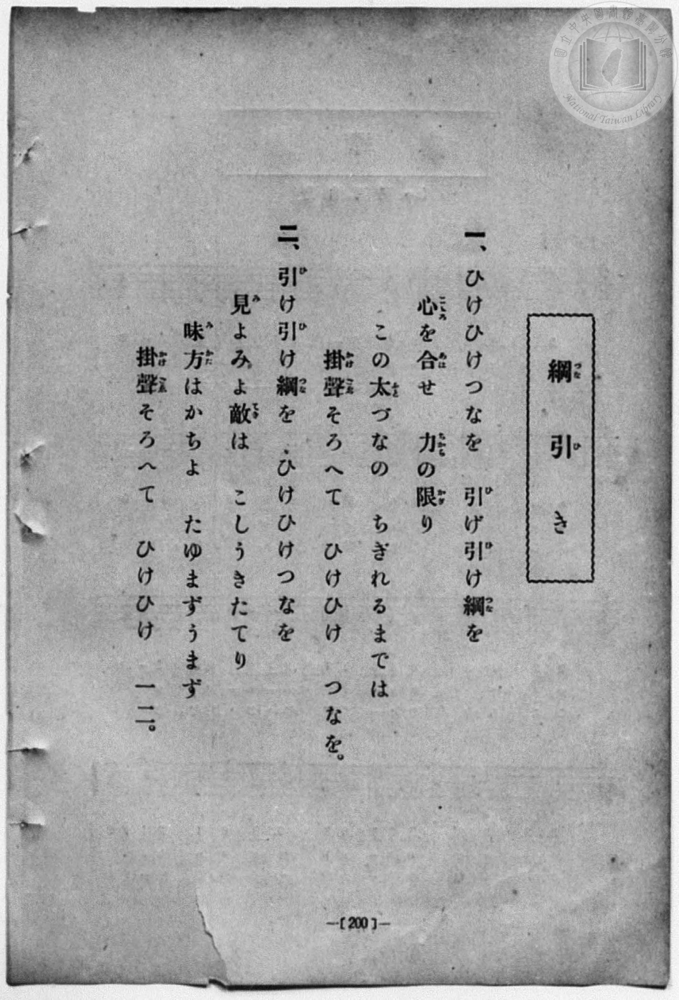
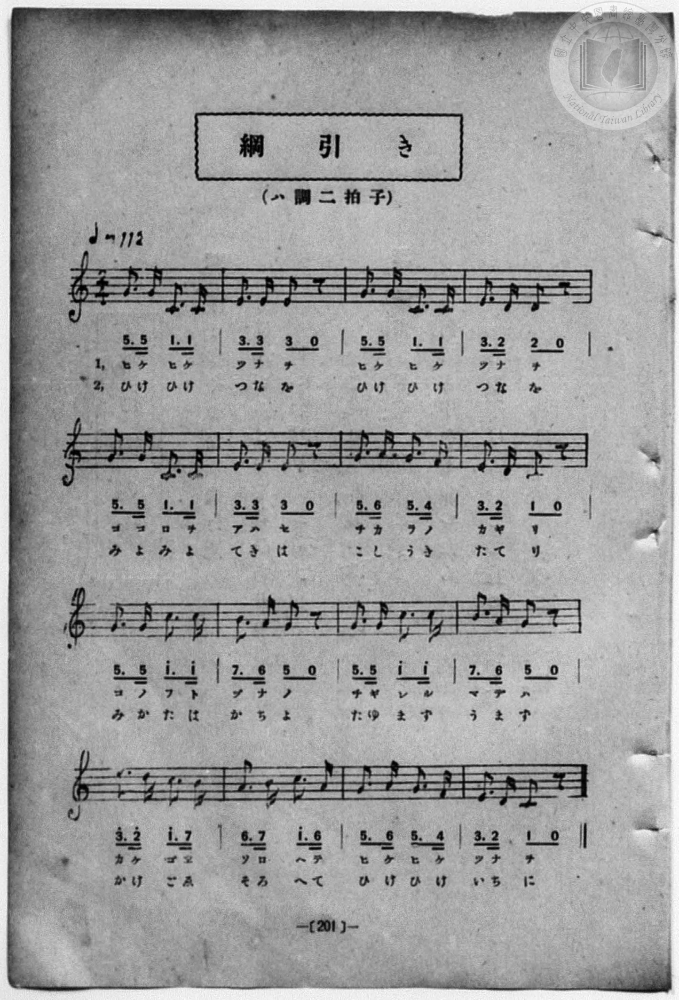

# 綱引き

> Re:Shōka 使用 AI 協助辨識與重建樂譜，可能會有錯誤。歡迎回報。

<audio controls src="tsunahiki.mp3"></audio>

- book: 新編 小學校・公學校 唱歌教材集（尋常科三・四學年用）
- 一條慎三郎 編《新編 小學校・公學校 唱歌教材集》（大正十二年十二月，索書號 0725-41）

## 說明

> [!NOTE]
> **原書資訊與歌詞全文（對應 P208.jpg–P209.jpg，原書第 200–201 頁）**
> - **調性與拍號**：ハ調二拍子（C 大調 2/4 拍），♩= 112。
> - **版本對照**：本曲與《教育唱歌集》及《新定兒童唱歌》尋常科第三學年用補充教材〈綱引〉同曲，惟本書速度標記為 ♩= 112，且第一節第 11 小節作「ちぎれる」、第 16 小節第一節作「つなを」（第二節作「いちに」），第二節第 6 小節作「てきは」（敵は）。
>
> **一、**
> ひけひけつなを　引（ひ）け引（ひ）け綱（つな）を
> 心（こゝろ）を合（あは）せ　力（ちから）の限（かぎ）り
> この太（ふと）づなの　ちぎれるまでは
> 掛聲（かけごゑ）そろへて　ひけひけ　つなを。
>
> **二、**
> 引（ひ）け引（ひ）け綱（つな）を　ひけひけつなを
> 見（み）よみよ敵（てき）は　こしうきたてり
> 味方（みかた）はかちよ　たゆまずうまず
> 掛聲（かけごゑ）そろへて　ひけひけ　一二（いちに）。


## 歌詞

```text
（TMD 檔案未包含歌詞註解）
```

## ABC

```abc
X:1
T:綱引き
M:2/4
L:1/16
Q:1/4=112
K:C
V:V1 name="Piano" snm="Pia"
[V:V1]
G3 G C3 C | E3 E E2 z2 | G3 G C3 C | E3 D D2 z2 |
w: 1.~ひ け ひ け | つ な を | ひ け ひ け | つ な を
w: 2.~ひ け ひ け | つ な を | ひ け ひ け | つ な を
G3 G C3 C | E3 E E2 z2 | G3 A G3 F | E3 D C2 z2 |
w: 1.~こ こ ろ を | あ は せ | ち か ら の | か ぎ り
w: 2.~み よ み よ | て き は | こ し う き | た て り
G3 G c3 c | B3 A G2 z2 | G3 G c3 c | B3 A G2 z2 |
w: 1.~こ の ふ と | づ な の | ち ぎ れ る | ま で は
w: 2.~み か た は | か ち よ | た ゆ ま ず | う ま ず
e3 d c3 B | A3 B c3 A | G3 A G3 F | E3 D C2 z2 |
w: 1.~か け ご ゑ | そ ろ へ て | ひ け ひ け | つ な を
w: 2.~か け ご ゑ | そ ろ へ て | ひ け ひ け | い ち に
G3 G C3 C | E3 E E2 z2 | G3 G C3 C | E3 D D2 z2 |
w: 1.~ひ け ひ け | つ な を | ひ け ひ け | つ な を
w: 2.~ひ け ひ け | つ な を | ひ け ひ け | つ な を
G3 G C3 C | E3 E E2 z2 | G3 A G3 F | E3 D C2 z2 |
w: 1.~こ こ ろ を | あ は せ | ち か ら の | か ぎ り
w: 2.~み よ み よ | て き は | こ し う き | た て り
G3 G c3 c | B3 A G2 z2 | G3 G c3 c | B3 A G2 z2 |
w: 1.~こ の ふ と | づ な の | ち ぎ れ る | ま で は
w: 2.~み か た は | か ち よ | た ゆ ま ず | う ま ず
e3 d c3 B | A3 B c3 A | G3 A G3 F | E3 D C2 z2 |
w: 1.~か け ご ゑ | そ ろ へ て | ひ け ひ け | つ な を
w: 2.~か け ご ゑ | そ ろ へ て | ひ け ひ け | い ち に
```

## TMD 檔案連結

- [主旋律 TMD 檔案](tsunahiki.tmd) [[在 TMD Studio 編輯](https://tmdlang.github.io/Tmd-TS/#tmd=s7IKdvYPcrWy4qpTUCpJTLdSSM7PyUlNLsnMz7MqzsjPTozPrsyvSsyML84ojTe0NDJWgqssy88pzU21Si9KTEmNN443QcgU55cWJadaFSdn5OfnxJekVpQk5edno8vHFySmp1oFGBlYIGQKivLLUvMS84C6C4oy80pSU8DaEQpSyzJTUkHSxcmJefFlqUWZaZmpKUiOSi0qBrsdYkVJUWJecXJRZgHIQwhV-UUlGflAhxdkVFplZBaX5BdlJifmxGcn5iUiFJVkpAK9l5ZaXJJZlpiDLl5cADQELAjym5XCs2kbnm9fofB0Q__TtTueLVj4uHn309Y1ELbC0ykbn63teTZ15rO5E17Obnu_p-Pphu6nO3Y8Xz7xyY5OkNLZs4FKn-7c8nzKivd7OpW4tLQUnm_b-HTP1MeNvQpaWlyKtgqGhkZc9rYKzlw2RvomdiCbn-xoeLZo7rPWPqAhL5v7FIAOeNzQRYpLHjd0gxyzZPmztYuf9jY-2dUDdAOE8WxOx_s9Pc-3LHo2e8eLmfMVDMyNTHVNDMGu49LXUrClFuBSUFCwU4hW9PMPcY2FcLS0nvbNB9m7uf3Fiq4XHe1AN79YOe9p64pn09rBodf7rL1TAZR29LIK0h81TAYyLUFMoJMhWp-vWaNgZGAAlDIyMFR4uaAR6HBgOIKN1wVa8GLV_mcNy0FGd_cCvael9X7PrMfN_UBhkN-7e5-unQC0yFkBGDZAMQVgkCsARYGGAG14NHMlODoeNzQhDHze2fFszhqgy563LgebBuQ9m70JaAMoTqbOfNG0CRL4kGB_2t8Fiaun62Y9bZ30fPVSiCxICpY2gH4Axiw8YbxYPOdpaysk7h43dEDTR0Pn0wk9QIuA7nrWPB9s6Y6XDfOf7lr2bMXMFytmPG_apQBzMFDNkx1TwMY2PF_fAAojQ0NQSgFynuyd87ih53HjwseNfY-beh43dT9u6H3c0AhWZAZVBNcKU73kceOqx02TgEqBoQWS3dWDJNsCNm41WBYUcHAFIENhZsIULwMm9ceN6yFGPZu6FcgG6oKFMSxhAK0HOgoWk48bNz1unAgj4Y5pAAYM0BCgOMiExoloXGDIgbkg9SCRpkkQ057ubwaLT37cNPdxE8jNQKmnE4D5ACjYBHVP42yQ-V2zwYJA33U_bgJ6DSi-7uVMUJIBiTT2gfV2wRw5GSj7dAnQLqAs0F-gLP64cSnItY3rgKahBHrjvseNy4F2QfQ-65v9AuRsiLFAP0553DQRrB3kwseNO0DhBjIBKRxAXHhQoIXeLmACg4ceqaGEbhHMFohpL5aBypLHjfvBikEMIAmMR7AgKHLBxgLjF2gIMECmP25sA8f4fJAsLKyeTtz8bNpOiDlgL8-H6gKxF4KMBWmf_7gJqBcYULPAhoAYlAQXME0BAwasC5piEQmP8vINChS09Lm4QopL8xIzMrMzrQIyE_PyHWoMaqpBtijYWGiBI0kBWLIa6ppYYU_ZOESBJoO01ihomAKLIl0FU01VDV1dTQUNQzDXEMoFyhuDBYyhAsYKBsRrMoIKGIE0ge3zMQRKAt0ClgY6CKgXhQeWXQLlr9JUADk1HiJKqh6IfUb0tQ8YFaa6FqCoACZXYJnQC8oC4HIAWAgARaGZH5SHwXkemIipExVmME0QrgmuqDBEj4rJUI9MBnmzqRfCa5oE9WYTVHY90JtAD0CDZiFUtBuspxPKWwfV0w3l94GCpgs9KvZDbegABysSDyy7DKq3F2Tfeph9MDdOB-tpQ6gBy86H8peh2geMCktdQyNoXADDG1SKwotQSFygF6B44iIOEhlxiIA1Rwl4U-wZgyht2OIDGJpA3lYobwXUr0uRkh3QE2jxAQxxYHz0QMMUGDtg2X1Q2eXwMMUSH5C4hIclML5R4nIhKGw7YPZBVTW1gfXAzJ8F1QOLn30g-2Yhx4ehsa6hGShCEAUtcimLo6jSB4pDy1ik-DGGhKwRLGRhQW2OCGkzFAGYAljIU551YIEDKSGmQAMFVkLMhfKByRTI24FIpBSXZrSztwUpuoGhDbK3lotL104BXgkpoHOUuQA)]
- [鋼琴伴奏 TMD 檔案](tsunahiki_piano.tmd) [[在 TMD Studio 編輯](https://tmdlang.github.io/Tmd-TS/#tmd=s7IKdvYPcrWy4qpTUCpJTLdSSM7PyUlNLsnMz7MqzsjPTozPrsyvSsyML84ojTe0NDJWgqssy88pzU21Si9KTEmNN443QcgU55cWJadaFSdn5OfnxJekVpQk5edno8vHFySmp1oFGBlYIGQKivLLUvMS84C6C4oy80pSU8DaEQpSyzJTUkHSxcmJefFlqUWZaZmpKUiOSi0qBrsdYkVJUWJecXJRZgHIQwhV-UUlGflAhxdkVFplZBaX5BdlJifmxGcn5iUiFCUWATWnp-am5pVYFWQm5uXHJyYn5-cWJOZlgsTACkH-slJ4Nm3D8-0rFJ5u6H-6dsezBQsfN-9-2roGwlZ4OmXjs7U9z6bOfDZ3wsvZbe_3dDzd0P10x47nyyc-2dEJUjp7NlDp051bnk9Z8X5PpxKXlpbC820bn-6Z-rixF6j85eyZzzq7X3bveT5hy5M9W54u7QeqUtDS4lK0VTA0NOKyt1Vw5rIx0jexA7noyY6GZ4vmPmvtAxr-srlPAeiwxw1dpLjwcUM3yJFLlj9bu_hpb-OTXT1At0EYz-Z0vN_T83zLomezd7yYOV_BwNzIVNfEEOxqrpDi0rzEjMzsTKsAUGgFeTjUGNRUcykAgY2Flh2Yoa-lYKhrYqXwuHHT48aJMHLJ48ZVj5sm4RDV0gdrrVHQMFXQBUJTTVUNXV1NBQ1DMNcQygXKG4MFjKECxgoGxGsyggoYgTSB7fMxBEoC3QKWBjoIqBeFB5ZdAuWv0lQAOTUeIkqqHoh9RvS1DxgVproWoKiYDEJNvUDJx41NjxvXP26cDRRd-Lix-3FT5-PGdSBGY9_jpi7qRIUZTBOEa4IrKgzRo2Iy1COTQd5s6oXwmiZBvdkElV0P9CbQA9CgWQgV7Qbr6YTy1kH1dEP5faCg6UKPiv1QGzrAwYrEA8sug-rtBdm3HmYfzI3TwXraEGrAsvOh_GWo9gGjwlLX0AgaF8Dw3vq4ccXjxqWgDNC4DhIXwPDvedwEjIh9jxuXgyzEHRdxkMiIQwSsOUrAm2LPGERpwxYfwNAE8rZCeSugfl2KlOyAnkCLD2CIA-OjBxqmwNgBy-6Dyi6HhymW-IDEJTwsgfGNEpcLQWHbAbMPqqqpDawHZv4sqB5Y_OwD2TcLOT4MjXUNzUARAgxxYFk05XETkJwLyiWNO0Bxj72o0geKt4CjazVS_BhDQtYIFrKwoDZHhLQZigBMASzkKc86sMCBlBBToIECKyHmQvnAZArk7UAkUopLM9rZ24IU3cDQBtlbi1EH-SDXQSbQOqhGwTBeIdowFsIAZQU43zQ-HsSBeAG7OhN86kDiGAbCogJJ2AQojDAJzW6gN3TtFOA-ifYBSqMKGIEFlLkA)]

## 分析

```text
================================================================================
📊 TMD Song Profile: [ 綱引き ]
================================================================================
⏱  Duration:       0:34 (34.3s), 32 measures total
🎼 Key & Tempo:    首調基準 C, != 112.0 BPM, <2/4>
   - 分析範圍：      由實際發聲的音符與和弦推測調性；播放脈絡另行呈現
🎤 人聲音域:    C4 (MIDI 60) – E5 (MIDI 76) [跨度: 16 個半音 / 1.3 個八度, 難度: moderate]
   - 最低音:  C4 in [Tsunahiki #1 @ m.1, 0:00]
   - 最高音: E5 in [Tsunahiki #1 @ m.13, 0:12]
   - 適合: soprano, mezzo-soprano, contralto, tenor, baritone, bass
🏛  結構:      Tsunahiki (17.1s) -> Tsunahiki (17.1s)
⚡ 編曲密度:        Peak 1 軌道同時演奏
🗝  調性診斷：       C 大調（純淨自然大調，未偵測到可信轉調）
   - 風格氣質:    純淨自然大調（陽光明朗、易唱易記，無明顯調外色彩）
   - 轉調歷程:    全曲維持單一推測調性（未偵測到可信轉調）
   - 核心骨幹音:  G, C, E, A, B
   - 調性數值:    C 大調 [相關度: 0.88, 穩定度: Moderate, 自然音純度: 100.0%]
   - 候選調性 (K-S): C 大調 (0.88), E 小調 (0.78), G 大調 (0.75)
   - 五度圈歷程:   +0 -> +0
   - 各段落調性細節:
     • [Tsunahiki #1]: C 大調 (r: 0.88, 自然音純度: 100.0%)
     • [Tsunahiki #2]: C 大調 (r: 0.88, 自然音純度: 100.0%)

  [ 五度圈游移軌跡 ]
              [C ]*
         F            G  
      Bb               D  
      Eb               A  
         Ab           E  
            Db       B  
               F# 
     (* = active key center)

  [ 十二半音累積音高分佈 ]
     C  : ████████████████████      26.3%
     C# :                            0.0%
     D  : ████                       5.3%
     D# :                            0.0%
     E  : ████████████████          21.1%
     F  : █                          1.8%
     F# :                            0.0%
     G  : ████████████████████████  31.6%
     G# :                            0.0%
     A  : █████                      7.0%
     A# :                            0.0%
     B  : █████                      7.0%
--------------------------------------------------------------------------------
Assignment 軌道音域：
  - Piano         : C4 – E5 (16 個半音 / 1.3 個八度, 114 個音符)
================================================================================
```


## 原書掃描頁






