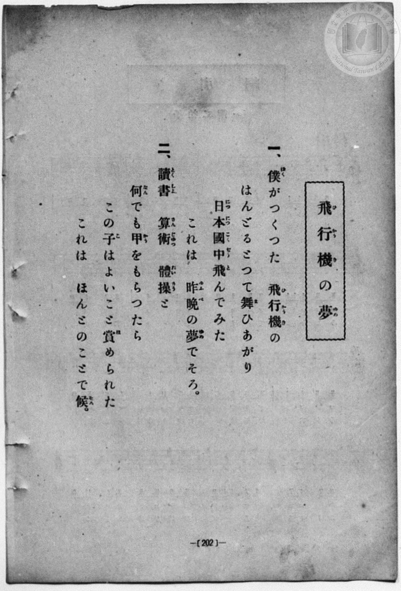
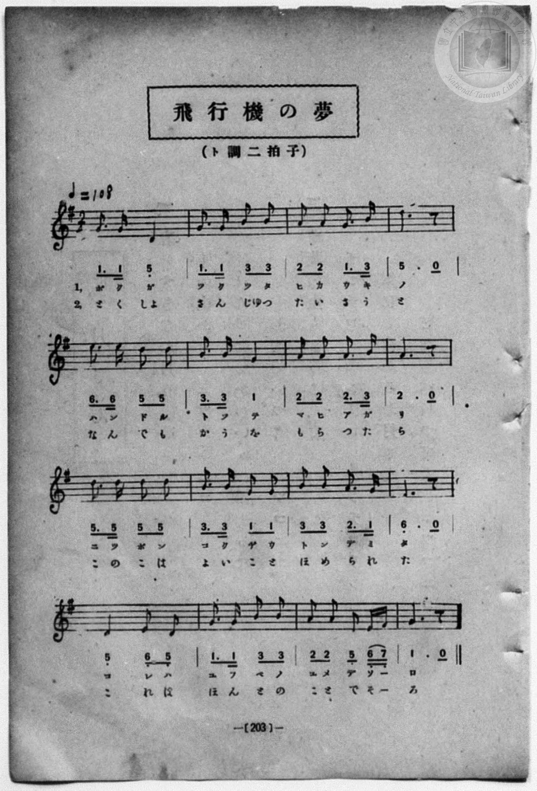

# 飛行機の夢

> Re:Shōka 使用 AI 協助辨識與重建樂譜，可能會有錯誤。歡迎回報。

<audio controls src="hikoki_no_yume.mp3"></audio>

- book: 新編 小學校・公學校 唱歌教材集（尋常科三・四學年用）
- 一條慎三郎 編《新編 小學校・公學校 唱歌教材集》（大正十二年十二月，索書號 0725-41）

## 說明

> [!NOTE]
> **原書資訊與歌詞全文（對應 P210.jpg–P211.jpg，原書第 202–203 頁）**
> - **調性與拍號**：ト調二拍子（G 大調 2/4 拍），♩= 108。
> - **曲風與構造**：全曲共 16 小節，以輕快活潑的附點十六分音符節奏，對比第一節「握著自製飛機操縱桿飛遍全日本是昨晚的夢（そろ＝候）」與第二節「讀書、算術、體操全拿甲等被誇獎是真正的事實（で候）」，充滿幽默與童趣。
>
> **一、**
> 僕（ぼく）がつくつた　飛行機（ひかうき）の
> はんどるどつて舞（ま）ひあがり
> 日本國中（につぽんこくぢう）飛（と）んでみた
> これは　昨晚（ゆふべ）の夢（ゆめ）でそろ。
>
> **二、**
> 讀書（とくしよ）　算術（さんじゆつ）　體操（たいさう）と
> 何（なん）でも甲（かう）をもらつたら
> この子（こ）はよいこと賞（ほ）められた
> これは　ほんとのことにて候（そろ）。

### 編曲說明（鋼琴伴奏版）：

1. 前奏 (Intro, 4 小節)：引用結尾樂句，以輕快俏皮的進行曲節奏展開。
2. 主歌伴奏 (HikokiNoYume, 16 小節 × 2 段)：右手演奏主旋律，左手配以輕快活潑的二拍子和弦伴奏。


## 歌詞

```text
（TMD 檔案未包含歌詞註解）
```

## ABC

```abc
X:1
T:飛行機の夢
M:2/4
L:1/16
Q:1/4=108
K:G
V:V1 name="Piano" snm="Pia"
[V:V1]
G3 G D4 | G3 G B2 B2 | A2 A2 G3 B | D6 z2 |
w: 1.~ぼ く が | つ く つ た | ひ か う き | の
w: 2.~と く しよ | さ ん じゆ つ | た い さ う | と
E3 E D2 D2 | B3 B G4 | A2 A2 A3 B | A6 z2 |
w: 1.~は ん ど る | と つ て | ま ひ あ が | り
w: 2.~な ん で も | か う を | も ら つ た | ら
D3 D D2 D2 | B3 B G2 G2 | B2 B2 A3 G | E6 z2 |
w: 1.~に つ ぽ ん | こ く ぢ う | と ん で み | た
w: 2.~こ の こ は | よ い こ と | ほ め ら れ | た
D4 E2 D2 | G3 G B2 B2 | A2 A2 D2 E F | G6 z2 |
w: 1.~こ れ は | ゆ ふ べ の | ゆ め で そ _ | ろ
w: 2.~こ れ は | ほ ん と の | こ と で そ _ | ろ
G3 G D4 | G3 G B2 B2 | A2 A2 G3 B | D6 z2 |
w: 1.~ぼ く が | つ く つ た | ひ か う き | の
w: 2.~と く しよ | さ ん じゆ つ | た い さ う | と
E3 E D2 D2 | B3 B G4 | A2 A2 A3 B | A6 z2 |
w: 1.~は ん ど る | と つ て | ま ひ あ が | り
w: 2.~な ん で も | か う を | も ら つ た | ら
D3 D D2 D2 | B3 B G2 G2 | B2 B2 A3 G | E6 z2 |
w: 1.~に つ ぽ ん | こ く ぢ う | と ん で み | た
w: 2.~こ の こ は | よ い こ と | ほ め ら れ | た
D4 E2 D2 | G3 G B2 B2 | A2 A2 D2 E F | G6 z2 |
w: 1.~こ れ は | ゆ ふ べ の | ゆ め で そ _ | ろ
w: 2.~こ れ は | ほ ん と の | こ と で そ _ | ろ
```

## TMD 檔案連結

- [主旋律 TMD 檔案](hikoki_no_yume.tmd) [[在 TMD Studio 編輯](https://tmdlang.github.io/Tmd-TS/#tmd=s7IKdvYPcrWy4qpTUCpJTLdSSM7PyUlNLsnMz7MqzsjPTozPrsyvSsyML84ojTe0NDJWgqssy88pzU21Si9KTEmNN443QcgU55cWJadaFSdn5OfnxJekVpQk5edno8vHFySmp1oFGBkaIGQKivLLUvMS84C6C4oy80pSU8DaEQpSyzJTUkHSxcmJefFlqUWZaZmpKUiOSi0qBrsdYkVJUWJecXJRZgHIQwhV-UUlGflAhxdkVFplZBaX5BdlJifmxGcn5iUiFJVkpAK9BzahAKgBXQLiO7AoyHdWCs-mbXi-fYXC0w39T9fueLZg4ePm3U9b10DYCk-nbHy2tufZ1JnP5k54Obvt_Z6Opxu6n-7Y8Xz5xCc7OkFKZ88GKn26c8vzKSve7-lU4tLSUni5ePaLhT3PVs5_3Lju6ZJFClpaXIq2CoYGFlz2tgruXDZG-iZ2IPuf7Gh4tmjus9Y-oFEvm_sUgM543NBFinseN3SDnLRk-bO1i5_2Nj7Z1QN0CYTxbE7H-z09z7csejZ7x4uZ8xUMzI1MdU0MwW7k0tdSsKUW4FJQULBTiFb08w9xjYVwtLSe9s0H2bu5_cWKrhcd7UA3v1g572nrimfT2sFh2PusvVMBlIb0sgrSHzVMBjINQUygkyFan69Zo2BkYASUMjIwVni5oBHocGA4go3XBVrwYtX-Zw3LQUZ39wK9p6X1fs-sx80dQGGQ37t7n66dALTIXQEYNkAxBWCQKwBFgYYAbXg0cyU4Oh43NCEMfDZ708tFK0AGLu9-2bAAbCDIwbM3PW3dqGBoBoqQ5-sbgNqf7F76Ys_Up_tXP9uy-9neic9ntbyc2fJy9zxguD9tXfu0o-3l_M3P1ywDKn66tB_kIaBv108BeggY30DBxw09z_oXvpg4_UX7qheL9wITCzClPJvc-3zHxmcL9wO5Lxt7QRZPX_pszppnM9Y_m7Hi2cxZQFuASQnopceNcx83AT0y92nDTKB3Hjf0At0MMnxXD8TwF-sagOH3uKHx-brpLxZOBjJerp4CNB9kZvf-51M2PV_b-WLR6her2p_39gHNfz5nPjD1AM1_sqv76fplYCuWww0Hub-19dnu_U937n25ewbIrtVLX2xbDAs7WIQD_Qa0CRZDT5ungs3Z87gRGAKdjxt7HjcuAbLB5PzHDQ3wLAJWtulxY_fjxrbHjaAIAmYaiCGPG9c_bpr8uHHl4yag7Eqw3mUvOuaBtewDqwRqbAIZ3tQF0QIJtKdzup_sWAtWthqsay_YHCACOmAR0CKgXqADwApAmRYsu_xx436g22BWT37cBHTzeqBTIeEPUtwEdOHWx407IY6ERgdQsAmUOMEmgKIGI2R29SCFDCR2IFaD3TP9cRMwowKDugESX2CpqWAnzQDbuAQiC4lEsCywXGkBqQF7BGgOxOQneyFhvgqoF-qepiZgdIMFQcEL9ukkoODjJqAsOCKaOhH-BfoInGeAbLB2YOAD2UCLgFIrXmyGBPtusCGNIBNA4YMluIBqwI4H-m4dRC84FpaBUxQ89QJ9BA4lyosfKFDQ0ufi8sjMzs_O9MuPBFVwAZmJefkONQY1CtUgmxRsDM20wJGigK30U4DkT2CiVNAAlT2GwJLHBJrndUAlFbh40sSiEWgxyNAaBUNgOaILJE3jwQxdJCFjIAnCNQpGQBKEITLGQBG4chA0ACkCm-djWAMM1z1gUWBCAeIeuLHA2EMSB7GBUQGV2QTmdYPJNqiqXrDMOiR7QHZC7TECya1AMg-UIpGsmgqRapoMZINSJFgdyE6QJMhWYCIBk1CFQFsRJiLbhj_sd_XAw94UGPYWpIW9GSQQgRQ4OMFEDTjIQYEMCWzk4AdhSPBDWNhDfz2S11eCWaBwRQ6vJUC8DCmw9oFFIXHQBFXTA5Jp6sIT-quQ7FkOZoH0gmRA9kHCFJh1EfaA5YGZEB4XkBQAkgGJkRLuOzrh4W4JDHdDI9ICHpp6gRSugAdhiAgIQ4LbEBFl2EN-NVL47oWGDSREQDQspS6Chg0iTiDqIKEIovfDUymusIeZtw7KhsQ6KCQhmQCUumEyIBtAenaDbWqExwGIBscyFpvwhj6w9YgocYxBwQ9rZ5AW_OCUDw993KUOWAFQqXk8XBn28IeECsRfyGECK1G2AvFOaLghZKBhAknDjXOhMr0EQx_DHnAIw3IEOF5h9iDFBGF7arm4dO0UkGsFBSx8ZS4A)]
- [鋼琴伴奏 TMD 檔案](hikoki_no_yume_piano.tmd) [[在 TMD Studio 編輯](https://tmdlang.github.io/Tmd-TS/#tmd=s7IKdvYPcrWy4qpTUCpJTLdSSM7PyUlNLsnMz7MqzsjPTozPrsyvSsyML84ojTe0NDJWgqssy88pzU21Si9KTEmNN443QcgU55cWJadaFSdn5OfnxJekVpQk5edno8vHFySmp1oFGBkaIGQKivLLUvMS84C6C4oy80pSU8DaEQpSyzJTUkHSxcmJefFlqUWZaZmpKUiOSi0qBrsdYkVJUWJecXJRZgHIQwhV-UUlGflAhxdkVFplZBaX5BdlJifmxGcn5iUiFCUWATWnp-am5pVYFWQm5uXHJyYn5-cWJOZlgsTACkH-slJ4Nm3D8-0rFJ5u6H-6dsezBQsfN-9-2roGwlZ4OmXjs7U9z6bOfDZ3wsvZbe_3dDzd0P10x47nyyc-2dEJUjp7NlDp051bnk9Z8X5PpxKXlpbCy8WzXyzsebZy_uPGdU-XLAJqejl75rPO7pfde55P2PJkz5anS_uBahW0tLgUbRUMDSy47G0V3LlsjPRN7EDuerKj4dmiuc9a-4BWvGzuUwA673FDFynufNzQDXLqkuXP1i5-2tv4ZFcP0IUQxrM5He_39DzfsujZ7B0vZs5XMDA3MtU1MQS7nUtfS8GWWoBLQUHhccOEZ7M3PZ-97sWqVc9m9D1umAgWBbq8fdeLmVPf75lFFb_ijZOe52vWKJgYKrxcNu1xQwda3Dxu6ASqeNo3HxgaIHVGBkaPGiYbGRgrvFzQCAxCUALXyypIBwoCmYYgJjCkHjc0Qf3xYtX-Zw3LX3S0P-vuBYYm0EOPmzuAgqCA7u59unYC0Ax3BWBEAMUUgPGrABQFGgC082XD_Ke7lilAEgDCQKC3gSEGCS5QwkFKMs87gTEH1DoLpFRBwVBP4WlnL1BcQcMzr6QoX0fBBBRgz9c3aALVPN0zFej751snPN2w79mKpqf9S4F2Ptm99MWeqU_3r36yv__5rHXPZ7W8bNgECg5gHK1vABr1dOPUl9O6oa5RUDDSU3iyYzcwsCEOUNDwyMzOz870y48Elh06CoZmUAsVDk9XMFJ4tm4r2Ob-zcC0_mzPFKAOkO7p3U_3AVNjz9Pty0B5oLUX7opnW3Y_2zsR6Ap4aD2d1PN0zzKIbVBXUJ4QoUBBS5-LCxxSVgGgAiHIw6HGoEahGuxVG0MzLTswq0bBNF5BFwzNQAwwr0bBECxiqGAMJEG4BuhhXTAGKwAqNY-HK4NAA5AyrloUS31QLLWA22kYrxBtGAujMPmm8UCWaXwsgoGsxgBiD3Ls4PUjtmyuAEz-wMwITA0KGqCcYAhM8rAEpaMAS_yaWDQCwxXqCWgYwQMQX7BBZIyRwxsRaCDzfAxrFB437gGLPm7sB-IeuLGPG5cgiYPYjxvnQ2U2gXndYLINqqoXLLMOyR5wrELsMQLJrUAyb_rjpg4kq6ZCpJomA9kzHjeBzITYCZIE2fq4sQVMQhUCbUWYiGwb_rDf1QMPe1Ng2FuQFvbgtApOh-DghKZaUJCDAhmWLBHBD8KQ4IewsIf-eiSvrwSzQOGKHF5LgHgZUmDtA4tC4qAJqqYHJNPUhSf0VyHZsxzMAukFyYDsg4Tp46ZJCHvA8o-bOuFxAUkBIBmQGCnhvqMTHu6WwHA3NCIt4KGpF0jhCngQhoiAMCS4DRFRhj3kVyOF715o2EBCBETDUuoiaNgg4gSiDhKKIHo_PJXiCnuYeeugbEisg0ISkglAqRsmA7IBpGc32KZGeByAaHAsY7EJb-gDq2pEiWMMCn5YnUJa8FOpsEaEPyRUIP5CDhNYibIViHdCww0hAw0TSBpunAuV6SUY-hj2gEMYliPA8QqzBykmCNuDtVIgUAeBaxj8lRD2aglUC0FMMgEJmyArJKY-w2EYQWchK4CYZAZimsXnxoJZGEZRVsvq2imAK3QFIAM5cKN9gMowxIzAYspcAA)]

## 分析

```text
================================================================================
📊 TMD Song Profile: [ 飛行機の夢 ]
================================================================================
⏱  Duration:       0:35 (35.6s), 32 measures total
🎼 Key & Tempo:    首調基準 G, != 108.0 BPM, <2/4>
   - 分析範圍：      由實際發聲的音符與和弦推測調性；播放脈絡另行呈現
🎤 人聲音域:    D4 (MIDI 62) – B4 (MIDI 71) [跨度: 9 個半音 / 0.8 個八度, 難度: easy]
   - 最低音:  D4 in [HikokiNoYume #1 @ m.1, 0:00]
   - 最高音: B4 in [HikokiNoYume #1 @ m.2, 0:01]
   - 適合: soprano, mezzo-soprano, contralto, tenor, baritone, bass
🏛  結構:      HikokiNoYume (17.8s) -> HikokiNoYume (17.8s)
⚡ 編曲密度:        Peak 1 軌道同時演奏
🗝  調性診斷：       G 大調（純淨自然大調，未偵測到可信轉調）
   - 風格氣質:    純淨自然大調（陽光明朗、易唱易記，無明顯調外色彩）
   - 轉調歷程:    全曲維持單一推測調性（未偵測到可信轉調）
   - 核心骨幹音:  D, G, A, B, E
   - 調性數值:    G 大調 [相關度: 0.85, 穩定度: Moderate, 自然音純度: 100.0%]
   - 候選調性 (K-S): G 大調 (0.85), D 大調 (0.80), B 小調 (0.62)
   - 五度圈歷程:   +1 -> +1
   - 各段落調性細節:
     • [HikokiNoYume #1]: G 大調 (r: 0.85, 自然音純度: 100.0%)
     • [HikokiNoYume #2]: G 大調 (r: 0.85, 自然音純度: 100.0%)

  [ 五度圈游移軌跡 ]
               C  
         F           [G ]*
      Bb               D  
      Eb               A  
         Ab           E  
            Db       B  
               F# 
     (* = active key center)

  [ 十二半音累積音高分佈 ]
     C  :                            0.0%
     C# :                            0.0%
     D  : ████████████████████████  25.0%
     D# :                            0.0%
     E  : ██████████                10.8%
     F  :                            0.0%
     F# : █                          0.8%
     G  : ████████████████████████  25.0%
     G# :                            0.0%
     A  : ███████████████████       20.0%
     A# :                            0.0%
     B  : ██████████████████        18.3%
--------------------------------------------------------------------------------
Assignment 軌道音域：
  - Piano         : D4 – B4 (9 個半音 / 0.8 個八度, 100 個音符)
================================================================================
```


## 原書掃描頁






