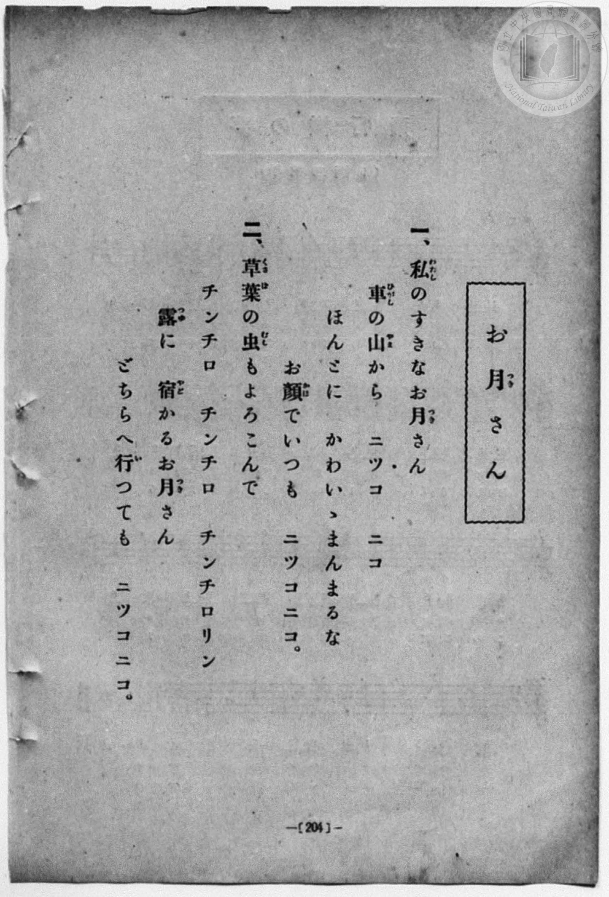
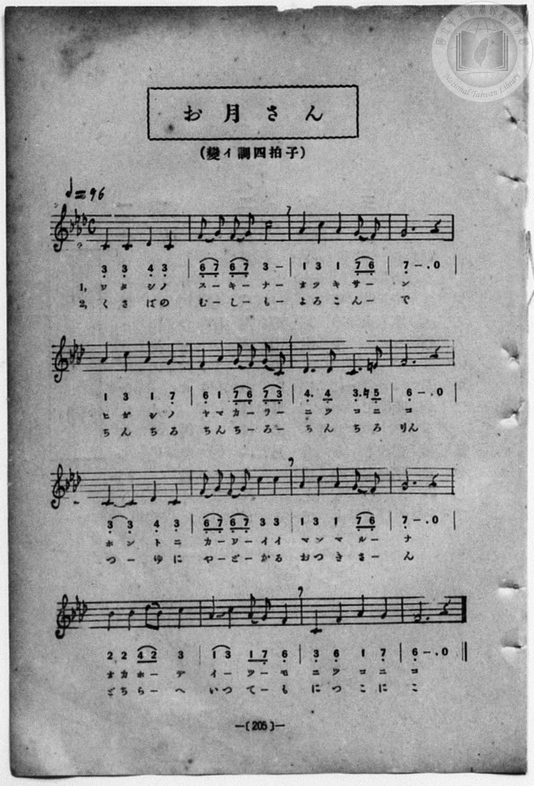

# お月さん

> Re:Shōka 使用 AI 協助辨識與重建樂譜，可能會有錯誤。歡迎回報。

- **鋼琴伴奏版**：<br><audio controls src="otsukisan.mp3"></audio>
- **NEUTRINO 歌聲合成版**：<br><audio controls src="otsukisan_neutrino.mp3"></audio>

- book: 新編 小學校・公學校 唱歌教材集（尋常科三・四學年用）
- 一條慎三郎 編《新編 小學校・公學校 唱歌教材集》（大正十二年十二月，索書號 0725-41）
- 日治時期公學校《唱歌帳》（典藏號 2020.006.0843・P147）同曲底本

## 說明

> [!NOTE]
> **原書資訊與歌詞全文（對應 P212.jpg–P213.jpg，原書第 204–205 頁）**
> - **調性與拍號**：變イ調四拍子（A♭ 大調關係小調 F minor，五線譜記四個降記號、第 7 小節第四拍 E4 記還原號 `5'`），4/4 拍，♩= 96。
> - **版本對照**：本曲即國立臺灣歷史博物館典藏《唱歌帳》第一冊 `p147_otsukisan`（標註「小公校教材集 205 頁ヨリ 13.12.12.」）所抄錄之原底本，調號、速度與各小節旋律完全吻合。
>
> **一、**
> 私（わたし）のすきなお月（つき）さん
> 東（ひがし）の山（やま）から　ニツコ　ニコ
> ほんとにかわいゝまんまるな
> お顏（かほ）でいつも　ニツコニコ。
>
> **二、**
> 草葉（くさば）の虫（むし）もよろこんで
> チンチロ　チンチロ　チンチロリン
> 露（つゆ）に宿（やど）かるお月（つき）さん
> どちらへ行（い）つても　ニツコニコ。

### 編曲說明（鋼琴伴奏版）：

1. 前奏 (Intro, 4 小節)：引用結尾樂句「お顏でいつも ニツコニコ」，描繪月夜柔光。
2. 主歌伴奏 (Song, 16 小節 × 2 段)：右手演奏主旋律，左手配以柔和的小調和弦伴奏。


## 歌詞

```text
（TMD 檔案未包含歌詞註解）
```

## ABC

<div class="abc-score" data-abc-src="otsukisan.abc" aria-label="五線譜載入中"></div>

[下載 ABC 原始檔](otsukisan.abc)

## TMD 檔案連結

- [主旋律 TMD 檔案](otsukisan.tmd) [[在 TMD Studio 編輯](https://tmdlang.github.io/Tmd-TS/#tmd=s7IKdvYPcrWy4qpTUCpJTLdSSM7PyUlNLsnMz7MqzsjPTozPrsyvSsyML84ojTe0NDJWgqssy88pzU21Si9KTEmNN443QcgU55cWJadaFSdn5OfnxJekVpQk5edno8vHFySmp1oFGBkaIWQKivLLUvMS84C6C4oy80pSU8DaEQpSyzJTUkHSxcmJefFlqUWZaZmpKUiOSi0qBrsdYkVJUWJecXJRZgHIQwhV-UUlGflAhxdkVFplZBaX5BdlJifmxGcn5iUiFJVkpAK9l5dYUlqUii5anJpYnJ9XjGxiZnpmnlVpHsh5JQhHgTxupfBs2obn21coPN3Q_3TtjmcLFj5u3v20dQ2ErfB0ysZna3ueTZ35bO6El7Pb3u_peLqh--mOHc-XT3yyoxOkdPZsoNKnO7c8n7Li_Z5OJS4tLYXHjV3P5nQ8bpz6uGmygpYWl6KtgqUZl72tgqMOV3Zqpa2CWy6XjYm-iR3IEU92NDxbNPdZax_QvJfNfQpAtzxu6CLFUY8bukHuWrL82drFT3sbn-zqAToHwgA64_2enudbFj2bvePFzPkKBuZGpromhmCHAu1-Nn3ps027n81sejZnPtx4oO0QC57u2Aw1unXHi-n9IP1GBkYGegYGZnoGFibGQDcFGJqYAw17OqHn2exNT3dNfTZnjRIXl76Wgi21AJeCgoKdQrSin3-IayyEo6X1tG8-yEOb21-s6HrR0Q5064uV8562rng2rR0cQ73P2jsVQIlXL6sg_VHDZCDTGMQEhgVE6_M1a4B-MQFKGRmYKrxc0Aj0BDCiwMbrAi14sWr_s4blIKO7e4H-1tJ6v2fWi3Vdj5uWAGWAUQ4Ufrp2AtAux0cz1yoAgx4o_HL6nCf7m4AxBmQruCnkZublFwEtfLJryvPts16snfNixQxQYmnofjmzF8gGGvu4oRHkEHNQND9f3wBkQ4xWcDVRAKp42dQCdC0o2BNM1ROALgSaBkw1CkAVQNajmStByepxQxPC2c87O4AxAPT_89blYDcDeaCI6d38dE7389XdL9p3PW9c_Gzt9qf9QMFZzztXvlyyAhK7aLEOdAswYT5t61JIKADGcXx-SXFpdmZxYh7QHR3PVsx8sWL344YeUPJsXQNMM_C0CAxVcHg-bl7xuHmVAjDYgZEARI8bgG7ufNbZ8Kyr5WVPy5Od3UCvQRIM0C_AEIMEx8sGoOAyYLg_ndACCZRn07uf7ut-uq4HGL1PJ-x-OqED5mNYYgC6E6gTFnvPlwPjsuNxU__jxvmPG6cDLX3cuO5x48zHjb2PG1dBciZIQeMSoAhYFpRLIXqfzd0Iltr0uLEHrvfpRrBgU8vjxn1gke7HTZ2PGxoeN3c_bm553AQMLTC7aTPEkMeNu4EGPm5c8bhxNVgx0CVAZXOB2sHiQLIb6BKY4q6XC_vBlgIFd4PNXw5SD3ReUxOKLWArMPy-qwfJ7y96O19MBKYSoGlAS6c-btwA8cKLmavBXmiAegpochOQCwyQyWAnLYc6phkYbUCLgORasNW4uc2rgGyIrpdzNkHDswlYPAKtW_103X5YiK2EhRjQd_hCHqjyceNCUMA27nixsAesrAWsBqh4Gb6goLyEgQIFLX0uruD8vHSrgMzEvHyHGoOaapAFCjaGZlrgAFfAVq4pQHIK0NEKGqDMbAgsU0ygGVoHVAaBCx5NLBqB9oEMrVEwjgdmXhCEM0wwRGoUzEBMcxCBYMGlYbBGwRCmE0rD-AidNRA2NmgAMwbsMh_DGgVg8oWKAfMTnDUdzloHtxiYx-CivXDWKgwHAhMCXHYJFh1TESqBtSd2d8JDBeJOI5CpCHfCTACmf2zubGrA9EdTE6Y7mzrgsgjXwVyEcBvI7uUE3Yk__ezqgacfU2D6sSAt_eCNcogTwRGPIYeWkGoQ6Q4EwRyUFAYUMVWPRzYOHWJJQI2boGLAQhXOwpqAmlrgovvgrG4Yq6kTobIZJgqWaQbpA5YIKGLdYBGQ2j043IotES2E2waPaCSxXoQLyFCJUI0u1gvEXUQmeAIFUSc8IVkCE5KhEd1LIiR11C6KGnfDQwwR5ivgrNVwi5FTDaJYQKQuGAukEp7SkMxEiMHMAalEL8pgEFs6ghVsMAisG7G5EynFr4SzEG5Htp2ahSbeNARsgiIqM2NQIjIjLREZQe2B0SZQNiwZYE8YiEQBUQNPR9iLLogiksohRAjCQxiRouBFOEglLFZgECnM4RUFcikEKYEg8rBSCCELihPksgkZYks7iJSAKE9gZR-weYTFnchpYhk2l8LTHLJKRHpHzjmEU08tF5eunQKopaSARCtzAQA)]
- [鋼琴伴奏 TMD 檔案](otsukisan_piano.tmd) [[在 TMD Studio 編輯](https://tmdlang.github.io/Tmd-TS/#tmd=s7IKdvYPcrWy4qpTUCpJTLdSSM7PyUlNLsnMz7MqzsjPTozPrsyvSsyML84ojTe0NDJWgqssy88pzU21Si9KTEmNN443QcgU55cWJadaFSdn5OfnxJekVpQk5edno8vHFySmp1oFGBkaIWQKivLLUvMS84C6C4oy80pSU8DaEQpSyzJTUkHSxcmJefFlqUWZaZmpKUiOSi0qBrsdYkVJUWJecXJRZgHIQwhV-UUlGflAhxdkVFplZBaX5BdlJifmxGcn5iUiFCUWATWnp-am5pVYFWQm5uXHJyYn5-cWJOZlgsTACkH-slJ4Nm3D8-0rFJ5u6H-6dsezBQsfN-9-2roGwlZ4OmXjs7U9z6bOfDZ3wsvZbe_3dDzd0P10x47nyyc-2dEJUjp7NlDp051bnk9Z8X5PpxKXlpbC48auZ3M6HjdOfdw0Gajj5eyZzzq7X3bveT5hy5M9W54u7QcqVNDS4lK0VbA047K3VXDU4cpOrbRVcMvlsjHRN7EDOe7JjoZni-Y-a-0D2vOyuU8B6MbHDV2kOPZxQzfIvUuWP1u7-Glv45NdPUBnQhhA573f0_N8y6Jns3e8mDlfwcDcyFTXxBDsAaDdz6YvfbZp97OZTc_mzIcbD7QdYsHTHZuhRrfueDG9H6TfyMDIQM_AwEzPwMLEGOimAEMTc6BhTyf0PJu96emuqc_mrFHi4tLXUrClFuBSUFB43DABaPzz2eterFr1bEbf44aJYFFgkLTvejFz6vs9s6gSiHhjvOf5mjUKJkYKL5dNe9wAjHNEzD9u6ARKP-2bDwxjkCIjA5NHDZONDEwVXi5oBIYeKO_oZRWkAwWBTGMQExhkjxuaoJ54sWr_s4blLzran3X3AsMY6JsX67oeNy0BigNlHzfPeD5_LZANNMkxSSE3MSu_SEFfwU0hNzMvvwhoENBuYFJSAGoGsl42zH-6a5kCOMEhbAAGAjD8IIEHSqdIKfR5JzCBAM2YBVKqoGCop_C0sxcorqDhmVdSlK-jYAIKvufrGzSBap7umQoMi-dbJzzdsO_Ziqan_UsfN_QAg-Llwv7HjcsfN7Y8blzyuKkJaGX34-aWx02bQQwg2QBy2rP-_uc7VwFD7emSOc_mT3naCgsCBQUjPYUnO3YDYwPiJgWN4Py8dB0FQzOo3QqHpysYKTxbtxXsiP7NwFz2bM8UoEqQrundT_cBE2nP0-3LQLmvtffJ7qUg8yf1PJ_VAtQPDDog--meZRDDoZZSnjChQEFLn4sLHFZWAaDiJ8jDocagphrsMRsLLTswowbofF0wNgGSxkC6RsEQSIJYhgrm8Qpm8WAxYxAFZoNkgeIgQTAfBg1AQly1KFb6IFtpgrAyXiHaKDcWZGi0MZAGmQRkmgGZcAbYSrAsDlUGENtAEYLFf4ZmUNuw5XgFYGYA5ssXC3sUNED5whCYAWCpSUcBlhU0sWgEBinEC-DwAEE4wwRDBBpA4MBCsODSMAgJcLBOKA3jI3TWQNjYICjcwcaAXeZjWKPwuKkfKva4cT6cNR3OWge3-HHjTLhoL5y1CsOBwJwEl12CRcdUhMqmyTjcCQ8ViDuNQKYi3Akz4XHjBmzubGrA9AcwO2O4s6kDLotwHcxFCLeB7F5O0J3408-uHnj6MQWmHwvS0g_eKIc4EZ67MJMDIiHVINIdCII5KCkMKGKqHo-eWZEhlgTUuAkq9rixB87CmoCaWuCi--CsbhirqROhshkmCpZpBukDlsAoYt1gEZDaPTjcii0RLYTbBo9oJLFehAvIUIlQjS7WC8RdRCZ4AgVRJzwhWQITkqER3UsiJHXULooad8NDDBHmK-Cs1XCLkVMNolhApC4YC6QSntKQzESIwcwBqUQvymAQWzqCFWww-LipDZs7kVL8SjgL4XZk26lZaOJNQ8AGIaIyMwYlIlgDhchEBGoAgCCMNoGyYckAe8JAJAqIGng6wl50QRSRVA4hQhAewogUBS_CQSphsQKDSGEOryiQSyFICQSRh5VCCFlQnCCXTcgQW9pBpAREeQIr-x437sDiTuQ0sQybS-FpDlklIr0j5xzCqQeloYSjVYatDQZnEt1UAzXL0MzDohchBCysok3wNvJo4zpqtkF17RTAjV4FIAMUzNE-hrEIthGYrcwFAA)]

## 分析

```text
================================================================================
📊 TMD Song Profile: [ お月さん ]
================================================================================
⏱  Duration:       1:20 (80.0s), 32 measures total
🎼 Key & Tempo:    首調基準 A,, != 96.0 BPM, <4/4>
   - 分析範圍：      由實際發聲的音符與和弦推測調性；播放脈絡另行呈現
🎤 人聲音域:    C4 (MIDI 60) – C#5 (MIDI 73) [跨度: 13 個半音 / 1.1 個八度, 難度: moderate]
   - 最低音:  C4 in [Song #1 @ m.1, 0:00]
   - 最高音: C#5 in [Song #1 @ m.13, 0:31]
   - 適合: soprano, mezzo-soprano, contralto, tenor, baritone, bass
🏛  結構:      Song (40.0s) -> Song (40.0s)
⚡ 編曲密度:        Peak 1 軌道同時演奏
🗝  調性診斷：       F 小調（純淨自然小調，未偵測到可信轉調）
   - 風格氣質:    純淨自然小調（陰鬱抒情、旋律集中，無明顯調外色彩）
   - 轉調歷程:    全曲維持單一推測調性（未偵測到可信轉調）
   - 核心骨幹音:  C, F, G, G#, C#
   - 調性數值:    F 小調 [相關度: 0.77, 穩定度: Moderate, 自然音純度: 99.6%]
   - 候選調性 (K-S): F 小調 (0.77), C 大調 (0.66), C 小調 (0.64)
   - 五度圈歷程:   -1 -> -1
   - 各段落調性細節:
     • [Song #1]: F 小調 (r: 0.77, 自然音純度: 99.6%, 調外音: E)
     • [Song #2]: F 小調 (r: 0.77, 自然音純度: 99.6%, 調外音: E)

  [ 五度圈游移軌跡 ]
               C  
        [F ]*          G  
      Bb               D  
      Eb               A  
         Ab           E  
            Db       B  
               F# 
     (* = active key center)

  [ 十二半音累積音高分佈 ]
     C  : ████████████████████████  30.0%
     C# : ██████                     7.9%
     D  :                            0.0%
     D# :                            0.0%
     E  :                            0.4%
     F  : █████████████████         20.8%
     F# :                            0.0%
     G  : █████████████████         20.8%
     G# : █████████████             15.8%
     A  :                            0.0%
     A# : ███                        4.2%
     B  :                            0.0%
--------------------------------------------------------------------------------
Assignment 軌道音域：
  - Piano         : C4 – C#5 (13 個半音 / 1.1 個八度, 124 個音符)
================================================================================
```


## 原書掃描頁






