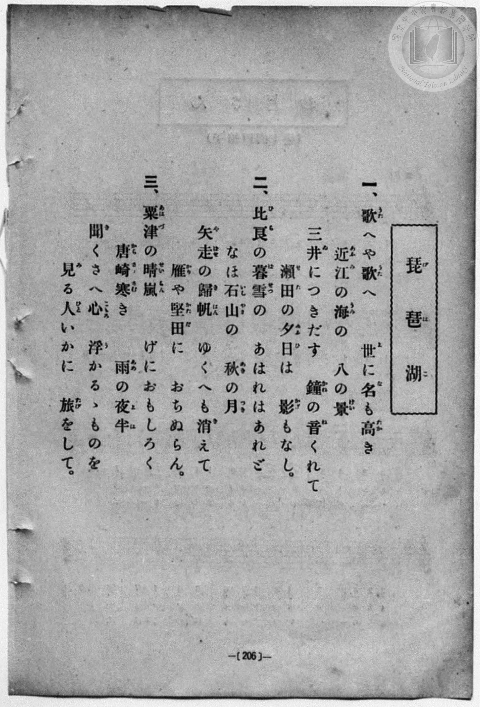
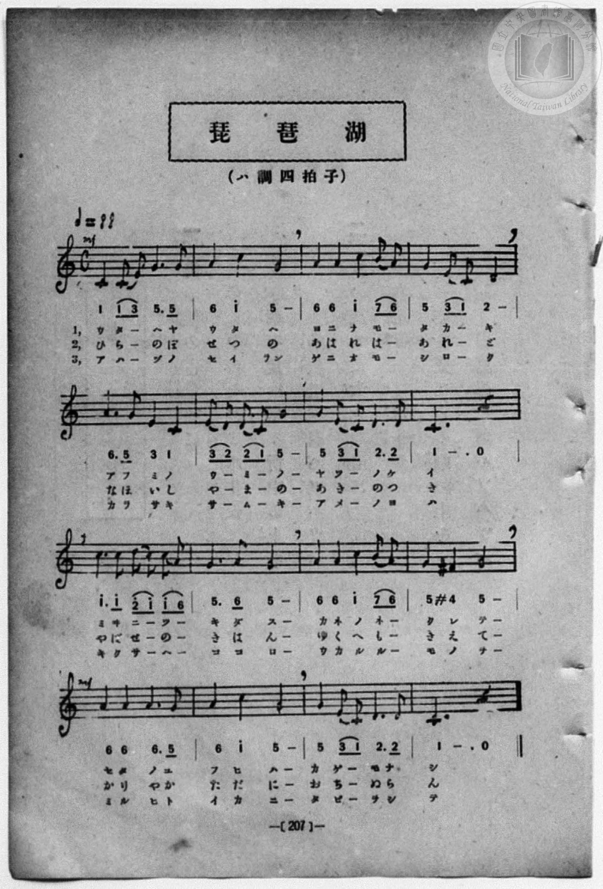

# 琵琶湖

> Re:Shōka 使用 AI 協助辨識與重建樂譜，可能會有錯誤。歡迎回報。

- **鋼琴伴奏版**：<br><audio controls src="biwako.mp3"></audio>
- **NEUTRINO 歌聲合成版**：<br><audio controls src="biwako_neutrino.mp3"></audio>

- book: 新編 小學校・公學校 唱歌教材集（尋常科三・四學年用）
- 一條慎三郎 編《新編 小學校・公學校 唱歌教材集》（大正十二年十二月，索書號 0725-41）
- 出處：共益商社樂器店《唱歌教科書 教師用 巻三》第十四～十五頁（第二學期第二曲）
- 日治時期公學校《唱歌帳》第十冊（P220・207頁・昭和2年1月28日抄）同曲底本

## 說明

> [!NOTE]
> **原書資訊與歌詞全文（對應 P214.jpg–P215.jpg，原書第 206–207 頁）**
> - **調性與拍號**：ハ調四拍子（C 大調 4/4 拍），♩= 88。
> - **版本對照**：本曲源自納所辨次郎、田村虎藏編《教科統合 唱歌教科書 巻三》之〈琵琶湖〉（大和田建樹作詞，詠嘆近江八景：三井晚鐘、瀨田夕照、比良暮雪、石山秋月、矢走歸帆、堅田落雁、粟津晴嵐、唐崎夜雨）。國立臺灣歷史博物館典藏《唱歌帳》第十冊 `vol_10/p220_biwako`（P220.jpg，標註「207頁 2.1.28」）即抄自本書第 207 頁（惟該目錄 `.tmd` 先前誤植了《尋常小學唱歌》版歌詞與後半旋律，圖檔實為本曲）。
> - **原書記譜細節**：開頭標記 `mf`，第 12 小節第二拍出現 `#4`（F♯4，`4'`），第 13 小節轉回 `mf`。第一節第 7 小節原書排印作「八の景」（譜下假名作「ヤツーノケイ」）。
>
> **一、**
> 歌（うた）へや歌（うた）へ　世（よ）に名（な）も高（たか）き
> 近江（あふみ）の海（うみ）の　八（やつ）の景（けい）
> 三井（みゐ）につきだす　鐘（かね）の音（ね）くれて
> 瀨田（せた）の夕日（ゆふひ）は　影（かげ）もなし。
>
> **二、**
> 比良（ひら）の暮雪（ぼせつ）の　あはれはあれど
> なほ石山（いしやま）の　秋（あき）の月（つき）
> 矢走（やばせ）の歸帆（きはん）　ゆくへも消（き）えて
> 雁（かり）や堅田（かただ）に　おちぬらん。
>
> **三、**
> 粟津（あはづ）の晴嵐（せいらん）　げにおもしろく
> 唐崎（からさき）寒（さむ）き　雨（あめ）の夜半（よは）
> 聞（き）くさへ心（こゝろ）　浮（う）かるゝものを
> 見（み）る人（ひと）いかに　旅（たび）をして。


## 歌詞

```text
（TMD 檔案未包含歌詞註解）
```

## ABC

```abc
X:1
T:琵琶湖
M:4/4
L:1/16
Q:1/4=88
K:C
V:V1 name="Voice" snm="Voi"
[V:V1]
!mf! C4 C2 E2 G6 G2 | A4 c4 G8 | A4 A4 c4 B2 A2 | G4 E2 C2 D8 |
w: 1.~う た _ へ や | う た へ | よ に な も _ | た か _ き
w: 2.~ひ ら _ の ぼ | せ つ の | あ は れ は _ | あ れ _ ど
w: 3.~あ は _ づ の | せ い らん | げ に お も _ | し ろ _ く
A6 G2 E4 C4 | E2 D2 D2 C2 G8 | G4 E2 C2 D6 D2 | C12 z4 |
w: 1.~あ ふ み の | う _ み _ の | や つ _ の け | い
w: 2.~な ほ い し | や _ ま _ の | あ き _ の つ | き
w: 3.~か ら さ き | さ _ む _ き | あ め _ の よ | は
!f! c6 c2 d2 c2 c2 A2 | G6 A2 G8 | A4 A4 c4 B2 A2 | G4 ^F4 G8 |
w: 1.~み ゐ に _ つ _ | き だ す | か ね の ね _ | く れ て
w: 2.~や ば せ _ の _ | き は ん | ゆ く へ も _ | き え て
w: 3.~き く さ _ へ _ | こ こ ろ | う か る る _ | も の を
!mf! A4 A4 A6 G2 | A4 c4 G8 | G4 E2 C2 D6 D2 | C12 z4 |
w: 1.~せ た の ゆ | ふ ひ は | か げ _ も な | し
w: 2.~か り や か | た だ に | お ち _ ぬ ら | ん
w: 3.~み る ひ と | い か に | た び _ を し | て
!mf! C4 C2 E2 G6 G2 | A4 c4 G8 | A4 A4 c4 B2 A2 | G4 E2 C2 D8 |
w: 1.~う た _ へ や | う た へ | よ に な も _ | た か _ き
w: 2.~ひ ら _ の ぼ | せ つ の | あ は れ は _ | あ れ _ ど
w: 3.~あ は _ づ の | せ い らん | げ に お も _ | し ろ _ く
A6 G2 E4 C4 | E2 D2 D2 C2 G8 | G4 E2 C2 D6 D2 | C12 z4 |
w: 1.~あ ふ み の | う _ み _ の | や つ _ の け | い
w: 2.~な ほ い し | や _ ま _ の | あ き _ の つ | き
w: 3.~か ら さ き | さ _ む _ き | あ め _ の よ | は
!f! c6 c2 d2 c2 c2 A2 | G6 A2 G8 | A4 A4 c4 B2 A2 | G4 ^F4 G8 |
w: 1.~み ゐ に _ つ _ | き だ す | か ね の ね _ | く れ て
w: 2.~や ば せ _ の _ | き は ん | ゆ く へ も _ | き え て
w: 3.~き く さ _ へ _ | こ こ ろ | う か る る _ | も の を
!mf! A4 A4 A6 G2 | A4 c4 G8 | G4 E2 C2 D6 D2 | C12 z4 |
w: 1.~せ た の ゆ | ふ ひ は | か げ _ も な | し
w: 2.~か り や か | た だ に | お ち _ ぬ ら | ん
w: 3.~み る ひ と | い か に | た び _ を し | て
```

## TMD 檔案連結

- [主旋律 TMD 檔案](biwako.tmd) [[在 TMD Studio 編輯](https://tmdlang.github.io/Tmd-TS/#tmd=s7IKdvYPcrWy4qpTUCpJTLdSSM7PyUlNLsnMz7MqzsjPTozPrsyvSsyML84ojTe0NDJWgqssy88pzU21Si9KTEmNN443QcgU55cWJadaFSdn5OfnxJekVpQk5edno8vHFySmp1oFGBki6Swoyi9LzUvMA-ouKMrMK0lNAWtHKEgty0xJBUkXJyfmxZelFmWmZaamIDkqtagY7HaIFSVFiXnFyUWZBSAPIVTlF5Vk5AMdXpBRaZWRWVySX5SZnJgTn52Yl4hQVJKRCvReTmJeCtCuglR0ifLEktQidMGCnMRkDJVAR5Sl5iDbnpmemWeVm5qZlYkaOiCGlcKzaRueb1-h8HRD_9O1O54tWPi4effT1jUQtsLTKRufre15NnXms7kTXs5ue7-n4-mG7qc7djxfPvHJjk6Q0tmzgUqf7tzyfMqK93s6lbi0tBSeT9j6fMK2ZzunKWhpcSnaKlhYcNnbKjhz2Zjom9iBLH6yo-HZornPWvuAZrxs7lMA2v-4oYsUhzxu6Aa5ZcnyZ2sXP-1tfLKrB-gECOPZnI73e3qeb1n0bPaOFzPnKxiYG5nqmhiCHQe0-2n7rhczp77fM-tp68bns7ueTm17vmTfsxVNT2eueLprOtAZcJuAfgQaoQBkPd2xGug9hafbd4M83dD9fM0aoF1Ar7_fOw9s6ZSXCxqB7gGKg1wCdPGc-RD2s9mbYBY_m7702abdz2Y2ASXh_oLb93THZoTBbV1AwwKMjAyAQWBkYA40HMh4NmPt00k9RkB_GgK9aGQBMq-rBWj60wkga57umvpszholLi59LQVbagEuBQUFO4VoRT__ENdYCEdL62nffFDQbm5_saLrRUc70PEvVs572rri2bR2cProfdbeqQDKaHpZBemPGiYDmaYgJjBWIFqBvlQwMjADSgE9pwAOuk5gSgEbrwu04MWq_c8aloOM7u4FxqCWFjC2Hjf3A4WBQQ4Ue7p2AtAiZwVg9APFFICpSgEoCjQEaMOjmStBCe5xQxPCvOedHcCgATrseetysGFAHjDEnu2a8KJ91fMtvc86G17sW_FszUJgWnzc0Ph8yoZncye-mNn3Yno_NGWCE8PzrRufTuhApERo-oCniic7ux83dMAT_-MGoHtASRQYa0Ajn-7e9WzFzid75wADC-jOFysXPJ3R9mL_xGcbgalh9bOZ64HuAprzBBiNM2e9nDAD5JCGFSCNS6YC3Q3kPls_5UXn-mez1r2cvQokO3_z040bny_vBqYGMHfRi60bngHz4g5g7mh8uqAVqPfFhL0vZzeCZDfNf7Zl6bOZW55unQCSnTLh6Za-p0vmvJwNyrXA0Ho6p_v56u4X7bueNy5-tnb70_5NT3tnPe9c-XLJiqetO4AhgSulKiQAS-Z4QwP9AmB6jU_KLE_Mzk-AJl9orD9bMfPFit2PG3ogaVnBSM9QzwgYRaAoe9q7GZiKgfEAjhNo0oAmio5nzfNfrNz0fPa6lz0tCgl6JbkpCQpPWzuedva-WLXk2ZLeJ7uAXu2ClEiQYgPiRJD7gHEOTpjAZPR0X8_T3q5n07uf7gOWGj1P50x7tmrK0_XLnjftgqQESBAgEgw0ha-Y8WLtnOdbNjxf3wBONi-ndb9csBbsmxkKCblpQG_2gBxsaAQqtICqoHkemEKB4di_TyFB2QQUFG6PZq43AapNMFEHckGpFKzLGKrrxd7Op7PngQ0EugJkxo4GiGEK5lAlEAc965v0tHcDMAkBgxKYZh43rgMmG3AwdgAd-mRH99PG9qcTeiEKHjcvedzc8rh5z2Ngom7a-LhpCSTAYR6F5WagZcAEAct-wDADmva4se1x43yQ4sYdj5tasAg2NDzZMQ0k2AQsbIEiq4H2gtWsAnGbml6ungHmzn_cCAxyoIJeiPmQBA-WanrcuPVx436w7LpnW7fDrICKAK0A-hFsRcvjxiVQZaBsAlQ28XEjqOSDmAnJNWDx_Y-bgEUDyD1ALUBLHzcueNw4E2gUMEOBFXQ_blwLMerl_M1gEQi3_3FTz-PGZRADIfkOLDsb5uV1wGwILHHB7gE6EuhycKppBIZ_w9O9G2GGT4J4HxgOjxuBlQlaUO8CpkxEUIOzM1jjpsdNwFQB9iA4d4MF94Bth3ocaAs4xNaD3bkexAYxVkKMAlu3G1IggPUCQ2w6ONz2wbUDCwpYsIOTAdAuUEUJFAEFFDwwIcUILNg3AN0AVQwuWMDqgaEKdMZkcFpqAIdGPzidND3bBjEQYj6QAQ1PYBEEDZ8mYMUGDJ8WSOkECzRgIlkAjTWQN7seNy583LgGGCZAWzCTK9BWeBhCijWYv4DBAmRD0gmooIPFYAvEKKiDGyeBk0cXOJqAoQT0Tj_ENEipCHMq0JypEL88XQ-MVqDg1MdNDZDEDEpRoJITbG8TqP4Cp5A5wGIGkimAjoEH6YtGYIEPDxZgWAGN3fF0fzNYcPLjprlAN0Dc9mzrOkguAKsEugGIgLJAd6573DQJatoySDyCs0lT95Ndu6BJqBFckoOiHhikoJB8Nr0VlgeBSR2oGOjx6cBIgQYp5a0DKFDQ0uficgIX_FZh-ZnJqQ41BjXVICsUbAzNtMBRp1Cdm1YLZgCbJ4-blgHxfgVg4QTEM4B4iUINkugMEK95BRB3A3EXEC8CqwWpAco3rYbobFoLshlkZo2CIbDcBkEQbQzEplA-CILYNQpmMBVxSMLIEKEEQ6k5VLAGrglkB8guI3RDwO7xMQQ6tbENKgaMAThrB5JaYD4Am0lYJcR5wGQFl10NZ62Cm9aEUIlkTjec1YvdrUYg9ZvgpnTC1a9DdmvjHqjJs-EiS7CqhLkA5hpgToCb3YMhhqISSX4ldrca4zC5cSmKW0HuQXUrKKSh_gOWBFicOwmuFBG0XXBNyEE7HS7aC1fZj9W54KQOSrpTgXg-EPfBkjk44YNEQDRYFJgFgNU1XARYY4PVLkEkcViqBEFQMgQlQRCEJf0asAgoQYIwSBQzheNLviA2IiOhQwMUn0ESOCxUIGGwFUzuh_NhiQI1gWPKI1wHyRAQWeyJC1jzQ02EqUSH8ajuBCduWBaBmLAbTCJsgsUnqv378LkTKQn24nAnyP0glTB5Au4EJ2xYVgWbAM6IwLoCwyaQSrhoUwOGPFZ3NjVidye4SAGphGUl_O6sRirEwel3A7SQBqVaSOoFBeNaIKsBSO8E80DFdS8kVYNpiJr1QNYaIG5DKsRh5S0IgjlGIALMAhOoZTAIgkQoKshN1KEMDFOQEjos0UKCbAKIRComYEkVPbqBrRowORPDfcil8lo4CxYxCDGQSljRglw6LsPuVlBihydhiMoNYBJRDiJnSlS3ghIA1qKxCZF54W6B106oRSPMRGDjj5BbwQke1QUg05ETPMwOkEpkd0F4iOIXya1IBQ08hJswWSBfIbIwPNybYJUAqltRmy67oY0UUGpeBi65QaX7JCDuh6X2pk3QHAEq-7vAotsxy3F0GgSJbqpQtyBHpA9EuwG1mACFK0glqJCHyMNbDBhFB2r6hles8BCHiIMKZeTqFB1iK8gRMYmomlHTO0gFavsHlAchLFiORXYn3JzGhXDWGmQTwcUwKAbRcwYOd4LTNbySQ6Q9eHhBeCug9iMqHIRKbO5E-Gcz3Gzk1AoJR5BK9PyG6c5aLi5dOwVIg10BhaXMBQA)]
- [鋼琴伴奏 TMD 檔案](biwako_piano.tmd) [[在 TMD Studio 編輯](https://tmdlang.github.io/Tmd-TS/#tmd=s7IKdvYPcrWy4qpTUCpJTLdSSM7PyUlNLsnMz7MqzsjPTozPrsyvSsyML84ojTe0NDJWgqssy88pzU21Si9KTEmNN443QcgU55cWJadaFSdn5OfnxJekVpQk5edno8vHFySmp1oFGBki6Swoyi9LzUvMA-ouKMrMK0lNAWtHKEgty0xJBUkXJyfmxZelFmWmZaamIDkqtagY7HaIFSVFiXnFyUWZBSAPIVTlF5Vk5AMdXpBRaZWRWVySX5SZnJgTn52Yl4hQlFgE1JyempuaV2JVkJmYlx-fmJycn1uQmJcJEgMrBPnLSuHZtA3Pt69QeLqh_-naHc8WLHzcvPtp6xoIW-HplI3P1vY8mzrz2dwJL2e3vd_T8XRD99MdO54vn_hkRydI6ezZQKVPd255PmXF-z2dSlxaWgrPJ2x9PmHbs53TgMpfzp75rLP7Zfee5xO2PNmz5enSfqAqBS0tLkVbBQsLLntbBWcuGxN9EzuQg57saHi2aO6z1j6g2S-b-xSA7nrc0EWKAx83dIPcuGT5s7WLn_Y2PtnVA3QahPFsTsf7PT3Ptyx6NnvHi5nzFQzMjUx1TQzBjgba_bR914uZU9_vmfW0dePz2V1Pp7Y9X7Lv2YqmpzNXPN01HegMuE1AvwONUACynu5YDfS2wtPtu0GB0dD9fM0aoF3AIHm_dx7Y0ikvFzQC3QMUB7kE6OI58yHsZ7M3wSx-Nn3ps027n81sAkrC_QW37-mOzQiD27qAhgUYGRkAg8DIwBxoOJDxbMbap5N6jID-NAR60cgCZF5XC9D0pxNA1jzdNfXZnDVKXFxOmeWJ2flWAaDEEOThUGNQU82lAAQ2hmZadmBWdW5aLZihr6XwuGkZEO9XeNy8B4hnAPEShRok0RkgXvMKIO4G4i4gXgRWC1IDlG9aDdHZtFZBSx9sZo2CoYIuGIJoYyA2hfJBEMSuUTCDqYhDEkaGCCUYSs2hgjVwTSA7QHYZoRsCdo-PIdCpjW1QsceN8-GsHUhqHze1gM0krBLivMdNHXDZ1XDWKrhpTQiVSOZ0w1m92N1qBFK_CW5KJ1z9OmS3Nu6BmjwbLrIEq0qYC2Cuedy4Hm52D4YYikok-ZXY3WqMw-TGpShuBbkH1a2gkIb673HTZCzOnQRXigjaLrgm5KCdDhfthavsx-pccFIHJd2pQDwfiPtgyRyc8EEiIBosCswCj5tb4CKPmzaC1S5BJHFYqgRBUDIEJUEQhCX9GrAIKEGCMEgUM4XjS74gNiIjoUMDFJ9BEjgsVCBhsBVM7ofzYYkCNYFjyiNcB8kQEFnsietx40SoiTCV6DAe1Z3gxA3LIhATdoNJhE2w-ES1fx8-dyIlwV4c7gS5H6QSJk_AneCEDcuqYBPAGfFx41QMm0Aq4aJNDRjyWN3Z1IjdneAiBaQSlpXwu7MaqRAHp98N0EIalGohqRcUjGuBrAYgvRPMAxXXvZBUDaYhatYDWWuAuA2pEIeVtyAI5hiBCDALTKCWwSAIEqGoIDdRhzIwTEFK6LBECwmyCSASqZiAJVX06H7cuABMzsRwH3KpvBbOgkUMQgykEla0IJeOy7C7FZTY4UkYonIDmESUg8iZEtWtoASAtWhsQmReuFvgtRNq0Qgz8XEjoqbC4VZwgkd1Ach05AQPswOkEtldEB6i-EVyK1JBAw_hJkwWyFeILAwP9yZYJYDqVtSmy25oIwWUmpeBS25Q6T4JiPthqb1pEzRHgMr-LrDodsxyHJ0GQaKbKtQtyBHpA9FuQC0mQOEKUgkq5CHy8BYDRtGBmr7hFSs8xCHioEIZuTpFh9gKckRMIqpm1PQOUoHa_gHlQQgLlmOR3Qk3p3EhnLUG2URwMQyKQfScgcOd4HQNr-QQaQ8eXhDeCqj9iAoHoRKbOxH-2Qw3Gzm1QsIRpBI9v2G6sxa1ve6D3F43gTbXgUn9RV_Xy_bep607Xs5uhfSukErqeIVow1gYVaNgAmSYIPhQVVBRKAXXZRoPpE3jMdTBTTMCMoxysSjEMADJIQaErCXgOLCluB0HV4fdq4RcBgxzXTsFSLBH-wDFkXhAW5F4xmCeMhcA)]

## 分析

```text
================================================================================
📊 TMD Song Profile: [ 琵琶湖 ]
================================================================================
⏱  Duration:       1:27 (87.3s), 32 measures total
🎼 Key & Tempo:    首調基準 C, != 88.0 BPM, <4/4>
   - 分析範圍：      由實際發聲的音符與和弦推測調性；播放脈絡另行呈現
🎤 人聲音域:    C4 (MIDI 60) – D5 (MIDI 74) [跨度: 14 個半音 / 1.2 個八度, 難度: moderate]
   - 最低音:  C4 in [Biwako #1 @ m.1, 0:00]
   - 最高音: D5 in [Biwako #1 @ m.9, 0:23]
   - 適合: soprano, mezzo-soprano, contralto, tenor, baritone, bass
🏛  結構:      Biwako (43.6s) -> Biwako (43.6s)
⚡ 編曲密度:        Peak 1 軌道同時演奏
🗝  調性診斷：       C 大調（純淨自然大調，未偵測到可信轉調）
   - 風格氣質:    純淨自然大調（陽光明朗、易唱易記，無明顯調外色彩）
   - 轉調歷程:    全曲維持單一推測調性（未偵測到可信轉調）
   - 核心骨幹音:  G, C, A, D, E
   - 調性數值:    C 大調 [相關度: 0.82, 穩定度: Moderate, 自然音純度: 98.4%]
   - 候選調性 (K-S): C 大調 (0.82), G 大調 (0.74), A 小調 (0.60)
   - 五度圈歷程:   +0 -> +0
   - 各段落調性細節:
     • [Biwako #1]: C 大調 (r: 0.82, 自然音純度: 98.4%, 調外音: F#)
     • [Biwako #2]: C 大調 (r: 0.82, 自然音純度: 98.4%, 調外音: F#)

  [ 五度圈游移軌跡 ]
              [C ]*
         F            G  
      Bb               D  
      Eb               A  
         Ab           E  
            Db       B  
               F# 
     (* = active key center)

  [ 十二半音累積音高分佈 ]
     C  : ███████████████████████   28.2%
     C# :                            0.0%
     D  : ██████████                12.1%
     D# :                            0.0%
     E  : █████                      5.6%
     F  :                            0.0%
     F# : █                          1.6%
     G  : ████████████████████████  29.8%
     G# :                            0.0%
     A  : █████████████████         21.0%
     A# :                            0.0%
     B  : █                          1.6%
--------------------------------------------------------------------------------
Assignment 軌道音域：
  - Voice         : C4 – D5 (14 個半音 / 1.2 個八度, 124 個音符)
================================================================================
```


## 原書掃描頁






