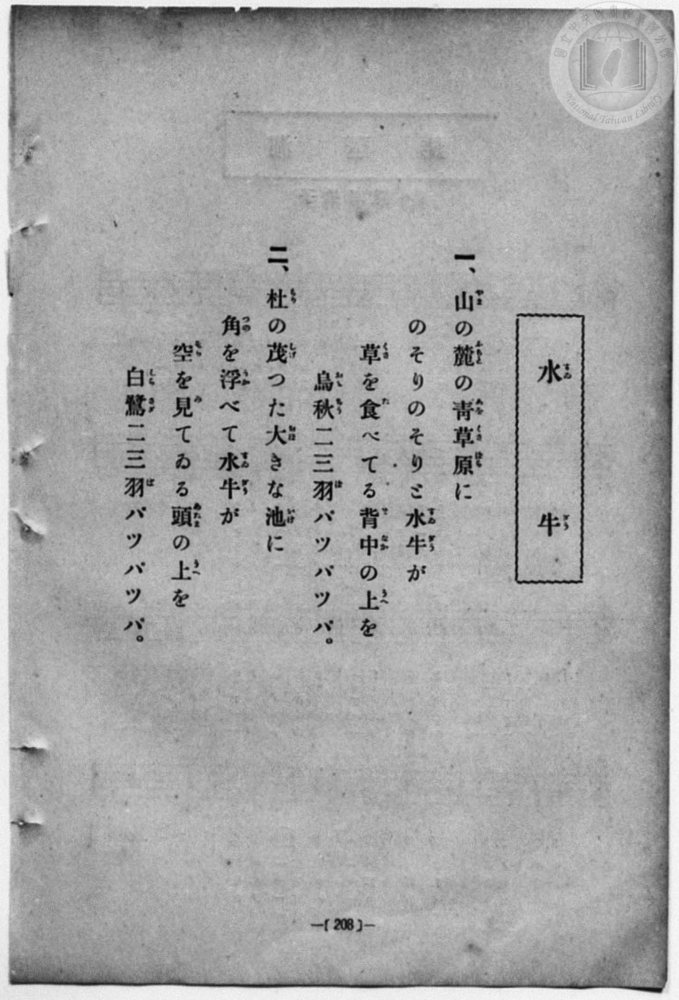
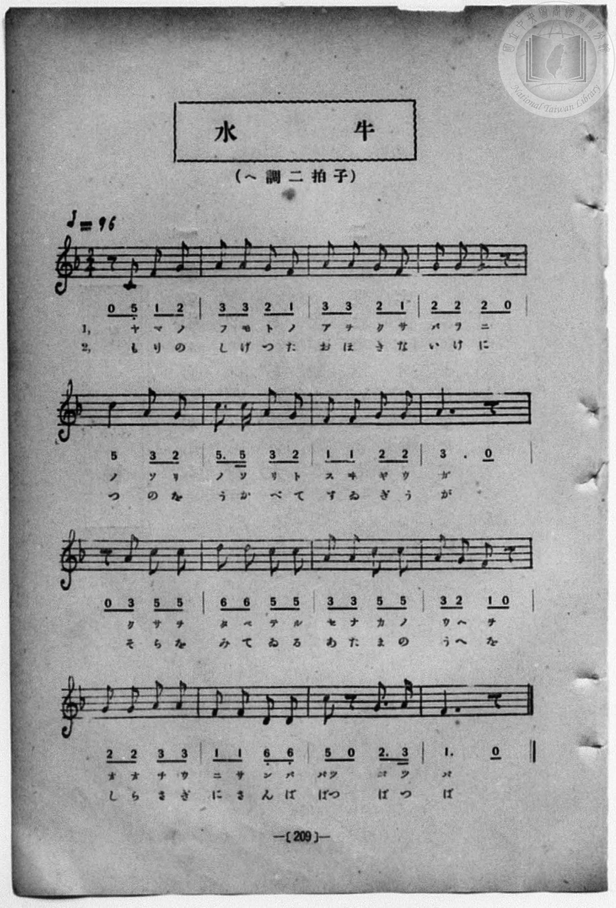

# 水牛

> Re:Shōka 使用 AI 協助辨識與重建樂譜，可能會有錯誤。歡迎回報。

<audio controls src="suigyu.mp3"></audio>

- book: 新編 小學校・公學校 唱歌教材集（尋常科三・四學年用）
- 一條慎三郎 編《新編 小學校・公學校 唱歌教材集》（大正十二年十二月，索書號 0725-41）

## 說明

> [!NOTE]
> **原書資訊與歌詞全文（對應 P216.jpg–P217.jpg，原書第 208–209 頁）**
> - **調性與拍號**：ヘ調二拍子（F 大調 2/4 拍），♩= 96。
> - **曲風與構造**：全曲共 16 小節，以五聲音階與弱起半拍（`0 5_`、`0 3`）描繪臺灣鄉間山麓青草原上慢吞吞吃草的水牛與背上飛舞的烏秋（大卷尾），以及樹林大池塘裡只露出雙角望著天空的水牛與頭頂振翅飛過的白鷺鷥，富有濃厚臺灣農村風情。
> - **原書排印細節**：第一節作「烏秋（おしちう）」，譜下假名作「オオチウ」（おおちう）。
>
> **一、**
> 山（やま）の麓（ふもと）の靑草原（あをくさはら）に
> のそりのそりと水牛（すゐぎう）が
> 草（くさ）を食（た）べてる背中（せなか）の上（うへ）を
> 烏秋（おしちう）二三羽（にさんば）バツバツバ。
>
> **二、**
> 杜（もり）の茂（しげ）つた大（おほ）きな池（いけ）に
> 角（つの）を浮（うか）べて水牛（すゐぎう）が
> 空（そら）を見（み）てゐる頭（あたま）の上（うへ）を
> 白鷺（しらさぎ）二三羽（にさんば）バツバツバ。

### 編曲說明（鋼琴伴奏版）：

1. 前奏 (Intro, 4 小節)：引用結尾樂句「烏秋二三羽バツバツバ」，引出臺灣田野水牛與飛鳥相伴的悠閒景象。
2. 主歌伴奏 (Suigyu, 16 小節 × 2 段)：右手演奏主旋律，左手配以輕快溫厚的二拍子和弦伴奏。


## 歌詞

```text
（TMD 檔案未包含歌詞註解）
```

## ABC

```abc
X:1
T:水牛
M:2/4
L:1/16
Q:1/4=96
K:F
V:V1 name="Piano" snm="Pia"
[V:V1]
z2 C2 F2 G2 | A2 A2 G2 F2 | A2 A2 G2 F2 | G2 G2 G2 z2 |
w: 1.~や ま の | ふ も と の | あ を く さ | は ら に
w: 2.~も り の | し げ つ た | お ほ き な | い け に
c4 A2 G2 | c3 c A2 G2 | F2 F2 G2 G2 | A6 z2 |
w: 1.~の そ り | の そ り と | す ゐ ぎ う | が
w: 2.~つ の を | う か べ て | す ゐ ぎ う | が
z2 A2 c2 c2 | d2 d2 c2 c2 | A2 A2 c2 c2 | A2 G2 F2 z2 |
w: 1.~く さ を | た べ て る | せ な か の | う へ を
w: 2.~そ ら を | み て ゐ る | あ た ま の | う へ を
G2 G2 A2 A2 | F2 F2 D2 D2 | C2 z2 G3 A | F6 z2 |
w: 1.~お お ち う | に さ ん ば | バツ バ ツ | バ
w: 2.~し ら さ ぎ | に さ ん ば | ばつ ば つ | ば
```

## TMD 檔案連結

- [主旋律 TMD 檔案](suigyu.tmd) [[在 TMD Studio 編輯](https://tmdlang.github.io/Tmd-TS/#tmd=s7IKdvYPcrWy4qpTUCpJTLdSSM7PyUlNLsnMz7MqzsjPTozPrsyvSsyML84ojTe0NDJWgqssy88pzU21Si9KTEmNN443QcgU55cWJadaFSdn5OfnxJekVpQk5edno8vHFySmp1oFGBmaIWQKivLLUvMS84C6C4oy80pSU8DaEQpSyzJTUkHSxcmJefFlqUWZaZmpKUiOSi0qBrsdYkVJUWJecXJRZgHIQwhV-UUlGflAhxdkVFplZBaX5BdlJifmxGcn5iUiFJVkpAK9l5iXmZuYgy5akphZnggxEOQ1K4Vn0zY8375C4emG_qdrdzxbsPBx8-6nrWsgbIWnUzY-W9vzbOrMZ3MnvJzd9n5Px9MN3U937Hi-fOKTHZ0gpbNnA5U-3bnl-ZQV7_d0KnFpaSk827DleedsBS0tLkVbBUszLntbBTcuGyN9EzuQrU92NDxbNPdZax_QgJfNfQpAyx83dJHiiscN3SCHLFn-bO3ip72NT3b1AO2HMJ7N6Xi_p-f5lkXPZu94MXO-goG5kamuiSHYZVz6Wgq21AJcCgoKdgrRin7-Ia6xEI6W1tO--SB7N7e_WNH1oqMd6OYXK-c9bV3xbFo7OOR6n7V3KoCSjV5WQfqjhslApjmICXQyROvzNWsUjAwsgFJGBpYKLxc0Ah0ODEaw8bpAC16s2v-sYTnI6O5eoPe0tN7vmfW4eQZQGOT37t6naycALXJTAIYNUEwBGOQKQFGgIUAbHs1cCYqNxw1NCPOezd70ctEKkHnLu182LACbB3Lv7E1PWzcqGJqB4uP5-gag7ie7lz7ZNeVF46aX8ze_nNUH1PJ0z8YXW7c_7e0C29CRYKBgGp_wuKERyDBOAFr5rL__-c5VL9p3PW9c_LKl8-W0yU83bny5a_LLuZNe9HYC_ftkR9ez1kVPJ8wDo2ag4PNZLZC0AzT-RXMPUMHLxUD2PKD48-b-58uh0f60d_vTDfsgvgK662l_17MVO5_Nmw5KERsXPF0448XihU_7V72cs-lp-66Xs2e-WD7p2ZzZLyYCFax8vnIXsi0vF6x9uaDpWc_65_tbgXa9bOwD2TVz78vtu15uXwqKl_XANNX5bH_z075ZEL-82Lfp2dyJwGB71tyKEpiQKHzWN-lp74bnWzYAww0cnsA4BSZ5IO_J3jmPG3rgHnnc2PW4cfrjxoWPG4H5qvNxAzAUe16snfNkR_fTxvanE3oh6h83rQKh5sbHTcvAaiAagQiuEeIGWCIEWgaMBViqAYY5SEtTy-NGUIg9blwHjAKwIVsfNzU9bgRlWpDg3ImQSAFLNT1umvS4sf9x49THjesfNwHDGahmNcRAoOLHjXMfNwEdAGesgIQnWO_Mx00THjf2Qd3W2APRBTQcLAsyEyTeNOnlYohdQBKobOfjxmWPm7rBkb4WLD77ceOqx43AgAI5D5gSwIJtjxt3QLRDjMUVmMDcACxdnu_bC5ZaDfJI0-THjRtAepsnPG5uQZDooberByn0ns2dAw49YIAAHQByyYueJrCZQLsmgUWWAL0ATHgwN-wGC_YCHQ9MimBBYMhPRA5AYGoEiwM1roP45dlWIAPiO4h_QaFBMEiBKRksC4wCcAQ1TXqxDBIU-8HKgOE5ARikwBQOjdPG-fA0gDM8wSkf6sEmoEpgAugjJzwpL2ChQEFLn4sruDQzvbLUKiAzMS_focagphpkhYKNoZkWON4UsBXsCpB892Jhj4IGqFg1BBaqJtDyTAdUCINLXk0sGoE2ggytUTAAZmvTeCBhCMRGQFyjYAwkQRjEA4liEwGxYBhkRA3YOB_DGgWQWcCsCCIb94HJdWAdwMwIlmkCi61AkQGLNU0Ci_WDyalQmfVgmU6w2GogCTIdapcRzC6I7i4UE6eDeRATl4DJ-VAZiLrdYLIXTK6CykDcPBHNLvyBv6sHHvimwMC3IC3wTYE2gCAsbGEipkgioPCGxQ0ifmAQNewh_gdBYJaBhwpCHCQKCylQDIBkZoLVTQCL9YHJNqhMD5I9qOEOCVOIiSCTIXEHEgfpBYl2A_FOMGsZGfYQSPCd8DC3BIa5oRHpKR4UhKCgBuEaBTMgCcIIEViCRxWBJX8sCR4p2SICA5TkkIMBWFJBZWaDxUAJDxRUyAkXFCjAAgtuDpYED41acKaA27UfyRZwIMPtgmQ4iFtQMyR2u_AGPrApjChtjEGhD2s_ERn6sGQMC2FEAjcDWQ8mgNkARIGCGaQUpBCiDFeqh6RoCLkQTMLSFigfw6JlMpi9ASIDLsuhfgZywMaCRMBSSFahJ3xwwQItkMDGghMzXqsaN0DyCyTyQIKQUgkshWFVLReXrp0CpDZQALKUuQA)]
- [鋼琴伴奏 TMD 檔案](suigyu_piano.tmd) [[在 TMD Studio 編輯](https://tmdlang.github.io/Tmd-TS/#tmd=s7IKdvYPcrWy4qpTUCpJTLdSSM7PyUlNLsnMz7MqzsjPTozPrsyvSsyML84ojTe0NDJWgqssy88pzU21Si9KTEmNN443QcgU55cWJadaFSdn5OfnxJekVpQk5edno8vHFySmp1oFGBmaIWQKivLLUvMS84C6C4oy80pSU8DaEQpSyzJTUkHSxcmJefFlqUWZaZmpKUiOSi0qBrsdYkVJUWJecXJRZgHIQwhV-UUlGflAhxdkVFplZBaX5BdlJifmxGcn5iUiFCUWATWnp-am5pVYFWQm5uXHJyYn5-cWJOZlgsTACkH-slJ4Nm3D8-0rFJ5u6H-6dsezBQsfN-9-2roGwlZ4OmXjs7U9z6bOfDZ3wsvZbe_3dDzd0P10x47nyyc-2dEJUjp7NlDp051bnk9Z8X5PpxKXlpbCsw1bnnfOBqp9OXvms87ul917nk_Y8mTPlqdL-4FKFLS0uBRtFSzNuOxtFdy4bIz0TexArnmyo-HZornPWvuABr9s7lMAOupxQxcprnvc0A1y4JLlz9Yuftrb-GRXD9BdEMazOR3v9_Q837Lo2ewdL2bOVzAwNzLVNTEEu5hLX0vBllqAS0FB4XHDhGezNz2fve7FqlXPZvQ9bpgIFgW6vH3Xi5lT3--ZRRW_4o2Jnudr1iiYmCi8XDbtcUMHJEYeN3QCJZ72zQcGAkjayMDiUcNkIwNLhZcLGoEhB0rNelkF6UBBINMcxAQG0OOGJqjzX6za_6xh-YuO9mfdvcBABPrjcfMMoCAofLt7n66dADTDTQEY_kAxBWC0KgBFgQYA7XzZMP_prmUK4GhHmAf0LDCcIIEESi1I6eR5JzC-gDpngZQqKBjqKTzt7AWKK2h45pUU5esomICC6fn6Bk2gmqd7pgL9_HzrhKcb9j1b0fS0f-njhp7nzf3Pl3cDnQYMnef79j5unvC4uQVBNgBd1gPUCIqS9l3PGxc_n7LhZXsfJKCAXny5ePbLzUufz94BdM_zWS3Pmha8nDbp2cz1LzYuhHpAQcFIT-HJjt3AWIG4WUEjuDQzvbJUR8HQDOo6hcPTFYwUnq3bCnZm_2Zgbni2ZwpQLUjf9O6n-4AJtufp9mWgXNLa-2T30hdAF-1f_WzX6qd9s4DWwkP26SSgY5dB7IHaT3lahQIFLX0uLnCwWgWASoogD4cag5pqsB9tDM207MCsGqBHdMHYGIprFAyBJAibxcOIGgVTEGUAVQpSCFEGgyCZGq5aFAt9kC20gNtnGh-vEG0aH6tgCKQNY0EGQRhmIAmz-FyQEEiRAUIpXA2QMoBYBIkUfF7Dlv8VgBkEmEtfLOxR0ADlFUNgpoClOR0FWPbQxKIRGJoQ94O8Cg4NkP9BoVEDDzoQDySKTQQWzCAMCS2QcT6GNQogsx43tYDIxn1gch1Yx-PGrWCZJrDYChQZsFjTJLBYP5icCpVZD5bpBIutBpLg6IPYZQSzC6K7C8XE6WAexMQlYHI-VAaibjeY7AWTq6AyEDdPRLMLf-Dv6oEHvikw8C1IC3xTaHqDhS1MxBRJBJZ8YaENiQ3UlAoLe4j_QfBx41x4qCDEQaKwkALFAEhmJljdBLBYH5hsg8r0INmDGu6QMIWYCDIZEncgcZBekGg3EO8Es5aRYQ-BBN8JD3NLYJgbGpGe4kFBCApqEK5RMAOSIIwQgSV4VBFY8seS4JGSLSIwQEkOORgeN3VDZWaDxUAJDxRUyAkXFCiPG3fAzcGS4KFRC84UcLv2I9kCDmS4XZAMB3ELaobEbhfewAfW34jSxhgU-rBahMjQp2L5jEj1kBQNIReCSVjaAuVjWLRMBrM3QGTAdSzUz0AO2FiQCFgKySr0hA8uWKAFEthYcGLGa1XjBkh-gUQeSBBSKoGlMKxCqwxwVDuICgSl0sHJh9c9kKoI4iOijcFZc2E3xQTIMCHGMSimUKkm1bVTANfaCkAGJCCjfYAKkHhGYJ4yFwA)]

## 分析

```text
================================================================================
📊 TMD Song Profile: [ 水牛 ]
================================================================================
⏱  Duration:       0:20 (20.0s), 16 measures total
🎼 Key & Tempo:    首調基準 F, != 96.0 BPM, <2/4>
   - 分析範圍：      由實際發聲的音符與和弦推測調性；播放脈絡另行呈現
🎤 人聲音域:    C4 (MIDI 60) – D5 (MIDI 74) [跨度: 14 個半音 / 1.2 個八度, 難度: moderate]
   - 最低音:  C4 in [Suigyu #1 @ m.1, 0:00]
   - 最高音: D5 in [Suigyu #1 @ m.10, 0:11]
   - 適合: soprano, mezzo-soprano, contralto, tenor, baritone, bass
🏛  結構:      Suigyu (20.0s)
⚡ 編曲密度:        Peak 1 軌道同時演奏
🗝  調性診斷：       C 調性不明確（純淨自然大調，未偵測到可信轉調）
   - 風格氣質:    純淨自然大調（陽光明朗、易唱易記，無明顯調外色彩）
   - 轉調歷程:    全曲維持單一推測調性（未偵測到可信轉調）
   - 核心骨幹音:  A, G, C, F, D
   - 調性數值:    C 調性不明確 [相關度: 0.73, 穩定度: Ambiguous, 自然音純度: 100.0%]
   - 候選調性 (K-S): C 大調 (0.73), F 大調 (0.71), A 小調 (0.67)
   - 五度圈歷程:   +0
   - 各段落調性細節:
     • [Suigyu #1]: C 調性不明確 (r: 0.73, 自然音純度: 100.0%)

  [ 五度圈游移軌跡 ]
              [C ]*
         F            G  
      Bb               D  
      Eb               A  
         Ab           E  
            Db       B  
               F# 
     (* = active key center)

  [ 十二半音累積音高分佈 ]
     C  : ███████████████████       21.1%
     C# :                            0.0%
     D  : ██████                     7.0%
     D# :                            0.0%
     E  :                            0.0%
     F  : █████████████████         19.3%
     F# :                            0.0%
     G  : ██████████████████████    25.4%
     G# :                            0.0%
     A  : ████████████████████████  27.2%
     A# :                            0.0%
     B  :                            0.0%
--------------------------------------------------------------------------------
Assignment 軌道音域：
  - Piano         : C4 – D5 (14 個半音 / 1.2 個八度, 52 個音符)
================================================================================
```


## 原書掃描頁






