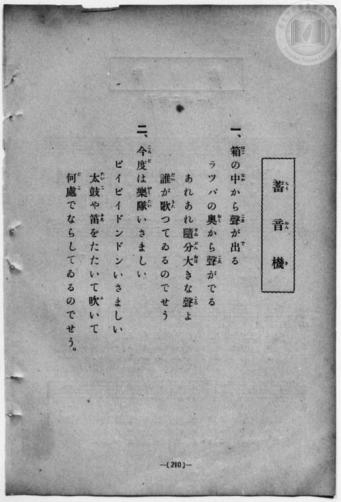
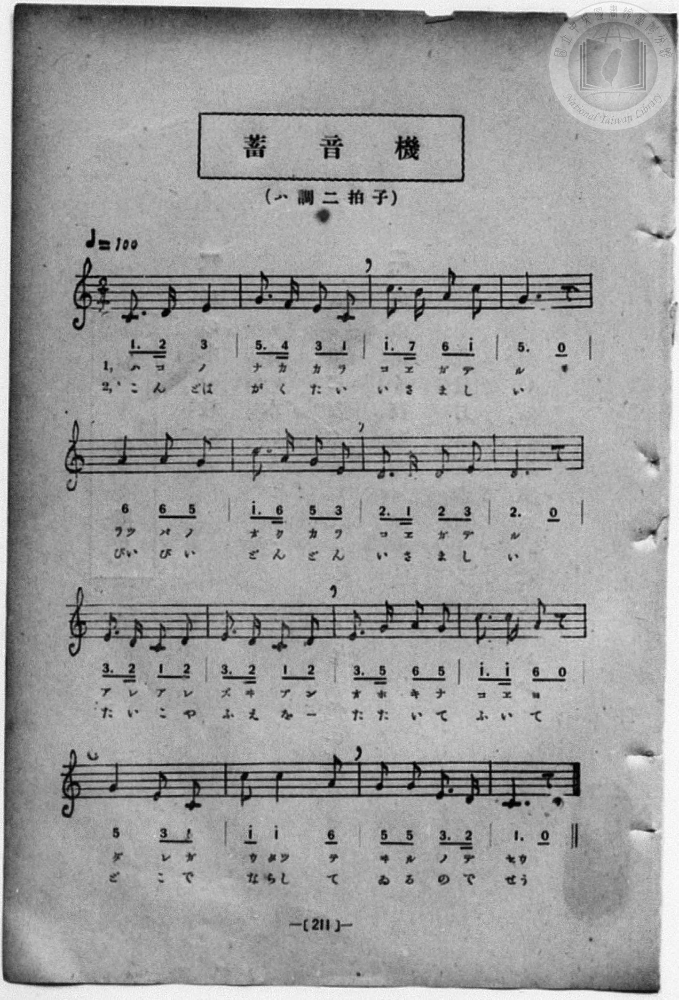

# 蓄音機

> Re:Shōka 使用 AI 協助辨識與重建樂譜，可能會有錯誤。歡迎回報。

- **鋼琴伴奏版**：<br><audio controls src="chikuonki.mp3"></audio>
- **NEUTRINO 歌聲合成版**：<br><audio controls src="chikuonki_neutrino.mp3"></audio>

- book: 新編 小學校・公學校 唱歌教材集（尋常科三・四學年用）
- lyrics: 葛原しげる
- composer: 梁田貞
- 一條慎三郎 編《新編 小學校・公學校 唱歌教材集》（大正十二年十二月，索書號 0725-41）

## 說明

> [!NOTE]
> **原書資訊與歌詞全文（對應 P218.jpg–P219.jpg，原書第 210–211 頁）**
> - **調性與拍號**：ハ調二拍子（C 大調 2/4 拍），♩= 100。
> - **詞曲作者**：葛原𦱳（葛原しげる）作詞／梁田貞 作曲（原載《大正幼年唱歌》）。
> - **版本對照**：本曲與《新定兒童唱歌》尋常科第三學年用〈蓄音機〉同曲，惟本書收錄之第二節為描寫留聲機播放樂隊吹笛打鼓（「今度は樂隊いさましい…」）之版本，且第 2 小節作 `5. 4̲ 3 1`、第 3 小節作 `1^. 7̲ 6 1^`、第 11 小節作 `1^. 1^̲ 6 0`、第 14 小節作 `1^ 1^ 6`（後半拍八分音符），速度標記為 ♩= 100。
>
> **一、**
> 箱（はこ）の中（なか）から聲（こゑ）が出（で）る
> ラツパの奧（おく）から聲（こゑ）がでる
> あれあれ隨分（ずゐぶん）大（おほ）きな聲（こゑ）よ
> 誰（だれ）が歌（うた）つてゐるのでせう
>
> **二、**
> 今度（こんど）は樂隊（がくたい）いさましい
> ピイピイドンドンいさましい
> 太鼓（たいこ）や笛（ふえ）をたたいて吹（ふ）いて
> 何處（どこ）でならしてゐるのでせう。

### 編曲說明（鋼琴伴奏版）：

1. 前奏 (Intro, 4 小節)：引用第四段「誰が歌つてゐるのでせう」俏皮輕快的結尾樂句開場。
2. 主歌伴奏 (Chikuonki, 16 小節 × 2 段)：右手演奏主旋律，左手以活潑的八分音符分解和弦伴奏。


## 歌詞

```text
（TMD 檔案未包含歌詞註解）
```

## ABC

<div class="abc-score" data-abc-src="chikuonki.abc" aria-label="五線譜載入中"></div>

[下載 ABC 原始檔](chikuonki.abc)

## TMD 檔案連結

- [主旋律 TMD 檔案](chikuonki.tmd) [[在 TMD Studio 編輯](https://tmdlang.github.io/Tmd-TS/#tmd=s7IKdvYPcrWy4qpTUCpJTLdSSM7PyUlNLsnMz7MqzsjPTozPrsyvSsyML84ojTe0NDJWgqssy88pzU21Si9KTEmNN443QcgU55cWJadaFSdn5OfnxJekVpQk5edno8vHFySmp1oFGBlaIGQKivLLUvMS84C6C4oy80pSU8DaEQpSyzJTUkHSxcmJefFlqUWZaZmpKUiOSi0qBrsdYkVJUWJecXJRZgHIQwhV-UUlGflAhxdkVFplZBaX5BdlJifmxGcn5iUiFJVkpAK9V5KanJGXn5OfXokuk1tanJmMbGZmemaeVW5qZlYmFj9DpUsSM4HBCgzN_PLE-NzEzLycxDyI80HKrRSeTdvwfPsKhacb-p-u3fFswcLHzbuftq6BsBWeTtn4bG3Ps6kzn82d8HJ22_s9HU83dD_dseP58olPdnSClM6eDVT6dOeW51NWvN_TCTY3pxLouWIrhRcTZz_tm_-4cfrjxkmPm7rBcsn5uQX5xalFQHsXNT6fsuHFpnlKXFpaCi8mt7ycv_nZyvkKWlpcirYKhgYGXPa2Cs5cNkb6JnYgnU92NDxbNPdZax_Q4pfNfQpARz9u6CLF9Y8bukEeWLL82drFT3sbn-zqAbobwng2p-P9np7nWxY9m73jxcz5CgbmRqa6JoZgH3HpaynYUgtwKSgo2ClEK_r5h7jGQjhaWsBQAtm7uf3Fiq4XHe1AN79YOe9p64pn09rBId77rL1TAZRs9bIK0h81TAYyLUFMoJMhWp-vWaNgZGgAlDIyNFR4uaAR6HBgOIKN1wVa8GLV_mcNy0FGd_cCvael9X7PrMfN_UBhkN-7e5-unQC0yFkBGDZAMQVgkCsARYGGAG14NHMlODoeNzQhGbhy3rPZm57snfOioRVsGiSuPyzbuBloEFrEA80BqVw57_2efnisKwCFgEaA_Nc3_8WeTmBcQmNm5x5QtICjDhxjQCkkm593djybswYYJs9bl4NtBvKA5gD9BkkNT9fNeto66fnqpXAT4CkWGErAtANPro8bOuCp7nFD59MJPWD39Dxrng82c8ezKdte9rQ82dkN0rir5_n6hudNu5719z9dv_r51JkvGjcBNT6btPbZlH3PVjS9nNX1dMLO52tmP-uc_HLPZKC_Hjf0PNnd9XTXsseN6yEKHje2PG6c-rhxHzhoWh41LHvcAAplkBVgbwFtf7JjCjg2QUkaaCMwlBQSTPUUTM5sUjBWMEx43NAIkjZGljaM01MwB8qbKRjGwRQAkwGaCsM4sBIDuAoTVBVABQpmCaD42NfztLcLlCpaVz_taAMG0PM1yyBp4WXDfKB_nq2Y-WLFDGBYKKCnDViCBuZVoC2wFPh83UZQcDSuf9wIDJfOx43rnuxYCxZZ9bgRHMGN3Y-bOoEBChac_LhpIliw52n7LrDIchC3qRti2uPmlY-bWx43TwSa83QpUAqoABiy_XjMAZqA0N7Y9LgJKAIiX85aAfQgWPGsx00THjdue9wEciEwIcKM3Q02oRfoVHRjmzogBr5YtQEsvgBoIMQ6YLIDi7Q9bpwPFlnyuHEZyPymbqCbQY5pnA2URQ2xXcCkCg8xSLqBWTf5ceNKsDnQZAQWB3qhH2g-MBmBpVASFiygpjxuWgIjgYX1ZiiJTfHTJaugqRZsJjSmmlqACRosuPVxI7CEBIpMAiuAqFkGTPEQWZgblkHdv3fqi5lTwVIrYZEO9PUqYOyALcUSGtAkRHkJCwUKWvpcXM4Zmdml-XnZmVYBmYl5-Q41BjXVIFsUbAzNtMBhr4CtcFcAlxQNLxb2KGiAswqwYIXlFh1QQQwufTWxaARaCjK0RsEQWFjpAnOxMZjWBYqYgmkTsAhIFqgmDixkDsyVQCEQB6YKAg1AImDzfAxrgAl3PVgUGJ5AvA5uLjBYoeLdYAxkNXVCZSZDZJomAtk9YDXLITJNIHUwGI-wxwhZF8ielWBdIJtBMiAzQPx-IJ4PZrVAZUA0iD8ViPeBWdNRZJBtwh_uu3rg4W4KDHcL0sIdFJQgCKJBYQkPZTMwFxT4NcBoAYkYgmlkEazBDi5uoFLAUgfsN1Dog_zWhRQe1Aj5LYjgAnJQAhgUESiRAmRRO-h3dMKD3hIY9IawSojIsIekdSNw6gYFKG4RU8z4AdU-mIHf2AT1dg-UDWJBPDcLKjMByN6GEiCwWNkNxL1gFiiHoMVKUweW8AelaUigQ9QCC0Cozq1QmQ6g2CRokCLrmA8NbmDZhqYDZBZIjIgIADamEWWOMSgGzEiLAVjpgVbGQIMYkisgqmCZARQvsNIKe6mzACoOCXlIagaJt0H8DazdYApgXgdGCUg5OENACypQ8gdpApX0SHahhz8kkUPKOKQ8A44_SN1BqV21XFy6dgrwekEBnaPMBQA)]
- [鋼琴伴奏 TMD 檔案](chikuonki_piano.tmd) [[在 TMD Studio 編輯](https://tmdlang.github.io/Tmd-TS/#tmd=s7IKdvYPcrWy4qpTUCpJTLdSSM7PyUlNLsnMz7MqzsjPTozPrsyvSsyML84ojTe0NDJWgqssy88pzU21Si9KTEmNN443QcgU55cWJadaFSdn5OfnxJekVpQk5edno8vHFySmp1oFGBlaIGQKivLLUvMS84C6C4oy80pSU8DaEQpSyzJTUkHSxcmJefFlqUWZaZmpKUiOSi0qBrsdYkVJUWJecXJRZgHIQwhV-UUlGflAhxdkVFplZBaX5BdlJifmxGcn5iUiFCUWATWnp-am5pVYFWQm5uXHJyYn5-cWJOZlgsTACkH-slJ4Nm3D8-0rFJ5u6H-6dsezBQsfN-9-2roGwlZ4OmXjs7U9z6bOfDZ3wsvZbe_3dDzd0P10x47nyyc-2dEJUjp7NlDp051bnk9Z8X5PJ9jcnEqgi4qtFF5MnP20b_7jxumPGyc9buoGy4HckF-cWgS0d1Hj8ykbXmyap8SlpaXwYnLLy_mbn62cD7Ti5eyZzzq7X3bveT5hy5M9W54u7QearKClxaVoq2BoYMBlb6vgzGVjpG9iBzLxyY6GZ4vmPmvtAzroZXOfAtAzjxu6SPHV44ZukMeWLH-2dvHT3sYnu3qA_oEwns3peL-n5_mWRc9m73gxc76CgbmRqa6JIdinXPpaCrbUAlwKCgqPGyY8m73p-ex1L1atejaj73HDRLAo0OXtu17MnPp-zyyq-BVvDPY8X7NGwcRU4eWyaY8bOuCx8rihEygHjE1gOIBUGBkaPGqYbGRoqPByQSMw8EAZQS-rIB0oCGRagpjAMHrc0AT1wYuV84BeA_oAkiY-LNu4GagLLYEAdTzZOweo9P2efnjqUAAKAbUiGbVq_7OG5S862p919wKjBGjm4-Z-oCAotrp7n66dADTYWQEYm0AxBWAiUQCKAk0GOv9lw_ynu5YpQFIRwkBg2AEtgIQ5KPUhpbvnncDoB2qdBVKqoGCop_C0sxcorqDhmVdSlK-jYAIK9efrGzSBap7umQoMQmDoAEP02bqtjxt6Xqza8LixBxj8jxuXPG5c9rhpAtCXjxvXPW5c_rhx9uNGYGz0Ptnf_3zWuhd7pj7dv_r5rJbnWyc83bDv2Yqmp_1LX07rfrpgC9ShCgpGegpPduwGmgZxm4KGc0Zmdml-XnamjoKhGdQhCoenKxgpAK0Hu6h_MzAjPdszBagcpHV699N9wFDuebp9GVD8ye6lz7bsfrZ3ItDap62rn3a0AeP6-ZplQMaL5YufTup5umcZxCqoEyhP5VCgoKXPxQUOQasAUNkU5OFQY1BTDfamjaGZlh2YVaNgqqALhsZAbAjENQqGcSAmiABBM7AYSBUIg1TpAj0PVAWVB0EDkBquWhT7fJDts4BbZxivEG0Yq2AKoeB8EyBlAuKDJEwh8kAKLg_CBhA74DGCz1_Yig0FYLIBZu4XC3sUNED5yxCYkWBpS0cBlqU0sWgEBiXU9VDvQ4IBFjC6wCSKFny6CubgkANzEIGMCCyQeT6GNQqPG9eDRR83TgbidXBzHzeugop3gzGQ1dQJlZkMkWmaCGT3gNUsh8g0gdTBYDzCHiNkXSB7VoJ1gWwGyYDMAPH7gXg-mNUClQHRIP5UIN4HZk1HkUG2CX-47-qBh7spMNwtSAt3UFDCEiMoLOGhbAZPlTXAaAGJGIJpZBGswd688nEzzA-PmyeC_QYKfZDfupDCgxohvwURXEAOSgCDIgIlUoAsagf9jk540FsCg97QiLSwh2V5UOoGBShuEVPM-AFSIDH0NN8E9XYPlA1iQTw3CyozAcjehhIgsFjZDcS9YBYoh6DFSlMHlvAHpWlIoEPUPm6CBf9WqEwHUGwSNEiRdcyHBjewYkHTATILJEZEBACrKkSZYwyKAVhFQmQMUK-IRsTAAqg4JOQhqRkk3gbxN7AyhSmAeR0YJSDl4AwBLahAyR-kCVTNItmFHv6QRA4p45DyDDj-gHkLkrIpsguzWiCz-sHBB6oH1T4QM6CSUCk4H67HCMgwyo2F08iVGsIUHC6B882ADDOgbnSnwGpCalWnunYK4FpbAciAh2G0D1ABqoARWECZCwA)]

## 分析

```text
================================================================================
📊 TMD Song Profile: [ 蓄音機 ]
================================================================================
⏱  Duration:       0:38 (38.4s), 32 measures total
🎼 Key & Tempo:    首調基準 C, != 100.0 BPM, <2/4>
   - 分析範圍：      由實際發聲的音符與和弦推測調性；播放脈絡另行呈現
🎤 人聲音域:    C4 (MIDI 60) – C5 (MIDI 72) [跨度: 12 個半音 / 1.0 個八度, 難度: easy]
   - 最低音:  C4 in [Chikuonki #1 @ m.1, 0:00]
   - 最高音: C5 in [Chikuonki #1 @ m.3, 0:02]
   - 適合: soprano, mezzo-soprano, contralto, tenor, baritone, bass
🏛  結構:      Chikuonki (19.2s) -> Chikuonki (19.2s)
⚡ 編曲密度:        Peak 1 軌道同時演奏
🗝  調性診斷：       C 大調（純淨自然大調，未偵測到可信轉調）
   - 風格氣質:    純淨自然大調（陽光明朗、易唱易記，無明顯調外色彩）
   - 轉調歷程:    全曲維持單一推測調性（未偵測到可信轉調）
   - 核心骨幹音:  C, E, G, D, A
   - 調性數值:    C 大調 [相關度: 0.90, 穩定度: High, 自然音純度: 100.0%]
   - 候選調性 (K-S): C 大調 (0.90), G 大調 (0.68), A 小調 (0.65)
   - 五度圈歷程:   +0 -> +0
   - 各段落調性細節:
     • [Chikuonki #1]: C 大調 (r: 0.90, 自然音純度: 100.0%)
     • [Chikuonki #2]: C 大調 (r: 0.90, 自然音純度: 100.0%)

  [ 五度圈游移軌跡 ]
              [C ]*
         F            G  
      Bb               D  
      Eb               A  
         Ab           E  
            Db       B  
               F# 
     (* = active key center)

  [ 十二半音累積音高分佈 ]
     C  : ████████████████████████  30.0%
     C# :                            0.0%
     D  : █████████████             15.8%
     D# :                            0.0%
     E  : ████████████████          20.0%
     F  : █                          0.8%
     F# :                            0.0%
     G  : ████████████████          20.0%
     G# :                            0.0%
     A  : ██████████                12.5%
     A# :                            0.0%
     B  : █                          0.8%
--------------------------------------------------------------------------------
Assignment 軌道音域：
  - Piano         : C4 – C5 (12 個半音 / 1.0 個八度, 100 個音符)
================================================================================
```


## 原書掃描頁






