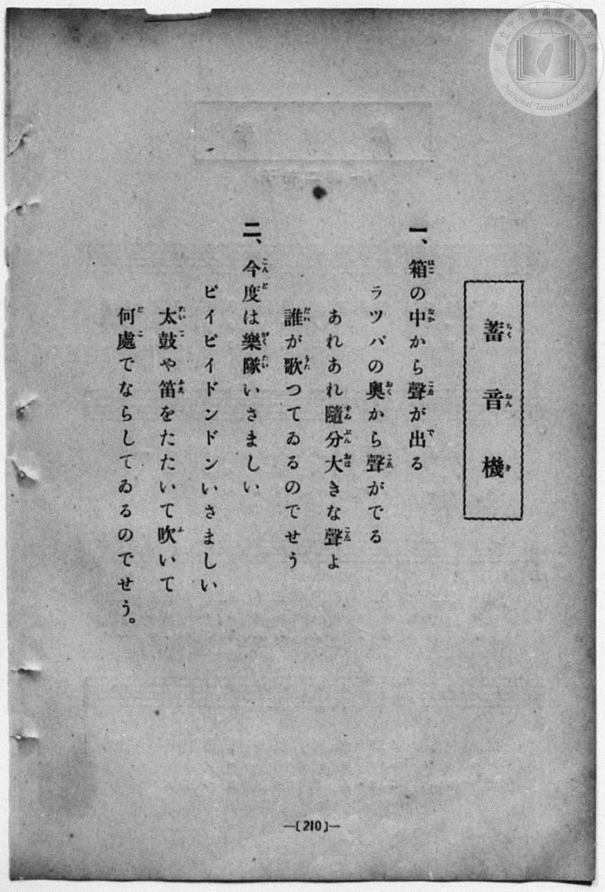
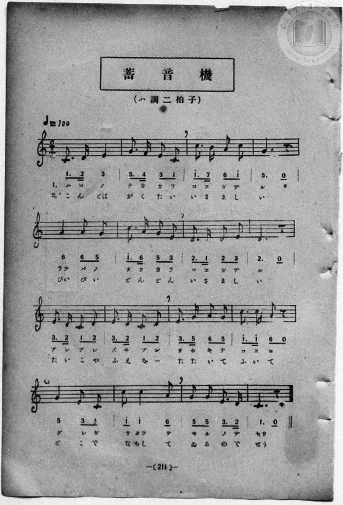

# 蓄音機

> Re:Shōka 使用 AI 協助辨識與重建樂譜，可能會有錯誤。歡迎回報。

- **NEUTRINO 歌聲合成版**：<br><audio controls src="chikuonki_neutrino.mp3"></audio>
- **鋼琴伴奏版**：<br><audio controls src="chikuonki.mp3"></audio>


- book: 新編 小學校・公學校 唱歌教材集（尋常科三・四學年用）
- lyrics: 葛原しげる
- composer: 梁田貞
- 一條慎三郎 編《新編 小學校・公學校 唱歌教材集》（大正十二年十二月，索書號 0725-41）

## 說明

> [!NOTE]
> **原書資訊與歌詞全文（對應 P218.jpg–P219.jpg，原書第 210–211 頁）**
> - **調性與拍號**：ハ調二拍子（C 大調 2/4 拍），♩= 100。
> - **詞曲作者**：葛原齒（葛原しげる）作詞／梁田貞 作曲（原載《大正幼年唱歌》）。
> - **版本對照**：本曲與《新定兒童唱歌》尋常科第三學年用〈蓄音機〉同曲，惟本書收錄之第二節為描寫留聲機播放樂隊吹笛打鼓（「今度は樂隊いさましい…」）之版本，且第 2 小節作 `5. 4̲ 3 1`、第 3 小節作 `1^. 7̲ 6 1^`、第 11 小節作 `1^. 1^̲ 6 0`、第 14 小節作 `1^ 1^ 6`（後半拍八分音符），速度標記為 ♩= 100。
>
> **一、**
> 箱（はこ）の中（なか）から聲（こゑ）が出（で）る
> ラツパの奧（おく）から聲（こゑ）がでる
> あれあれ隨分（ずゐぶん）大（おほ）きな聲（こゑ）よ
> 誰（だれ）が歌（うた）つてゐるのでせう
>
> **二、**
> 今度（こんど）は樂隊（がくたい）いさましい
> ピイピイドンドンいさましい
> 太鼓（たいこ）や笛（ふえ）をたたいて吹（ふ）いて
> 何處（どこ）でならしてゐるのでせう。

### 編曲說明（鋼琴伴奏版）：

1. 前奏 (Intro, 4 小節)：引用第四段「誰が歌つてゐるのでせう」俏皮輕快的結尾樂句開場。
2. 主歌伴奏 (Chikuonki, 16 小節 × 2 段)：右手演奏主旋律，左手以活潑的八分音符分解和弦伴奏。


## 歌詞

```text
（TMD 檔案未包含歌詞註解）
```

## ABC

```abc
X:1
T:蓄音機
M:2/4
L:1/16
Q:1/4=100
K:C
V:V1 name="Piano" snm="Pia"
[V:V1]
C3 D E4 | G3 F E2 C2 | c3 B A2 c2 | G6 z2 |
w: 1.~は こ の | な か か ら | こ ゑ が で | る
w: 2.~こ ん ど | が く た い | い さ ま し | い
A4 A2 G2 | c3 A G2 E2 | D3 C D2 E2 | D6 z2 |
w: 1.~ラツ パ の | お く か ら | こ ゑ が で | る
w: 2.~ぴい ぴ い | ど ん ど ん | い さ ま し | い
E3 D C2 D2 | E3 D C2 D2 | E3 G A2 G2 | c3 c A2 z2 |
w: 1.~あ れ あ れ | ず ゐ ぶ ん | お ほ き な | こ ゑ よ
w: 2.~た い こ や | ふ え を _ | た た い て | ふ い て
G4 E2 C2 | c2 c4 A2 | G2 G2 E3 D | C6 z2 |
w: 1.~だ れ が | う たつ て | ゐ る の で | せう
w: 2.~ど こ で | な らし て | ゐ る の で | せう
C3 D E4 | G3 F E2 C2 | c3 B A2 c2 | G6 z2 |
w: 1.~は こ の | な か か ら | こ ゑ が で | る
w: 2.~こ ん ど | が く た い | い さ ま し | い
A4 A2 G2 | c3 A G2 E2 | D3 C D2 E2 | D6 z2 |
w: 1.~ラツ パ の | お く か ら | こ ゑ が で | る
w: 2.~ぴい ぴ い | ど ん ど ん | い さ ま し | い
E3 D C2 D2 | E3 D C2 D2 | E3 G A2 G2 | c3 c A2 z2 |
w: 1.~あ れ あ れ | ず ゐ ぶ ん | お ほ き な | こ ゑ よ
w: 2.~た い こ や | ふ え を _ | た た い て | ふ い て
G4 E2 C2 | c2 c4 A2 | G2 G2 E3 D | C6 z2 |
w: 1.~だ れ が | う たつ て | ゐ る の で | せう
w: 2.~ど こ で | な らし て | ゐ る の で | せう
```

## TMD 檔案連結

- [主旋律 TMD 檔案](chikuonki.tmd) [[在 TMD Studio 編輯](https://tmdlang.github.io/Tmd-TS/#tmd=s7IKdvYPcrWy4qpTUCpJTLdSSM7PyUlNLsnMz7MqzsjPTozPrsyvSsyML84ojTe0NDJWgqssy88pzU21Si9KTEmNN443QcgU55cWJadaFSdn5OfnxJekVpQk5edno8vHFySmp1oFGBlaIGQKivLLUvMS84C6C4oy80pSU8DaEQpSyzJTUkHSxcmJefFlqUWZaZmpKUiOSi0qBrsdYkVJUWJecXJRZgHIQwhV-UUlGflAhxdkVFplZBaX5BdlJifmxGcn5iUiFJVkpAK9V5KanJGXn5OfXokuk1tanJmMbGZmemaeVW5qZlYmFj9DpUsSM4HBCgzN_PLE-NzEzLycxDyI80HKrRSeTdvwfPsKhacb-p-u3fFswcLHzbuftq6BsBWeTtn4bG3Ps6kzn82d8HJ22_s9HU83dD_dseP58olPdnSClM6eDVT6dOeW51NWvN_TCTY3pxLouWIrhRcTZz_tm_-4cfrjxkmPm7rBcsn5uQX5xalFQHsXNT6fsuHFpnlKXFpaCi8mt7ycv_nZyvkKWlpcirYKhgYGXPa2Cs5cNkb6JnYgnU92NDxbNPdZax_Q4pfNfQpARz9u6CLF9Y8bukEeWLL82drFT3sbn-zqAbobwng2p-P9np7nWxY9m73jxcz5CgbmRqa6JoZgH3HpaynYUgtwKSgo2ClEK_r5h7jGQjhaWsBQAtm7uf3Fiq4XHe1AN79YOe9p64pn09rBId77rL1TAZRs9bIK0h81TAYyLUFMoJMhWp-vWaNgZGgAlDIyNFR4uaAR6HBgOIKN1wVa8GLV_mcNy0FGd_cCvael9X7PrMfN_UBhkN-7e5-unQC0yFkBGDZAMQVgkCsARYGGAG14NHMlODoeNzQhGbhy3rPZm57snfOioRVsGiSuX-6dBDQHLd6BxoAUrpz3fk8_PNIVgEJAE0De65v_Yk8nMCqhEbNzDyhWwDEHjjCgFJLFzzs7ns1ZAwyS563LwRYDeUBzgF6DJIan62Y9bZ30fPVSuAnwBAsMJGDSgafWxw0d8ET3uKHz6YQesHt6njXPB5u549mUbS97Wp7s7AZp3NXzfH3D86Zdz_r7n65f_XzqzBeNm4Aan01a-2zKvmcrml7O6no6YefzNbOfdU5-uWcy0F-PG3qe7O56umvZ48b1EAWPG1seN0593LgPHDQtjxqWPW4ABTLICrC3gLY_2TEFHJmgFA20ERhKCgmmegomZzYpGCsYJjxuaARJGyNLG8bpKZgD5c0UDONgCoCpAE2FYRxYiQFchQmqCqACBbMEUHzs63na2wVKFK2rn3a0AQPo-ZplkKTwsmE-0D_PVsx8sWIGMCwU0JMGLD0DsyrQFlgCfL5uIyg4Gtc_bgSGS-fjxnVPdqwFi6x63AiO4Mbux02dwAAFC05-3DQRLNjztH0XWGQ5iNvUDTHtcfPKx80tj5snAs15uhQoBVQADNl-POYATUBob2x63AQUAZEvZ60AehCseNbjpgmPG7c9bgK5EJgQYcbuBpvQC3QqurFNHRADX6zaABZfADQQYh0w2YFF2h43zgeLLHncuAxkflM30M0gxzTOBsqihtguYFKFhxgk3cCsm_y4cSXYHGgyAosDvdAPNB-YjMBSKAkLFlBTHjctgZHAsnozlMSm-OmSVdBUCzYTGlNNLcAEDRbc-rgRWEACRSaBFUDULAOmeIgszA3LoO7fO_XFzKlgqZWwSAf6ehUwdsCWYgkNaBKivICFAgUtfS4u54zM7NL8vOxMq4DMxLx8hxqDmmqQLQo2hmZa4LBXwFa2K4BLioYXC3sUNMBZBViuwnKLDqgcBhe-mlg0Ai0FGVqjYAgsrHSBudgYTOsCRUzBtAlYBCQLVBMHFjIH5kqgEIgDUwWBBiARsHk-hjXAhLseLAoMTyBeBzcXGKxQ8W4wBrKaOqEykyEyTROB7B6wmuUQmSaQOhiMR9hjhKwLZM9KsC6QzSAZkBkgfj8QzwezWqAyIBrEnwrE-8Cs6SgyyDbhD_ddPfBwNwWGuwVp4Q4KShAE0aCwhIeyGZgLCvwaYLSARAzBNLII1mAHFzdQKWCpA_YbKPRBfutCCg9qhPwWRHABOSgBDIoIlEgBsqgd9Ds64UFvCQx6Q1glRGTYQ9K6ETh1gwIUt4gpZvyAah_MwG9sgnq7B8oGsSCemwWVmQBkb0MJEFis7AbiXjALlEPQYqWpA0v4g9I0JNAhaoEFIFTnVqhMB1BsEjRIkXXMhwY3sGxD0wEyCyRGRAQA29KIMscYFANmpMUArPRAK2OgQQzJFRBVsMwAihdYaYW91FkAFYeEPCQ1g8TbIP4G1m4wBTCvA6MEpBycIaAFFSj5gzSBSnoku9DDH5LIIWUcUp4Bxx-k7qDUrlouLl07BXi9oIDOUeYCAA)]
- [鋼琴伴奏 TMD 檔案](chikuonki_piano.tmd) [[在 TMD Studio 編輯](https://tmdlang.github.io/Tmd-TS/#tmd=s7IKdvYPcrWy4qpTUCpJTLdSSM7PyUlNLsnMz7MqzsjPTozPrsyvSsyML84ojTe0NDJWgqssy88pzU21Si9KTEmNN443QcgU55cWJadaFSdn5OfnxJekVpQk5edno8vHFySmp1oFGBlaIGQKivLLUvMS84C6C4oy80pSU8DaEQpSyzJTUkHSxcmJefFlqUWZaZmpKUiOSi0qBrsdYkVJUWJecXJRZgHIQwhV-UUlGflAhxdkVFplZBaX5BdlJifmxGcn5iUiFCUWATWnp-am5pVYFWQm5uXHJyYn5-cWJOZlgsTACkH-slJ4Nm3D8-0rFJ5u6H-6dsezBQsfN-9-2roGwlZ4OmXjs7U9z6bOfDZ3wsvZbe_3dDzd0P10x47nyyc-2dEJUjp7NlDp051bnk9Z8X5PJ9jcnEqgi4qtFF5MnP20b_7jxumPGyc9buoGy4HckF-cWgS0d1Hj8ykbXmyap8SlpaXwYnLLy_mbn62cD7Ti5eyZzzq7X3bveT5hy5M9W54u7QearKClxaVoq2BoYMBlb6vgzGVjpG9iBzLxyY6GZ4vmPmvtAzroZXOfAtAzjxu6SPHV44ZukMeWLH-2dvHT3sYnu3qA_oEwns3peL-n5_mWRc9m73gxc76CgbmRqa6JIdinXPpaCrbUAlwKCgqPGyY8m73p-ex1L1atejaj73HDRLAo0OXtu17MnPp-zyyq-BVvDPY8X7NGwcRU4eWyaY8bOuCx8rihEygHjE1gOIBUGBkaPGqYbGRoqPByQSMw8EAZQS-rIB0oCGRagpjAMHrc0AT1wYuV84BeA_oAkiZe7p0E1ISWPoAanuydA1T5fk8_PHEoAIWAOpFMWrX_WcPyFx3tz7p7gTECNPJxcz9QEBRZ3b1P104AGuysAIxMoJgCMI0oAEWBJgNd_7Jh_tNdyxQgiQhhIDDogBZAghyU-JCS3fNOYOwDtc4CKVVQMNRTeNrZCxRX0PDMKynK11EwAQX68_UNmkA1T_dMBYYgMHCAAfps3dbHDT0vVm143NgDDP3HjUseNy573DQB6MvHjeseNy5_3Dj7cSMwMnqf7O9_Pmvdiz1Tn-5f_XxWy_OtE55u2PdsRdPT_qUvp3U_XbAF6lAFBSM9hSc7dgNNg7hNQcM5IzO7ND8vO1NHwdAM6hCFw9MVjBSA1oNd1L8ZmI-e7ZkCVA7SOr376T5gKPc83b4MKP5k99JnW3Y_2zsRaO3T1tVPO9qAUf18zTIg48XyxU8n9TzdswxiFdQJlCdyKFDQ0ufiAoegVQCoaArycKgxqKkGe9PG0EzLDsyqUTBV0AVDYyA2BOIaBcM4EBNEgKAZWAykCoRBqnSBngeqgsqDoAFIDVctin0-yPZZwK0zjFeINoxVMIVQcL4JkDIB8UESphB5IAWXB2EDiB3wGMHnL2ylhgIw2QDz9ouFPQoaoOxlCMxHsLSlowDLUZpYNAKDEup6qPchwQALGF1gEkULPl0Fc3DIgTmIQEYEFsg8H8MahceN68GijxsnA_E6uLmPG1dBxbvBGMhq6oTKTIbINE0EsnvAapZDZJpA6mAwHmGPEbIukD0rwbpANoNkQGaA-P1APB_MaoHKgGgQfyoQ7wOzpqPIINuEP9x39cDD3RQY7hakhTsoKGGJERSW8FA2g6fKGmC0gEQMwTSyCNZgb175uBnmh8fNE8F-A4U-yG9dSOFBjZDfggguIAclgEERgRIpQBa1g35HJzzoLYFBb2hEWtjDsjwodYMCFLeIKWb8ACmQGHqab4J6uwfKBrEgnpsFlZkAZG9DCRBYrOwG4l4wC5RD0GKlqQNL-IPSNCTQIWofN8GCfytUpgMoNgkapMg65kODG1ixoOkAmQUSIyICgFUVoswxBsUArCIhMgaoV0QjYmABVBwS8pDUDBJvg_gbWJnCFMC8DowSkHJwhoAWVKDkD9IEqmaR7EIPf0gih5RxSHkGHH_AvAVJ2RTZhVktkFn94OAD1YNqH4gZUEmoFJwP12MEZBjlxsJp5EoNYQoOl8D5ZkCGGVA3ulNgNSG1qlNdOwVwra0AZMDDMNoHqABVwAgsoMwFAA)]

## 分析

```text
================================================================================
📊 TMD Song Profile: [ 蓄音機 ]
================================================================================
⏱  Duration:       0:38 (38.4s), 32 measures total
🎼 Key & Tempo:    首調基準 C, != 100.0 BPM, <2/4>
   - 分析範圍：      由實際發聲的音符與和弦推測調性；播放脈絡另行呈現
🎤 人聲音域:    C4 (MIDI 60) – C5 (MIDI 72) [跨度: 12 個半音 / 1.0 個八度, 難度: easy]
   - 最低音:  C4 in [Chikuonki #1 @ m.1, 0:00]
   - 最高音: C5 in [Chikuonki #1 @ m.3, 0:02]
   - 適合: soprano, mezzo-soprano, contralto, tenor, baritone, bass
🏛  結構:      Chikuonki (19.2s) -> Chikuonki (19.2s)
⚡ 編曲密度:        Peak 1 軌道同時演奏
🗝  調性診斷：       C 大調（純淨自然大調，未偵測到可信轉調）
   - 風格氣質:    純淨自然大調（陽光明朗、易唱易記，無明顯調外色彩）
   - 轉調歷程:    全曲維持單一推測調性（未偵測到可信轉調）
   - 核心骨幹音:  C, E, G, D, A
   - 調性數值:    C 大調 [相關度: 0.90, 穩定度: High, 自然音純度: 100.0%]
   - 候選調性 (K-S): C 大調 (0.90), G 大調 (0.68), A 小調 (0.65)
   - 五度圈歷程:   +0 -> +0
   - 各段落調性細節:
     • [Chikuonki #1]: C 大調 (r: 0.90, 自然音純度: 100.0%)
     • [Chikuonki #2]: C 大調 (r: 0.90, 自然音純度: 100.0%)

  [ 五度圈游移軌跡 ]
              [C ]*
         F            G  
      Bb               D  
      Eb               A  
         Ab           E  
            Db       B  
               F# 
     (* = active key center)

  [ 十二半音累積音高分佈 ]
     C  : ████████████████████████  30.0%
     C# :                            0.0%
     D  : █████████████             15.8%
     D# :                            0.0%
     E  : ████████████████          20.0%
     F  : █                          0.8%
     F# :                            0.0%
     G  : ████████████████          20.0%
     G# :                            0.0%
     A  : ██████████                12.5%
     A# :                            0.0%
     B  : █                          0.8%
--------------------------------------------------------------------------------
Assignment 軌道音域：
  - Piano         : C4 – C5 (12 個半音 / 1.0 個八度, 100 個音符)
================================================================================
```


## 原書掃描頁






