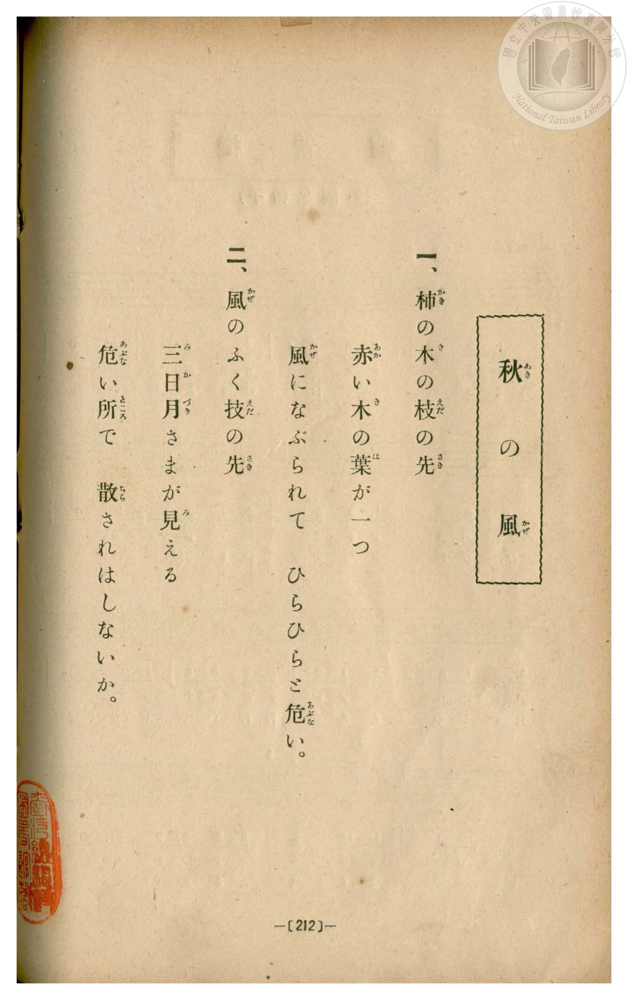
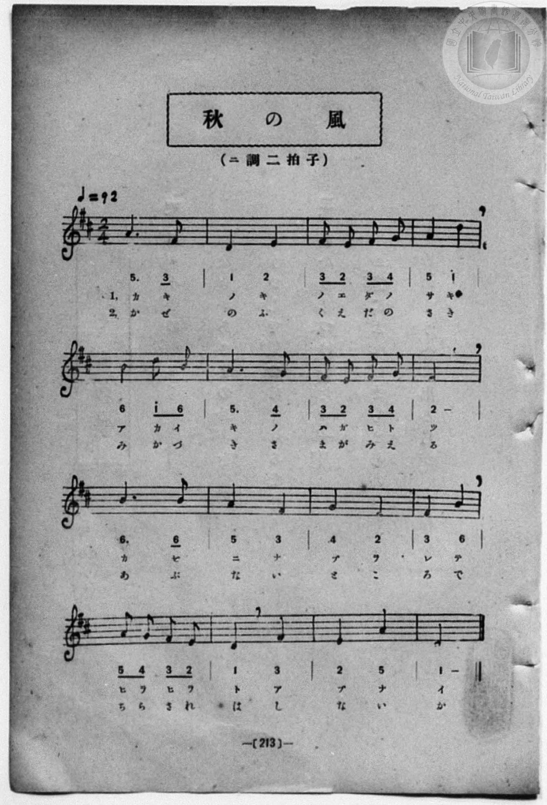

# 秋の風

> Re:Shōka 使用 AI 協助辨識與重建樂譜，可能會有錯誤。歡迎回報。

- **鋼琴伴奏版**：<br><audio controls src="aki_no_kaze.mp3"></audio>
- **NEUTRINO 歌聲合成版**：<br><audio controls src="aki_no_kaze_neutrino.mp3"></audio>

- book: 新編 小學校・公學校 唱歌教材集（尋常科三・四學年用）
- 一條慎三郎 編《新編 小學校・公學校 唱歌教材集》（大正十二年十二月，索書號 0725-41）
- 日治時期公學校《唱歌帳》（典藏號 2020.006.0843・P148）同曲底本

## 說明

> [!NOTE]
> **原書資訊與歌詞全文（對應 P220.jpg–P221.jpg，原書第 212–213 頁）**
> - **調性與拍號**：ニ調二拍子（D 大調 2/4 拍），♩= 92。
> - **版本對照**：本曲即國立臺灣歷史博物館典藏《唱歌帳》第一冊 `p148_aki_no_kaze`（標註「小公唱材集 213 頁ヨリ 13.12.12.」）所抄錄之原底本。對照本書印刷原譜：
>   1. 第二節首句本書作「風のふく枝の先」（手抄本省略為點號後誤補「ソノ」）。
>   2. 第 15 小節本書五線譜與數字譜均為兩拍四分音符 `2 5`（E4–A4），而非手抄本所記之附點四分音符加低音八分音符 `2. 5_̲`。
>
> **一、**
> 柿（かき）の木（き）の枝（えだ）の先（さき）
> 赤（あか）い木（き）の葉（は）が一（ひと）つ
> 風（かぜ）になぶられて
> ひらひらと危（あぶな）い。
>
> **二、**
> 風（かぜ）のふく枝（えだ）の先（さき）
> 三日月（みかづき）さまが見（み）える
> 危（あぶな）い所（ところ）で
> 散（ちら）されはしないか。

### 編曲說明（鋼琴伴奏版）：

1. 前奏 (Intro, 4 小節)：取末樂句「ひらひらと危い」，描繪秋風吹拂紅葉飄搖。
2. 主歌伴奏 (Song, 16 小節 × 2 段)：右手演奏主旋律，左手配以輕巧和弦伴奏。


## 歌詞

```text
（TMD 檔案未包含歌詞註解）
```

## ABC

```abc
X:1
T:秋の風
M:2/4
L:1/16
Q:1/4=92
K:D
V:V1 name="Piano" snm="Pia"
[V:V1]
A6 F2 | D4 E4 | F2 E2 F2 G2 | A4 d4 |
w: 1.~か き | の き | の え だ の | さ き
w: 2.~か ぜ | の ふ | く え だ の | さ き
B4 d2 B2 | A6 G2 | F2 E2 F2 G2 | E8 |
w: 1.~あ か い | き の | は が ひ と | つ
w: 2.~み か づ | き さ | ま が み え | る
B6 B2 | A4 F4 | G4 E4 | F4 B4 |
w: 1.~か ぜ | に な | ぶ ら | れ て
w: 2.~あ ぶ | な い | と こ | ろ で
A2 G2 F2 E2 | D4 F4 | E4 A4 | D8 |
w: 1.~ひ ら ひ ら | と あ | ぶ な | い
w: 2.~ち ら さ れ | は し | な い | か
A6 F2 | D4 E4 | F2 E2 F2 G2 | A4 d4 |
w: 1.~か き | の き | の え だ の | さ き
w: 2.~か ぜ | の ふ | く え だ の | さ き
B4 d2 B2 | A6 G2 | F2 E2 F2 G2 | E8 |
w: 1.~あ か い | き の | は が ひ と | つ
w: 2.~み か づ | き さ | ま が み え | る
B6 B2 | A4 F4 | G4 E4 | F4 B4 |
w: 1.~か ぜ | に な | ぶ ら | れ て
w: 2.~あ ぶ | な い | と こ | ろ で
A2 G2 F2 E2 | D4 F4 | E4 A4 | D8 |
w: 1.~ひ ら ひ ら | と あ | ぶ な | い
w: 2.~ち ら さ れ | は し | な い | か
```

## TMD 檔案連結

- [主旋律 TMD 檔案](aki_no_kaze.tmd) [[在 TMD Studio 編輯](https://tmdlang.github.io/Tmd-TS/#tmd=s7IKdvYPcrWy4qpTUCpJTLdSSM7PyUlNLsnMz7MqzsjPTozPrsyvSsyML84ojTe0NDJWgqssy88pzU21Si9KTEmNN443QcgU55cWJadaFSdn5OfnxJekVpQk5edno8vHFySmp1oFGBkZIGQKivLLUvMS84C6C4oy80pSU8DaEQpSyzJTUkHSxcmJefFlqUWZaZmpKUiOSi0qBrsdYkVJUWJecXJRZgHIQwhV-UUlGflAhxdkVFplZBaX5BdlJifmxGcn5iUiFJVkpAK9V56aCGQUoQsXpyYW5-cVIxuZmZ6ZZ1WaB3JfCcJVIJ9bKTybtuH59hUKTzf0P12749mChY-bdz9tXQNhKzydsvHZ2p5nU2c-mzvh5ey293s6nm7ofrpjx_PlE5_s6AQpnT0bqPTpzi3Pp6x4v6dTiUtLS-H58u7HjeteLlqhoKXFpWirYGnEZW-r4MJlY6RvYgey-MmOhmeL5j5r7QOa8bK5TwFo_-OGLlIc8rihG-SWJcufrV38tLfxya4eoBMgjGdzOt7v6Xm-ZdGz2TtezJyvYGBuZKprYgh2HNDuZ9OXPtu0-9nMpmdz5sONB9oOseDpjs1Qo1t3vJjeD9JvZGBkoGdgYKZnYGFiDHRTgKGJBdCwpxN6ns3e9HTX1Gdz1ihxcelrKdhSC3ApKCjYKUQr-vmHuMZCOFpaT_vmgzy0uf3Fiq4XHe1At75YOe9p64pn09rBsdL7rL1TAZRi9bIK0h81TAYyDUFMYFhAtD5fs0bByNAIKGVkaKzwckEj0BPA-AEbrwu04MWq_c8aloOM7u4F-ltL6_2eWY-bu4HCoEDt7n26dgLQIhcFYKADxRSAcakAFAUaArTh0cyVoGh-3NCEMO95ZwcwaIAOe966HGwYkAcKsd7NT-d0P1_d_aJ91_PGxc_Wbn_aDxSc9bxz5cslKyDBjhYdQJcDU8zTti6FhAJg4McnZmfG5-UDs0RVagLQSc9WzHyxYvfjhh5QygHGKFAnOI0AfQv25-PmFY-bVykYGusZGoHQ4waQq591NjzrannZ0_JkZzcwgCARCfQAxMFgt-542rvhacd2oOyLtXOAHoD4TUHBUE8B5KRdPc_XN7xcNu1p_1KI8id75wBdAUz3wNT_uHHr48b-Z_PmAtlPWzvAdnY86-wG2glU_HxO4_OpS5837Xq5ex4wrJ_u63mxasmLxSDtj5v2Pm7ug7gRHp4KCkZgOxUMTUH5A2gv1MZdU55vnwV0HSjapu54unY6kP10bjvQ5KetK0GRBsyeHW0v529-vmaZQoKRgikowFxNgInA0QQSdS-ALp47D-4yYLC8WDEDGCYvZ7YAHYes_2nXgid7-4Dsp62rkQ3VUzCNP7MpAeZYWIIFRtnjhkZYCns2fz_Q5seNwJIB7LPGdc_mAAsMoAiMO28umAtECyAiwGADi0yFqIGY82LrErBgE9AosDKgo1HMeTER6Csgdz2Y2wN0BZi76XEjqHx63LgEYg4wlmDuAUYtUHz148ZVjxu3PW7qfNzU87hxGUQZSCNQBEqueNq7EWb7NqB6iAMwPL6rB8njGBYhkgYx_gWWkKASC1SmAaX2g81ZCvMsUOU-oB9fLAOVWEBZsGDH46ZuiF6srgVGMFgQmEgnP26CmLMcGkdTF4OlFgI9CzUfFBTrHzdOBwdOC8h2iGcpL-SgQEFLn4srOD8v3SogMzEv36HGoEahGmSDgo2FFjhIFbAVreAMuKPhxcIeBQ1wvgCmaBNo1tABFYPgsk8Ti0agfSBDaxRMgaWUroIxkGUIpI2AuAbIMwJiE6isYRxIEKzcx7AGmBa6wVqAoQ9UAIwwKBukEcQDBj0QLwCzQSJTEfIQM4yQzZiDZMZWqBn9eM3AHxi7euCBYQoMDAvSAsMM4l0zeLiAwgARGqDQAUHkwGgCO60biFvATgU5EiQCcfh6IO4BZR8gXgEWWYJqBjgw9sPNWIpixlQwbx_UjP3gYAGKNEECj3Bg7OiEB4YlMDAMjUgPDV14YBiDY8cEKZGA5LCnDEisrgazV0FjdRuI19QJ4TX1gOWWoQUEKDBB4tvAOkA6QcEK0b8CzJsM1Q8KImCOJRwIwKIbkT2MQaFgRmoGMQEnAUgGgYQCKARAYQIRQ08SwMgG-hNGI9wO8h08JODhAvIfeoJYCDVhKjikIAkJpGc6VA9qyCCSQy0Xl66dAqgcUUCilbkA)]
- [鋼琴伴奏 TMD 檔案](aki_no_kaze_piano.tmd) [[在 TMD Studio 編輯](https://tmdlang.github.io/Tmd-TS/#tmd=s7IKdvYPcrWy4qpTUCpJTLdSSM7PyUlNLsnMz7MqzsjPTozPrsyvSsyML84ojTe0NDJWgqssy88pzU21Si9KTEmNN443QcgU55cWJadaFSdn5OfnxJekVpQk5edno8vHFySmp1oFGBkZIGQKivLLUvMS84C6C4oy80pSU8DaEQpSyzJTUkHSxcmJefFlqUWZaZmpKUiOSi0qBrsdYkVJUWJecXJRZgHIQwhV-UUlGflAhxdkVFplZBaX5BdlJifmxGcn5iUiFCUWATWnp-am5pVYFWQm5uXHJyYn5-cWJOZlgsTACkH-slJ4Nm3D8-0rFJ5u6H-6dsezBQsfN-9-2roGwlZ4OmXjs7U9z6bOfDZ3wsvZbe_3dDzd0P10x47nyyc-2dEJUjp7NlDp051bnk9Z8X5PpxKXlpbC8-XdjxvXvVwEFOh4OXvms87ul917nk_Y8mTPlqdL-4GqFLS0uBRtFSyNuOxtFVy4bIz0TexADnqyo-HZornPWvuAZr9s7lMAuutxQxcpDnzc0A1y45Llz9Yuftrb-GRXD9BpEMazOR3v9_Q837Lo2ewdL2bOVzAwNzLVNTEEOxpo97PpS59t2v1sZtOzOfPhxgNth1jwdMdmqNGtO15M7wfpNzIwMtAzMDDTM7AwMQa6KcDQxAJo2NMJPc9mb3q6a-qzOWuUuLj0tRRsqQW4FBQUHjdMABr_fPa6F6tWPZvR97hhIlgUGCTtu17MnPp-zyyqBCLeWO55vmaNgomZwstl0x43dMBj-3FDJ1Duad98YACDVBgZGj1qmGxkaKzwckEjMOhAmUUvqyAdKAhkGoKYwPB63NAE9cGLVfufNSx_0dH-rLsXGMBArzxu7gYKguKuu_fp2glAM1wUgHELFFMAJhkFoCjQAKCdLxvmP921TAGcpBDmAf0LDCpIOIFSIlIafN4JTAtAnbNAShUUDPUUnnb2AsUVNDzzSorydRRMQCH1fH2DJlDN0_5pz-asfrai6Wn_0scNPY8bNz1u6oSRK572bnzc2PK4AeiUnmf9_c93rgIGCDA0nk7Y-ay76fmW1hcTO18ubnk2ARhWYJcpKBjpKTzZsRsY4hDHKGgE5-el6ygYmkEtVTg8XcFI4dm6rRDbNwMz0LM9U4AqQbqmdz_dB0yIPU-3LwNlrNbeJ7uXvtgz9en25U8n9TzdswxiJtQuytMcFCho6XNxgcPGKgBUmgR5ONQY1ChUgz1kY6FlB2bUKJgCQ84Y6PgaBUMFXSBLF8gyApKmYBZIDARruGpRTPPBZVp8vEK0aSycBpoAZBjGwij8Kgwg9oACF5-jseVQBWD6BeajFwt7FDRASdkQmGZhSUJHAZZ6NbFoBIYTLCRAPjWG-hoUBjXgkDEGhhBE1jAOHBQg5T6GNQqPG7vBWh439gIVALMUlA3SCOI9buwA4gVgNkhkKkIeYoYRshlzkMzYCjWjH68Z-ANjVw88MEyBgWFBWmCYQbxrBg8XUBggQgMUOpB0gQiMJrDTuoG4BexUkCNBIhCHrwfiHiDeBMQrwCJLUM0AB8Z-uBlLUcyYCubtg5qxHxwsQJEmSOARDowdnfDAsAQGhqER6aGhCw8MSCYxQUokIDnsKQMSq6vB7FXQWN0G4jV1QnhNPWC5ZWgBAQpMkPg2sA6QTlCwQvSvAPMmQ_WDguhx43LCgQCsEhDZwxgUCrDii-gMQlxRgQgFYGQD_QmjEW4H-Q4eEvBwAfkPPUEshJowFRxSkIQE0jMdqgc1ZBDJAaUYwVVaQUsecFEELpyQBZDLJpzFGdQgEyDXJBZG4TYYaykIKvXwGkO47DQDCZjlIhxElXJY104BXOQrABmgwIz2AUrD2UZgtjIXAA)]

## 分析

```text
================================================================================
📊 TMD Song Profile: [ 秋の風 ]
================================================================================
⏱  Duration:       0:41 (41.7s), 32 measures total
🎼 Key & Tempo:    首調基準 D, != 92.0 BPM, <2/4>
   - 分析範圍：      由實際發聲的音符與和弦推測調性；播放脈絡另行呈現
🎤 人聲音域:    D4 (MIDI 62) – D5 (MIDI 74) [跨度: 12 個半音 / 1.0 個八度, 難度: easy]
   - 最低音:  D4 in [Song #1 @ m.2, 0:01]
   - 最高音: D5 in [Song #1 @ m.4, 0:04]
   - 適合: soprano, mezzo-soprano, contralto, tenor, baritone, bass
🏛  結構:      Song (20.9s) -> Song (20.9s)
⚡ 編曲密度:        Peak 1 軌道同時演奏
🗝  調性診斷：       D 大調（純淨自然大調，未偵測到可信轉調）
   - 風格氣質:    純淨自然大調（陽光明朗、易唱易記，無明顯調外色彩）
   - 轉調歷程:    全曲維持單一推測調性（未偵測到可信轉調）
   - 核心骨幹音:  E, A, F#, D, B
   - 調性數值:    D 大調 [相關度: 0.82, 穩定度: Moderate, 自然音純度: 100.0%]
   - 候選調性 (K-S): D 大調 (0.82), A 大調 (0.72), B 小調 (0.63)
   - 五度圈歷程:   +2 -> +2
   - 各段落調性細節:
     • [Song #1]: D 大調 (r: 0.82, 自然音純度: 100.0%)
     • [Song #2]: D 大調 (r: 0.82, 自然音純度: 100.0%)

  [ 五度圈游移軌跡 ]
               C  
         F            G  
      Bb              [D ]*
      Eb               A  
         Ab           E  
            Db       B  
               F# 
     (* = active key center)

  [ 十二半音累積音高分佈 ]
     C  :                            0.0%
     C# :                            0.0%
     D  : ████████████████████      17.2%
     D# :                            0.0%
     E  : ████████████████████████  20.3%
     F  :                            0.0%
     F# : ██████████████████████    18.7%
     G  : ███████████                9.4%
     G# :                            0.0%
     A  : ████████████████████████  20.3%
     A# :                            0.0%
     B  : █████████████████         14.1%
--------------------------------------------------------------------------------
Assignment 軌道音域：
  - Piano         : D4 – D5 (12 個半音 / 1.0 個八度, 74 個音符)
================================================================================
```


## 原書掃描頁






