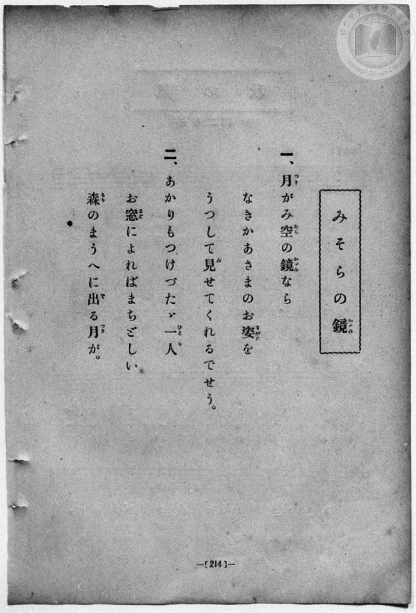
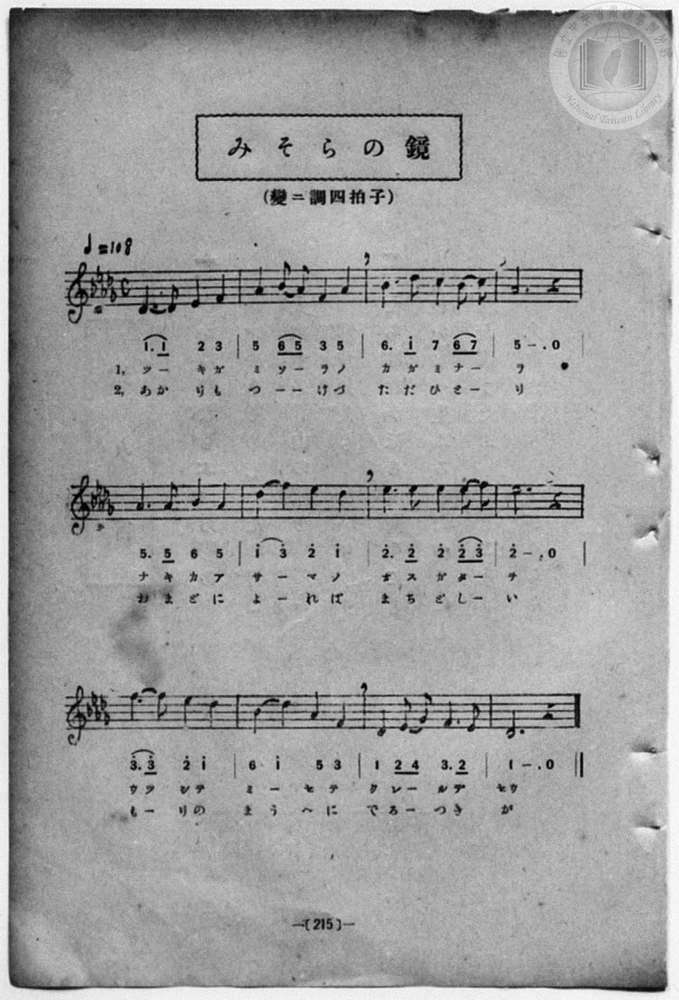

# みそらの鏡

> Re:Shōka 使用 AI 協助辨識與重建樂譜，可能會有錯誤。歡迎回報。

<audio controls src="misora_no_kagami.mp3"></audio>

- 一條慎三郎 編《新編 小學校・公學校 唱歌教材集》（大正十二年十二月，索書號 0725-41）
- 日治時期公學校《唱歌帳》（典藏號 2020.006.0843・P149）
- 原載《小公校唱歌教材集》第 215 頁（大正 13 年 12 月 12 日抄）

## 說明


- 出處：《唱歌帳》（國立臺灣歷史博物館典藏號 2020.006.0843）第 P149.jpg 頁（手寫頁碼 20）。
- 標註：（小公校唱歌教材集 215 頁ヨリ）13.12.12.（大正 13 年 12 月 12 日抄錄）。
- 調性與拍號：變ニ調（Db 大調），4/4 拍，速度 != 108。
- 背景與曲風：共 12 小節，將明月比作高掛天際的「天空之鏡」（みそらの鏡），孩童在未點燈的窗邊仰望森林上方的明月，
期盼月亮能映照出已故母親（なきかあさま）溫柔的身影，情感真摯動人。
- 版本說明：本檔案為原頁單聲部簡譜之忠實數位化版本。
【原頁歌詞全文與中文語譯】（對應 P149.jpg）

### 編曲說明（鋼琴伴奏版）：

1. 前奏 (Intro, 4 小節)：引用結尾樂句「ウツシテミーセテ クレールデセウ」，營造澄澈溫柔的月夜氛圍。
2. 主歌伴奏 (Song, 12 小節 × 2 段)：右手演奏主旋律，左手配以抒情和弦伴奏。


## 跨冊／重複收錄參照

> 同曲（《新編 小學校・公學校 唱歌教材集》、《楊金土手抄唱歌帖》共同收錄教材）

- **[同曲]** 楊金土手抄《唱歌帖》第 1 冊（2020.006.0843）：[**〈みそらの鏡〉**](../../../shokacho/vol_01/p149_misora_no_kagami/index.md)（`D,` / `4/4` — [原始 TMD](../../../shokacho/vol_01/p149_misora_no_kagami/misora_no_kagami.tmd)）
- 總表：[跨冊重複與同名歌曲總索引](../../../duplicate_songs.md)

## 歌詞

```text
（一）ツーキガ　ミソーラノ　カガミナーラ
ナキカーアサーマノ　オスガターヲ
ウツシテミーセテ　クレールデセウ
一定會把已故母親的身影，映照出來給我看吧。）

（二）アカリモツーケズ　タダヒトーリ
オマドニヨーレバ　マチドシーイ
モーリノマウヘニ　デルーツキガ
多麼期盼那輪即將升上森林正上方的明月呀。）
```

## ABC

```abc
X:1
T:みそらの鏡
M:4/4
L:1/16
Q:1/4=108
K:Db
V:V1 name="Piano" snm="Pia"
[V:V1]
D6 D2 E4 F4 | A4 B2 A2 F4 A4 | B6 d2 c4 B2 c2 | A12 z4 |
A6 A2 B4 A4 | d4 f4 e4 d4 | e6 e2 e4 e2 f2 | e12 z4 |
f6 f2 e4 d4 | B4 d4 A4 F4 | D4 E2 G2 F6 E2 | D12 z4 |
```

## TMD 檔案連結

- [主旋律 TMD 檔案](misora_no_kagami.tmd) [[在 TMD Studio 編輯](https://tmdlang.github.io/Tmd-TS/#tmd=s7IKdvYPcrWy4qpTUCpJTLdSSM7PyUlNLsnMz7MqzsjPTozPrsyvSsyML84ojTe0NDJWgqssy88pzU21Si9KTEmNN443QcgU55cWJadaFSdn5OfnxJekVpQk5edno8vHFySmp1oFGBkZIWQKivLLUvMS84C6C4oy80pSU8DaEQpSyzJTUkHSqSmZJflFmYk5SA5KLSoGuxtifElRYl5xclFmAcgzSlxaWgqPG_c_bpz7uKnzceO6l_0LFbS0uBRtFQwNLLjsbRVcdLhsTPRN7EDGPdnR8GzR3GetfU92dL5s7lN4vn3F44auZ9M2ABkKTzf0P12749mChY-bdz9tXQNhKzydsvHZ2p5nU2c-mzvh5ey2xw3d7_d0PF2y_NnaxU97G5_s6nm6cwuE8WxOx_s9Pc-3LHo2e8eLmfMVDMyNTHVNDN_v6QR75dn0pc827X42s-nZnPlw44G2Qyx4umMz1OjWHS-m94P0GxkYGegZGJjpGViYGAPdFGBoYgkz7Gnf_Bd7OkG6gY5uXQM0CdOdz9esUTAyNFV4uaAR7mQFQ2MFoIMVDI0UgM4FU0BndbWAzeXS11KwpRbgUlBQeNww4dnsTc9nr3uxatWzGX2PGyaCRYHB277rxcyp7_fMwuL_Od3PV3e_aN_1vHHxs7Xbn_Zveto763nnypdLVuAIGqDbQV4FBY9eVkE61L_POrufrl8NZD9ftAeoHqjocUMT1PpnK2a-WLEbaD3IPhwBCAu6x80rHjevAmo3NNYzNAIhgoH5sgcUngjrXqza_6xh-YuO9mfdvUDXA-19sa7rcXM3UBxolkuSAtA4MLsTmH6ASVUBqA7Ietkw_-muZQqQlIxkWnPPs5nrQabN3vRy0QqgaU9bN4IsB_rk-foGoManG9qBoQ100rP1U57snfNy9YxnfbOfLln5ctbs57NaHjf0ANnPV-56srMbmFkeNwDt6kDLQRCnPF278vnqpU_nrHg2Z9XL3fOet3cAtT9fNf1lU9eT3RuezZn9bPG6Z_OmP9kBzEE7gVIQS4EaQS5VAIbJ_Oez9wBFnuxa96J577MZC563LgfG_NPtm55NbX22vvfFMmC4Aq1e9bix93Fj9-PGpseNUx837gPa_mzX6mfzpwDNfLFr9dO9G4FmPmtufdYy__mc-c8mrn_aPfXJrl2IIHne2fFszhpIIgOGB5D9bNWUZws7njftAmYUYCQ-nbbuReOml80rnm9Y-GLtHKDPn-5f8HT9smdTdzzZ2_u0ZxrEBJCJ0HQL0QdMEC9WznvauuLZtHZgiD_ZsRbEWDXvxdr1wMQMTj29z9o74WkP6HKwAUAZYFEDSgTNLY-b9zxuWvu4CWh6w-Pm-Y-b9oJEmlc-bgZmiIbHTatBUkDxZmCSAIlDHNAARUBRkObVYFMWPW7aClY0D6Z51eOmnSD9TfvB4ptQNTctA9nftP1xcxvYBqARu0FskNT6x81Aa4F6gEa3g8SblkFdDvEfKF0ta3o2bw4kAp_NWA9NNTvWAqMF6LuXcxcBgxucWKARDhR8ug4Y-s3PurqQIxklGmGp4Mm-tudblz3rmPh8TvfTCcuBQY8ceLt6QIEH8jDQeaseNy-CBeTGx03AiAe6H-hhYOhMetzcAfbFKjSfA_UAAwkY_t3gDAxUAfTtBHCIAsWBuRpoOjBcgCYuQQtwoFUg80AhDFQKCsIZIFNAUu3g0ALKAgMVFKPoAfayYTEwkzzZOf_ZpknP5nQC8www5EB1Qu-KF-2rgMEDTLUv5y4A5ihILoKH3NMls17uAmYVUIZ52bT4xZ5VT3s3A7Px015gmuuCZDNggYOW055OBLoYHGxAIygvsaFAQUufiys4Py_dKiAzMS_focagRqEa7EwbCy07MANYT2gAfaMJzHugWFEAhgYQr1GoAQrMB7JAKRzIXAnEfSDBptVgabAkOJmDJWsUDEB2wQ3c1QM0sGkRRHnzKiBeBDYRasVGIN4FNm0_ULABiCcBMSj2waqRTKtRMFTQBUJDBSMgaQzENQqmQNIMSIJ4IHYNkAdWE6dgDpYyhyqCQQOQInB6RPZuF9SvoGQAdizIPaA8CZSbB_cu0O1NOyFeBmdMoMQmHN4FeROksROIu8HeBaVWIAUKrglgAZB0I0QJOMkCqSWo3oW42xTsJYjngN4C-hxEGIEIMLcGwgYLgVlAAqgELozH303LQPEAsh9It0HiGeKS3TCBpvUgR0PcDoq_drAgqFjB9DU4j0HjGBxiID-C7ZgBD4Z2kDkQZSCL14KNW4PwM9hzYD8i-xAUAmAmKBggMQ9KC0YKJmAeiAVLHcjereXi0rVTACV6BSCtzAUA)]
- [鋼琴伴奏 TMD 檔案](misora_no_kagami_piano.tmd) [[在 TMD Studio 編輯](https://tmdlang.github.io/Tmd-TS/#tmd=s7IKdvYPcrWy4qpTUCpJTLdSSM7PyUlNLsnMz7MqzsjPTozPrsyvSsyML84ojTe0NDJWgqssy88pzU21Si9KTEmNN443QcgU55cWJadaFSdn5OfnxJekVpQk5edno8vHFySmp1oFGBkZIWQKivLLUvMS84C6C4oy80pSU8DaEQpSyzJTUkHSqSmZJflFmYk5SA5KLSoGuxtifElRYl5xclFmAcgzSlxaWgqPG_c_bpz7uKnzceO6l_0L3-_peDl75rPO7pfde55P2PJkz5anS_vf7-lU0NLiUrRVMDSw4LK3VXDR4bIx0TexA1nzZEfDs0Vzn7X2PdnR-bK5T-H59hWPG7qeTdsAZCg83dD_dO2OZwsWPm7e_bR1DYSt8HTKxmdre55Nnfls7oSXs9seN3QDrX26ZPmztYuf9jY-2dXzdOcWCOPZnI73e3qeb1n0bPaOFzPnKxiYG5nqmhgCHQT24rPpS59t2v1sZtOzOfPhxgNth1jwdMdmqNGtO15M7wfpNzIwMtAzMDDTM7AwMQa6KcDQxBJm2NO--S_2dIJ0Ax3dugZoEqY7n69Zo2BkaKrwckGjEheXvpaCLbUAl4KCwuOGCc9mb3o-e92LVauezeh73DARLAoMuvZdL2ZOfb9nFha_zel-vrr7Rfuu542Ln63d_rR_09PeWc87V75csgKHt4H-BXkD5HW9rIJ0kF8eNzRBbXqxav-zhuUvOtqfdfcCdQKtfLGu63FzN1AcaJlLkgIwmsDsTmC8AJOAAlAdkPWyYf7TXcsUICkEYRowCQA9BPENKGUhpannncCYBRoyC6RUQcFQT-FpZy9QXEHDM6-kKF9HwQSUeJ6vb9AEqnm6Z-rzKSueb53wdMO-ZyuanvYvfdzQ87hp2ePmlsdN2x83tz1unv-4ec_jpt1AtsLjpvWPm9eA-M2rHze3g0SBShtA7nzePv9lw4Jn-1qe7et4tmv1s_lTns9qASayp0vmPNsw--mcXqjbFRSM9BSe7NgNDGmIcxU0gvPz0nUUDI2gzlI4PF3BSOHZuq1g9_VvBmaZZ3umAFWCdE3vfroPGDk9T7cvA2Wl1t4nu5c-65r0rLn16aSep3uWQcyE2kV52oECBS19Li5w6FkFZCbm5Qd5ONQY1ChUgz1kY6FlB2bUKBjHKegCIZAyArEMQUSNghmMaQqSAwsZAkkjYESAeCAWRAQGDUBquGpRrPRBsdIEbqVhvEK0YayCKZAyjQXyTYAMk1iYMJwPl4dKACkDiB2g0MfvK4jTDIHOhDkf5BEzIAnigdgQP4J9aQ6WMocqQvURxDiIuClYC0QzOHDAYYccbGA2WAjMAhJAJXBhTHOpHfiIgCE27BFhixL2RkDKCMSHKgRSoLBHMQOqFM43A1JmuSABqG5iDCE_EejaKYDTmgKQAfI3Mq3MBQA)]

## 分析

```text
================================================================================
📊 TMD Song Profile: [ みそらの鏡 ]
================================================================================
⏱  Duration:       0:26 (26.7s), 12 measures total
🎼 Key & Tempo:    首調基準 D,, != 108.0 BPM, <4/4>
   - 分析範圍：      由實際發聲的音符與和弦推測調性；播放脈絡另行呈現
🎤 人聲音域:    C#4 (MIDI 61) – F5 (MIDI 77) [跨度: 16 個半音 / 1.3 個八度, 難度: moderate]
   - 最低音:  C#4 in [Song #1 @ m.1, 0:00]
   - 最高音: F5 in [Song #1 @ m.6, 0:11]
   - 適合: soprano, mezzo-soprano, contralto, tenor, baritone, bass
🏛  結構:      Song (26.7s)
⚡ 編曲密度:        Peak 1 軌道同時演奏
🗝  調性診斷：       G# 調性不明確（純淨自然大調，未偵測到可信轉調）
   - 風格氣質:    純淨自然大調（陽光明朗、易唱易記，無明顯調外色彩）
   - 轉調歷程:    全曲維持單一推測調性（未偵測到可信轉調）
   - 核心骨幹音:  C#, D#, G#, F, A#
   - 調性數值:    G# 調性不明確 [相關度: 0.81, 穩定度: Ambiguous, 自然音純度: 98.9%]
   - 候選調性 (K-S): G# 大調 (0.81), C# 大調 (0.81), F 小調 (0.60)
   - 五度圈歷程:   -4
   - 各段落調性細節:
     • [Song #1]: G# 調性不明確 (r: 0.81, 自然音純度: 98.9%, 調外音: F#)

  [ 五度圈游移軌跡 ]
               C  
         F            G  
      Bb               D  
      Eb               A  
        [Ab]*          E  
            Db       B  
               F# 
     (* = active key center)

  [ 十二半音累積音高分佈 ]
     C  : ███                        3.3%
     C# : ████████████████████████  23.3%
     D  :                            0.0%
     D# : ████████████████████████  23.3%
     E  :                            0.0%
     F  : ██████████████████        17.8%
     F# : █                          1.1%
     G  :                            0.0%
     G# : ██████████████████████    21.1%
     A  :                            0.0%
     A# : ██████████                10.0%
     B  :                            0.0%
--------------------------------------------------------------------------------
Assignment 軌道音域：
  - Piano         : C#4 – F5 (16 個半音 / 1.3 個八度, 43 個音符)
================================================================================
```


## 原書掃描頁






