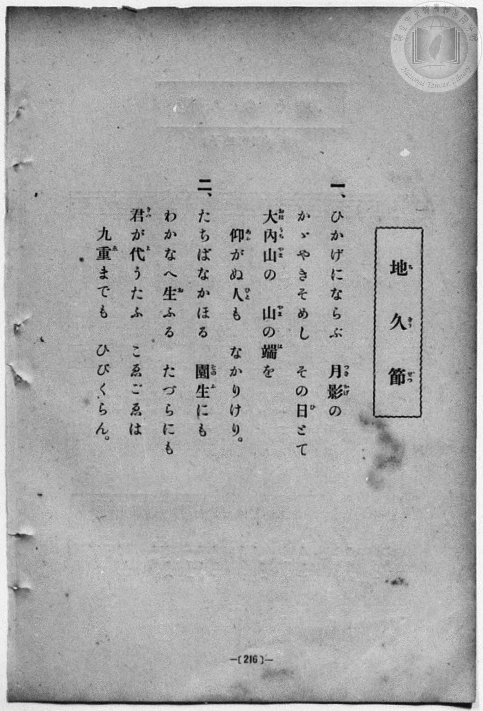
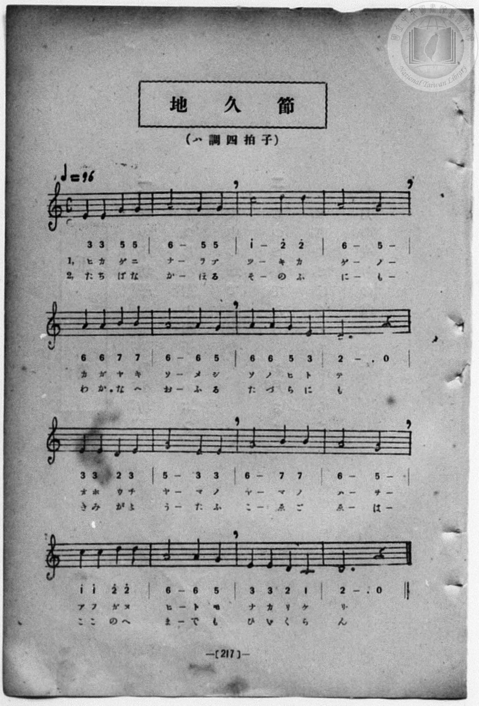

# 地久節

> Re:Shōka 使用 AI 協助辨識與重建樂譜，可能會有錯誤。歡迎回報。

- **鋼琴伴奏版**：<br><audio controls src="chikyusetsu.mp3"></audio>
- **NEUTRINO 歌聲合成版**：<br><audio controls src="chikyusetsu_neutrino.mp3"></audio>

- book: 新編 小學校・公學校 唱歌教材集（尋常科三・四學年用）
- 一條慎三郎 編《新編 小學校・公學校 唱歌教材集》（大正十二年十二月，索書號 0725-41）

## 說明

> [!NOTE]
> **原書資訊與歌詞全文（對應 P224.jpg–P225.jpg，原書第 216–217 頁）**
> - **調性與拍號**：ハ調四拍子（C 大調 4/4 拍，雅樂律音階／呂旋法風格，結音於 `2` D4），♩= 96。
> - **曲風與構造**：全曲共 16 小節，全由四分音符、二分音符與附點二分音符構成，莊重典雅，慶賀皇后誕辰「地久節」（將皇后比作與日光「ひかげ」並耀之月光「月影」）。
>
> **一、**
> ひかげにならぶ　月影（つきかげ）の
> かゞやきそめし　その日（ひ）とて
> 大內山（おほうちやま）の　山（やま）の端（は）を
> 仰（あふ）がぬ人（ひと）も　なかりけり。
>
> **二、**
> たちばなかほる　園生（そのふ）にも
> わかなへ生（お）ふる　たづらにも
> 君（きみ）が代（よ）うたふ　こゑごゑは
> 九重（こゝのへ）までも　ひびくらん。

### 編曲說明（鋼琴伴奏版）：

1. 前奏 (Intro, 4 小節)：引用結尾樂句，以莊嚴肅穆的雅樂和聲揭開序幕。
2. 主歌伴奏 (Chikyusetsu, 16 小節 × 2 段)：右手演奏主旋律，左手配以莊重穩健的四拍子和聲伴奏。


## 歌詞

```text
（TMD 檔案未包含歌詞註解）
```

## ABC

<div class="abc-score" data-abc-src="chikyusetsu.abc" aria-label="五線譜載入中"></div>

[下載 ABC 原始檔](chikyusetsu.abc)

## TMD 檔案連結

- [主旋律 TMD 檔案](chikyusetsu.tmd) [[在 TMD Studio 編輯](https://tmdlang.github.io/Tmd-TS/#tmd=s7IKdvYPcrWy4qpTUCpJTLdSSM7PyUlNLsnMz7MqzsjPTozPrsyvSsyML84ojTe0NDJWgqssy88pzU21Si9KTEmNN443QcgU55cWJadaFSdn5OfnxJekVpQk5edno8vHFySmp1oFGBkh6Swoyi9LzUvMA-ouKMrMK0lNAWtHKEgty0xJBUkXJyfmxZelFmWmZaamIDkqtagY7HaIFSVFiXnFyUWZBSAPIVTlF5Vk5AMdXpBRaZWRWVySX5SZnJgTn52Yl4hQVJKRCvRecmpRam5-XiW6eEZ-TmZKIpIw0Iz0zDyr0jyQA0sQzgJ53Urh2bQNz7evUHi6of_p2h3PFix83Lz7aesaCFvh6ZSNz9b2PJs689ncCS9nt73f0_F0Q_fTHTueL5_4ZEcnSOns2UClT3dueT5lxfs9nUpcWloKT-dseLKz9fn6BgUtLS5FWwVLMy57WwVnLhsTfRM7kMVPdjQ8WzT3WWsf0IyXzX0KQPsfN3SR4pDHDd0gtyxZ_mzt4qe9jU929QCdAGE8m9Pxfk_P8y2Lns3e8WLmfAUDcyNTXRNDsOO49LUUbKkFuBQUFOwUohX9_ENcYyEcLa2nffNB9m5uf7Gi60VHO9DNL1bOe9q64tm0dnDg9T5r71QApSy9rIL0Rw2TgUxTEBPoZIjW52vWKBgZmgGljAzNFV4uaAQ6HBiMYON1gRa8WLX_WcNykNHdvUDvaWm93zPrcXM_UBgYFUCxp2snAC1yVgCGDVBMARjkCkBRoPEvZ7c-W9H0dF_3y_mbX87qe7-n_-nEpmfTu59tnvpy0YpnC_aAQm3rBKDss2l7FBKMEhRcTIB2A0UfzVwJisTHDU0IZzybvQmoC-SM5d0vGxaAnQHy5uxNT1s3KhiagaIRmAJA3mpd8XzKRlA66WgDGv58zbLHDeAIg3GBhryc2fJy9zxkQaCxzzqAPul50df1sr33aesOoPuB3Get215sbng-q_3phL4Xq6a-2LfhcUMPPME9bgD6FBjK7RAFz9ZPebJ3DsiR05c-be0EqnzcuOlxY_fjxklAlU92LHvR0PBkZzcwxUBkQYy9G8GGALkQ38IiFphmge6GxQTCnMbVjxtXPW7qfNy47XFDA8QEoBseNy553NgLUQMyrXEdTGP346Z5j5tawLJzHzc1Pm6cDtQIYjeuA7oTrHcTWMuKx43LILqAkfm0dfnTjRCTux437n7c2Pa4cSHYnH0Q84GGQBUgCT5fvR6sBUh2Pm6aBDHtye4NYMGmx41bwcqAwbLmya5dEKuB9oIVN4FdtQrsYKCNE0Ekepjs6kEJk_kgJzVugOoCOrKpG-SqOZOeT5kPNhzkR5ilq4FWQDU29YPVA3XtgKnsAqvZCjEBbPJScCAjdD2dMBusEhiM-yG-eLJ7Mdj7wPwP5ALDB6hrK1j75MdNEx83TgGT66GBsHMuMF2BTQDKQhy2A6xx3-PG5TDvA0Nj8-PGfpDVTZOh3qe85IACBS19Li7njMzsytLi1JLiUquAzMS8fIcag5pqkD0KNiZa4KBWwFZqKQALCmCafLGwR0EDVGYYAksME2iu0wGVMOBiRROLRqCtIENrFIyB0BQIaxTMgHkawjKMAzKN4kAIJqyrUAPW4GNYA0r3oCQMxJOAeDVQDTDagCqAAQRkbQPzl4D4jb1gdSD-JDB_HcIcI5DofCBeCMQbwCaARLrB6nYDzYLomwvVB4xEMH812J4msDn4g2VXDzxYTIHBYkFasJgBoTkQQvxvBg0gEG0MZBkBxXQVDFDCBBQePUC3tYD9DXd7UyOQNR3Kh_gEFHorwCLLwObEI4dJUz_UrFVAvAOsqgscBlvhYQIKtaXQ0AaHPjg8IOYQSCqd8DCxBIaJoRHpacUIHACgBAHiQYIHEVDoCaULEpmNbeCIBjm1BeyZfeCgwMJvXA8ONFByQU4ooIS0HxrAHWB1bWB9oKCAJIzJYH0TgawpYHMnguVBphEIFGClhMg_xqBQgdVbRIYKMLcAEXJ2gSQXSGgZ4kguTZAoBfmocQ3YB5vALl4Bjk5IlgInhCZQGE4E-wmUENCSC9DfEAxKWJDksg9sznK4OaDkthmIgQkLmGRA5oDCCmJOLReXrp0CUvGjgMlV5gIA)]
- [鋼琴伴奏 TMD 檔案](chikyusetsu_piano.tmd) [[在 TMD Studio 編輯](https://tmdlang.github.io/Tmd-TS/#tmd=s7IKdvYPcrWy4qpTUCpJTLdSSM7PyUlNLsnMz7MqzsjPTozPrsyvSsyML84ojTe0NDJWgqssy88pzU21Si9KTEmNN443QcgU55cWJadaFSdn5OfnxJekVpQk5edno8vHFySmp1oFGBkh6Swoyi9LzUvMA-ouKMrMK0lNAWtHKEgty0xJBUkXJyfmxZelFmWmZaamIDkqtagY7HaIFSVFiXnFyUWZBSAPIVTlF5Vk5AMdXpBRaZWRWVySX5SZnJgTn52Yl4hQlFgE1JyempuaV2JVkJmYlx-fmJycn1uQmJcJEgMrBPnLSuHZtA3Pt69QeLqh_-naHc8WLHzcvPtp6xoIW-HplI3P1vY8mzrz2dwJL2e3vd_T8XRD99MdO54vn_hkRydI6ezZQKVPd255PmXF-z2dSlxaWgpP52x4srP1-foGoPKXs2c-6-x-2b3n-YQtT_Zsebq0H6hKQUuLS9FWwdKMy95WwZnLxkTfxA7koCc7Gp4tmvustQ9o9svmPgWgux43dJHiwMcN3SA3Lln-bO3ip72NT3b1AJ0GYTyb0_F-T8_zLYuezd7xYuZ8BQNzI1NdE0Owo7n0tRRsqQW4FBQUHjdMeDZ70_PZ616sWvVsRt_jholgUaDL23e9mDn1_Z5ZVPEr3sjoeb5mjYKJhcLLZdMeN3TAI-VxQydQ7mnffGA4gFQYGZo9aphsZGiu8HJBIzDwQGlaL6sgHSgIZJqCmMAwetzQBPXBi1X7nzUsf9HR_qy7FxiOQK88bu4HCgItB4o8XTsBaIazAjAKgGIKwJhVAIoCLXw5u_XZiqaXi1Y83zrh5fzNz6btUTACmguSaZj_dNcyBXCCQFgDDAZgCEKCD5SOkFLQ805gTAJ1zgIpVVAw1FN42tkLFFfQ8MwrKcrXUTABBSDQq5pANU_3TAWGBtDSpxv2AR3wtH8p0Monu5e-6Ot6OmvLi6bW5yvbns9qgTjv6aSeF42bnvWvfTmt--mu_qc7p0IdpKBgpKfwZMduYPhD3KCg4ZyRmV1ZWpxaUlyqo2BoBrVS4fB0BSOFZ-u2gu3u3wxM_M_2TAFqAGme3v10HzB99jzdvgyUKVp7Ie542d77fOXKp41Lge6AhyLEKRDLoI6gPGlCgYKWPhcXOKysAkBlQ5CHQ41BTTXYozYmWnZgRo2CYRwIGYFRjYKZgi4QmwJZxkBopGAIZBkBxXQVDBRquGpRDPTBbqBJvEK0SayCEZAyyo1FCBgCKUMQH8owiwfSZvFgJTDFQBpqD1LA43E-thytAEzvwHz3YmGPggYo6RsC0zgsregowFK7JhaNwACDeAHkd1NwKIDCA8ICBpIuSjCZAnENWIOPYY3C48ZNQNwNxJOAeDVQzePGVUAVj5s6gaxtYP4SEL-xF6wOxJ8E5q9DmGMEEp0PxAuBeAPYBJBIN1jdbqBZEH1zofoeN24F81eD7WkCm4M_WHb1wIPFFBgsFqQFixkQmgMhcjIBiZkCgws5mSDCBBQePUC3tYD9DXd7UyOQNR3Kh_gEFHorwCLLwObEI4dJUz_UrFVAvAOsqgscBlvhYQIKtaXQ0AaHPjg8IOYQSCqd8DCxBIaJoRHpacUIHACgBAHiQYIHEVDoCaULEpmNbeCIBjm1BeyZfeCgwMJvXA8ONFByQU4ooIS0HxrAHWB1bWB9oKCAJIzJYH0TgawpYHMnguVBphEIFGABhcg_xqBQgRV9RIYKKaUKImSaIFEK8lHjGrAPNoFdvAIcnZAsBU4ITaAwnAj2EyghoCUXoL8hGJSwIMllH9ic5XBzQMltMxADExYwyYDMAYUVxBxspQ-Osg5alMGLNvSijlBZiFpkGgMpY6xFJjofrbxEcQxyuYrDfTgtomoRrmunAK4tFIAMpACN9gHqRBcyAgspcwEA)]

## 分析

```text
================================================================================
📊 TMD Song Profile: [ 地久節 ]
================================================================================
⏱  Duration:       1:20 (80.0s), 32 measures total
🎼 Key & Tempo:    首調基準 C, != 96.0 BPM, <4/4>
   - 分析範圍：      由實際發聲的音符與和弦推測調性；播放脈絡另行呈現
🎤 人聲音域:    C4 (MIDI 60) – D5 (MIDI 74) [跨度: 14 個半音 / 1.2 個八度, 難度: moderate]
   - 最低音:  C4 in [Chikyusetsu #1 @ m.15, 0:36]
   - 最高音: D5 in [Chikyusetsu #1 @ m.3, 0:06]
   - 適合: soprano, mezzo-soprano, contralto, tenor, baritone, bass
🏛  結構:      Chikyusetsu (40.0s) -> Chikyusetsu (40.0s)
⚡ 編曲密度:        Peak 1 軌道同時演奏
🗝  調性診斷：       D 調性不明確（流行色彩大調，未偵測到可信轉調）
   - 風格氣質:    流行大調（略帶和弦色彩音與裝飾副屬和弦）
   - 轉調歷程:    全曲維持單一推測調性（未偵測到可信轉調）
   - 核心骨幹音:  A, G, D, E, C
   - 調性數值:    D 調性不明確 [相關度: 0.72, 穩定度: Ambiguous, 自然音純度: 91.9%]
   - 候選調性 (K-S): D 大調 (0.72), G 大調 (0.71), A 小調 (0.68)
   - 五度圈歷程:   +2 -> +2
   - 各段落調性細節:
     • [Chikyusetsu #1]: D 調性不明確 (r: 0.72, 自然音純度: 91.9%, 調外音: C)
     • [Chikyusetsu #2]: D 調性不明確 (r: 0.72, 自然音純度: 91.9%, 調外音: C)

  [ 五度圈游移軌跡 ]
               C  
         F            G  
      Bb              [D ]*
      Eb               A  
         Ab           E  
            Db       B  
               F# 
     (* = active key center)

  [ 十二半音累積音高分佈 ]
     C  : ███████                    8.1%
     C# :                            0.0%
     D  : ████████████████          19.4%
     D# :                            0.0%
     E  : █████████████             16.1%
     F  :                            0.0%
     F# :                            0.0%
     G  : █████████████████         21.0%
     G# :                            0.0%
     A  : ████████████████████████  29.0%
     A# :                            0.0%
     B  : █████                      6.5%
--------------------------------------------------------------------------------
Assignment 軌道音域：
  - Piano         : C4 – D5 (14 個半音 / 1.2 個八度, 96 個音符)
================================================================================
```


## 原書掃描頁






