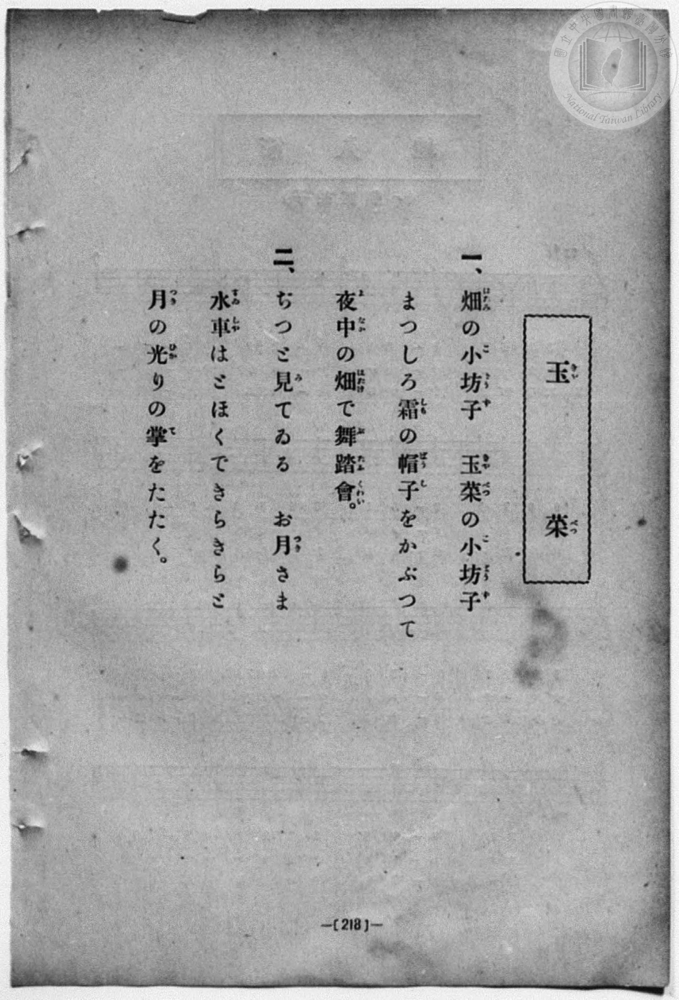
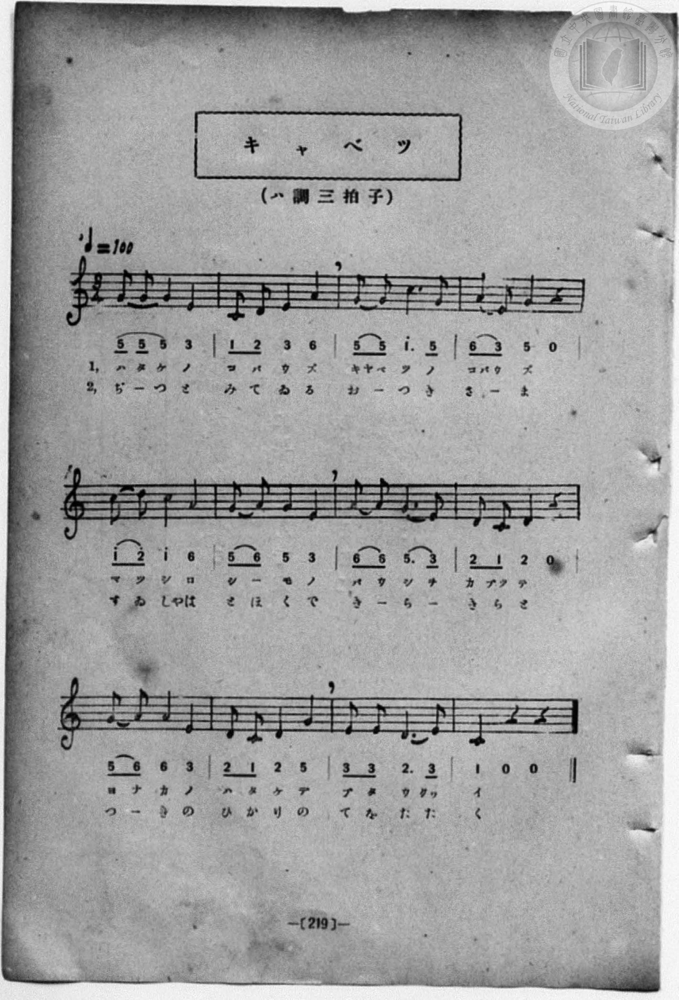

# キャベツ

> Re:Shōka 使用 AI 協助辨識與重建樂譜，可能會有錯誤。歡迎回報。

- **鋼琴伴奏版**：<br><audio controls src="kyabetsu.mp3"></audio>
- **NEUTRINO 歌聲合成版**：<br><audio controls src="kyabetsu_neutrino.mp3"></audio>

- book: 新編 小學校・公學校 唱歌教材集（尋常科三・四學年用）
- 一條慎三郎 編《新編 小學校・公學校 唱歌教材集》（大正十二年十二月，索書號 0725-41）
- 臺灣教育會公認《新定兒童唱歌》尋常科第三學年用（2020.006.0847.0003）同曲

## 說明

> [!NOTE]
> **原書資訊與歌詞全文（對應 P226.jpg–P227.jpg，原書第 218–219 頁）**
> - **標題表記**：左頁歌詞標題作「玉菜（キヤベツ）」，右頁樂譜標題作「キャベツ」。
> - **調性與拍號**：ハ調三拍子（C 大調 3/4 拍），♩= 100。
> - **曲風與構造**：全曲共 12 小節，以三拍子圓舞曲節奏將田裡結霜的高麗菜（玉菜／キャベツ）擬人化為戴著白霜小帽、在午夜菜園裡開舞會的小和尚（小坊子），月亮靜靜守望、遠方水車在月光下閃閃拍手，充滿童話詩意。
>
> **一、**
> 畑（はたけ）の小坊子（こばうず）　玉菜（きやべつ）の小坊子（こばうず）
> まつしろ霜（しも）の帽子（ばうし）をかぶつて
> 夜中（よなか）の畑（はたけ）で舞踏會（ぶたふくわい）。
>
> **二、**
> ぢつと見（み）てゐる　お月（つき）さま
> 水車（すゐしや）はとほくできらきらと
> 月（つき）の光（ひかり）の掌（て）をたたく。


## 歌詞

```text
（TMD 檔案未包含歌詞註解）
```

## ABC

<div class="abc-score" data-abc-src="kyabetsu.abc" aria-label="五線譜載入中"></div>

[下載 ABC 原始檔](kyabetsu.abc)

## TMD 檔案連結

- [主旋律 TMD 檔案](kyabetsu.tmd) [[在 TMD Studio 編輯](https://tmdlang.github.io/Tmd-TS/#tmd=s7IKdvYPcrWy4qpTUCpJTLdSSM7PyUlNLsnMz7MqzsjPTozPrsyvSsyML84ojTe0NDJWgqssy88pzU21Si9KTEmNN443QcgU55cWJadaFSdn5OfnxJekVpQk5edno8vHFySmp1oFGBmZIWQKivLLUvMS84C6C4oy80pSU8DaEQpSyzJTUkHSxcmJefFlqUWZaZmpKUiOSi0qBrsdYkVJUWJecXJRZgHIQwhV-UUlGflAhxdkVFplZBaX5BdlJifmxGcn5iUiFJVkpAK9V5CTmIdkP0QwLT8fyU6g7vTMPKuSxMxyoJvy09IykzMTc8DyIH9bKTybtuH59hUKTzf0P12749mChY-bdz9tXQNhKzydsvHZ2p5nU2c-mzvh5ey293s6nm7ofrpjx_PlE5_s6AQpnT0bqPTpzi3Pp6x4v6dTiUtLS-Fx09rHzYsfN8983NyioKXFpWirYGhgwGVvq-DMZWOsb2IHsvzJjoZni-Y-a-0DmvOyuU8B6IbHDV2kOOZxQzfIPUuWP1u7-Glv45NdPUBnQBjP5nS839PzfMuiZ7N3vJg5X8HA3MhU18QQ7ECg3S_adz1vXAw06EXTpmdzmoE2vFjVC7H96bpZT1snPV-9FGIZ0A64h5-vWQN0K5JvO4wMjAz0DAzM9AwsTMyBDANjoA1PJ_Q8m71JiYtLX0vBllqAS0FBwU4hWtHPP8Q1FsLR0nraNx_kv83tL1Z0vehoBzr3xcp5T1tXPJvWDo6o3mftnQqgJKyXVZD-qGEykGkOYgKDBqIV6CMFI0MLoJSRoaXCywWNQOcD4wtsvC7QgmcrZr5c2PNi4YoXK2Zoab3fM-vp9mVAVRCLIJJP9s553NDzvK_zRf8coKXgqF8CiXqgYY8bekGW9W8G6VrR9GLtHGRdyOkEqPJxQxPC6her9j9rWA7yVXcvMAbBtj9u7gcKA-MAKPZ07QSgdc4KwOgHiikAU5UCUBRoJdC-RzNXglMcioHAOHm5aAXIwOXdLxsWQLwDDKvZm562blQwNAKluefrG4Dan-xeCrfj6ZzJLzrmARUBpZ4u7X-6of35lA0vFi98vnXCyzlzns9qebl6xstd0yGeh4VCP7LHgE56NnnNk127nvZMe96061nHlhcTpz-fuReoHZTKd-x93ND4dM6Kp73AlDwHqP3pnElA819O6wbZO6cZaAVI2aSepxtmgSO1_-ncLrDnQT4FpvMnu9a9nDsHiJ6u63g2ZzbQtJeNC55N2_lsw5YXu7uAJgPVPG3tfLKj--W0ZiAC-utZJzDj9DxtbX22ez8wpb9YufHFypXPWvph4QVLX8AsCjQOliCeT50IiuDG9Y8b5z9uBLI7HzeuQ3IPUGry48YNjxvbHjcCnQqM-wZEsmjsfdzU8rhx5-PGJQQ1Qqx73LgPqPhx4_THTb3AsAIrA7KboNp37IXphWicDhJvmvS4sftx4zawxmUQc4Ch-mTHWnDSBCpeBVQAMQGbd4Dpbd6LHf3AYAdLAc0BSm193AiM0P7HjZAEjRZEu4BFBDyIHjcuAlu94sUyUNH0uHE_2Nhlj5smPG7qBgbI48YucNEElAIqAyXXx41TgT6FaIdEGVh2JkgLyL9gS0GOXPG4cTfIJY3LwYEJFISQK6B60Y1dB4x0sMgmUJg0AY0FCT7r6wELLoMFF9CDQASLesoLKihQ0NLn4goDVnfAOjQzMS_focagphpkg4KNhRY49BSAxaOhrokVMNCgUQB0HnJKQKlG0OWAxoPMqFEwBUNdBWMgrlEwVDACs8zAPJCMYRyQqQtk1AAFjcFKDUCSYO0-hjUg64F4PhBPBIoD7QFrBVoGxBuAuA0sOgsiCnaRAtBJQNwCNhikAa4cpBqiNh5hhxFIehFY6WIwuQJqw34gXgY0cwJItKkbKtoFVrMEangvWGwqmL0PxVxg8JnqWoCCD5hPFkPyCSSHgJwEzxZIeQKoaBki4IABYxQHCR5YaJkhhaQZlAfi1wBDFRSymEG3D-wpoDVgL_RCvQDhNaEEJyQoIXIg2Ulg0W4gBrkMHBKYoQYMZmDogH3RDDZtPdS0FUC8G4j7waLLoaIg-4F5AmwDTATEhwQ5StBZ6hoaAcMOViSAkxc8GS6HuAol7yOnOFDYwMIJFjKgsKoBihmDeZBQM4SGGFqoNXUAzV8F9j1yCKEmQ5iftkFFt0ITBMg5YAlQ8gN5CT3MQCkHGhRwozdBgroJkrZgoqC0NwlsPMTo-WBRUJAizK3l4tK1UwBnZAVkhjIXAA)]
- [鋼琴伴奏 TMD 檔案](kyabetsu_piano.tmd) [[在 TMD Studio 編輯](https://tmdlang.github.io/Tmd-TS/#tmd=s7IKdvYPcrWy4qpTUCpJTLdSSM7PyUlNLsnMz7MqzsjPTozPrsyvSsyML84ojTe0NDJWgqssy88pzU21Si9KTEmNN443QcgU55cWJadaFSdn5OfnxJekVpQk5edno8vHFySmp1oFGBmZIWQKivLLUvMS84C6C4oy80pSU8DaEQpSyzJTUkHSxcmJefFlqUWZaZmpKUiOSi0qBrsdYkVJUWJecXJRZgHIQwhV-UUlGflAhxdkVFplZBaX5BdlJifmxGcn5iUiFCUWATWnp-am5pVYFWQm5uXHJyYn5-cWJOZlgsTACkH-slJ4Nm3D8-0rFJ5u6H-6dsezBQsfN-9-2roGwlZ4OmXjs7U9z6bOfDZ3wsvZbe_3dDzd0P10x47nyyc-2dEJUjp7NlDp051bnk9Z8X5PpxKXlpbC46a1j5sXP26e-bi5Bajj5eyZzzq7X3bveT5hy5M9W54u7QcqVNDS4lK0VTA0MOCyt1Vw5rIx1jexAznqyY6GZ4vmPmvtA5r_srlPAei2xw1dpDjycUM3yJ1Llj9bu_hpb-OTXT1A50EYz-Z0vN_T83zLomezd7yYOV_BwNzIVNfEEOxwoN0v2nc9b1wMNOhF06Znc5qBNrxY1Qux_em6WU9bJz1fvRRiGdAOeEA8X7MG6FakUOgwMjAy0DMwMNMzsDAxBzIMjIE2PJ3Q82z2JiUurjBgLAOTDihSgjwcagxqqrkUgMDGQssOzKhRMAVDXQVjIK5RMFQwArPMwDyQjGEckKkLZNQABY3BSg1AkmDtPoY1Co8b1wPxfCCeCBR_3LgOrPVx42Qg3gDEbWDRWRBRcGwpAKMLiFvABoM0wJWDVEPUxiPsMAJJLwIrXQwmV0Bt2A_Ey4BmTgCJNnVDRbvAapZADe8Fi00Fs_ehmAv0bJyCURzEgzD_miGFhRmUB-LXAMMFFDaYnt8HdtbjxulgR_RCHQHhNaEECCQwIHIg2Ulg0W4g3gYxYhkWfwMDCug_oKbHTc1g09ZDTVsBxLuBuB8suhwqCrL_cVMn2AaYCIgPCTRkz4P8CvI1xK8w34H8WwMUMwbzID43hPoazedNHUBTV4F9gOxL1MQAc9c2qOhWaLT0P27qB0uAEgHIWej-BsUf1DtwozdBgqsJEsMwUVAKmAQ2HmL0fLAoKFgQ5tai5AQf7DnBEKQ22jAWTqIImYBNwqkITCBCqAaiPtoErBBMYtULVoUkDoyXeBDPFN04sBqEapi6aNN4sHEQCqoMRQoqhohAYFjo2imAgyPaB2QpnGME5ihzAQA)]

## 分析

```text
================================================================================
📊 TMD Song Profile: [ キャベツ ]
================================================================================
⏱  Duration:       0:43 (43.2s), 24 measures total
🎼 Key & Tempo:    首調基準 C, != 100.0 BPM, <3/4>
   - 分析範圍：      由實際發聲的音符與和弦推測調性；播放脈絡另行呈現
🎤 人聲音域:    C4 (MIDI 60) – D5 (MIDI 74) [跨度: 14 個半音 / 1.2 個八度, 難度: moderate]
   - 最低音:  C4 in [Verse #1 @ m.2, 0:01]
   - 最高音: D5 in [Verse #1 @ m.5, 0:07]
   - 適合: soprano, mezzo-soprano, contralto, tenor, baritone, bass
🏛  結構:      Verse (21.6s) -> Verse (21.6s)
⚡ 編曲密度:        Peak 1 軌道同時演奏
🗝  調性診斷：       G 大調（純淨自然大調，未偵測到可信轉調）
   - 風格氣質:    純淨自然大調（陽光明朗、易唱易記，無明顯調外色彩）
   - 轉調歷程:    全曲維持單一推測調性（未偵測到可信轉調）
   - 核心骨幹音:  G, E, C, D, A
   - 調性數值:    G 大調 [相關度: 0.80, 穩定度: Moderate, 自然音純度: 100.0%]
   - 候選調性 (K-S): G 大調 (0.80), C 大調 (0.76), E 小調 (0.67)
   - 五度圈歷程:   +1 -> +1
   - 各段落調性細節:
     • [Verse #1]: G 大調 (r: 0.80, 自然音純度: 100.0%)
     • [Verse #2]: G 大調 (r: 0.80, 自然音純度: 100.0%)

  [ 五度圈游移軌跡 ]
               C  
         F           [G ]*
      Bb               D  
      Eb               A  
         Ab           E  
            Db       B  
               F# 
     (* = active key center)

  [ 十二半音累積音高分佈 ]
     C  : ███████████████           17.2%
     C# :                            0.0%
     D  : ███████████████           17.2%
     D# :                            0.0%
     E  : █████████████████         20.3%
     F  :                            0.0%
     F# :                            0.0%
     G  : ████████████████████████  28.1%
     G# :                            0.0%
     A  : ███████████████           17.2%
     A# :                            0.0%
     B  :                            0.0%
--------------------------------------------------------------------------------
Assignment 軌道音域：
  - Piano         : C4 – D5 (14 個半音 / 1.2 個八度, 86 個音符)
================================================================================
```


## 原書掃描頁






