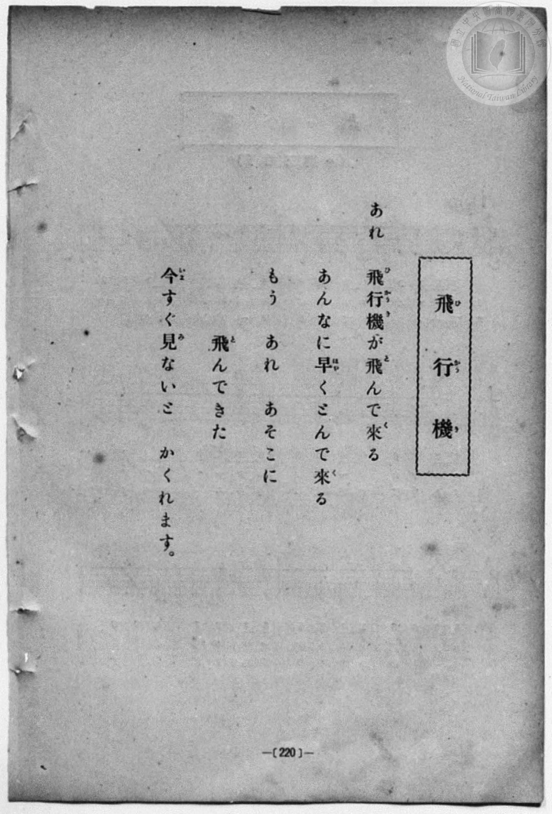
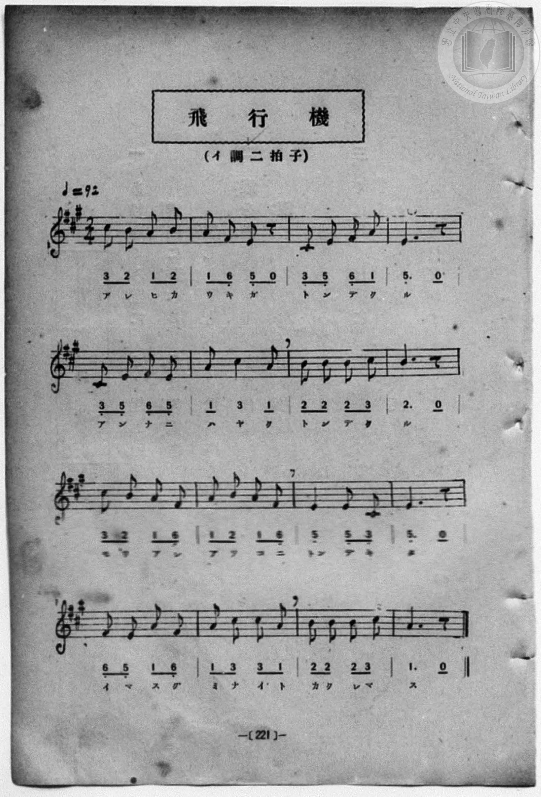

# 飛行機

> Re:Shōka 使用 AI 協助辨識與重建樂譜，可能會有錯誤。歡迎回報。

- **NEUTRINO 歌聲合成版**：<br><audio controls src="hikoki_neutrino.mp3"></audio>
- **鋼琴伴奏版**：<br><audio controls src="hikoki.mp3"></audio>


- book: 新編 小學校・公學校 唱歌教材集（尋常科三・四學年用）
- 一條慎三郎 編《新編 小學校・公學校 唱歌教材集》（大正十二年十二月，索書號 0725-41）

## 說明

> [!NOTE]
> **原書資訊與歌詞全文（對應 P228.jpg–P229.jpg，原書第 220–221 頁）**
> - **調性與拍號**：イ調二拍子（A 大調 2/4 拍，五線譜記三個升記號），♩= 92。
> - **曲風與構造**：全曲共 16 小節（單段歌詞），以五聲音階（`3_ 5_ 6_ 1 2 3`）急促流暢的八分音符進行，生動捕捉飛機在天空中高速飛來、轉瞬又飛向遠方，催促同伴「若不馬上抬頭看就要躲進雲裡去了」的臨場驚奇感。
>
> **歌詞全文**
> あれ　飛行機（ひかうき）が飛（と）んで來（く）る
> あんなに早（はや）くとんで來（く）る
> もう　あれ　あそこに　飛（と）んできた
> 今（いま）すぐ見（み）ないと　かくれます。

### 編曲說明（鋼琴伴奏版）：

1. 前奏 (Intro, 4 小節)：引用結尾樂句「今すぐ見ないと かくれます」，以輕快緊湊的節奏描繪飛機掠過天際。
2. 主歌伴奏 (Hikoki, 16 小節)：右手演奏主旋律，左手配以輕快推進的二拍子和弦伴奏。


## 歌詞

```text
（TMD 檔案未包含歌詞註解）
```

## ABC

```abc
X:1
T:飛行機
M:2/4
L:1/16
Q:1/4=92
K:A
V:V1 name="Piano" snm="Pia"
[V:V1]
c2 B2 A2 B2 | A2 F2 E2 z2 | C2 E2 F2 A2 | E6 z2 |
w: あ れ ひ か | う き が | と ん で く | る
C2 E2 F2 E2 | A2 c4 A2 | B2 B2 B2 c2 | B6 z2 |
w: あ ん な に | は や く | と ん で く | る
c2 B2 A2 F2 | A2 B2 A2 F2 | E4 E2 C2 | E6 z2 |
w: も う あ れ | あ そ こ に | とん で き | た
F2 E2 A2 F2 | A2 c2 c2 A2 | B2 B2 B2 c2 | A6 z2 |
w: い ま す ぐ | み な い と | か く れ ま | す
```

## TMD 檔案連結

- [主旋律 TMD 檔案](hikoki.tmd) [[在 TMD Studio 編輯](https://tmdlang.github.io/Tmd-TS/#tmd=s7IKdvYPcrWy4qpTUCpJTLdSSM7PyUlNLsnMz7MqzsjPTozPrsyvSsyML84ojTe0NDJWgqssy88pzU21Si9KTEmNN443QcgU55cWJadaFSdn5OfnxJekVpQk5edno8vHFySmp1oFGBlZIGQKivLLUvMS84C6C4oy80pSU8DaEQpSyzJTUkHSxcmJefFlqUWZaZmpKUiOSi0qBrsdYkVJUWJecXJRZgHIQwhV-UUlGflAhxdkVFplZBaX5BdlJifmxGcn5iUiFJVkpAK9BzahAKgBWXdmemaeVUliZjnQDflpaZnJmYk5YHmQP60Unk3b8Hz7CoWnG_qfrt3xbMHCx827n7augbAVnk7Z-Gxtz7OpM5_NnfBydtv7PR1PN3Q_3bHj-fKJT3Z0gpTOng1U-nTnludTVrzf06nEpaWl8HLx7BcLe56tnK-gpcWlaKtgacRlb6vgyGVjpG9iB7L4yY6GZ4vmPmvtA5rxsrlPAWj_44YuUhzyuKEb5JYly5-tXfy0t_HJrh6gEyCMZ3M63u_peb5l0bPZO17MnK9gYG5kqmtiCHYcl76Wgi21AJeCgoKdQrSin3-IayyEo6X1tG8-yN7N7S9WdL3oaAe6-cXKeU9bVzyb1g4OvN5n7Z0KoGSkl1WQ_qhhMpBpCWICnQzR-nzNGgUjIwOglJGRocLLBY1AhwODEWy8LtCCF6v2P2tYDjK6uxfoPS2t93tmPW5aAhQG-b279-naCUCLHBWAYQMUUwAGuQJQFGj8k11Tnm-f9WLtnBcrZgDD_WlD99NeoCtnAA0BWgFU8GjmSlBcPW5oQtj2bPaml4tWgGxb3v2yYQHYNpBvZm962rpRwdAMFFvP1zeAvDZt3bN1WyH-hZj3ZPdSoJ0vGje9nL_55aw-oJoE43gF03gFs3gFQwUjBeMEoLpnDUuf7G9-trXx2axFz2e1PG1d_bSjDajh-ZplLxs2AZMRKC6nzH_aPfVZLxB1AtMWMGE9nbPi6ZKVz1fuerJj7cvVM142zAeKP9kHTBaNL_Z2Pp-35ml_B1Dk6YSJLxsXPJu2ExS6TWuAFj2d0PNkz5bHDT0vupc-2dH7ctmaJzu6nnWteblg7fM53U83bHyxrPHFrk1Aq1_O3vRi8cKnfbuf7AIa2wt024v2FU8XbHm5ctbTpe3PWubDwgkW88hRDYuwx41Nj5t6Hjc0wLMEMBQeN2563Nj9uLHtcSMwXjofN_YAZcHioBz0uGny48blQL-ARfrBIt1IpgFlVz1uXP1s-kqwgvWPm1rAhvQDtePT29QEsrGhAe4kEKNx7uNGoJbVEBeiuQHovMeN8yHan-zuAsu2PG7cB7Zu5uPGCS-WgTLh48b9YBGgq4CywIwMNBnou36QLY37QCohAUV5hoMCBS19Li6PzOz87EyrgMzEvHyHGoOaapAVCjYWWuD4UMCWzxWAWQtY8gDjQUEDlMsMgXnMBJqAdUB5EpwRNbFoBFoIMrRGwRiYbEFJtwZIAlMxMC0bgEQRqboGxNIFQqA4WI9PDSjagMHfA6Q3AXE3UA0wJoC4F4h7FOLB_BVAFZOB9HIg7geJNHWDjQHKcuH30K4euIdMgR6yINFDMKcDSZCnjIF2gnxhBIbGYBZW74AcuwqIV4Odvx4o0gJUBnU8Bd7Z0Qn3jiXQO4ZG5EQQ0D8gz8CZ4DgBEkDfYo2gJqCPwFECiSioHxvnAjHIFxA_gnIX2IsgT_WCheYT5ylgHYlIdMYgX8HKTSJ9BYkfuL-MgRA1kgwxI6kFiPcB8UwgngB27X5olIFkVoBFusHRA0mb-8AiM-E-quXi0rVTgGQzBSBLmQsA)]
- [鋼琴伴奏 TMD 檔案](hikoki_piano.tmd) [[在 TMD Studio 編輯](https://tmdlang.github.io/Tmd-TS/#tmd=s7IKdvYPcrWy4qpTUCpJTLdSSM7PyUlNLsnMz7MqzsjPTozPrsyvSsyML84ojTe0NDJWgqssy88pzU21Si9KTEmNN443QcgU55cWJadaFSdn5OfnxJekVpQk5edno8vHFySmp1oFGBlZIGQKivLLUvMS84C6C4oy80pSU8DaEQpSyzJTUkHSxcmJefFlqUWZaZmpKUiOSi0qBrsdYkVJUWJecXJRZgHIQwhV-UUlGflAhxdkVFplZBaX5BdlJifmxGcn5iUiFCUWATWnp-am5pVYFWQm5uXHJyYn5-cWJOZlgsTACkH-slJ4Nm3D8-0rFJ5u6H-6dsezBQsfN-9-2roGwlZ4OmXjs7U9z6bOfDZ3wsvZbe_3dDzd0P10x47nyyc-2dEJUjp7NlDp051bnk9Z8X5PpxKXlpbCy8WzXyzsebZyPlD5y9kzn3V2v-ze83zClid7tjxd2g9UpaClxaVoq2BpxGVvq-DIZWOkb2IHctCTHQ3PFs191toHNPtlc58C0F2PG7pIceDjhm6QG5csf7Z28dPexie7eoBOgzCezel4v6fn-ZZFz2bveDFzvoKBuZGprokh2NFc-loKttQCXAoKCo8bJjybven57HUvVq16NqPvccNEsCjQ5e27Xsyc-n7PLKr4FW9k9Dxfs0bB1EDh5bJpjxs64JHyuKETKPe0bz4wHEAqjIwMHjVMNjIyVHi5oBEYeKA0rZdVkA4UBDItQUxgGD1uaIL64MWq_c8alr_oaH_W3QsMR6BXHjctAQqCgri79-naCUAzHBWAUQAUUwDGrAJQFGgA0M6XDfOf7lqmAI55hHlA_wKDChJOoASDlFSedwKjDKhzFkipgoKhnsLTzl6guIKGZ15JUb6OggkopJ6vb9AEqnm6ZyrQ28-3Tni6Yd-zFU1P-5c-buh5srvrcePMx40TXizrfty46nFjy-PGFQqPG4Gc_sdNPY8b94GkG4AOBCpd-mLP1Kf7Vz_f3vVsZ9fzWS1Ag4GWPevvf75zFTD4gGH3rG_By8a-p0tWvpw1G-oDBQUjPYUnO3YDYwbiaAUNj8zs_OxMHQVDM2Tn9W8GZoRne6YAlYCUT-9-ug-YVnuebl8GyiCtvXD7n_WteNmwCWg_PESfTup5umcZxHiotZQnUyhQ0NLn4gIHp1UAqJwI8nCoMaipBnvNxkLLDsyoUTCLVzCNVzAE0TVAyhgIDYEsIzA0BovpAqGBQg1XLYp5PtjNM4mPV4g2iY9VMATShrEgAyAMON8UpMIUqALOQFYDtQgS1Hhcji1jKwCTPTD7AbODggYoBxgCkzosJekowBK9JhaNwLCCON8Y6GtDIAb5GxI0QAcpGINZQD4oaIAsWIiA9PjUAJNdkwIw0QHpTaAkCFTzuLENiHuBuEcBFLDgxNk0GUgvB-J-kEhTN9gYoCwXfg_t6oF7yBToIQsSPQRzOpCERLAuWgQbYfcOyLGrgHg12PnrgSItQGVQx1PgnR2dcO9YAr1jaEROBEFTK5wJjhMgAfQt1ghqAvoIHCWQiIL6sXEuEIN8AfHjCpCXQF4EeaoXLDSfOE8By2dEojMG-QpWQhDpKxJyITySWoB4HxDPBOIJYNfuh0YZSGYFWKQbHD2QtLkPLDIT7iO0XIYjP0NzJmZeBYmA8gaUawZSYBafi5HDYW6Gq4SXEMQVDfgNQ7YWtxB2CxCGUanQ0rVTABeQCkAGJGhBLGUuAA)]

## 分析

```text
================================================================================
📊 TMD Song Profile: [ 飛行機 ]
================================================================================
⏱  Duration:       0:20 (20.9s), 16 measures total
🎼 Key & Tempo:    首調基準 A, != 92.0 BPM, <2/4>
   - 分析範圍：      由實際發聲的音符與和弦推測調性；播放脈絡另行呈現
🎤 人聲音域:    C#4 (MIDI 61) – C#5 (MIDI 73) [跨度: 12 個半音 / 1.0 個八度, 難度: easy]
   - 最低音:  C#4 in [Hikoki #1 @ m.3, 0:02]
   - 最高音: C#5 in [Hikoki #1 @ m.1, 0:00]
   - 適合: soprano, mezzo-soprano, contralto, tenor, baritone, bass
🏛  結構:      Hikoki (20.9s)
⚡ 編曲密度:        Peak 1 軌道同時演奏
🗝  調性診斷：       A 調性不明確（純淨自然大調，未偵測到可信轉調）
   - 風格氣質:    純淨自然大調（陽光明朗、易唱易記，無明顯調外色彩）
   - 轉調歷程:    全曲維持單一推測調性（未偵測到可信轉調）
   - 核心骨幹音:  E, A, B, C#, F#
   - 調性數值:    A 調性不明確 [相關度: 0.82, 穩定度: Ambiguous, 自然音純度: 100.0%]
   - 候選調性 (K-S): A 大調 (0.82), E 大調 (0.79), C# 小調 (0.59)
   - 五度圈歷程:   +3
   - 各段落調性細節:
     • [Hikoki #1]: A 調性不明確 (r: 0.82, 自然音純度: 100.0%)

  [ 五度圈游移軌跡 ]
               C  
         F            G  
      Bb               D  
      Eb              [A ]*
         Ab           E  
            Db       B  
               F# 
     (* = active key center)

  [ 十二半音累積音高分佈 ]
     C  :                            0.0%
     C# : ███████████████████       18.6%
     D  :                            0.0%
     D# :                            0.0%
     E  : ████████████████████████  23.7%
     F  :                            0.0%
     F# : ████████████              11.9%
     G  :                            0.0%
     G# :                            0.0%
     A  : ████████████████████████  23.7%
     A# :                            0.0%
     B  : ██████████████████████    22.0%
--------------------------------------------------------------------------------
Assignment 軌道音域：
  - Piano         : C#4 – C#5 (12 個半音 / 1.0 個八度, 49 個音符)
================================================================================
```


## 原書掃描頁






