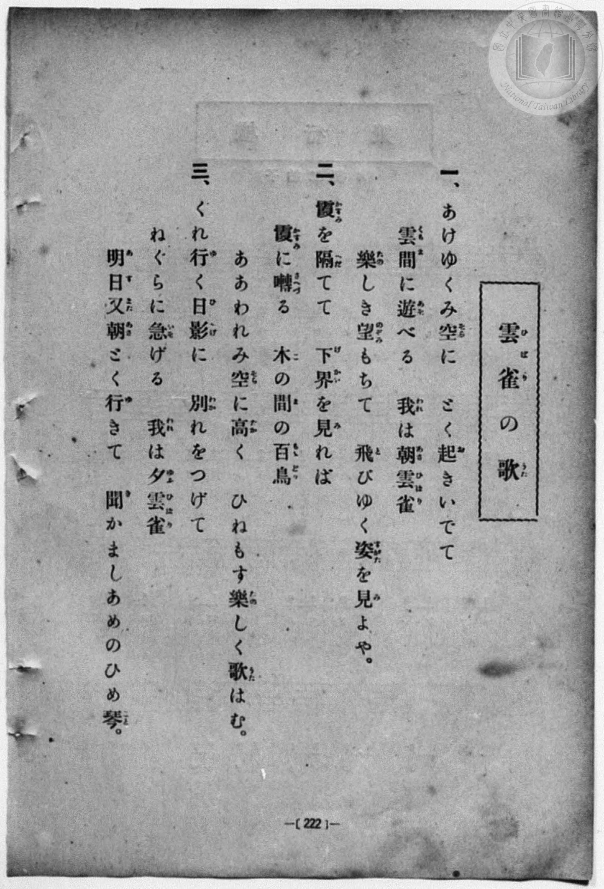
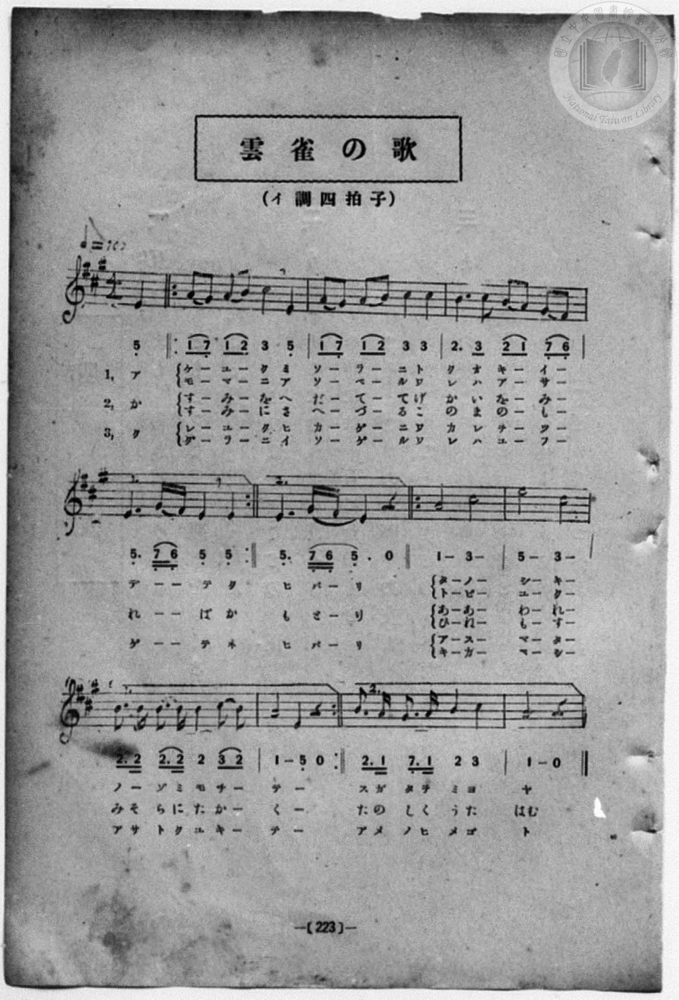

# 雲雀の歌

> Re:Shōka 使用 AI 協助辨識與重建樂譜，可能會有錯誤。歡迎回報。

<audio controls src="hibari_no_uta.mp3"></audio>

- 詞：文部省《中學唱歌》／《教育音楽講習曲集》
- 曲：Felix Mendelssohn（《無言歌》或合唱曲〈Lerchengesang〉Op. 48 No. 4 改編）
- book: 新編 小學校・公學校 唱歌教材集（尋常科五・六學年用）
- 一條慎三郎 編《新編 小學校・公學校 唱歌教材集》（大正十二年十二月，索書號 0725-41）
- 日治時期公學校《唱歌帳》（典藏號 2020.006.0843・P150，原載《小公校唱材集》第 223 頁）

## 說明

> [!NOTE]
> **原書資訊與歌詞全文**（對應 `P230.jpg`–`P231.jpg`，原書 p. 222–223，尋常科五・六學年第 1 首）：
> - **調性與拍號**：イ調四拍子（A 大調 4/4 拍），速度 ♩= 100，弱起拍（第 4 拍起唱），含前後兩段反覆（1.、2. 結尾）。
> - **版面校勘**：本檔案完整展開原頁前後反覆記號（1.、2. 括號），五線譜與簡譜逐音核對一致。
>
> **一、**
> あけゆくみ空（そら）に　とく起（お）きいでて
> 雲間（くもま）に遊（あそ）べる　我（われ）は朝雲雀（あさひばり）
> 樂（たの）しき望（のぞみ）もちて　飛（と）びゆく姿（すがた）を見（み）よや。
>
> **二、**
> 霞（かすみ）を隔（へだ）てて　下界（げかい）を見（み）れば
> 霞（かすみ）に囀（さへづ）る　木（こ）の間（ま）の百鳥（もゝどり）
> ああわれみ空（そら）に高（たか）く　ひねもす樂（たの）しく歌（うた）はむ。
>
> **三、**
> くれ行（ゆ）く日影（ひかげ）に　別（わか）れをつけて
> ねぐらに急（いそ）げる　我（われ）は夕雲雀（ゆふひばり）
> 明日（あす）又（また）朝（あさ）とく行（ゆ）きて　聞（き）かましあめのひめ琴（ごと）。


## 歌詞

```text
（TMD 檔案未包含歌詞註解）
```

## ABC

```abc
X:1
T:雲雀の歌
C:曲：Felix Mendelssohn（《無言歌》或合唱曲〈Lerchengesang〉Op. 48 No. 4 改編）
M:4/4
L:1/16
Q:1/4=100
K:A
V:V1 name="Piano" snm="Pia"
[V:V1]
z4 z4 z4 E4 | A2 G2 A2 B2 c4 E4 | A2 G2 A2 B2 c4 c4 | B6 c2 B2 A2 G2 F2 |
w: あ | け _ ゆ _ く み | そ _ ら _ に と | く お き _ い _
E6 G F E4 E4 | A2 G2 A2 B2 c4 E4 | A2 G2 A2 B2 c4 c4 | B6 c2 B2 A2 G2 F2 |
w: で _ _ て く | も _ ま _ に あ | そ _ べ _ る わ | れ は あ _ さ _
E6 G F E4 z4 | A8 c8 | e8 c8 | B3 B B3 B B4 c2 B2 |
w: ひ ば _ り | た の | し き | の ぞ み _ も ち _
A8 E4 z4 | A8 c8 | e8 c8 | B3 A G3 A B4 c4 |
w: て _ | と び | ゆ く | す が た を み よ
A8 z8 | z4 z4 z4 E4 | A2 G2 A2 B2 c4 E4 | A2 G2 A2 B2 c4 c4 |
w: や | か | す _ み _ を へ | だ _ て _ て げ
B6 c2 B2 A2 G2 F2 | E6 G F E4 E4 | A2 G2 A2 B2 c4 E4 | A2 G2 A2 B2 c4 c4 |
w: か い を _ み _ | れ _ _ ば か | す _ み _ に さ | へ _ づ _ る こ
B6 c2 B2 A2 G2 F2 | E6 G F E4 z4 | A8 c8 | e8 c8 |
w: の ま の _ も _ | も ど _ り | あ あ | わ れ
B3 B B3 B B4 c2 B2 | A8 E4 z4 | A8 c8 | e8 c8 |
w: み そ ら に た か _ | く _ | ひ ね | も す
B3 A G3 A B4 c4 | A8 z8 | z4 z4 z4 E4 | A2 G2 A2 B2 c4 E4 |
w: た の し く う た | はむ | く | れ _ ゆ _ く ひ
A2 G2 A2 B2 c4 c4 | B6 c2 B2 A2 G2 F2 | E6 G F E4 E4 | A2 G2 A2 B2 c4 E4 |
w: か _ げ _ に わ | か れ を _ つ _ | げ _ _ て ね | ぐ _ ら _ に い
A2 G2 A2 B2 c4 c4 | B6 c2 B2 A2 G2 F2 | E6 G F E4 z4 | A8 c8 |
w: そ _ げ _ る わ | れ は ゆ _ ふ _ | ひ ば _ り | あ す
e8 c8 | B3 B B3 B B4 c2 B2 | A8 E4 z4 | A8 c8 |
w: ま た | あ さ と く ゆ き _ | て _ | き か
e8 c8 | B3 A G3 A B4 c4 | A8 z8 |
w: ま し | あ め の ひ め ご | と
```

## TMD 檔案連結

- [主旋律 TMD 檔案](hibari_no_uta.tmd) [[在 TMD Studio 編輯](https://tmdlang.github.io/Tmd-TS/#tmd=s7IKdvYPcrWy4qpTUCpJTLdSSM7PyUlNLsnMz7MqzsjPTozPrsyvSsyML84ojTe0NDJWgqssy88pzU21Si9KTEmNN403Q8gU55cWJadaFSdn5OfnxJekVpQk5edno8vHFySmp1oFGBkbIGQKivLLUvMS84C6C4oy80pSU8DaEQpSyzJTUkHSxcmJefFlqUWZaZmpKUiOSi0qBrsdYkVJUWJecXJRZgHIQwhV-UUlGflAhxdkVFplZBaX5BdlJifmxGcn5iUiFJVkpAK9l5iXmZuYo8SlpaXwcvaml7MbHjeue7a2R0FLi0vRVsHQwIDL3lbBkcvGRN_EDqQV5FMrhWfTNjzfvkLh6Yb-p2t3PFuw8HHz7qetayBshadTNgJNeDZ15rO5E17Obnu_p-Pphu6nO3Y8Xz7xya4pYKVrgUqf7tzyfMqK93s6wU56sqPh2aK5z1r7nuzofNncpwA0_nFDFyn2PG7oBlm1ZPmztYuf9jY-2dUDtAHCeDan4_2enudbFj2bvePFzPkKBuZGpromhjC7X6yc937PrGfT2l82r3g-pxFo75MdYBeCLQCb2w9yzNSZL5o2vZy_-dnSvS_WzH6-f9IzUIiBLAYbA-QBjXFLzcmsUPBNzUtJzSkuzs_IAzoKqPl5y8IXKxogxj3rmPZ0QgfI9NmbHjd0-KQWJWek5qWnFifmpT9u6PQv0FMwsVDwywdSCs-m7ASGAMylz6YvfbZp97OZTc_mzIcHBNB0iEuf7tgMDYTWHS-m94N8amRgZKBnYGCmZ2BhYgwMvQBDUwNgUDztm_9iTydIIzBkW9cADQGZAAvG52vWKBgZGSu8XNAItphLX0vBllqAS0FBwU4hWtHPP8Q1FsLR0gK6BxQ1m9tfrOh60dEO9AswTp62rgDGiZYWOAH1PmvvVEgA5Sa9rIL0hEcNk0EcQzAH4iGgAQrAkDMyMgJKAp0PEsWV7oAeNFR4uWwa0HvAKIO4Qhfojher9j9rWA5yQXcvMPhAds963LQEKPx09myg2NO1E4CucVQApjKgmAIwUygARcGm9LxsmP901zKFRzNXgvMNyPo9G19s3Q5W0AGyEqwYKAIMa4iWpxNWP-3sfbqv52nrymfrtj7t732xDJRfDPUeNzQa6Sk83zrh6YZ9QLWPG5oQjnze2fFy7iJQnHXPALvw2Zw1z1ZNebaw4-k6YHbY8nTj1JfTuoEhAow_qPFgg1-smAH0E5Lxz7rXgAVATgGG0PPts16snQP0_PMNC4GMlw0TQGl9wQ5g4ANz54v2LTBXwGINKAo0CFhSgPmPG5seN0583NT2uLH_ceP-5yt3gVJ-49zHTUDzOx83rn7cACxcVgBlgUEAluoCi_c-bmx53Lj8ceMyiDmgYmjaZLCC_sdNQDPBAdC4-iVIPVAQKDIXLLLzcVM30MxnHRNB4k1AxT1g8fXP5syFlGUw9VMfN2563LjhcRPIRogtz1Y0gWXnA8s7sK7pQJc8mzMbLLjuceM8oBdA4iAHLAS6DWjRy8UQWVBufNy4GeLTp8uByoCCMx839gBNA2uZ9GIZKBfCTAC6rQUj6HYBCwJ40L2cAyyAgOq7weZAdE16OWsKWHDH48YFYBuXQZzxZEf386lAnwKlJoG1tGCzFOiYDTgNb1z9FBo4wJABmr8UrAUcmHOAvgOKA8MfqGwdLCIgUbDu-cx9LzcDFQN91PS4ae7jxpXIQQoOaqA4KCKwJoCXq2fAwhzoVKAIsFQFJglg1KwFh_NMbJHSDywMwILA0AYHb-P6x03AdIeeFIF5BCkpgtzwYiFYYxMwR4HsApadT_cCMx7QKKCNwNCYBE-WTzsgngKmW7DDgO5vAobtElB6hiVLkCMbJwD9AtTyrAGsHpRuIUlxEq6k-HTJVERSBCWYrViS4ow-oNtgaXUmUPxpP7C-AgU7xMvA9AxPyWBjwZkIxXfATARKGy8aIXENKpLAfgSaAAxDYKQ0glP1JiDj-YQtYDVToCkZEpKUF-xQoKClz8UVnJ-XbhWQmZiX71BjUFMNskDBxtBMCxxfCtiqEwVIYQmsj56vb1DQAJZbCsag4vLJnonP1i4C1d6oBagmFiOANoOMr1EwAJaTIIhOm8ZDGTVghT6GNQowEXQaGGioao3wqe1GVWuMT20_XC2ewOjshdcHQI8DC9qXjb0KGoZ6eL1tCDTVHGQRiGEExMYY_satBkbXgEVhECQK4sO1mYGIGoSJIAiUAArDhbCEMjAjwfzf1IYREsDCAm45MEfBVXbC5VfDWSuQVML0Q2S6wGQvnN-CpHI5kkqI7DIMVyDiGZgJMVwGLBDgYjuQTF6AxUQEC6YHpBKWRhCuQzYTKQSaejBcuwHOwkxpCPXYw3YTFjcgXIYUtk3wkEB3LdgGZNcuQVIJE0W4FuH_tXDXEp_Wd_WA07rRkEjrsJIFKak3wQoOYOkLZyESMLxYQU7qjTthrCZ4FCFHB0qSAFYrKCYBawUkM2HRDZEBJRxgXQPlo2VMXEkdybXIJsOSPbC9gOnaxslIKtehuAEUCggxRPgghxVE5Up8rgUl9cYJcFOwFQ7IWR4RtvBkS3zYImWkrUhmEhe2eJL6vh4yi3VkCEu9MAhMoQRVQNK5ERqNSPOYtuBL4o3z0RSjRjksuKZjqOrFogqiE9jiRiltEYl7IZJaWMmCDrElbOSkBTEJXQQU-ch1CMRm9NIXZBbEXaBEBUt4oGSHCAekchmp7CXgSnCCxnQlLEMi2w8rSBCq0GMAYRYo08LqSZBbkBNzL5JqwmFJfEImvsxGhuQnZENIAQ1iIKdkiBJ0a2AJGG4IUkKGNSdgENivw7ASEYAIVehRjChJgf1AePSAqkzkRN2BZCasrIJB5EoGyZXgpIxc7kDsWIvFlcQlJajLgNkOlkHBiaQRkUhgSQukGtTXIs6h4NTci-EE5HYEzFDM1IxeUiCl5qZGpDJiE5gP0zUFSTV6RGK6spaLS9dOAdQzifYxjFWAs42Q2MZgtjIXAA)]
- [鋼琴伴奏 TMD 檔案](hibari_no_uta_piano.tmd) [[在 TMD Studio 編輯](https://tmdlang.github.io/Tmd-TS/#tmd=s7IKdvYPcrWy4qpTUCpJTLdSSM7PyUlNLsnMz7MqzsjPTozPrsyvSsyML84ojTe0NDJWgqssy88pzU21Si9KTEmNN403Q8gU55cWJadaFSdn5OfnxJekVpQk5edno8vHFySmp1oFGBkbIGQKivLLUvMS84C6C4oy80pSU8DaEQpSyzJTUkHSxcmJefFlqUWZaZmpKUiOSi0qBrsdYkVJUWJecXJRZgHIQwhV-UUlGflAhxdkVFplZBaX5BdlJifmxGcn5iUiFCUWATWnp-am5pVYFWQm5uXHJyYn5-cWJOZlgsQQCksygIqsQMKJOUpcWloKL2dvejm74XHjumdre97v6Xg5e-azzu6X3XueT9jyZM-Wp0v73-_pVNDS4lK0VTA0MOCyt1Vw5LIx0TexAxkJCiorhWfTNjzfvkLh6Yb-p2t3PFuw8HHz7qetayBshadTNgJNfjZ15rO5E17ObgNa8XRD99MdO54vn_hk1xSw0rVApU93bnk-ZQXQLrBTn-xoeLZo7rPWvic7Ol829ykAjX_c0EWKPY8bukFWLVn-bO3ip72NT3b1AG2AMJ7N6Xi_p-f5lkXPZu94MXO-goG5kamuiSHM7hcr573fM-vZtPaXzSuez2kE2vtkB9iFYAvA5vaDHDN15oumTS_nb362dO-LNbOf75_0DBSSIIvBxgB5QGPcUnMyKxR8U_NSUnOKi_Mz8oCOAmp-3rLwxYoGiHHPOqY9ndABMn32pscNHT6pRckZqcC4LAZG6OOGTv8CPQUTCwW_fCCl8GzKTmAIwFz6bPrSZ5t2P5vZ9GzOfHhAAE2HuPTpjs3QQGjd8WJ6P8inRgZGBnoGBmZ6BhYmxsDQCzA0NQAGxdO--S_2dII0AkO2dQ3QEJAJsGB8vmaNgpGRscLLBY1gi7k880qK8q0CQKksyMOhxqCmmksBCGwMzbTswKwaBUMFXRRojMavUTAlqMIITBsqmMdDGRABhFJMawzQDeGqRXGuD7JzTRCujVeINoxVMI2H0FgEwCxTqAiQhisBUgYQa4Lz89LxBYq-lsLTPRtfbN0ODOTn6xsUtPShtsMcjU6bQvwN8gVIoY9hjQJMBJ1-3NiEqtYIn9puVLXG-NT2w9XCPdHZ-2zd1qf9vS-WtQGTBjCnvmzsVdAw1NNEeAkUL-BoAzFA0QaLMoSfcKtBRC8swmGiID5cmxmIAMUMkiKgBFAYLoQlBB83ToT5rakNw5ePG_fDLX_cOBeushMuvxrOWoGkEqYfItMFJnvh_BYklcuRVEJkl2G4AhGHjxtnYrjscdMkuNgOJJMXYDERwYLpAamExT_CdchmIoVAUw-GazfAWZipCKEee9huwuIGhMuQwrYJHhLorgXbgOzaJUgqYaII1yL8vxbuWlzpeFcPOB0bDcJ0DCsRkJJxEyzDP27cB2chEie8OEBOxo07YawmePAjBzVKdD9uXI9i0uPGqUhmwqISIgNKFI-bQMkeBNEyHa5kjORaZJNhSfpx41JM1zZORlK5DsUNoFBAiCHCBzmsICpX4nMtKBk3ToCbgi3jI2dnRNjCkyTxYYuUSbYimUlc2MKT8b4eoopjZEh-bWyERiPSM6Yt-JJv43w0xajRCQuK6RiqerGoguh83DgPpZREJNyFSGphJQI6xJZokZMNxCR0EVDEIpf9EJvRS02QWRB3gRIMLFGBkhQiHJDKU6Qyk4ArwYkV05WwzIZsP6yQQKhCjwGEWaAMCavfQG5BTqi9SKoJhyWuRIqrrEWGA9ZkRCRSWBUPg48bN2NYiQgchCr06EOUgI8be-BBD6rGkBNsB5KZsDIGBpErByRXgpMpcnkBsWMtFlcSl0ygLgNmKVjmAyeARkQCgCUbkOr1j5saiHMoOKX2YjgBuW6HGYqZUtFLAaSU2tSIlP83gfkwXVOQVKNHJKYrURrwOLoJBlAI8RMp3QYjIGWE3o8YUIMwOjJUMwjRI9K1UwD3vRSADFDgRvsApeFsoDfgbGMwW5kLAA)]

## 分析

```text
================================================================================
📊 TMD Song Profile: [ 雲雀の歌 ]
================================================================================
⏱  Duration:       2:02 (122.4s), 51 measures total
🎼 Key & Tempo:    首調基準 A, != 100.0 BPM, <4/4>
   - 分析範圍：      由實際發聲的音符與和弦推測調性；播放脈絡另行呈現
🎤 人聲音域:    E4 (MIDI 64) – E5 (MIDI 76) [跨度: 12 個半音 / 1.0 個八度, 難度: easy]
   - 最低音:  E4 in [Song[L1] #1 @ m.1, 0:01]
   - 最高音: E5 in [Song[L1] #1 @ m.11, 0:24]
   - 適合: soprano, mezzo-soprano, contralto, tenor, baritone, bass
🏛  結構:      Song[L1] (40.8s) -> Song[L2] (40.8s) -> Song[L3] (40.8s)
⚡ 編曲密度:        Peak 1 軌道同時演奏
🗝  調性診斷：       C# 調性不明確（純淨自然大調，未偵測到可信轉調）
   - 風格氣質:    純淨自然大調（陽光明朗、易唱易記，無明顯調外色彩）
   - 轉調歷程:    全曲維持單一推測調性（未偵測到可信轉調）
   - 核心骨幹音:  C#, E, A, B, G#
   - 調性數值:    C# 調性不明確 [相關度: 0.80, 穩定度: Ambiguous, 自然音純度: 100.0%]
   - 候選調性 (K-S): C# 小調 (0.80), A 大調 (0.78), E 大調 (0.77)
   - 五度圈歷程:   -5 -> -5 -> -5
   - 各段落調性細節:
     • [Song[L1] #1]: C# 調性不明確 (r: 0.80, 自然音純度: 100.0%)
     • [Song[L2] #1]: C# 調性不明確 (r: 0.80, 自然音純度: 100.0%)
     • [Song[L3] #1]: C# 調性不明確 (r: 0.80, 自然音純度: 100.0%)

  [ 五度圈游移軌跡 ]
               C  
         F            G  
      Bb               D  
      Eb               A  
         Ab           E  
           [Db]*      B  
               F# 
     (* = active key center)

  [ 十二半音累積音高分佈 ]
     C  :                            0.0%
     C# : ████████████████████████  27.0%
     D  :                            0.0%
     D# :                            0.0%
     E  : ████████████████████      23.0%
     F  :                            0.0%
     F# : ██                         2.5%
     G  :                            0.0%
     G# : ██████                     7.0%
     A  : ████████████████████      22.1%
     A# :                            0.0%
     B  : ████████████████          18.4%
--------------------------------------------------------------------------------
Assignment 軌道音域：
  - Piano         : E4 – E5 (12 個半音 / 1.0 個八度, 210 個音符)
================================================================================
```


## 原書掃描頁






