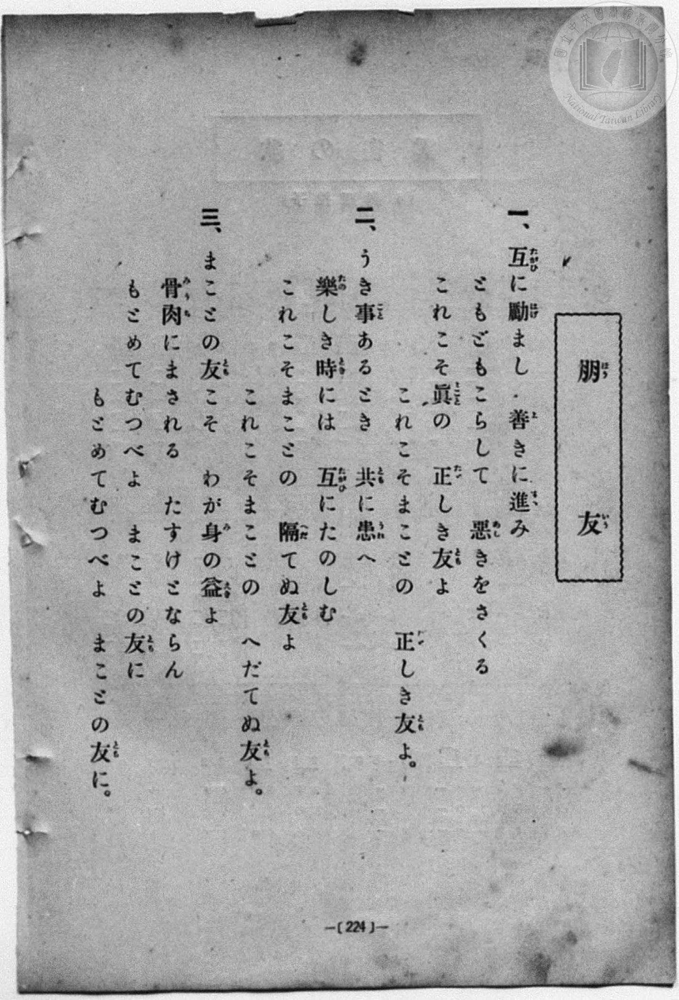
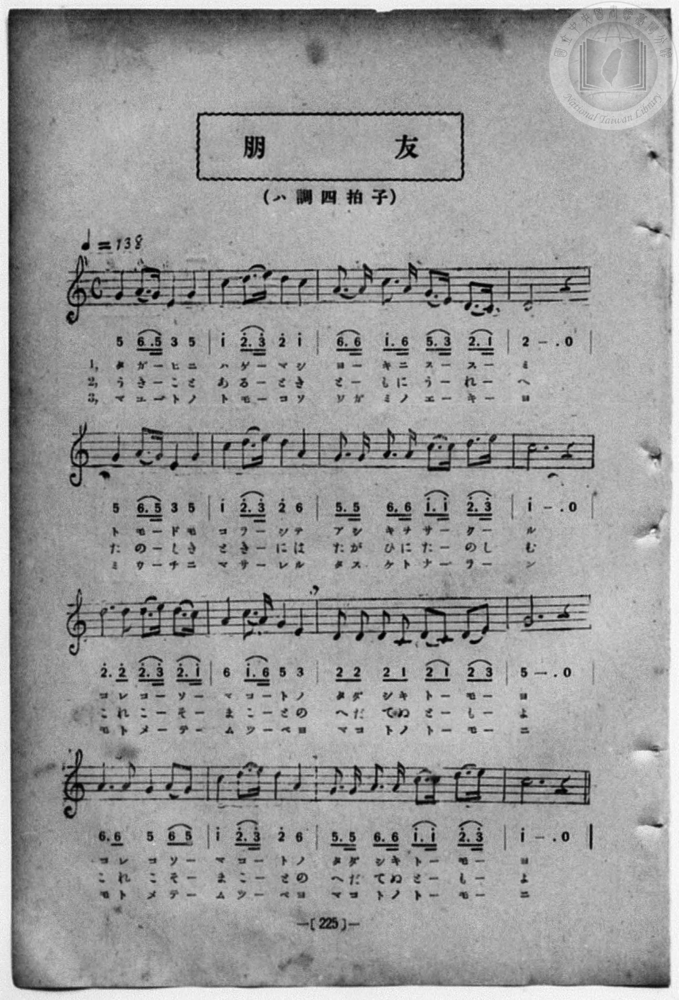

# 朋友

> Re:Shōka 使用 AI 協助辨識與重建樂譜，可能會有錯誤。歡迎回報。

- **鋼琴伴奏版**：<br><audio controls src="hoyu.mp3"></audio>
- **NEUTRINO 歌聲合成版**：<br><audio controls src="hoyu_neutrino.mp3"></audio>

- book: 新編 小學校・公學校 唱歌教材集（尋常科五・六學年用）
- 一條慎三郎 編《新編 小學校・公學校 唱歌教材集》（大正十二年十二月，索書號 0725-41）
- 出處：共益商社樂器店《唱歌教科書 教師用 巻二》第十～十一頁（第五曲）
- NDL Digital Collections PID 854863（https://dl.ndl.go.jp/pid/854863）掃描 P011.jpg

## 說明


- 出處：book: 新編 小學校- 公學校 唱歌教材集（尋常科五- 六學年用）
- 出處：一條慎三郎 編《新編 小學校- 公學校 唱歌教材集》（大正十二年十二月，索書號 0725-41）
- 出處：出處：共益商社樂器店《唱歌教科書 教師用 巻二》第十～十一頁（第五曲）
- 出處：NDL Digital Collections PID 854863（https://dl.ndl.go.jp/pid/854863）掃描 P011.jpg
- 調性與拍號：調號 ?= C，拍號 <4/4>，速度 != 138


## 歌詞

```text
（TMD 檔案未包含歌詞註解）
```

## ABC

```abc
X:1
T:朋友
M:4/4
L:1/16
Q:1/4=138
K:C
V:V1 name="Piano" snm="Pia"
[V:V1]
!mf! G4 A3 G E4 G4 | c4 d3 e d4 c4 | A3 A c3 A G3 E D3 C | D12 z4 |
w: 1.~た が _ ひ に | は げ _ ま し | よ _ き に す _ す _ | み
w: 2.~う き _ こ と | あ る _ と き | と _ も に う _ れ _ | へ
w: 3.~ま こ _ と の | と も _ こ そ | わ _ が み の _ え き | よ
G4 A3 G E4 G4 | c4 d3 e d4 A4 | G3 G A3 A c3 c d3 e | c12 z4 |
w: 1.~と も _ ど も | こ ら _ し て | あ し き を さ _ く _ | る
w: 2.~た の _ し き | と き _ に は | た が ひ に た の し _ | む
w: 3.~み う _ ち に | ま さ _ れ る | た す け と な _ ら _ | ん
[M:3/4] d3 d d3 e d3 c | [M:4/4] A4 c3 A G4 E4 | D2 D2 D2 C2 D2 C2 D2 E2 | G12 z4 |
w: 1.~こ れ こ _ そ _ | ま こ _ と の | た だ し き と _ も _ | よ
w: 2.~こ れ こ _ そ _ | ま こ _ と の | へ だ て ぬ と _ も _ | よ
w: 3.~も と め _ て _ | む つ _ べ よ | ま こ と の と _ も _ | に
[M:3/4] A3 A G4 A2 G2 | [M:4/4] c4 d3 e d4 A4 | G3 G A3 A c3 c d3 e | c12 z4 |
w: 1.~こ れ こ そ _ | ま こ _ と の | た だ し き と _ も _ | よ
w: 2.~こ れ こ そ _ | ま こ _ と の | へ だ て ぬ と _ も _ | よ
w: 3.~も と め て _ | む つ _ べ よ | ま こ と の と _ も _ | に
!mf! G4 A3 G E4 G4 | c4 d3 e d4 c4 | A3 A c3 A G3 E D3 C | D12 z4 |
w: 1.~た が _ ひ に | は げ _ ま し | よ _ き に す _ す _ | み
w: 2.~う き _ こ と | あ る _ と き | と _ も に う _ れ _ | へ
w: 3.~ま こ _ と の | と も _ こ そ | わ _ が み の _ え き | よ
G4 A3 G E4 G4 | c4 d3 e d4 A4 | G3 G A3 A c3 c d3 e | c12 z4 |
w: 1.~と も _ ど も | こ ら _ し て | あ し き を さ _ く _ | る
w: 2.~た の _ し き | と き _ に は | た が ひ に た の し _ | む
w: 3.~み う _ ち に | ま さ _ れ る | た す け と な _ ら _ | ん
[M:3/4] d3 d d3 e d3 c | [M:4/4] A4 c3 A G4 E4 | D2 D2 D2 C2 D2 C2 D2 E2 | G12 z4 |
w: 1.~こ れ こ _ そ _ | ま こ _ と の | た だ し き と _ も _ | よ
w: 2.~こ れ こ _ そ _ | ま こ _ と の | へ だ て ぬ と _ も _ | よ
w: 3.~も と め _ て _ | む つ _ べ よ | ま こ と の と _ も _ | に
[M:3/4] A3 A G4 A2 G2 | [M:4/4] c4 d3 e d4 A4 | G3 G A3 A c3 c d3 e | c12 z4 |
w: 1.~こ れ こ そ _ | ま こ _ と の | た だ し き と _ も _ | よ
w: 2.~こ れ こ そ _ | ま こ _ と の | へ だ て ぬ と _ も _ | よ
w: 3.~も と め て _ | む つ _ べ よ | ま こ と の と _ も _ | に
```

## TMD 檔案連結

- [主旋律 TMD 檔案](hoyu.tmd) [[在 TMD Studio 編輯](https://tmdlang.github.io/Tmd-TS/#tmd=s7IKdvYPcrWy4qpTUCpJTLdSSM7PyUlNLsnMz7MqzsjPTozPrsyvSsyML84ojTe0NDJWgqssy88pzU21Si9KTEmNN403Q8gU55cWJadaFSdn5OfnxJekVpQk5edno8vHFySmp1oFGBkbIWQKivLLUvMS84C6C4oy80pSU8DaEQpSyzJTUkHSxcmJefFlqUWZaZmpKUiOSi0qBrsdYkVJUWJecXJRZgHIQwhV-UUlGflAhxdkVFplZBaX5BdlJifmxGcn5iUiFJVkpAK9l1aUmZqXUpyRWYCsPTM9M88qNzUzKxPJe1paCs_mdD_t71bQ0uJStFUwNLbgsrdVcOayMdE3sQPpBqmzUng2bcPz7SsUnm7of7p2x7MFCx83737augbCVng6ZeOztT3Pps58NnfCy9lt7_d0PN3Q_XTHjufLJz7ZNQWsdC1Q6dOdW55PWfF-TyfYVU92NDxbNPdZa9-THZ0vm_sUgMY_bugixZ7HDd0gq5Ysf7Z28dPexie7eoA2QBjP5nS839PzfMuiZ7N3vJg5X8HA3MhU18QQZvfT9l0vZk59v2fW09aNz2d3PZ3a9nzJvmcrmp7OXPF013SgM-A2Ab0ANEIByHq6YzXQ9QpPt-8Gmg-0-vmaNUC73u-dB7JxR8PLBY1AxwAFgT5-NnsTzCY_Fx8FF2DIlyTmKDjDk2mxQoCni4KFqYmFmTFQV0ZJSUGxlb5-So5eHhCn5-tlFegXZKbow1R0PutrftbfrxBgYGgIlEtX4uLS11KwpRbgUlBQsFOIVvTzD3GNhXC0tJ72zQcF3ub2Fyu6XnS0A4Pjxcp5T1tXPJvWrqUFjuLeZ-2dCgmgzAByU8KjhskgjjGYAwx9iAEKBXoKRkYmQEkjI1OQKK6UsWaNgpHCy2XTgL4FRgzEFbpAd7xYtf9Zw3KQC7p7gVEJsnvW4-Z-oPDT2bOBYk_XTgC6xlkBmA6AYgrAZKsAFAXa9GLtnCc7ul6smKHgDDaz52XD_Ke7lik8mrkSks7hVjzv7Hg5dxEwhT3tngE2H-TN2ZtA5q_bCkwiwBgGuXND__P1DY8bmp5tXvGspR_iPVCE7-gEKgMzGiBqIAlBwRKUjMHcHqBnn2-fBXQR0B_PNywEMp7Panuyd45CglGcnlGcApA0BpOGccCg6wSpAiYvsP1YDDY0JsZkMz0zBVMFIAaZ-HT9spezZj9tbn3auwHkYFAIdTzfswuUC0FsUPgATUDOD8RlA2AwAIPv-ewdTyf0AM14NmfNs1VTnk3b82LlJlCGBDvz2YqZCgnVNsbAEqU2QeHJ7qVP9y8AOujpxI7n_fuABgAd_XL-5udrloFieWbT04Y9oFBeu-TpEmBqABkJzOxICU0BEiQgg8GJEujbxw09jxsnP24Ck41zn8-ZB_Te48Z9YC6oyHncuA5YSoAF5z9uXAAWmf64sRdY8oEFVzxuagIJNnU8bgAlHki8guO75-WqFS-aOoHiz3rWP21sfzqhF-ghmKX7Hze2PW5cCNbVAU5y3U92LXvZ2guSbZ7_uGnZ4-bGx83dYAVAQ5rAyQ6WyYDeeNzQCCx6wfwnuybBXAg0GVSGPG5c_bR7K1hw_eNGoCxQBOgpYBHV8HRaC0i8CVjQAQV7gSpfNgC1AFXOfNw0Fyy4H2IsxHePG1eCSWAoQfy-DGjIs-aFYC1A8elQc5omPW6c-rix_3FTN0w7gYAFmUNc2GIaCDeKJHMwghGUFOHBCI6R3ie7ILrg7mwC-ghsETBqGoAJHcXMxtXPmiBWtwHdBhbZATENWC3AnLQO7iRgKoVqbwRHa-NqUAQ1NGCNQYhekMamBoIh8HLWFLAJO2AhsOxx4xoyQhJiAi7tmOkQmDSRAhBhFLpeiF1A85v6gX58sWs1WHY_JCUAyw4wF4jAwQJzJyQHQVRC8gssZIAWTQV5ARg1IDcDA2rm48aJYKtXgRJq02Sok0BJF-iGRpCPmoAqlzxu3An2CJCNx7WrKdQODSjK61goUNDS5-LyyK8stQrITMzLd6gxqKkGWaBgY2imBY4OherctFowA1jFP27aD8RrFB437wHiSUDcrVADJPuBopugovOA7O1g0RUQkaa1YHWPm3ZC-RAapGI-yH6Q2TXAqkEXDM3ApKmCMZQPE69RMIyDMoEVFIgC11BQIbhcDdQAM5gQqNIBqwZW52CVQCUQFiY0gBkCdpOPIdCJjfOhYsDUBWdtgrNWw60FZji46CQ4ax-cNR2hsqkDLtoLNweY0uCiMBbI1P043BqP6lYjkNo2NHNBrMlw1gokU5tgok3dGPII3SCVcNEmiB6IW-E2NcFCBaR2B3FuNQapRYQMpguBSR-PC1D1zEWobOqHi0JcBQo9hFnAcgDuP-RYwO9aUKpv7gDiRdD03QlmgwzYDGSthKbp7UC6DSwKVAfigVM9ME80bYWqWA9P9aupleohukCqIOpBzSuIOFQXkEJoQzILHWJL-NiCfSWGGEglPDKaOuEqYckdWMAhqYQloemIpN8ELEUap8JVw6IQFJKwpIkOsSV9RDZFRDfCDRC70JITUiaBZWNEJkaYCUpMsCwPSfww8XVo2bqBOPeCkz8sWyNn2oUY7kHNKPBQgmc6RBghu3cmEE-EsoFlcOMquGpY_IBcC4s1_K4FF_qghA4s9ME0KCnvhSdlUGEPFQVnkj6w0cBc19yAlA1AMiAVkCwEqRqgWQDaDIdmB2hiBfdAwCxEagemXeTUCXE9KCSwFgZIKYMolaA4gRdwwDBraoSrhKdfqHtBAxEw98IyIFpdA6ptYAENqmtg2BCNBqlClAHoEFumJL7UBCUGYIsLTIISKSS5Y8vWxJeFkAAl3g2g-gDmBlAwAtt-lLsBHFWwrAZsOcFZO-GmwkyCuRbiUoi9EBficAM84-F3A3qmoF2GgJXnyPUEiD34ssKA1VOkZQlIgoSV26BMQf8sAXMDJDhBmYL-WQLiVpi9kLqM3CxRy8Wla6cA6kUoINHKXAA)]
- [鋼琴伴奏 TMD 檔案](hoyu_piano.tmd) [[在 TMD Studio 編輯](https://tmdlang.github.io/Tmd-TS/#tmd=s7IKdvYPcrWy4qpTUCpJTLdSSM7PyUlNLsnMz7MqzsjPTozPrsyvSsyML84ojTe0NDJWgqssy88pzU21Si9KTEmNN403Q8gU55cWJadaFSdn5OfnxJekVpQk5edno8vHFySmp1oFGBkbIWQKivLLUvMS84C6C4oy80pSU8DaEQpSyzJTUkHSxcmJefFlqUWZaZmpKUiOSi0qBrsdYkVJUWJecXJRZgHIQwhV-UUlGflAhxdkVFplZBaX5BdlJifmxGcn5iUiFCUWATWnp-am5pVYFWQm5uXHJyYn5-cWJOZlgsQQCksygIqs0ooyU_NSijMyC5S4tLQUns3pftrf_X5Px8vZM591dr_s3vN8wpYne7Y8Xdr_fk-ngpYWl6KtgqGxBZe9rYIzl42JvokdyEBQQFkpPJu24fn2FQpPN_Q_Xbvj2YKFj5t3P21dA2ErPJ2y8dnanmdTZz6bO-Hl7DagFU83dD_dseP58olPdk0BK10LVPp055bnU1YA7QI79MmOhmeL5j5r7Xuyo_Nlc58C0PjHDV2k2PO4AeSbp0uWP1u7-Glv45NdPUAbIIxnczre7-l5vmXRs9k7Xsycr2BgbmSqa2IIs_tp-64XM6e-3zPraevG57O7nk5te75k37MVTU9nrni6azrQGXCbgF4AGqEAZD3dsRroeoWn23cDzQda_XzNGqBd7_fOA9m4o-HlgkagY4CCQB8_m70JZpOfi4-CS2Z6ZklijoIzPCEXKwR4uihYmJpYmBkDdWWUlBQUW-nrp-To5QFxer5eVoF-QWaKPkxF57O-5mf9_QoBBoaGQLl0JS4uj_zKUqsAUCII8nCoMaip5lIAAhtDMy07MKs6N60WzNDXUnjctB-I1yg8bt4DxJOAuFuhBkj2A0U3QUXnAdnbwaIrICJNa8HqHjfthPIhNEjFfAUtfbDZNQqmCrpgaAYmTRWMoXyYeI2CYRyUaQRhGMfBWLoIuRqoAWYwITOoCcYKRhCVQCUQFiY0gBkCdpOPIdCJjfOhYo8be-CsTXDWari1jxvXw0UnwVn74KzpCJVNHXDRXrg5jxtnwkVhLJCp-3G4NR7VrUYgtW1o5oJYk-GsFUimNsFEm7ox5BG6QSrhok0QPRC3wm1qgoUKSO0O4txqDFKLCBlMFz5uXIfHBah65iJUNvXDRSGuAoUewqzHjZBwB_kPORbwuxaU6ps7gHgRNH13gtkgAzYDWSuhaXo7kG4DiwLVgXjgVA_ME01boSrWw1P9amqleogukCqIelP0xA-kENqQzEKH2BI-tmBfiSEGUgmPjKZOuEpYcn_cuAxJJSwJTUck_SZgKdI4Fa4aFoWgkIQlTXSILekjsikiuhFugNiFlpyQMgksGyMyMcJMUGKCZXlI4oeJr0PL1g3EuRec_GHZGjnTLsRwD2pGgYcSPNMhwgjZvTOBeCKUDSyDG1fBVcPiB-RaWKzhdy240AcldGChD6ZBSXkvPCmDCnuoKDiT9IGNBua65gakbACSAamAZCFI1QDNAtU2xsDmAaSCARbMkAQKpDBSOzDtIqdOiOtBIYG1MEBKGUSpBMUJvIADhllTI1wlPP1C3QtqzsDcC8uAaHUNqLaBBTSoroFhQzQapApRBqBDbJmS-FITlBgeNy4Ak6BECknu2LI18WUhJECJdwOoPoC5ARSMjxvXUO4GcFTBstrjxiVw1k64qTCTYK6FuBRiL8SFONwAz3j43YCeKWiXIWDlOXI9AWIPvqwwYPUUaVkCkiBh5TYoU9A_S8DcAAlOUKagf5aAuBVmL6QuIzdL1CJ3InyQOxEm0D4EMMO86Ot62d77tHXHy9mtkL4iohVkGK8QbRgLozD4UFUmQK4JkirTeCDLND4WzDCAK8NhGFQ3TBWKZjADWSfMNNTMiKIHWx7A60KIJRiOxG4VwiSseQ3VS0TbA4woXTsFUFxF-wBF4WwjJLYxmK3MBQA)]

## 分析

```text
================================================================================
📊 TMD Song Profile: [ 朋友 ]
================================================================================
⏱  Duration:       0:53 (53.9s), 32 measures total
🎼 Key & Tempo:    首調基準 C, != 138.0 BPM, <4/4>
   - 分析範圍：      由實際發聲的音符與和弦推測調性；播放脈絡另行呈現
🎤 人聲音域:    C4 (MIDI 60) – E5 (MIDI 76) [跨度: 16 個半音 / 1.3 個八度, 難度: moderate]
   - 最低音:  C4 in [Hoyu #1 @ m.3, 0:05]
   - 最高音: E5 in [Hoyu #1 @ m.2, 0:02]
   - 適合: soprano, mezzo-soprano, contralto, tenor, baritone, bass
🏛  結構:      Hoyu (27.0s) -> Hoyu (27.0s)
⚡ 編曲密度:        Peak 1 軌道同時演奏
🗝  調性診斷：       G 調性不明確（純淨自然大調，未偵測到可信轉調）
   - 風格氣質:    純淨自然大調（陽光明朗、易唱易記，無明顯調外色彩）
   - 轉調歷程:    全曲維持單一推測調性（未偵測到可信轉調）
   - 核心骨幹音:  D, C, G, A, E
   - 調性數值:    G 調性不明確 [相關度: 0.77, 穩定度: Ambiguous, 自然音純度: 100.0%]
   - 候選調性 (K-S): G 大調 (0.77), C 大調 (0.75), A 小調 (0.56)
   - 五度圈歷程:   +1 -> +1
   - 各段落調性細節:
     • [Hoyu #1]: G 調性不明確 (r: 0.77, 自然音純度: 100.0%)
     • [Hoyu #2]: G 調性不明確 (r: 0.77, 自然音純度: 100.0%)

  [ 五度圈游移軌跡 ]
               C  
         F           [G ]*
      Bb               D  
      Eb               A  
         Ab           E  
            Db       B  
               F# 
     (* = active key center)

  [ 十二半音累積音高分佈 ]
     C  : ███████████████████████   25.9%
     C# :                            0.0%
     D  : ████████████████████████  26.7%
     D# :                            0.0%
     E  : ████████                   9.1%
     F  :                            0.0%
     F# :                            0.0%
     G  : ████████████████████      22.0%
     G# :                            0.0%
     A  : ███████████████           16.4%
     A# :                            0.0%
     B  :                            0.0%
--------------------------------------------------------------------------------
Assignment 軌道音域：
  - Piano         : C4 – E5 (16 個半音 / 1.3 個八度, 154 個音符)
================================================================================
```


## 原書掃描頁






