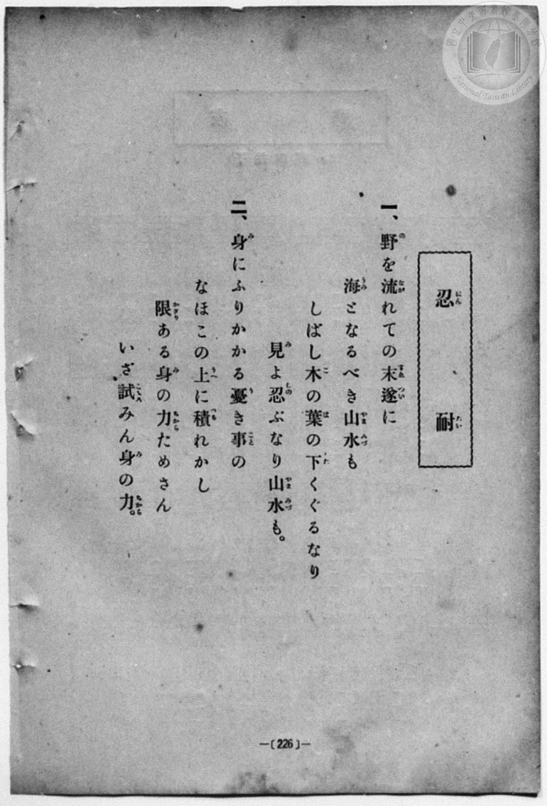
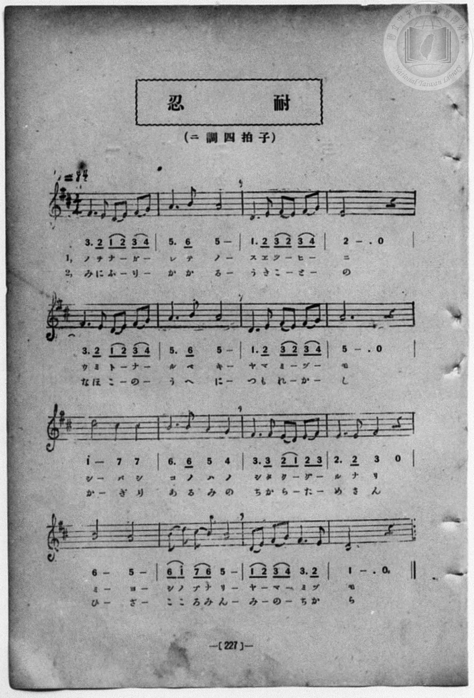

# 忍耐

> Re:Shōka 使用 AI 協助辨識與重建樂譜，可能會有錯誤。歡迎回報。

<audio controls src="nintai.mp3"></audio>

- 詞：文部省
- 曲：文部省
- 一條慎三郎 編《新編 小學校・公學校 唱歌教材集》（大正十二年十二月，索書號 0725-41）
- 臺灣總督府《公學校唱歌》第五學年用（昭和十一年一月，索書號 523.37 4322-4）

## 說明

原書資訊與歌詞全文（對應 P052.jpg–P053.jpg，原書 p. 48–49，第 20 首）：
調性與拍號：ニ長調（D 大調，2 個升記號）4/4 拍子，♩= 84


## 跨冊／重複收錄參照

> 同曲（《公學校唱歌》、《新定兒童唱歌》、《新編 小學校・公學校 唱歌教材集》共同收錄教材）

- **[同曲]** 《公學校唱歌》第五學年用（昭和13年／1938）：[**〈忍耐〉**](../../../kogakko_shoka/grade_5/20_nintai/index.md)（`D` / `4/4` — [原始 TMD](../../../kogakko_shoka/grade_5/20_nintai/nintai.tmd)）
- **[同曲]** 《新定兒童唱歌》尋常科第四學年用（2020.006.0847.0004）：[**〈忍耐〉**](../../../shintei_jido_shoka/grade_4_2020.006.0847.0004/3_05_nintai/index.md)（`C` / `4/4` — [原始 TMD](../../../shintei_jido_shoka/grade_4_2020.006.0847.0004/3_05_nintai/nintai.tmd)）
- 總表：[跨冊重複與同名歌曲總索引](../../../duplicate_songs.md)

## 歌詞

```text
一
野を流れての末つひに、
海となるべき山水も、
しばし木の葉の下くゞるなり。
見よ、しのぶなり、山水も。

二
身にふりかゝるうき事の、
なほこの上につもれかし。
かぎりある身の力ためさん。
いざ、こゝろみん、身の力。
```

## ABC

```abc
X:1
T:忍耐
C:曲：文部省
M:4/4
L:1/16
Q:1/4=84
K:D
V:V1 name="Piano" snm="Pia"
[V:V1]
!mf! F6 E2 D2 E2 F2 G2 | A6 B2 A8 | D6 E2 F2 E2 F2 G2 | E12 z4 |
w: 1.~ノ ヲ ナ _ ガ _ | レ テ ノ | ス エ ツ _ ヒ _ | ニ
w: 2.~み に ふ _ り _ | か か る | う き こ _ と _ | の
F6 E2 D2 E2 F2 G2 | A6 B2 A8 | D6 E2 F2 E2 F2 G2 | A12 z4 |
w: 1.~ウ ミ ト _ ナ _ | ル ベ キ | ヤ マ ミ _ ヅ _ | モ
w: 2.~な ほ こ _ の _ | う へ に | つ も れ _ か _ | し
!f! d8 c4 c4 | B6 B2 A4 G4 | !mf! F6 F2 E2 D2 E2 F2 | E6 E2 F4 z4 |
w: 1.~シ バ シ | コ ノ ハ ノ | シ タ ク _ グ _ | ル ナ リ
w: 2.~か ぎ り | あ る み の | ち か ら _ た _ | め さ ん
!mp! B8 A8 | B2 d2 c2 B2 A8 | !mf! D2 E2 F2 G2 F6 E2 | D12 z4 |
w: 1.~ミ ヨ | シ ノ ブ ナ リ | ヤ _ マ _ ミ ヅ | モ
w: 2.~い ざ | こ こ ろ み ん | み _ の _ ち か | ら
```

## TMD 檔案連結

- [主旋律 TMD 檔案](nintai.tmd) [[在 TMD Studio 編輯](https://tmdlang.github.io/Tmd-TS/#tmd=s7IKdvYPcrWy4qpTUCpJTLdSSM7PyUlNLsnMz7MqzsjPTozPrsyvSsyML84ojTe0NDJWgqssy88pzU21Si9KTEmNN403Q8gU55cWJadaFSdn5OfnxJekVpQk5edno8vHFySmp1oFGBmbIGQKivLLUvMS84C6C4oy80pSU8DaEQpSyzJTUkHSqSmZJflFmYk5SA5KLSoGuxtifElRYl5xclFmAcgzCFX5RSUZ-UBHF2RUWmVkFoMMSU7Mic9OzEtEKCrJSAV6LTe_CNl8iGBqbj7EQC0thaf7e180TFDQ0uJStFWwMOGyt1Vw4bIx0TexA2l6sqPh2aK5z1r7nuzofNncp_B8-4rHDV3Ppm0AMhSebuh_unbHswULHzfvftq6BsJWeDpl47O1Pc-mznw2d8LL2W2PG7rf7-l4umT5s7WLn_Y2PtnV83TnFgjj2ZyO93t6nm9Z9Gz2jhcz5ysYmBuZ6poYvt_TCXbwi5Xz3u-Z9Wxa-8vmFc_nNILFns3ehCH2on3X88bFz3fsfT538dNdc4DugzsG4hagE56vWfNk1xSgINDy51NWAF30bMbap5N6QA7Z0QAUBHkUzTmmRsZ6xuYKJsZGRromYEdx6Wsp2FILcCkoKDztmw-ybHP7ixVdLzragW4Fevpp6wqgB0GBtqH3WXunQoCBqZFeVkH6o4bJQKYxiAl0J0SrQoGegokFUMbEEuT2NWsUjAwUXi6bBnQuMJxAVrxYtf9Zw3KQ4d29QF8BRR83d7-cuh0oDrTCRQEYM2Bmj5HC04bup71Ap8wAq-sEpgEFoKanaycAZR_NXAlOHiAjgWEFol629z1umvRsa-Pjpp7HjcseN657Nmf148Yljxs3PW5c_bihEaTo2dbtjxtXPG5c9bip-3HjzseNvU83bny2YcvjpiaoiseN0x83bgCSz-YA1a17MbETSD7ZAVTd_7hpHlgbUHPX44YmsHeWdT9u6gBqBWtb97hxG0y6EcngJog7d_WAtewCugqItoKUNQK1zwUb2gZ0y5NdQMY6uENWPW7c_bhxMth-oFKwZ4DGgbwHVDcd6gQwB-h1oAqgXDfY-HVPu2Y_bpz_uAnorqmPmybDlbY8bpwGdu1ksL29jxv3g6UbEdogSilPUFCgoKXPxeUHLHgSM60CMhPz8h1qDGqqQVYo2Fho2YEZ2NKxAiiP7Gh4sbBHQcMElLefr2_QgSc-TSwagBaBDKtRqM5Nq1UwVtAFQiMFQyA2VjABCpuCRcygtC5QxBCqxhiuxggqB4IGIDVgI30MaxQeA4sbkOjj5k1A3AViNa0Bm_K4GUSDZNrgqsDiTTsh4k0rgOItYBWToDq6keyJR9hjBJRr3A_R1bgaiLeC9YNsA8lAdIFoYEQj7Glsg4r3AvFkMGsFVGYdhj34A3xXDzkBTl5Yw-SwhHXTMmiIzgfiDjALGgbNq6EyM4Gq1iLCoHkJVHweWBeI1QqVWYQnrFdBQ243PORAIYYcpjvAMYEIa6g9TU1A3AONDYjMdBLDekcnWYkbmLYN46DWmENxDTCoEQFuAhZBygWgMIfEDSyFg9iYob4dauzj5glgP4L4IPHNUNE-IO6HsiAyEB2Pm_YD8XowawNaPHUBMSiU0UMeln6BZRdYHyyNN0FNBKZxcE5AxMhCqHpQ6u8Es0DxDHJFI1RmKpANikUiQv_p7NnkFS0FtdCw1kVK3GagKDFHSe_g4IdlCFgGgWUDrIkenGwhgQbKvtAEBwxiSMBPQwpM5EQPSvKQrALR20ow0YOKIkiATUOYBUz-YNwEKkRA0QkKSJgcIiKQowHkOlBEoNpTy8Wla6cAKfEVgCxlLgA)]
- [鋼琴伴奏 TMD 檔案](nintai_piano.tmd) [[在 TMD Studio 編輯](https://tmdlang.github.io/Tmd-TS/#tmd=s7IKdvYPcrWy4qpTUCpJTLdSSM7PyUlNLsnMz7MqzsjPTozPrsyvSsyML84ojTe0NDJWgqssy88pzU21Si9KTEmNN403Q8gU55cWJadaFSdn5OfnxJekVpQk5edno8vHFySmp1oFGBmbIGQKivLLUvMS84C6C4oy80pSU8DaEQpSyzJTUkHSqSmZJflFmYk5SA5KLSoGuxtifElRYl5xclFmAcgzSlxaWgpP9_e-aJjwfk_Hy9kzn3V2v-ze83zClid7tjxd2v9-T6eClhaXoq2ChQmXva2CC5eNib6JHcjsJzsani2a-6y178mOzpfNfQrPt6943ND1bNoGIEPh6Yb-p2t3PFuw8HHz7qetayBshadTNj5b2_Ns6sxncye8nN32uKEbaOnTJcufrV38tLfxya6epzu3QBjP5nS839PzfMuiZ7N3vJg5X8HA3MhU18QQ6Bywv16snPd-z6xn09pfNq94PqcRLPZs9iYMsRftu543Ln6-Y-_zuYuf7poDdB_cMRC3AJ3wfM2aJ7umAAWBlj-fsgLoomcz1j6d1ANyyI4GoCDIo2jOMTUy1jM2VzAxNjLSNQE7isszr6Qo3yogMzEvP8jDocagpppLAQhsLLTswIwahercgloFMwVdMDSF0jVAEcM4BXMghRCqzk2rVTBUMFIwVjABYpCgEVDYEKoABA1ACrlqUez1QbbXBNVek3iFaJNYBUMgZRgLFATyTePjEXywlUiCpvEgUag0CBtArPMDpr7ETAL-BBoFczXMFzVQ7yF7E-IfkDxMjRGGD0FG-hjWKDwGpjCQ6OPmTUDcBWI1rQGb8rgZRINk2uCqwOJNOyHiTSuA4i1gFZOgOrqR7IlH2GMElGvcD9HVuBqIt4L1g2wDyUB0gejHTTATQOJtUPFeIJ4MZq2AyqzDsAcaRuQFD0wOS_A0LYMGwnwg7gCzoM5uXg2VmQlUtRbh7OYlUPF5YF0gVitUZhGe4FkF9exuuGdBnkQOhh3gwEMED9SepiYg7oEGIERmOq7gqQal_ziojDkUg7IKIoxMwCJIaQ0UTJDghKUjEBszoLZDjX3cPAHsLBAfJL4ZKtoHxP1QFkQGouNx034gXg9mbUAL2i4gBgUMemDBUsnjRpBZiJTUBDURmJLA6Q0RiAuh6kFprBPMAkUNyBWNUJmpQDYo4FEDjPplCyLngVwA8ScoXUOjFRgqkLCahuR_5KQFSliQBAnR20owaYHyKMSP0xBmARMZGDeBchcoBkB-h8khwg455ECuA4Udqj1ohReOwhJa4gEpUEkI54M4qGUiXAVcCkyAiklyTUIrbVGMQdKGVJSbxpsjGQSUALKQXATkIQwiVAMQUfjr2imAqxsFIAMSltE-QFkknhGYp8wFAA)]

## 分析

```text
================================================================================
📊 TMD Song Profile: [ 忍耐 ]
================================================================================
⏱  Duration:       0:45 (45.7s), 16 measures total
🎼 Key & Tempo:    首調基準 D, != 84.0 BPM, <4/4>
   - 分析範圍：      由實際發聲的音符與和弦推測調性；播放脈絡另行呈現
🎤 人聲音域:    D4 (MIDI 62) – D5 (MIDI 74) [跨度: 12 個半音 / 1.0 個八度, 難度: easy]
   - 最低音:  D4 in [Nintai #1 @ m.1, 0:01]
   - 最高音: D5 in [Nintai #1 @ m.9, 0:22]
   - 適合: soprano, mezzo-soprano, contralto, tenor, baritone, bass
🏛  結構:      Nintai (45.7s)
⚡ 編曲密度:        Peak 1 軌道同時演奏
🗝  調性診斷：       A 調性不明確（流行色彩大調，未偵測到可信轉調）
   - 風格氣質:    流行大調（略帶和弦色彩音與裝飾副屬和弦）
   - 轉調歷程:    全曲維持單一推測調性（未偵測到可信轉調）
   - 核心骨幹音:  A, F#, E, D, B
   - 調性數值:    A 調性不明確 [相關度: 0.84, 穩定度: Ambiguous, 自然音純度: 94.2%]
   - 候選調性 (K-S): A 大調 (0.84), D 大調 (0.84), F# 小調 (0.70)
   - 五度圈歷程:   +3
   - 各段落調性細節:
     • [Nintai #1]: A 調性不明確 (r: 0.84, 自然音純度: 94.2%, 調外音: G)

  [ 五度圈游移軌跡 ]
               C  
         F            G  
      Bb               D  
      Eb              [A ]*
         Ab           E  
            Db       B  
               F# 
     (* = active key center)

  [ 十二半音累積音高分佈 ]
     C  :                            0.0%
     C# : ████                       4.2%
     D  : █████████████████         17.5%
     D# :                            0.0%
     E  : ██████████████████        18.3%
     F  :                            0.0%
     F# : ██████████████████        19.2%
     G  : ██████                     5.8%
     G# :                            0.0%
     A  : ████████████████████████  25.0%
     A# :                            0.0%
     B  : ██████████                10.0%
--------------------------------------------------------------------------------
Assignment 軌道音域：
  - Piano         : D4 – D5 (12 個半音 / 1.0 個八度, 62 個音符)
================================================================================
```


## 原書掃描頁






