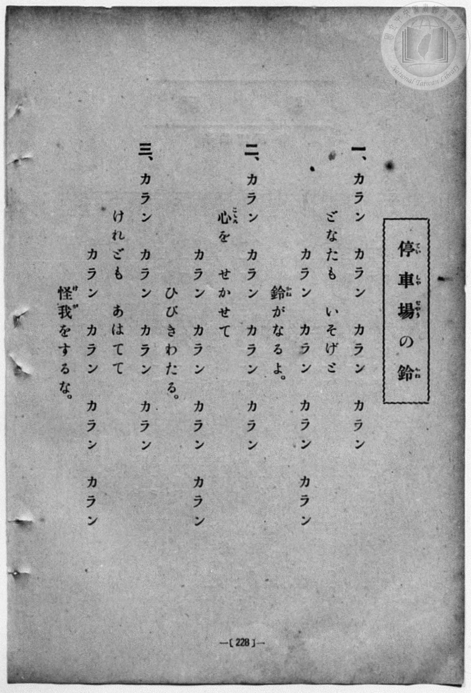
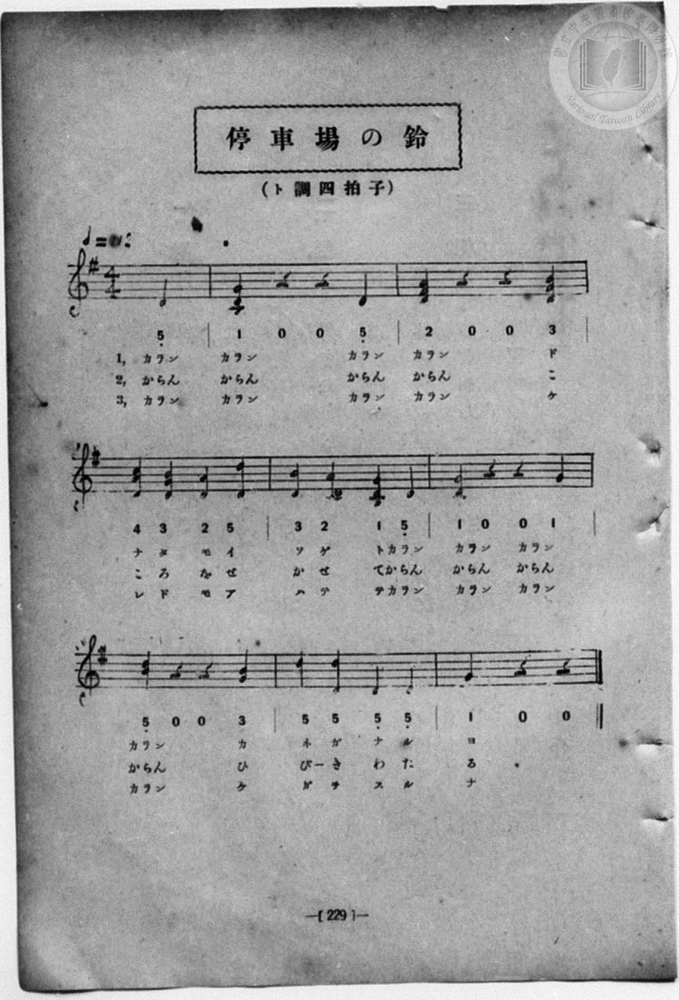

# 停車場の鈴

> Re:Shōka 使用 AI 協助辨識與重建樂譜，可能會有錯誤。歡迎回報。

- **NEUTRINO 歌聲合成版**：<br><audio controls src="teishaba_no_suzu_neutrino.mp3"></audio>
- **鋼琴伴奏版**：<br><audio controls src="teishaba_no_suzu.mp3"></audio>


- book: 新編 小學校・公學校 唱歌教材集（尋常科五・六學年用）
- 一條慎三郎 編《新編 小學校・公學校 唱歌教材集》（大正十二年十二月，索書號 0725-41）
- 日治時期公學校《唱歌帳》（典藏號 2020.006.0843・P151，原載《小公唱材集》第 229 頁）

## 說明

> [!NOTE]
> **原書資訊與歌詞全文**（對應 `P236.jpg`–`P237.jpg`，原書 p. 228–229，尋常科五・六學年第 4 首）：
> - **調性與拍號**：ト調四拍子（G 大調 4/4 拍），速度 ♩= 112，弱起拍（第 4 拍「カラン」起唱）。
> - **版面校勘**：五線譜同時印有主旋律與下聲部重唱／和聲聲部，生動模擬火車站發車前搖鈴「カラン、カラン」清脆響聲。注意：
>   1. 第 5 小節（第二行末小節）五線譜高音為 `G4 0 0 D4`（`1 0 0 5_`），下方簡譜第 4 拍誤印為無下點之 `1`（即 `1 0 0 1`），依五線譜與鈴聲動機應為 `1 0 0 5_`。
>   2. 第 6 小節（第三行首小節）五線譜高音為 `A4 0 0 B4`（`2 0 0 3`），下方簡譜第 1 拍誤印為 `5`（即 `5 0 0 3`），依五線譜應為 `2 0 0 3`。
>
> **一、**
> カラン　カラン　カラン　カラン
> どなたも　いそげと
> カラン　カラン　カラン　カラン
> 鈴（かね）がなるよ。
>
> **二、**
> カラン　カラン　カラン　カラン
> 心（こゝろ）を　せかせて
> カラン　カラン　カラン　カラン
> ひびきわたる。
>
> **三、**
> カラン　カラン　カラン　カラン
> けれども　あはてて
> カラン　カラン　カラン　カラン
> 怪我（けが）をするな。


## 歌詞

```text
（TMD 檔案未包含歌詞註解）
```

## ABC

```abc
X:1
T:停車場の鈴
M:4/4
L:1/16
Q:1/4=112
K:G
V:V1 name="Piano" snm="Pia"
[V:V1]
z4 z4 z4 D4 | G4 z4 z4 D4 | A4 z4 z4 B4 | c4 B4 A4 d4 |
w: 1.~カラン | カラン カラン | カラン ど | な た も い
w: 2.~からん | からん からん | からん こ | こ ろ を せ
w: 3.~カラン | カラン カラン | カラン け | れ ど も あ
B4 A4 G4 D4 | G4 z4 z4 D4 | A4 z4 z4 B4 | d4 d4 D4 D4 |
w: 1.~そ げ と カラン | カラン カラン | カラン か | ね が な る
w: 2.~か せ て からん | からん からん | からん ひ | び き わ た
w: 3.~は て て カラン | カラン カラン | カラン け | が を す る
G4 z4 z4 D4 | G4 z4 z4 D4 | A4 z4 z4 B4 | c4 B4 A4 d4 |
w: 1.~よ カラン | カラン カラン | カラン ど | な た も い
w: 2.~る からん | からん からん | からん こ | こ ろ を せ
w: 3.~な カラン | カラン カラン | カラン け | れ ど も あ
B4 A4 G4 D4 | G4 z4 z4 D4 | A4 z4 z4 B4 | d4 d4 D4 D4 |
w: 1.~そ げ と カラン | カラン カラン | カラン か | ね が な る
w: 2.~か せ て からん | からん からん | からん ひ | び き わ た
w: 3.~は て て カラン | カラン カラン | カラン け | が を す る
G4 z4 z4 z4 |
w: 1.~よ
w: 2.~る
w: 3.~な
```

## TMD 檔案連結

- [主旋律 TMD 檔案](teishaba_no_suzu.tmd) [[在 TMD Studio 編輯](https://tmdlang.github.io/Tmd-TS/#tmd=s7IKdvYPcrWy4qpTUCpJTLdSSM7PyUlNLsnMz7MqzsjPTozPrsyvSsyML84ojTe0NDJWgqssy88pzU21Si9KTEmNN403Q8gU55cWJadaFSdn5OfnxJekVpQk5edno8vHFySmp1oFGBkj6Swoyi9LzUvMA-ouKMrMK0lNAWtHKEgty0xJBUkXJyfmxZelFmWmZaamIDkqtagY7HaIFSVFiXnFyUWZBSAPIVTlF5Vk5AMdXpBRaZWRWVySX5SZnJgTn52Yl4hQVJKRCvQe2IQCoAZk3ZnpmXlWpXkgp5RAHaClpfC0cc6L3V1PF2x53LjuZccWBS0tLkVbBUNDIy57WwV3LhsTfRM7kCGgwLBSeDZtw_PtKxSebuh_unbHswULHzfvftq6BsJWeDpl47O1Pc-mznw2d8LL2W3v93Q83dD9dMeO58snPtk1Bax0LVDp051bnk9Z8X5PJ9hxT3Y0PFs091lr35MdnS-b-xSAxj9u6CLFnscN3SCrlix_tnbx097GJ7t6gDZAGM_mdLzf0_N8y6Jns3e8mDlfwcDcyFTXxBBm97PpS59t2v1sZtOzOfPhxgNth1jwdMdmqNGtO15M7wfpNzIwMtAzMDDTM7AwMQa6KcDQFGhYz9O--S_2dII0At0LNAeoHeay52vWKBgZWSq8XNAItpVLX0vBllqAS0FBwU4hWtHPP8Q1FsLR0gI6BuTbze0vVnS96GgHeuTFynlPW1c8m9aupQWOk95n7Z0KCaA0rJdVkJ7wqGEyiGMO5kB8AzRAoUAP6HALoCTQ-SBRXFEJ9KCJwstl04Dee79nFsQVukB3vFi1_1nDcpALunuBYQeye9bj5g6g8NPZs4FiT9dOALrGXQEYcUAxBWA6UwCKgk3pedkw_-muZQqPZq4EJ0WQ9Xs2vti6HaygA2IlkP24oedx0-rHzSsfNwOjqheoABj0QBMeNzQh3PG8s-Pl3EXAiH3aPQPsCKAHnm-f9WLtnKcTeoBx_7R3w7M5nU927H42vfvpvm6gg5_s6H7RuOll84qX7b1gA_ufTuoBikAEQQlqyvyn3VOfrVj4bPKa542rgfnn-eqZz2fuAWWkzt5nE6YBMxKq2xqR3flsR-uLlraX8_cDDQQ69dnmFc9a-uFhp6BgqKcA8qIpKPk_X98A8TEwNb9YCEzQq2GCnXB_vFw94-X8zc-bdikkuJsoGAChiwkwIjsSDMEc03ggBxSqQH89m7bz-YaFQD3wMHyxagkwBICan7csBCp4uXvek53dCgmGIAOe9m4GssCGgPhgM_bNhdsLDCqgR4GeAAXGyvnAVAV2A9xWeDQoKBhBvGSG6qUdnUAvAZMOXi85QrzkBPGSEZhjjMNHhig-UkgwhfvCFFUfki9gzoaZDHM1LD8BCyhg_AGLRTAfKR4bCLKhWhpXPm5c9bhx_uOmJpBsY8vjxrmPGyc9blxBtpnAcAf67HFj9-PGtaAE39gDsqKp-3FTB4b7d_VQ5v6n-5vBdk1-3DT3cRMohz5umgT2yGywA4DkMgoCZ9Pjxs2PG3sfN_WDg6gbM_yB-Zmy8J_4uAkYPith4d_0uHE90M2UOPtZw6pnHRPBwTIRGPjQMGmcCXI_MCIgXqC8gIcCBS19Lq7g_Lx0q4DMxLx8hxpdw5pqkA0KNiZa4IBSwFatKEAKTWA2BWe2BmBmU9CAlfSaWNQDrQGZVQPOCaAsDGTCcjOQCc0hCjVgVT6GNQrxYAgPG6AaBJuATONKmDlGcHOAqakJGJCTQarhbEIyQDGIOcaUuWci0BzcQQkvgRU0jKGFmI4CUWFpAgwxI2BhXgOmDdFDFR6WwHQDxPOB7moC0i1gn84F4klAvII4P8HDExQqwKwKxCDdsyGhBmYBEz1x4QwPU2DeAccWxF1NYD3roeYAMVHuwh-u4GqA5HCFp0Zg2AJhPHLAGiCHK1o8d4N9sBaIQf4ChnkTWKSpA5p6kEMRNWw2gXVuBmJQyPaDYwuksxtVJzjMMNIWxD5wfMyE2Qm0HaazlotL104BlMcVkGhlLgA)]
- [鋼琴伴奏 TMD 檔案](teishaba_no_suzu_piano.tmd) [[在 TMD Studio 編輯](https://tmdlang.github.io/Tmd-TS/#tmd=s7IKdvYPcrWy4qpTUCpJTLdSSM7PyUlNLsnMz7MqzsjPTozPrsyvSsyML84ojTe0NDJWgqssy88pzU21Si9KTEmNN403Q8gU55cWJadaFSdn5OfnxJekVpQk5edno8vHFySmp1oFGBkj6Swoyi9LzUvMA-ouKMrMK0lNAWtHKEgty0xJBUkXJyfmxZelFmWmZaamIDkqtagY7HaIFSVFiXnFyUWZBSAPIVTlF5Vk5AMdXpBRaZWRWVySX5SZnJgTn52Yl4hQlFgE1JyempuaV2JVkJmYlx-fmJycn1uQmJcJEkMoLMkAKrICW1UANFmJS0tL4WnjnBe7u54u2PK4cd3Lji3v93S8nD3zWWf3y-49zydsebJny9Ol_e_3dCpoaXEp2ioYGhpx2dsquHPZmOib2IEMBgWYlcKzaRueb1-h8HRD_9O1O54tWPi4effT1jUQtsLTKRufre15NnXms7kTXs5uA1rxdEP30x07ni-f-GTXFLDStUClT3dueT5lBdAusIOf7Gh4tmjus9a-Jzs6Xzb3KQCNf9zQRYo9jxu6QVYtWf5s7eKnvY1PdvUAbYAwns3peL-n5_mWRc9m73gxc76CgbmRqa6JIczuZ9OXPtu0-9nMpmdz5sONB9oOseDpjs1Qo1t3vJjeD9JvZGBkoGdgYKZnYGFiDHRTgKEp0LCep33zX-zpBGkEuhdoDlA7zGXP16xRMDKyVHi5oBFsK5dnXklRvlUAKPqCPBxqDGqquRSAwMZEyw7MqFEwAEPTeCDTOF7bNF7bECFgEq9tFq9tBFVTw1WLYqAPfgNBBkQbxiLzTCE8qFHB-XnpCKfpGpLvNqiktjHQYJBOH8MahXgwfNy0-nHzysfNm4E6EGwCMo0rYeYYwc1p7H7c1Pm4aTJINZxNSAYoBjHHmDL3TASaAw0SI20TBZBHzUF-B3raFCgG4puogwRgoYQ1yOBB87hxFRDPB1rTBKRbwA6fC8STgHgFcU6EBw_Ik4-beoEYpHs2JBDArMeNy4gLNngQPW7qAQc-xF1NYD3roeYAMVHuggYTOHggHgelCmCwmYLETEEBAQ4cSLCAUiI8VNACvRts_1ogBrkKGGJNYJGmDmhUIocBqs82gXVuBmJQuPSDwxqksxtVJ9jHGBENsQ8cmjNhdgJth-lEyTegHIgv3-DOgiBRiDMgYiA-jIboiTaC8LCYgqQPbhZYBiQCoxF6oNld104BXHgoABkgL0T7AOXhbKBtcLYxmK3MBQA)]

## 分析

```text
================================================================================
📊 TMD Song Profile: [ 停車場の鈴 ]
================================================================================
⏱  Duration:       0:34 (34.3s), 16 measures total
🎼 Key & Tempo:    首調基準 G, != 112.0 BPM, <4/4>
   - 分析範圍：      由實際發聲的音符與和弦推測調性；播放脈絡另行呈現
🎤 人聲音域:    D4 (MIDI 62) – D5 (MIDI 74) [跨度: 12 個半音 / 1.0 個八度, 難度: easy]
   - 最低音:  D4 in [Song #1 @ m.1, 0:01]
   - 最高音: D5 in [Song #1 @ m.4, 0:08]
   - 適合: soprano, mezzo-soprano, contralto, tenor, baritone, bass
🏛  結構:      Song (17.1s) -> Song (17.1s)
⚡ 編曲密度:        Peak 1 軌道同時演奏
🗝  調性診斷：       D 大調（純淨自然大調，未偵測到可信轉調）
   - 風格氣質:    純淨自然大調（陽光明朗、易唱易記，無明顯調外色彩）
   - 轉調歷程:    全曲維持單一推測調性（未偵測到可信轉調）
   - 核心骨幹音:  D, G, A, B, C
   - 調性數值:    D 大調 [相關度: 0.83, 穩定度: Moderate, 自然音純度: 95.5%]
   - 候選調性 (K-S): D 大調 (0.83), G 大調 (0.75), B 小調 (0.64)
   - 五度圈歷程:   +2 -> +2
   - 各段落調性細節:
     • [Song #1]: D 大調 (r: 0.84, 自然音純度: 95.2%, 調外音: C)
     • [Song #2]: D 大調 (r: 0.83, 自然音純度: 95.5%, 調外音: C)

  [ 五度圈游移軌跡 ]
               C  
         F            G  
      Bb              [D ]*
      Eb               A  
         Ab           E  
            Db       B  
               F# 
     (* = active key center)

  [ 十二半音累積音高分佈 ]
     C  : ███                        4.5%
     C# :                            0.0%
     D  : ████████████████████████  40.9%
     D# :                            0.0%
     E  :                            0.0%
     F  :                            0.0%
     F# :                            0.0%
     G  : ███████████               18.2%
     G# :                            0.0%
     A  : ███████████               18.2%
     A# :                            0.0%
     B  : ███████████               18.2%
--------------------------------------------------------------------------------
Assignment 軌道音域：
  - Piano         : D4 – D5 (12 個半音 / 1.0 個八度, 44 個音符)
================================================================================
```


## 原書掃描頁






