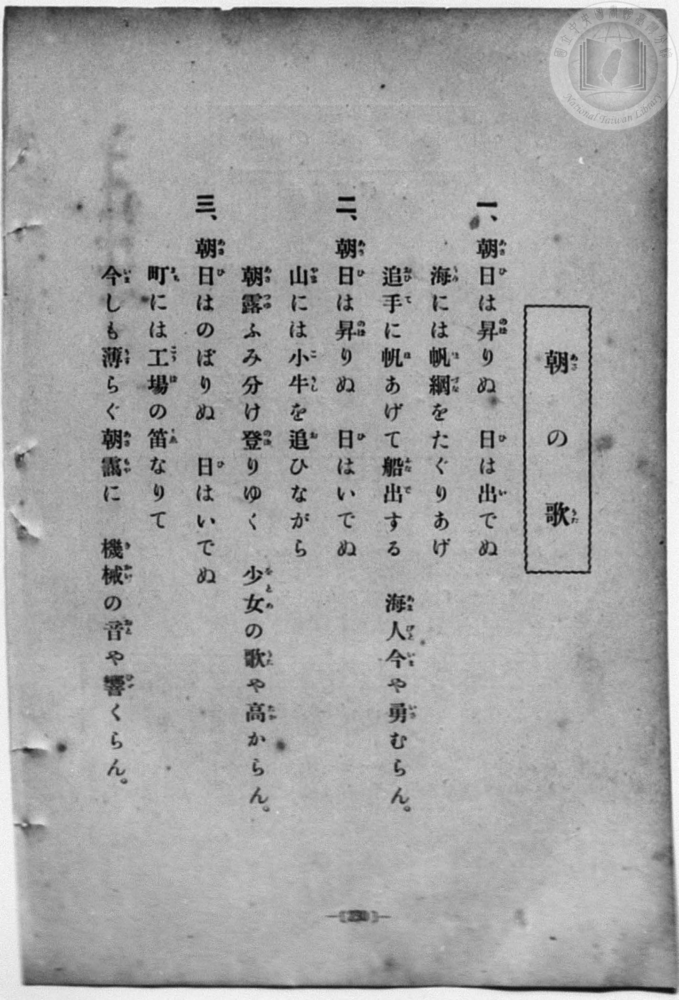
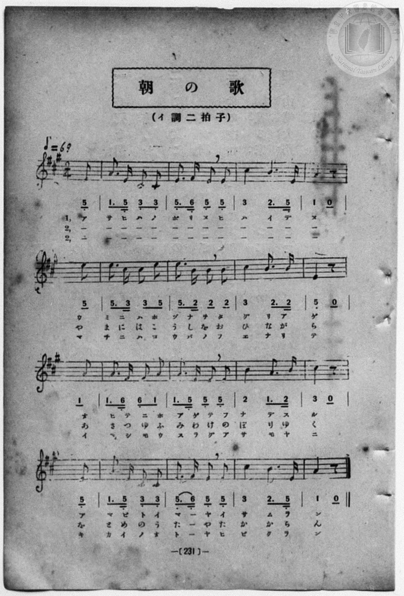

# 朝の歌

> Re:Shōka 使用 AI 協助辨識與重建樂譜，可能會有錯誤。歡迎回報。

- **鋼琴伴奏版**：<br><audio controls src="asa_no_uta.mp3"></audio>
- **NEUTRINO 歌聲合成版**：<br><audio controls src="asa_no_uta_neutrino.mp3"></audio>

- 詞：文部省《尋常小學唱歌》
- 曲：文部省《尋常小學唱歌》
- book: 新編 小學校・公學校 唱歌教材集（尋常科五・六學年用）
- 一條慎三郎 編《新編 小學校・公學校 唱歌教材集》（大正十二年十二月，索書號 0725-41）
- 臺灣教育會公認《新定兒童唱歌》尋常科第五學年用（2020.006.0847.0005）

## 說明

> [!NOTE]
> **原書資訊與歌詞全文**（對應 `P238.jpg`–`P239.jpg`，原書 p. 230–231，尋常科五・六學年第 5 首）：
> - **調性與拍號**：イ調二拍子（A 大調 2/4 拍），速度 ♩= 69（《新定兒童唱歌》標為 ♩= 96 並移為 G 大調，本集保留文部省原調 A 大調），弱起拍（第 2 拍後半八分音符起唱）。
> - **版面校勘**：五線譜與簡譜逐音核對完全一致。注意本集第二節歌詞作「朝露（あさつゆ）ふみ分（わ）け」（《新定兒童唱歌》作「朝霧」），第一節作「海人（あまびと）」「船出（ふなで）」。
>
> **一、**
> 朝日（あさひ）は昇（のぼ）りぬ　日（ひ）は出（い）でぬ
> 海（うみ）には帆綱（ほづな）をたぐりあげ
> 追手（おひて）に帆（ほ）あげて船出（ふなで）する
> 海人（あまびと）今（いま）や勇（いさ）むらん。
>
> **二、**
> 朝日（あさひ）は昇（のぼ）りぬ　日（ひ）はいでぬ
> 山（やま）には小牛（こうし）を追（お）ひながら
> 朝露（あさつゆ）ふみ分（わ）け登（のぼ）りゆく
> 少女（をとめ）の歌（うた）や高（たか）からん。
>
> **三、**
> 朝日（あさひ）はのぼりぬ　日（ひ）はいでぬ
> 町（まち）には工場（こうば）の笛（ふえ）なりて
> 今（いま）しも薄（うす）らぐ朝靄（あさもや）に
> 機械（きかい）の音（おと）や響（ひび）くらん。


## 歌詞

```text
（TMD 檔案未包含歌詞註解）
```

## ABC

<div class="abc-score" data-abc-src="asa_no_uta.abc" aria-label="五線譜載入中"></div>

[下載 ABC 原始檔](asa_no_uta.abc)

## TMD 檔案連結

- [主旋律 TMD 檔案](asa_no_uta.tmd) [[在 TMD Studio 編輯](https://tmdlang.github.io/Tmd-TS/#tmd=s7IKdvYPcrWy4qpTUCpJTLdSSM7PyUlNLsnMz7MqzsjPTozPrsyvSsyML84ojTe0NDJWgqssy88pzU21Si9KTEmNN403Q8gU55cWJadaFSdn5OfnxJekVpQk5edno8vHFySmp1oFGBlbIGQKivLLUvMS84C6C4oy80pSU8DaEQpSyzJTUkHSxcmJefFlqUWZaZmpKUiOSi0qBrsdYkVJUWJecXJRZgHIQwhV-UUlGflAhxdkVFplZBaX5BdlJifmxGcn5iUiFJVkpAK9V5KZmxqfnxafkliJrD8zPTPPKjc_L6kUGEpKXFpaCs_mzH3cuO7Z2h4FLS0uRVsFM0sue1sFRy4bI30TO5BOUBhYKTybtuH59hUKTzf0P12749mChY-bdz9tXQNhKzydshFowLOpM5_NnfBydtv7PR1PN3Q_3bHj-fKJT3ZNAStdC1T6dOeW51NWvN_TCXbRkx0NzxbNfdba92RH58vmPgWg8Y8bukix53FDN8iqJcufrV38tLfxya4eoA0QxrM5He_39DzfsujZ7B0vZs5XMDA3MtU1MYTZ_WLlvPd7Zj2b1v6yecXzOY1AeyEOhlgLsQZoOljts9mbiFb7on3X88bFQAe-aNr0bE4z0OUvVvVCfPV03aynrZOer14K1wEPo-dr1gCDCSmAOowMjAz0DAzM9AwsTMyBDANTsMu59LUUbKkFuBQUFOwUohX9_ENcYyEcLa2nffNBIba5_cWKrhcd7UCHAoPqaesKoPe1tMDx2vusvVMhAZT89bIK0hMeNUwGcSzBHGCQQwxQKNBTMDI2AEoaGQMDvQdnclizRsFU4eWyaUDvAQMZ4gpdoDterNr_rGE5yAXdvcD4A9k963HTEqAwKHK7e5-unQB0jaMCMPKBYgrAtKoAFAWb0vOyYf7TXcsUHs1cCUrNQGW4IuDZipnPm3ZBFFqaKTzZsez58t0gEXeouUDDns1ZA0xpT_bPfQ5MdbA0APQkyFaY9RBrn-7Z-GLrdrArOkD-MgK56Om-nqe9XU9bVz_taHs5f_PzNcuAaoAOAGp53NCE8O_zzo6XcxcB0_jT7hlgzwID6vn2WS_WzgGGwfMNC4GMlw0TgCY8WwBMeL1P1_UAIwWYg160bwGa82zzimct_RCnghNTz_P1DZC4e7J3zuMGoC_mvpwDTMYdjxubHjdOfdy45HETMJt2Pm7c-rhxP9BtIKmmfrDIxMcNIC_gCjQkA5eDVYL8DrJ0RwPQUqjs1u1Pdu2CWbfvcePmx42gfA9UD5R90bHzaTtEFmj7qseNy2FSkACBpUWgiY8bGoGlEpgPtPHZ9KVIXgB6B-ja9c9mtIMF1z1u3AMSaep63LjmcUMDTDFUGczGFjB3OVAN1Nit28HibcBwAEutBine0fZ8GzCOgOK7HzcuBToSbPKkx43zHzdOAFsBdMMkiAkv9u991gkqiB43AsU3PW5cBjEHaAjEBDAXpB4ohd3vjTMfN3XD3YM16J7s7oK4HygIdkzL026Ix4EiU8EiDY-bgORkjGDcBYw2agUj2DpE6D3dCA6lJpirIKG3of9552ywrsnggJ0OCT1gQEFCCawSGFBA7_cA3Qx3GPFJ9PlMYKiiurYJaFE_1FUbJj5duhmsHhjmKx43NYJ1gSo5WFzPh4Thy9UzwCLAaAXGIFBNN44w3AFMoATDEOIeIoPu-RRILAOjeCEi6LYvfbpgC1LQbYC4_PkaSHgCgwJYrwFFVoFtWQYxCj1tNE5_3NT0YhowqUM8OxPsWaD4BFAgz4WIg13e1AQMBIjtUK-tnP9sEdBSoIJeUGhA88s6YMkDS-HgjAwMuvnA_ALyHTCJgtX0owQd5fUTFCho6XNxORYn-uWHliRaBWQm5uU71BjUVIMsUbAxNNMCR5ICtppRAVIkg0pQcPn0YmGPggasstLEoh5oFcisGgUDYKEMgiDaNB5I1CgYggWAHGMQH0zUQOR0FcziISyoUmOobiOYFphuZAPBNvkY1ihAjNAF04-bFoFNeNy0FSz2uHkSEPeDWX0QmeY5UJlVQNwDVQORAakDyzUtgappB4uDVCFsWIaw3QjN9sYmiEmNUyH6GzcB8Xowax1UZg_Uhi4gew1UDUQGpA6iqwVKLweLg1QhbAfJQW03prvfm-eBbcedYCCVJzidmIDaoMAaTUeBqBRjCrbFGBz3IDZMxAicCkAYPV0YIdIPJF2A0ggiWTxung_1SDc8GGZDPdsKlQFGQjMo-B837YcG3QZYMACDCBIci8DiIFWIgAbJIZIAsNSAqG1cDY_uyRDzGtugMtOBukBBDSwBoDIwE4FlEZTuAdvUiWwTJEHBo_txcyO6n5o2Q10OSpYgmQnQ6H7cDEqEIJkVcD-B7Ib4DWQWxG0wP4GinVDU7ugkJ2oheReYx4EIGkuI0gA530PiFaIEEr-wGMeS7SFJF-SbNnB4IMUvOCOA_ATMfmBfwsMCGgKQ5A1RsxMsvholLMAZCSl-Ydl5CVAObF4jKIuBZEDpBqSjH8ieCJZBzeiQrA6h28DisIwGsQmc_ZDiF5TBQOLbgWyQK6DFDdidEHevhKZS9OwOkoP6u3kJ2E-gMEHYtBZsE974fTp7NvnxS42SHQSRYxgaGs2TgbgD7AtwKoXLQPyKJI4UFgvg4QVSD8olsLBAsgUcu5D8AWzlQGMPkmtBMpASBFbsQvggcVjIwligXAuyHZTrsdgCitkmSAoDuRSaPyGlCNRnSH6BF8kw0x43QaoG3H6p5eLStVOAVfIKaGxlLgA)]
- [鋼琴伴奏 TMD 檔案](asa_no_uta_piano.tmd) [[在 TMD Studio 編輯](https://tmdlang.github.io/Tmd-TS/#tmd=s7IKdvYPcrWy4qpTUCpJTLdSSM7PyUlNLsnMz7MqzsjPTozPrsyvSsyML84ojTe0NDJWgqssy88pzU21Si9KTEmNN403Q8gU55cWJadaFSdn5OfnxJekVpQk5edno8vHFySmp1oFGBlbIGQKivLLUvMS84C6C4oy80pSU8DaEQpSyzJTUkHSxcmJefFlqUWZaZmpKUiOSi0qBrsdYkVJUWJecXJRZgHIQwhV-UUlGflAhxdkVFplZBaX5BdlJifmxGcn5iUiFCUWATWnp-am5pVYFWQm5uXHJyYn5-cWJOZlgsQQCksygIqsSoCi8flp8SmJlUpcWloKz-bMfdy47tnanvd7Ol7Onvmss_tl957nE7Y82bPl6dL-93s6FbS0uBRtFcwsuextFRy5bIz0TexAZoLCykrh2bQNz7evUHi6of_p2h3PFix83Lz7aesaCFvh6ZSNQIOfTZ35bO6El7PbgDY83dD9dMeO58snPtk1Bax0LVDp051bnk9ZAbQK7NYnOxqeLZr7rLXvyY7Ol819CkDjHzd0kWLP44ZukFVLlj9bu_hpb-OTXT1AGyCMZ3M63u_peb5l0bPZO17MnK9gYG5kqmtiCLP7xcp57_fMejat_WXziudzGoH2QhwMsRZiDdB0sNpnszcRrfZF-67njYuBDnzRtOnZnGagy1-s6oX46um6WU9bJz1fvRSuAx5Gz9esAQYTUgB1GBkYGegZGJjpGViYmAMZBqZgl3M5Fif65YeWJFoFgBJAkIdDja5hTTWXAhDYGJpp2YFZ-loKtuhA4emejS-2bn_R0Q6ybEfDi4U9ChrAtG6pl1WQrolFvZY-2KwaBQMFXTAE0abxQKJGwRAsAOQYg_hgogYip6tgFg9hQZUaQ3UbwbTAdCMbCLbJx7BGAWKELph-3LQIbMLjpq1gscfNk4C4H8zqg8g0z4HKrALiHqgaiAxIHViuaQlUTTtYHKQKYcMyhO1GaLY3NkFMapwK0d-4CYjXg1nroDJ7oDZ0AdlroGogMiB1EF0tUHo5WBykCmE7SA5quzHd_d48D2w77gQDTpQ94HRiAsqOz9c36CgQlWJMwbYYg-MexIaJGIFTAQijpwsjRPqBpAtQGkEki8fN86Ee6YYHw2yoZ1uhMsBIaAYF_-Om_dCg2wALBmAQQYJjEVgcpAoR0CA5RBJ43LgPorZxNTy6J0PMa2yDykwH6gIF9ePGLqgMzMTHjVCbGnvANnUi2wRJUPDoftzciO6nps1Ql4OSJUhmAjS6HzeDEiFIZgXcTyC7IX4DmQVxG8xPoGgnFLU7OsmJWkjeBeZxIILGEqI0QM73kHiFKIHELyzGsWR7SNIF-aYNHB5I8QvOCCA_AbMf2JfwsICGACR5Q9TsBIuvRgkLcEZCil9Ydl4ClAOb1wjKYiAZULoB6egHsieCZVAzOiSrQ-g2sDgso0FsAmc_pPgFZTCQ-HYgG-QKaHEDdifE3SuhqRQ9u4PkoP5uXgL2EyhMEDatBduEN36fzp5NfvxSo2QHQeQYhoZG82Qg7gD7ApxK4TIQvyKJI4XFAnh4gdSDcgksLJBsAccuJH88bmqExh4k14JkICUIrNiF8EHisJCFsUC5FmQ7KNdjsQUUs02QFAZyKTR_QkoRqM-Q_AIvkmGmPW6CVA24_VKLXsn7oFTyFog6Htige7Zh8YvJa552Nz_Z2Q1q9HT3Pl074en2ZcDGHaRZh1mNA2MpXiHaMBZGgaIXyDKNj0Uw4GowRYCUATQsSDLJCEgZYahBGGUCFDWJhVEkGU2uk3CaBIwCXTsFWCxE-wBlUPhAf6DwjcF8ZS4A)]

## 分析

```text
================================================================================
📊 TMD Song Profile: [ 朝の歌 ]
================================================================================
⏱  Duration:       0:59 (59.1s), 34 measures total
🎼 Key & Tempo:    首調基準 A, != 69.0 BPM, <2/4>
   - 分析範圍：      由實際發聲的音符與和弦推測調性；播放脈絡另行呈現
🎤 人聲音域:    C#4 (MIDI 61) – E5 (MIDI 76) [跨度: 15 個半音 / 1.2 個八度, 難度: moderate]
   - 最低音:  C#4 in [AsaNoUta #1 @ m.2, 0:02]
   - 最高音: E5 in [AsaNoUta #1 @ m.6, 0:08]
   - 適合: soprano, mezzo-soprano, contralto, tenor, baritone, bass
🏛  結構:      AsaNoUta (29.6s) -> AsaNoUta (29.6s)
⚡ 編曲密度:        Peak 1 軌道同時演奏
🗝  調性診斷：       E 調性不明確（純淨自然大調，未偵測到可信轉調）
   - 風格氣質:    純淨自然大調（陽光明朗、易唱易記，無明顯調外色彩）
   - 轉調歷程:    全曲維持單一推測調性（未偵測到可信轉調）
   - 核心骨幹音:  E, C#, A, B, F#
   - 調性數值:    E 調性不明確 [相關度: 0.81, 穩定度: Ambiguous, 自然音純度: 100.0%]
   - 候選調性 (K-S): E 大調 (0.81), A 大調 (0.81), C# 小調 (0.71)
   - 五度圈歷程:   +4 -> +4
   - 各段落調性細節:
     • [AsaNoUta #1]: E 調性不明確 (r: 0.81, 自然音純度: 100.0%)
     • [AsaNoUta #2]: E 調性不明確 (r: 0.81, 自然音純度: 100.0%)

  [ 五度圈游移軌跡 ]
               C  
         F            G  
      Bb               D  
      Eb               A  
         Ab          [E ]*
            Db       B  
               F# 
     (* = active key center)

  [ 十二半音累積音高分佈 ]
     C  :                            0.0%
     C# : ████████████████          22.5%
     D  :                            0.0%
     D# :                            0.0%
     E  : ████████████████████████  34.2%
     F  :                            0.0%
     F# : ███                        4.2%
     G  :                            0.0%
     G# :                            0.0%
     A  : ████████████████          22.5%
     A# :                            0.0%
     B  : ████████████              16.7%
--------------------------------------------------------------------------------
Assignment 軌道音域：
  - Piano         : C#4 – E5 (15 個半音 / 1.2 個八度, 104 個音符)
================================================================================
```


## 原書掃描頁






