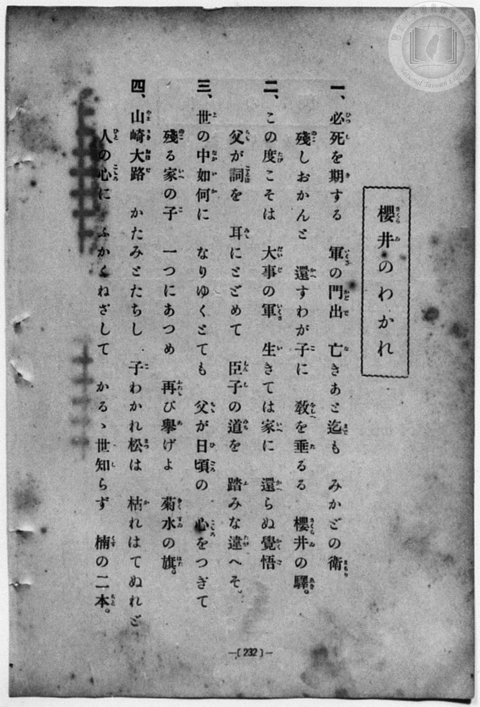
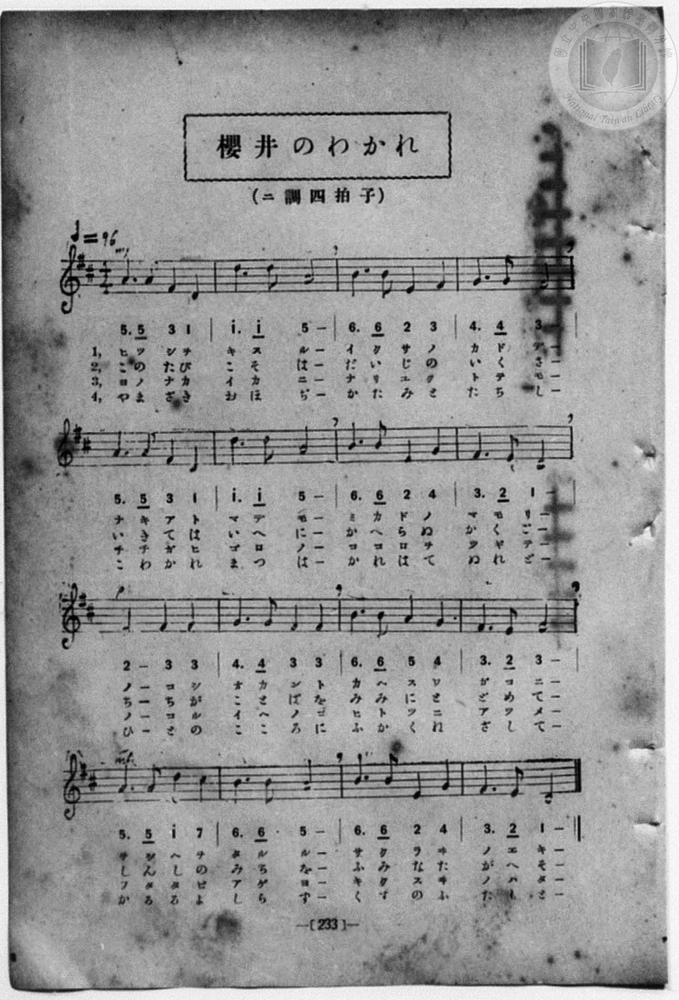

# 櫻井のわかれ

> Re:Shōka 使用 AI 協助辨識與重建樂譜，可能會有錯誤。歡迎回報。

- **鋼琴伴奏版**：<br><audio controls src="sakurai_no_wakare.mp3"></audio>
- **NEUTRINO 歌聲合成版**：<br><audio controls src="sakurai_no_wakare_neutrino.mp3"></audio>

- 詞：文部省《尋常小學唱歌》
- 曲：文部省《尋常小學唱歌》
- book: 新編 小學校・公學校 唱歌教材集（尋常科五・六學年用）
- 一條慎三郎 編《新編 小學校・公學校 唱歌教材集》（大正十二年十二月，索書號 0725-41）
- 臺灣總督府《公學校唱歌集》（大正四年三月，索書號 0725 26）

## 說明

> [!NOTE]
> **原書資訊與歌詞全文**（對應 `P240.jpg`–`P241.jpg`，原書 p. 232–233，尋常科五・六學年第 6 首）：
> - **調性與拍號**：ニ調四拍子（D 大調 4/4 拍），速度 ♩= 96
> - **版面校勘**：五線譜與簡譜逐音核對一致。注意本集第二節歌詞作「生（い）きては家（いへ）に還（かへ）らぬ覺悟（かくご）」。
>
> **一、**
> 必死（ひつし）を期（き）する　軍（いくさ）の門出（かどで）
> 亡（な）きあと迄（まで）も　みかどの衞（まもり）
> 殘（のこ）しおかんと　還（かへ）すわが子（こ）に
> 教（をしへ）を垂（た）るる　櫻井（さくらゐ）の驛（えき）。
>
> **二、**
> この度（たび）こそは　大事（だいじ）の軍（いくさ）
> 生（い）きては家（いへ）に　還（かへ）らぬ覺悟（かくご）
> 父（ちち）が詞（ことば）を　耳（みみ）にとどめて
> 臣子（しんし）の道（みち）を　踏（ふ）みな違（たが）へそ。
>
> **三、**
> 世（よ）の中（なか）如何（いか）に　なりゆくとても
> 父（ちち）が日頃（ひごろ）の　心（こころ）をつぎて
> 殘（のこ）る家（いへ）の子（こ）　一（ひと）つにあつめ
> 再（ふたた）び擧（あ）げよ　菊水（きくすゐ）の旗（はた）。
>
> **四、**
> 山崎大路（やまざきおほぢ）　かたみとたちし
> 子（こ）わかれ松（まつ）は　枯（か）れはてぬれど
> 人（ひと）の心（こころ）に　ふかくねざして
> かるゝ世（よ）知（し）らず　楠（くす）の二本（ふたもと）。


## 歌詞

```text
（TMD 檔案未包含歌詞註解）
```

## ABC

```abc
X:1
T:櫻井のわかれ
C:曲：文部省《尋常小學唱歌》
M:4/4
L:1/16
Q:1/4=96
K:D
V:V1 name="Piano" snm="Pia"
[V:V1]
!mf! A6 A2 F4 D4 | d6 d2 A8 | B6 B2 E4 F4 | G6 G2 F8 |
w: 1.~ひ つ し を | き す る | い く さ の | か ど で
w: 2.~こ の た び | こ そ は | だ い じ の | い く さ
w: 3.~よ の な か | い か に | な り ゆ く | と て も
w: 4.~や ま ざ き | お ほ ぢ | か た み と | た ち し
A6 A2 F4 D4 | d6 d2 A8 | B6 B2 E4 G4 | F6 E2 D8 |
w: 1.~な き あ と | ま で も | み か ど の | ま も り
w: 2.~い き て は | い へ に | か へ ら ぬ | か く ご
w: 3.~ち ち が ひ | ご ろ の | こ こ ろ を | つ ぎ て
w: 4.~こ わ か れ | ま つ は | か れ は て | ぬ れ ど
!p! E8 F4 F4 | G6 G2 F4 F4 | B6 B2 A4 G4 | F6 E2 F8 |
w: 1.~の こ し | お か ん と | か へ す わ | が こ に
w: 2.~ち ち が | こ と ば を | み み に と | ど め て
w: 3.~の こ る | い へ の こ | ひ と つ に | あ つ め
w: 4.~ひ と の | こ こ ろ に | ふ か く ね | ざ し て
!mf! A6 A2 d4 c4 | B6 B2 A8 | B6 B2 E4 G4 | F6 E2 D8 |
w: 1.~を し へ を | た る る | さ く ら ゐ | の え き
w: 2.~し ん し の | み ち を | ふ み な た | が へ そ
w: 3.~ふ た た び | あ げ よ | き く す ゐ | の は た
w: 4.~か る る よ | し ら ず | く す の ふ | た も と
!mf! A6 A2 F4 D4 | d6 d2 A8 | B6 B2 E4 F4 | G6 G2 F8 |
w: 1.~ひ つ し を | き す る | い く さ の | か ど で
w: 2.~こ の た び | こ そ は | だ い じ の | い く さ
w: 3.~よ の な か | い か に | な り ゆ く | と て も
w: 4.~や ま ざ き | お ほ ぢ | か た み と | た ち し
A6 A2 F4 D4 | d6 d2 A8 | B6 B2 E4 G4 | F6 E2 D8 |
w: 1.~な き あ と | ま で も | み か ど の | ま も り
w: 2.~い き て は | い へ に | か へ ら ぬ | か く ご
w: 3.~ち ち が ひ | ご ろ の | こ こ ろ を | つ ぎ て
w: 4.~こ わ か れ | ま つ は | か れ は て | ぬ れ ど
!p! E8 F4 F4 | G6 G2 F4 F4 | B6 B2 A4 G4 | F6 E2 F8 |
w: 1.~の こ し | お か ん と | か へ す わ | が こ に
w: 2.~ち ち が | こ と ば を | み み に と | ど め て
w: 3.~の こ る | い へ の こ | ひ と つ に | あ つ め
w: 4.~ひ と の | こ こ ろ に | ふ か く ね | ざ し て
!mf! A6 A2 d4 c4 | B6 B2 A8 | B6 B2 E4 G4 | F6 E2 D8 |
w: 1.~を し へ を | た る る | さ く ら ゐ | の え き
w: 2.~し ん し の | み ち を | ふ み な た | が へ そ
w: 3.~ふ た た び | あ げ よ | き く す ゐ | の は た
w: 4.~か る る よ | し ら ず | く す の ふ | た も と
```

## TMD 檔案連結

- [主旋律 TMD 檔案](sakurai_no_wakare.tmd) [[在 TMD Studio 編輯](https://tmdlang.github.io/Tmd-TS/#tmd=s7IKdvYPcrWy4qpTUCpJTLdSSM7PyUlNLsnMz7MqzsjPTozPrsyvSsyML84ojTe0NDJWgqssy88pzU21Si9KTEmNN403Q8gU55cWJadaFSdn5OfnxJekVpQk5edno8vHFySmp1oFGJkYIGQKivLLUvMS84C6C4oy80pSU8DaEQpSyzJTUkHSxcmJefFlqUWZaZmpKUiOSi0qBrsdYkVJUWJecXJRZgHIQwhV-UUlGflAhxdkVFplZBaX5BdlJifmxGcn5iUiFJVkpAK9B5GuRBfOzczJLElEFgeakZ6ZZ5Wbn5dUCgw5TInUzKxMpMDQ0lJ4tnr3k11THzeue9zU_7ix-3FTj4KWFpeirYKlGZe9rYILl42JvokdyCCQFiuFZ9M2PN--QuHphv6na3c8W7DwcfPup61rIGyFp1M2Plvb82zqzGdzJ7yc3fZ-T8fTDd1Pd-x4vnzik11TwErXApU-3bnl-ZQV7_d0gh34ZEfDs0Vzn7X2PdnR-bK5TwFo_OOGLlLsedzQDbJqyfJnaxc_7W18sqsHaAOE8WxOx_s9Pc-3LHo2e8eLmfMVDMyNTHVNDGF2v1g57_2eWc-mtb9sXvF8TiPQXoiDIdZCrAGaDlb7bPYmotW-aN_1vHHx8x17n89d_HTXHJBamOMhCtFdPXs20MnAAMDmXgUjM7B7ufS1FGypBbgUFBTsFKIV_fxDXGMhHC2tp33zQfZubn-xoutFRzvQncAAetq6AuhpLS1wbPY-a-9USABlGL2sgvSERw2TQRxDMAfocIgBCgV6CkbGRkBJI2NjkCiuRLBmjYKZwstl04DeAwYtxBW6QHe8WLX_WcNykAu6e4GhALJ71uPmbqAwMKCAYk_XTgC6xkUBGHhAMQVgClUAioJN6XnZMP_prmUKj2auBKdhuJnPOztezl0EioDuGWADgY55vn3Wi7VzgPY837AQyHjZMOHl_M3PFgCjtBeYKl-0b3nc0PRs84pnLf3P5qwBRhnQwcA09Xx9AyRknuwFxmzP8ynzgY553NgCtP9xY-_jxmWPG9c_XbcNIvi4cQdYfPXLJqACoEg3VKQJKLjmxbJdz5og2oHiwAw4BSTV0Au0F-xyWMQAXfO4oRGYMcH8p_tbn63dDda16XHjkseN08EGTno2B2IUKCQeN8583NT9uKHhxW4gF-ISoPlTwVLrXk5reNq-C2bvyseNy4HiEMOf7FoIFl8F807T48YVL_ZDHL8PovJxUxPQ5MeN-2Ha171YCMxIYAVAqaYuuGnP1s0Ai6973DgZbOD0x41d4HJmMtBYoCHowQJyNtCdPZAohulaDTVt6kyQYNMksDmQYJz0dF4TWCXQ70Au0GSQryHFGlgcWLj1g0K7CWgg2O8rZ4PFYQGFHtS7gLkYHtRABwC1ABMUxIrHjZvBhgAF5wJjGWgRMAk-2QXKyI8bF4ADGehfkC2YwQ4xkMjUgiVkcCcYqMkdEEMWAhHYEFAShYQhKKgbN0CCC5QkGoC-AIoDo28_1DqQgpWPmxqB7oGY9qJ9MSwKpoMjC5zGgKEHihGIXrAtEAN39IMFt4LVAKVWvQR5GRJiPWDBHaAQw0jVwNCHB_WTHcByABi5wAIQZNGTHWsh6RDoU6DI02VNT_ZCzASGEkgEEkogBU1dj5vawKEB9MUyYArEFSDPpi99uaAZlnGmPG6C5JR1oHjcDxEH-nQyVByUzICZqw8eJuiJuakbI-LWoaTbhgZgxoVZB6rwwAYCQxuYp5YAQxuandsgSWUrOLjAybhx87PJwIwGFASmbSB3EjBYQOHc3_VswxZIHgf7F5hZoKn62XRgBAHF10NNQAtqYLmJXIBs3Ph0Sx-o9Ny-HhzmQPcDs_Y0sLHA7Ln7ceMiiPvByQzoKmCcAsMWyAAG5nSoIcg-hTUens3dBysoloAdBsojz-aBbYHEWlMP2JHAZL8GzF4JK3YgxRE8oNZhiRFojAMDCpL414LdDCwKoBEEdgMQzUVOS8_nL4UkY1gmmgVy0tIFYEFQGELTG6ixsAYREcByDOISSEhSXuNCgYKWPhdXcGJ2aVFipl9-eGJ2YhGwBZqZmJfvUGNQUw2yS8HGQgsccwrYanwFUC0ErJ0W9ihomIAaSMD6SEcBVgtrYtEAtBFkWI1CdW5arYIpsDrUBZLGQNIQiGsUDOPAQkAKIgcSMwPTZgpGQBKkskbBBCxiAuaB1YAN9TGsAQb7JrAIMM6BeDqI1TQJrAeYoKAyM4Fi3XDTgTkGKt4PxFPBrHVQGYgqYMIA4uWodhmB5CdD5dcB8XwwazNUJ0xmLhCvR7JrAVS8BYhnoNiF7goku4yB8k0dSHatArNArkPW2Q3Eq5HsAqkC-b8LiNugZkNkVkB1LAPKNKHaZQKyC2biPiCeBmaBwg6kswsqsxuIFyHZBQup-UC8H8wC2QGSAYULiL8QGh8Qu_AnqV095CQp0lMTKB3VQFOREVgPemqChiHQ_8DyD8Vf-6Ayy5HDEOp7WGyshMYYig6galCcYKYmWKiD7FoGZoFSDrLMDrQYhoU6ULypE8xagyYDSk1TUO0CpSZgbCBipQfMAuUbkAxENbCUg7ocZhcsRU8GyyHnqyVQmT6ou9FSE0xnE8gtIHeBOnaoYQjKq8i5BOp6oDqIOMRckAzIfzAZUOgSk5p2dJJVQBXUgtMICIJSCGbJAxGBpSdQCkNNT9hKJ1iIQkIFkiOQ8xUw1TRBZGDpDCmOgSUXJBwhMqBQhMYIIlUgpSdIHENiGUTCQh0WkyuAeAPYRFhMwtLufqiJCFdAwhrYTsCMY3B6QvMXuHxFT7kgNRB55HIa5ApQCoLYCJKB5CZwqgDah5meIDphrkPkL4wUCjdxKyJ0wWUgsLqGyoBKN0g8IPsLb3oCtl8orvDABZM52A3I6QeS_kkqocBxB_PBDnDYw2ITWvIC4wK1voPULuCyAVJqNE2AykBiEdgfAWJQCKKnKEj5DUqh0LoVHvawlAMsT6AuQg15UIqC1FogVyGnXlDKmItqFzhFwXSCahTUuhWWPibBa0WIOMTFkDIPklPQ_bUeHiqoKQpW3sBCCmIuso87gexZSHaBUhHIRGBbApquQe5FDnVgKQ-tZ0F21XJx6dopoLW1FLALKXMBAA)]
- [鋼琴伴奏 TMD 檔案](sakurai_no_wakare_piano.tmd) [[在 TMD Studio 編輯](https://tmdlang.github.io/Tmd-TS/#tmd=s7IKdvYPcrWy4qpTUCpJTLdSSM7PyUlNLsnMz7MqzsjPTozPrsyvSsyML84ojTe0NDJWgqssy88pzU21Si9KTEmNN403Q8gU55cWJadaFSdn5OfnxJekVpQk5edno8vHFySmp1oFGJkYIGQKivLLUvMS84C6C4oy80pSU8DaEQpSyzJTUkHSxcmJefFlqUWZaZmpKUiOSi0qBrsdYkVJUWJecXJRZgHIQwhV-UUlGflAhxdkVFplZBaX5BdlJifmxGcn5iUiFCUWATWnp-am5pVYFWQm5uXHJyYn5-cWJOZlgsQQCksygIqg5lSiC-dm5mSWJILEtbQUnq3e_WTX1MeN6x439T9u7H7c1PN-T8fL2TOfdXa_7N7zfMKWJ3u2PF3a_35Pp4KWFpeirYKlGZe9rYILl42JvokdyGRQQFopPJu24fn2FQpPN_Q_Xbvj2YKFj5t3P21dA2ErPJ2y8dnanmdTZz6bO-Hl7DagDU83dD_dseP58olPdk0BK10LVPp055bnU1YArQK7-MmOhmeL5j5r7Xuyo_Nlc58C0PjHDV2k2PO4oRtk1ZLlz9Yuftrb-GRXD9AGCOPZnI73e3qeb1n0bPaOFzPnKxiYG5nqmhjC7H6xct77PbOeTWt_2bzi-ZxGoL0QB0OshVgDNB2s9tnsTUSrfdG-63nj4uc79j6fu_jprjkgtTDHQxSiu3r2bKCTgQGAzb0KRmZg93IFJ2aXFiVm-uWHJ2YnFgETMChpBHk41BjUVHMpAIGNhZYdmKGvpWCLDhSer1kDDOsXC3sUNExAAft8fYOOAjATGOplFaRrYtGgpQ82rEahOjetVsFUQRcITRWMgaQhENcoGMaBhYAURA4kZgamzRSMgCRIZY2CCVjEBMwDqwEb6mNYo_C4cRNY5HHjEiCeDmI1TQLredzYC5WZCRTrhpv-uLEFKt4PxFPBrHVQGYiqx40rgXg5ql1GIPnJUPl1QDwfzNoM1QmTmQvE65HsWgAVbwHiGSh2obsCyS5joHxTB5Jdq8AskOuQdXYD8Woku0CqQP7vAuI2qNkQmRVQHcuAMk2odpmA7IKZuA-Ip4FZoLAD6eyCyuwG4kVIdsFCaj4Q7wezQHaAZEDhAuIvhMYHxC78SWpXDzlJivTUBEpHNdBUZATWg56aoGEI9P_jRlBIIfy1DyqzHDkMob6HxcZKaIyh6ACqBsUJZmqChTrIrmVgFijlIMvsQIthWKgDxZs6waw1aDKg1DQF1S5QagLGBiJWesAsUL4ByUBUP24CuQLkcphdsBQ9GSyHnK-WQGX6oO5GS00wnU0gt4DcBawo0MIQlFeRcwnU9UB1EHGIuSAZkP9gMqDQJSY17egkq4AqqAWnERAEpRDMkgciAktPoBSGmp6wlU6wEIWECiRHIOcrYKppgsjA0hlSHANLLkg4QmRAoQiNEUSqQEpPkDiGxDKIhIU6LCZXAPEGsImwmISl3f1QExGugIT146ZGzDgGpyc0f4HLV_SUC1IDkUcup0GuAKUgiI0gGUhuAqcKoH2Y6QmiE-Y6RP7CSKFwE7ciQhdcBj5uXAuVAZVukHhA9hfe9ASsWCmu8MAFkznYDcjpB5L-SSqhwHEH88EOcNjDYhNa8gLjArW-g9Qu4LIBUmo0TYDKQGLxcWMHEINCED1FQcpvUAqF1q3wsIelHGB5AnURasiDUhSk1gK5Cjn1glLGXFS7wCkKphNUo6DWrbD0MQleK0LEIS6GlHmQnILur_XwUEFNUbDyBhZSEHORfdwJZM9CsguUikAmAtsS0HQNci9yqANLeWg9C7KrFkdTywe5qWUCbWpBE4thvEK0YSyMApY9QIYJJt80HkibxoNE4EygGpgPgbUgyeaApDCMARWIyBZANGOKIBkPpHAZhuRBqAYyHAYMVV07BbSAjfYxjAXbgk3KCLeUMW4pE7iUMhcA)]

## 分析

```text
================================================================================
📊 TMD Song Profile: [ 櫻井のわかれ ]
================================================================================
⏱  Duration:       1:20 (80.0s), 32 measures total
🎼 Key & Tempo:    首調基準 D, != 96.0 BPM, <4/4>
   - 分析範圍：      由實際發聲的音符與和弦推測調性；播放脈絡另行呈現
🎤 人聲音域:    D4 (MIDI 62) – D5 (MIDI 74) [跨度: 12 個半音 / 1.0 個八度, 難度: easy]
   - 最低音:  D4 in [SakuraiNoWakare #1 @ m.1, 0:01]
   - 最高音: D5 in [SakuraiNoWakare #1 @ m.2, 0:02]
   - 適合: soprano, mezzo-soprano, contralto, tenor, baritone, bass
🏛  結構:      SakuraiNoWakare (40.0s) -> SakuraiNoWakare (40.0s)
⚡ 編曲密度:        Peak 1 軌道同時演奏
🗝  調性診斷：       D 大調（純淨自然大調，未偵測到可信轉調）
   - 風格氣質:    純淨自然大調（陽光明朗、易唱易記，無明顯調外色彩）
   - 轉調歷程:    全曲維持單一推測調性（未偵測到可信轉調）
   - 核心骨幹音:  F#, A, D, B, G
   - 調性數值:    D 大調 [相關度: 0.86, 穩定度: High, 自然音純度: 100.0%]
   - 候選調性 (K-S): D 大調 (0.86), B 小調 (0.72), F# 小調 (0.70)
   - 五度圈歷程:   +2 -> +2
   - 各段落調性細節:
     • [SakuraiNoWakare #1]: D 大調 (r: 0.86, 自然音純度: 100.0%)
     • [SakuraiNoWakare #2]: D 大調 (r: 0.86, 自然音純度: 100.0%)

  [ 五度圈游移軌跡 ]
               C  
         F            G  
      Bb              [D ]*
      Eb               A  
         Ab           E  
            Db       B  
               F# 
     (* = active key center)

  [ 十二半音累積音高分佈 ]
     C  :                            0.0%
     C# : ██                         1.6%
     D  : █████████████████         17.2%
     D# :                            0.0%
     E  : ██████████                10.2%
     F  :                            0.0%
     F# : ████████████████████████  24.2%
     G  : ███████████               10.9%
     G# :                            0.0%
     A  : ████████████████████      20.3%
     A# :                            0.0%
     B  : ███████████████           15.6%
--------------------------------------------------------------------------------
Assignment 軌道音域：
  - Piano         : D4 – D5 (12 個半音 / 1.0 個八度, 112 個音符)
================================================================================
```


## 原書掃描頁






