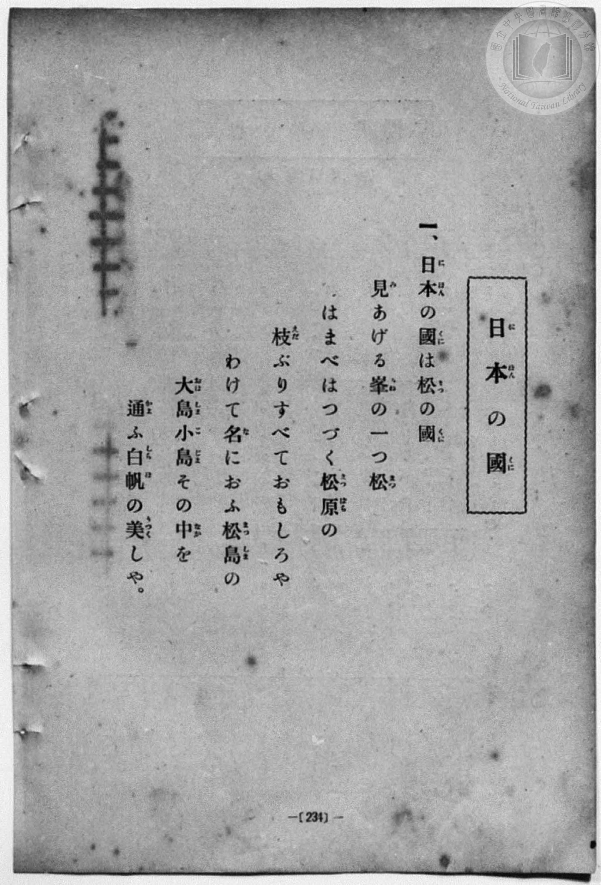
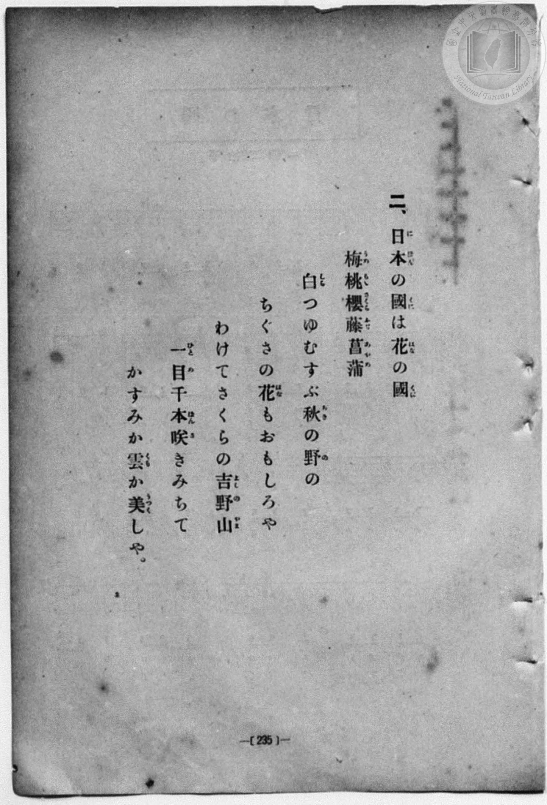
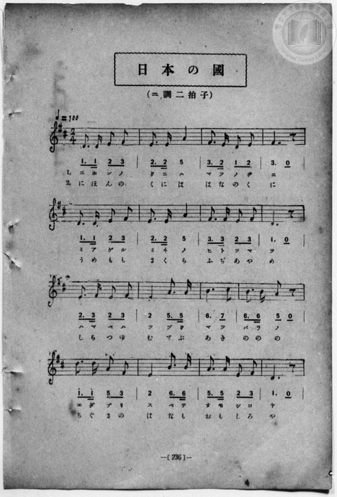
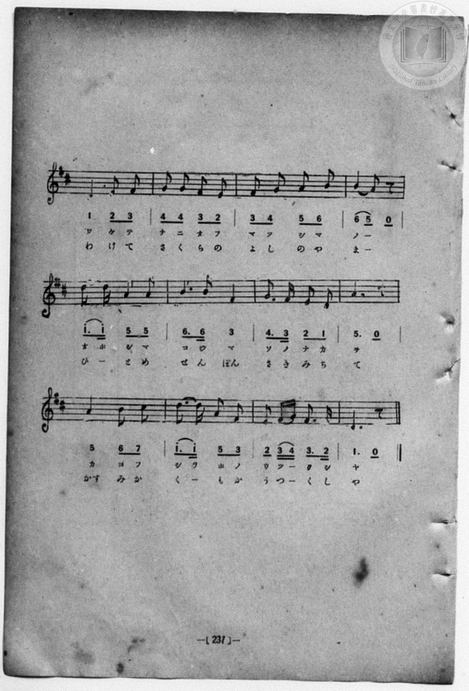

# 日本の國

> Re:Shōka 使用 AI 協助辨識與重建樂譜，可能會有錯誤。歡迎回報。

- **NEUTRINO 歌聲合成版**：<br><audio controls src="nihon_koku_neutrino.mp3"></audio>
- **鋼琴伴奏版**：<br><audio controls src="nihon_koku.mp3"></audio>


- 詞：文部省
- 曲：文部省
- book: 新編 小學校・公學校 唱歌教材集（尋常科五・六學年用）
- 一條慎三郎 編《新編 小學校・公學校 唱歌教材集》（大正十二年十二月，索書號 0725-41）
- 臺灣總督府《公學校唱歌集》（大正四年三月，索書號 0725 26）

## 說明

> [!NOTE]
> **原書資訊與歌詞全文**（對應 `P242.jpg`–`P245.jpg`，原書 p. 234–237，尋常科五・六學年第 7 首）：
> - **調性與拍號**：ニ調二拍子（D 大調 2/4 拍），速度 ♩= 100
> - **版面校勘**：全 28 小節橫跨兩頁（`P244.jpg`–`P245.jpg`），五線譜與簡譜逐音核對一致。
>
> **一、**
> 日本（にほん）の國（くに）は松（まつ）の國（くに）
> 見（み）あげる峯（みね）の一（ひと）つ松（まつ）
> はまべはつづく松原（まつばら）の
> 枝（えだ）ぶりすべておもしろや
> わけて名（な）におふ松島（まつしま）の
> 大島（おほしま）小島（こじま）その中（なか）を
> 通（かよ）ふ白帆（しらほ）の美（うつく）しや。
>
> **二、**
> 日本（にほん）の國（くに）は花（はな）の國（くに）
> 梅（うめ）桃（もも）櫻（さくら）藤（ふぢ）菖蒲（あやめ）
> 白（しら）つゆむすぶ秋（あき）の野（の）の
> ちぐさの花（はな）もおもしろや
> わけてさくらの吉野山（よしのやま）
> 一目（ひとめ）千本（せんぼん）咲（さ）きみちて
> かすみか雲（くも）か美（うつく）しや。


## 歌詞

```text
（TMD 檔案未包含歌詞註解）
```

## ABC

```abc
X:1
T:日本の國
C:曲：文部省
M:2/4
L:1/16
Q:1/4=100
K:D
V:V1 name="Piano" snm="Pia"
[V:V1]
D3 D E2 F2 | E3 E A4 | F3 E D2 E2 | F6 z2 |
w: 1.~に ほ ん の | く に は | ま つ の く | に
w: 2.~に ほ ん の | く に は | は な の く | に
D3 D E2 F2 | E3 E A4 | F3 F E2 F2 | D6 z2 |
w: 1.~み あ げ る | み ね の | ひ と つ ま | つ
w: 2.~う め も も | さ く ら | ふ ぢ あ や | め
E3 F E2 F2 | E4 A3 A | B6 c2 | B3 B A2 z2 |
w: 1.~は ま べ は | つ づ く | ま つ | ば ら の
w: 2.~し ら つ ゆ | む す ぶ | あ き | の の の
d3 d A2 F2 | E4 B3 B | A3 A E2 F2 | D6 z2 |
w: 1.~え だ ぶ り | す べ て | お も し ろ | や
w: 2.~ち ぐ さ の | は な も | お も し ろ | や
D4 E2 F2 | G2 G2 F2 E2 | F2 G2 A2 B2 | B4 A2 z2 |
w: 1.~わ け て | な に お ふ | ま つ し ま | の _
w: 2.~わ け て | さ く ら の | よ し の や | ま _
d3 d A2 A2 | B3 B F4 | G3 F E2 D2 | A6 z2 |
w: 1.~お ほ し ま | こ じ ま | そ の な か | を
w: 2.~ひ _ と め | せ ん ぼん | さ き み ち | て
A4 B2 c2 | d3 d A2 F2 | E2 F G F3 E | D6 z2 |
w: 1.~か よ ふ | し ら ほ の | う つ _ く し | や
w: 2.~かす み か | く _ も か | う つ _ く し | や
D3 D E2 F2 | E3 E A4 | F3 E D2 E2 | F6 z2 |
w: 1.~に ほ ん の | く に は | ま つ の く | に
w: 2.~に ほ ん の | く に は | は な の く | に
D3 D E2 F2 | E3 E A4 | F3 F E2 F2 | D6 z2 |
w: 1.~み あ げ る | み ね の | ひ と つ ま | つ
w: 2.~う め も も | さ く ら | ふ ぢ あ や | め
E3 F E2 F2 | E4 A3 A | B6 c2 | B3 B A2 z2 |
w: 1.~は ま べ は | つ づ く | ま つ | ば ら の
w: 2.~し ら つ ゆ | む す ぶ | あ き | の の の
d3 d A2 F2 | E4 B3 B | A3 A E2 F2 | D6 z2 |
w: 1.~え だ ぶ り | す べ て | お も し ろ | や
w: 2.~ち ぐ さ の | は な も | お も し ろ | や
D4 E2 F2 | G2 G2 F2 E2 | F2 G2 A2 B2 | B4 A2 z2 |
w: 1.~わ け て | な に お ふ | ま つ し ま | の _
w: 2.~わ け て | さ く ら の | よ し の や | ま _
d3 d A2 A2 | B3 B F4 | G3 F E2 D2 | A6 z2 |
w: 1.~お ほ し ま | こ じ ま | そ の な か | を
w: 2.~ひ _ と め | せ ん ぼん | さ き み ち | て
A4 B2 c2 | d3 d A2 F2 | E2 F G F3 E | D6 z2 |
w: 1.~か よ ふ | し ら ほ の | う つ _ く し | や
w: 2.~かす み か | く _ も か | う つ _ く し | や
```

## TMD 檔案連結

- [主旋律 TMD 檔案](nihon_koku.tmd) [[在 TMD Studio 編輯](https://tmdlang.github.io/Tmd-TS/#tmd=s7IKdvYPcrWy4qpTUCpJTLdSSM7PyUlNLsnMz7MqzsjPTozPrsyvSsyML84ojTe0NDJWgqssy88pzU21Si9KTEmNN403Q8gU55cWJadaFSdn5OfnxJekVpQk5edno8vHFySmp1oFGJkYIWQKivLLUvMS84C6C4oy80pSU8DaEQpSyzJTUkHSxcmJefFlqUWZaZmpKUiOSi0qBrsdYkVJUWJecXJRZgHIQwhV-UUlGflAhxdkVFplZBaX5BdlJifmxGcn5iUiFJVkpAK9l5dYUlqUii5akJOYjCQI1J-emWeVm5-XVAoMNQyJksRMoDAwDPPLE-NzEzPzchLzgI7W0lJ4Nn3pszlrHjeuezqnW0FLi0vRVsHQwIDL3lbBhcvGSN_EDmQUKPSsFJ5N2_B8-wqFpxv6n67d8WzBwsfNu5-2roGwFZ5O2fhsbc-zqTOfzZ3wcnbb-z0dTzd0P92x4_nyiU92TQErXQtU-nTnludTVrzf0wl24pMdDc8WzX3W2vdkR-fL5j4FoPGPG7pIsedxQzfIqiXLn61d_LS38cmuHqANEMazOR3v9_Q837Lo2ewdL2bOVzAwNzLVNTGE2f1i5bz3e2Y9m9b-snnF8zmNYLFnszdhiL1o3_W8cfHzHXufz138dNccoPvgjoG4Bd0Vs2cDnQD0EDb7FYzMwPZz6Wsp2FILcCkoKNgpRCv6-Ye4xkI4WlpP--aD7N3c_mJF14uOdqA7gR5-2roC6DktLXDs9D5r71RIACV_vayC9IRHDZNBHFMwB-hwiAEKBXoKRsYmQEkjY3OQKK5IXbNGwVzh5bJpQO8BgxDiCl2gO16s2v-sYTnIBd29wFAA2T3rcXM3UBgURd29T9dOALrGRQEYeEAxBWCKUwCKgk3pedkw_-muZQqPZq6EJEq4oc87O17OXQSKge4ZYBOBHlMwsgAlmefrG56tXP1i-4qnrStfLmgEmg3ylQk2L4KsAHrj-fZZL9bOAbrw-YaFQMbLhgkv529-tmAHMISA6fNF-5bHDU1gq2FBCxR93NAIzCtgPiQDAe153Lj6cePux02TgSZD8hNYsB8oDhZZ_2zuPrDIvseNS7CqgRj4YhlEcD9YTdPjxkmPm7qfbl4PEXzcuBaiF-gKsMimx42g_AQ0E818iGlAe8EiO8GMJY8blwKtA6oERi9c8ePGDY-bgKEBMhbqqXlzwbJAtAAsvu1xU9fjxplgc5Y9bux63AR02PTHTb2Pm1qgFjUBfTERKPt0AjD6gBpXgTUCwwSocSvIxs3bkGycDmQg2wiMf5gCoPrdcAWgUgAqPvlx4wyYrrngEAAGBciix43AEOt83DQJYtTLhllg8e7HTcAcCFS89fnMvU93gMoksJuBIrshVj_f1wcWbAM7qR8sCFTQghHju3rIivEXXRvBIsCQh4QG9hh_tqgV6owmYILtfLawGcQFhnBTE4i7GuhaoOxUkC5wNL2YDoxfoMjWx42LQNz-aS8mAQsuoAhQSwvEEIjJQI_DfQ1JJI-bgLY0gKNy2_PlEMcAoxKU44DOe9kOCZB1yFHzuHHh48YJYAesQ_cRKBngSwxwZ4P8PqETaP7TjWATmsCualwHcjA4TiEagan6-Wyg7dCEDfHL095mWIDPBob248Y9kDB_CvX1VLBre8G5A-jUZTBnd4O9CRTsfgkq2MHBDg5SoAiBqKe8VIYCBS19Li6_zIz8PL9879K8TKuAzMS8fIcag5pqkD0KNoZmWuB0poCtSlAAlqugQmhhj4KGCbR401GAFWiaWDQArQMZVqNgCCwpdYGkEZA0BuIaMEsXSJqCaZAISBwkAlILkoWJQKABSARsmo9hDTA4V4NFgSkeGL2Twax1YD3A4IPKrAYVN3DTgfEKFV8CVQtRiTALAuMR9hiRZw-EDUySRNiDP6x39dA2rI2R1EB0YQ_r_VAfNQHxJBCrqRvqI5jMWqhfYWGwCSq-AhzeIBYo9EEyIB6usG6D6GpqBOImMAtEgmSmQs3rB4p1ItmzFSq-COw6kI4WiAzQDNLCekcnOWENCVnkcISI6ELD2hQoYobkEnOwGoiIGVgNeljDUs8-IN4JZoFEkEMOWGvCQwORrmFyIFUg0Q3QsOyExgx6WE9HkgfHUBMo9EEh1wA3ayaU3gY2ERS-CHt6ofZAYh1EI9uDN6yBjVKy0nUc2CogBQo31NCGhWgNPNyJS9kdUNcvAPsSFApdUH9B_A6SA8UCiF4GFgfJQ1ImJAyBFQ003EApD1fKXgg1YwI0LSNKEVjJASovYCaTag-BUmQKZmiDW51ElCKQkhgSjiZAEoRBPET5DBIBhTkoBhBpHUvKboKUlyCfToSGJyQEQP6GlI0QX0NyNSxlw8oPcBjASxFYWYMlrHHaAwl3kCykDIHHQRMoFcBsAJfYsFIEJW8Rk7Jb15IV1igpG4QRZQSsDoSEP6ysAcUOLK1jT9nQ9AOqt9DCDlSLgfgzkPwHEp8LFQflZEicQEv5JlCZjytlQ0p6SFkPKbshps2GiALrTEgLCckiWGHeC8SgCgSSPUAyoKgiJWnvaCYnuGHBBgpiSIGMq2gxBgY6rFmCvyABBRXEw5DEBEvCyMXsbmjwQmRAxS0sccOaEtMJFiSgViQ8xCGBB6uL4ekeUnfCxUmxqJaLS9dOAamFqIDJVeYCAA)]
- [鋼琴伴奏 TMD 檔案](nihon_koku_piano.tmd) [[在 TMD Studio 編輯](https://tmdlang.github.io/Tmd-TS/#tmd=s7IKdvYPcrWy4qpTUCpJTLdSSM7PyUlNLsnMz7MqzsjPTozPrsyvSsyML84ojTe0NDJWgqssy88pzU21Si9KTEmNN403Q8gU55cWJadaFSdn5OfnxJekVpQk5edno8vHFySmp1oFGJkYIWQKivLLUvMS84C6C4oy80pSU8DaEQpSyzJTUkHSxcmJefFlqUWZaZmpKUiOSi0qBrsdYkVJUWJecXJRZgHIQwhV-UUlGflAhxdkVFplZBaX5BdlJifmxGcn5iUiFCUWATWnp-am5pVYFWQm5uXHJyYn5-cWJOZlgsQQCksygIqs8hJLSotS0UULchKTgYJaWgrPpi99NmfN48Z1T-d0v9_T8XL2zGed3S-79zyfsOXJni1Pl_a_39OpoKXFpWirYGhgwGVvq-DCZWOkb2IHMhEUflYKz6ZteL59hcLTDf1P1-54tmDh4-bdT1vXQNgKT6dsfLa259nUmc_mTng5uw1oxdMN3U937Hi-fOKTXVPAStcClT7dueX5lBVAu8AufbKj4dmiuc9a-57s6HzZ3KcANP5xQxcp9jxuAPnm6ZLlz9Yuftrb-GRXD9AGCOPZnI73e3qeb1n0bPaOFzPnKxiYG5nqmhjC7H6xct77PbOeTWt_2bzi-ZxGsNiz2ZswxF6073reuPj5jr3P5y5-umsO0H1wx0Dcgu6K2bOBTgB6CJv9CkZmYPu5_DIz8vP88r1L8zKtAkCxG-ThUGNQU82lAAQ2hmZadmCWvpaCLTpQeL5mDTDgXizsUdAwAYXS8_UNOgrAhGyil1WQrolFg5Y-2LAaBUMFXSA0VDACksZAXANm6QJJUzANEgGJg0RAakGyMBEINACJgE3zMaxReNy4Giz6uHG3wuOmyWDWOrCex439UJnVQLwebvrjxn1Q8SVQtRCVCLMgMB5hjxF59kDYjxtXEWEP_rDe1UPbsDZGUgPRhT2s90N91ATEk0Cspm6oj2Aya6F-hYXBJqj4CnB4g1ig0AfJgHi4wroNoqupEYibwCwQCZKZCjWvHyjWiWTPVqj4IrDrQDpaIDJAM0gL6x2d5IQ1JGSRwxEiogsNa1OgiBmSS8zBaiAiZmA16GENSz37gHgnmAUSQQ65x41L4aGBSNcwOZAqkOgGaFh2QmMGPaynI8mDY6gJFPqgkGuAmzUTSm8DmwgKX4Q9vVB7ILEOopHtwRvWwIKKrHQdB7YKSIHCDTW0YSFaAw934lJ2B9T1C8C-BIVCF9RfEL-D5ECxAKKXgcVB8pCUCQnDx03QkACnPFwpeyHUjAnQtIwoRWAlB6i8gJlMqj0ESpEpmKFtSmQpAimJIeFoAiRBGMRDlM8gEVCYg2IAkdaxpOwmSHkJ8ulEaHhCQgDkb0jZCPE1JFfDUjas_ACHAbwUgZU1WMIapz2QcAfJQsoQeBw0gVIBzAZwiQ0rRVDyFjEpu3UtWWGNkrJBGFFGwOpASPjDyhpQ7MDSOvaUDU0_oHoLLexAtRiIPwPJfyDxuVBxUE6GxAm0lG8Clfm4UjakpIeU9ZCyG2LabIgosM583LgHUnXCLIIV5r1ADKpAINkDJAOKKlKS9o5mcoIbFmygIIYUyLiKFmNgoMOaJfgLElBQQTwMSUywJIxczO6GBi9EBlTcwhI3rCkxnWBB0o1cMkECD1YXw9M9pO6Ei5NiUS2WBqIPcgPRAto-BIZGvEK0YSyMAoZqPJBlGo8kAmXAJeAiIGwA9RYVDYLLIynENMwEyDCJBVMQJVABoAIi3ARVTLbnEJYh6YK5D2wwMc5BMgVHkMFFwASGSQjf4w19rB4DphFdOwWkZBLtYxgLNh5d2AgurMwFAA)]

## 分析

```text
================================================================================
📊 TMD Song Profile: [ 日本の國 ]
================================================================================
⏱  Duration:       1:07 (67.2s), 56 measures total
🎼 Key & Tempo:    首調基準 D, != 100.0 BPM, <2/4>
   - 分析範圍：      由實際發聲的音符與和弦推測調性；播放脈絡另行呈現
🎤 人聲音域:    D4 (MIDI 62) – D5 (MIDI 74) [跨度: 12 個半音 / 1.0 個八度, 難度: easy]
   - 最低音:  D4 in [NihonNoKuni #1 @ m.1, 0:00]
   - 最高音: D5 in [NihonNoKuni #1 @ m.13, 0:14]
   - 適合: soprano, mezzo-soprano, contralto, tenor, baritone, bass
🏛  結構:      NihonNoKuni (33.6s) -> NihonNoKuni (33.6s)
⚡ 編曲密度:        Peak 1 軌道同時演奏
🗝  調性診斷：       D 大調（純淨自然大調，未偵測到可信轉調）
   - 風格氣質:    純淨自然大調（陽光明朗、易唱易記，無明顯調外色彩）
   - 轉調歷程:    全曲維持單一推測調性（未偵測到可信轉調）
   - 核心骨幹音:  D, F#, E, A, B
   - 調性數值:    D 大調 [相關度: 0.85, 穩定度: Moderate, 自然音純度: 100.0%]
   - 候選調性 (K-S): D 大調 (0.85), A 大調 (0.73), B 小調 (0.64)
   - 五度圈歷程:   +2 -> +2
   - 各段落調性細節:
     • [NihonNoKuni #1]: D 大調 (r: 0.85, 自然音純度: 100.0%)
     • [NihonNoKuni #2]: D 大調 (r: 0.85, 自然音純度: 100.0%)

  [ 五度圈游移軌跡 ]
               C  
         F            G  
      Bb              [D ]*
      Eb               A  
         Ab           E  
            Db       B  
               F# 
     (* = active key center)

  [ 十二半音累積音高分佈 ]
     C  :                            0.0%
     C# : ██                         1.9%
     D  : ████████████████████████  21.9%
     D# :                            0.0%
     E  : █████████████████████     19.5%
     F  :                            0.0%
     F# : ██████████████████████    20.5%
     G  : █████                      4.8%
     G# :                            0.0%
     A  : █████████████████████     19.0%
     A# :                            0.0%
     B  : ██████████████            12.4%
--------------------------------------------------------------------------------
Assignment 軌道音域：
  - Piano         : D4 – D5 (12 個半音 / 1.0 個八度, 172 個音符)
================================================================================
```


## 原書掃描頁










