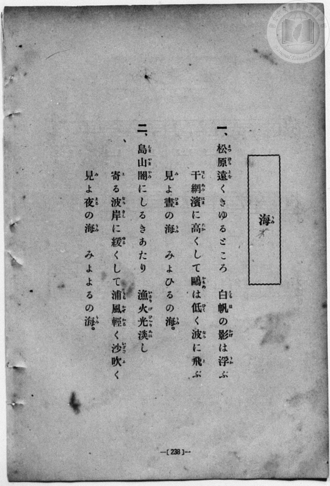
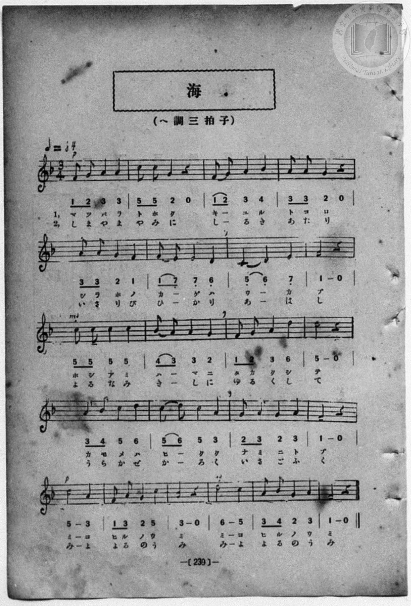

# 海

> Re:Shōka 使用 AI 協助辨識與重建樂譜，可能會有錯誤。歡迎回報。

<audio controls src="umi.mp3"></audio>

- 詞：文部省唱歌
- 曲：文部省唱歌
- 一條慎三郎 編《新編 小學校・公學校 唱歌教材集》（大正十二年十二月，索書號 0725-41）
- 臺灣總督府《公學校唱歌》第五學年用（昭和十一年，索書號 523.37 4322-4）

## 說明

原書資訊與歌詞全文（對應 P020.jpg–P021.jpg，原書 pp. 16–17）：
調性與拍號：ヘ長調（F 大調，1 降記號）3/4 拍，速度 ♩=84（原譜標示 𝅗𝅥=84）


## 跨冊／重複收錄參照

> 同曲＋同名異曲（《公學校唱歌》五年級、《新定兒童唱歌》五年級與《唱歌帖》P039 為文部省『尋常小學唱歌』〈海〉同曲；《共益商社唱歌教科書》卷二與《唱歌帖》P037 為共益商社版〈海〉同曲；《新定兒童唱歌》一年級〈ウミ〉為同名異曲）

- **[同名異曲]** 《公學校唱歌》第五學年用（昭和13年／1938）：[**〈海〉**](../../../kogakko_shoka/grade_5/7_umi/index.md)（`F` / `3/4` — [原始 TMD](../../../kogakko_shoka/grade_5/7_umi/umi.tmd)）
- **[同名異曲]** 《共益商社唱歌教科書》卷二・教師用（明治33年／1900）：[**〈海〉**](../../../kyoeki_shoka/kan_2_854863/9_umi/index.md)（`D` / `4/4` — [原始 TMD](../../../kyoeki_shoka/kan_2_854863/9_umi/umi.tmd)）
- **[同名異曲]** 《新定兒童唱歌》尋常科第一學年用（2020.006.0847.0001）：[**〈ウミ（海）〉**](../../../shintei_jido_shoka/grade_1_2020.006.0847.0001/4_08_umi/index.md)（`F` / `2/4` — [原始 TMD](../../../shintei_jido_shoka/grade_1_2020.006.0847.0001/4_08_umi/umi.tmd)）
- **[同名異曲]** 《新定兒童唱歌》尋常科第五學年用（2020.006.0847.0005）：[**〈海〉**](../../../shintei_jido_shoka/grade_5_2020.006.0847.0005/1_08_umi/index.md)（`F` / `3/4` — [原始 TMD](../../../shintei_jido_shoka/grade_5_2020.006.0847.0005/1_08_umi/umi.tmd)）
- **[同名異曲]** 《新編小公學校唱歌教材集》高等一、二學年（大正12年／1923，國臺圖 0725-41）：[**〈海（二部）〉**](../../koto_1_2/35_umi/index.md)（`C` / `2/4` — [原始 TMD](../../koto_1_2/35_umi/umi.tmd)）
- **[同名異曲]** 楊金土手抄《唱歌帖》第 3 冊・I（2020.006.0843）：[**〈海（其一）〉**](../../../shokacho/vol_03/p037_umi/index.md)（`D` / `4/4` — [原始 TMD](../../../shokacho/vol_03/p037_umi/umi.tmd)）
- **[同名異曲]** 楊金土手抄《唱歌帖》第 3 冊・I（2020.006.0843）：[**〈海（其二）〉**](../../../shokacho/vol_03/p039_umi/index.md)（`F` / `3/4` — [原始 TMD](../../../shokacho/vol_03/p039_umi/umi.tmd)）
- 總表：[跨冊重複與同名歌曲總索引](../../../duplicate_songs.md)

## 歌詞

```text
一
松原遠く消ゆるところ、
白帆（しらほ）のかげはうかぶ。
干網（ほしあみ）はまに高くして、
かもめはひくく波に飛ぶ。
見よ、晝の海。
見よ、晝の海。

二
島山やみにしるきあたり
漁火（いさりび）、光あはし。
よる波岸にゆるくして、
うら風かるく沙（いさご）吹く。
見よ、夜の海。
見よ、夜の海。
```

## ABC

```abc
X:1
T:海
C:曲：文部省唱歌
M:3/4
L:1/16
Q:1/4=84
K:F
V:V1 name="Piano" snm="Pia"
[V:V1]
!p! F2 G2 A4 A4 | c2 c2 G4 z4 | F2 G2 A4 d4 | A2 A2 G4 z4 |
w: 1.~マ ツ バ ラ | ト ホ ク | キ _ ユ ル | ト コ ロ
w: 2.~し ま や ま | や み に | し _ る き | あ た り
A2 A2 G4 F4 | F2 E2 E4 D4 | C4 D4 E4 | F8 z4 |
w: 1.~シ ラ ホ ノ | カ _ ゲ ハ | ウ _ カ | ブ
w: 2.~い さ り び | ひ _ か り | あ _ は | し
!mf! c2 c2 c4 c4 | d2 c2 c4 B4 | F2 G2 A4 d4 | c8 z4 |
w: 1.~ホ シ ア ミ | ハ _ マ ニ | タ カ ク シ | テ
w: 2.~よ る な み | き _ し に | ゆ る く し | て
A2 B2 c4 d4 | c2 d2 c4 A4 | G2 A2 G4 A4 | F8 z4 |
w: 1.~カ モ メ ハ | ヒ _ ク ク | ナ ミ ニ ト | ブ
w: 2.~う ら か ぜ | か _ る く | い さ ご ふ | く
!p! c8 A4 | F2 A2 G4 c4 | A8 z4 | !mf! d8 c4 |
w: 1.~ミ ヨ | ヒ ル ノ ウ | ミ | ミ ヨ
w: 2.~み よ | よ る の う | み | み よ
A2 B2 G4 A4 | F8 z4 |
w: 1.~ヒ ル ノ ウ | ミ
w: 2.~よ る の う | み
```

## TMD 檔案連結

- [主旋律 TMD 檔案](umi.tmd) [[在 TMD Studio 編輯](https://tmdlang.github.io/Tmd-TS/#tmd=s7IKdvYPcrWy4qpTUCpJTLdSSM7PyUlNLsnMz7MqzsjPTozPrsyvSsyML84ojTe0NDJWgqssy88pzU21Si9KTEmNN403Q8gU55cWJadaFSdn5OfnxJekVpQk5edno8vHFySmp1oFGJkg6Swoyi9LzUvMA-ouKMrMK0lNAWtHKEgty0xJBUmnpmSW5BdlJuYgOSi1qBjsbojxJUWJecXJRZkFIM8gVOUXlWTkAx1dkFFplZFZDDIkOTEnPjsxLxGhqCQjFei1vMSS0qJUdNHyxJLUIiUuLS2FZ1u3K2hpcSnaKliYcNnbKrhx2Rjrm9iB1D_Z0fBs0dxnrX1PdnS-bO5TeL59xeOGrmfTNgAZCk839D9du-PZgoWPm3c_bV0DYSs8nbLx2dqeZ1NnPps74eXstscN3e_3dDxdsvzZ2sVPexuf7Op5unMLhPFsTsf7PT3Ptyx6NnvHi5nzFQzMjUx1TQzf7-kEu_XFynnv98x6Nq39ZfOK53MaIeaCZZ7N3oRD5kX7rueNi5_v2Pt87uKnu-YA3Qp3GEQV0DnP16x5smsKUBDokOdTVgBd92zG2qeTekCO2tEAFERxlKmRsZ6xuYKJsZGRrgnYaVz6Wgq21AJcCgoKT_vmgyzb3P5iRdeLjnagK4Fef9q6AuhBUNBt6H3W3qkQYGBkoJdVkP6oYTKQaQhiAt0J0apQUKCnYGgGlDI0BzoRGDYgY1-s2v-sYTnIwO5eoE-Aoo-bZ7ycuh0oDjTWTQEYJ2Bmj6HCy5m9L1bMACvqBEa9AlAHUPxlw_ynu5YpPJq50tYC6PUOoGUv1s55tmLm8yW7FD7MbZ0OxEvBUp1cIAuBoQeins3dB1T5snHB48b-Z9s6Hje1PW7qfty44nHj5MdNvY8bGkGKns_c-3RHG9DQx43THzd1Pm7cDTTlceO6x41ApZMeN65_3NgGZm973NAEDqSdm55vA0Y7UMNukJ7GpseNQMcD9QCV7nvcuPrl6hlAC8FSy6CWgAxoanrc1AhWtAks3f9s8yKQ6sWzEWa_WAZU1wHU9GzmXKAbgPkBrwTYr7t6wK7avO3pxo2Pm1qAjgGaCvYM0NG9YOfNf9zUBQ6QPY3PG1eDnQ5UNxUo-rhxM8jpDY1PW4EeACoFOm861E6QhU3dQFc-3bQDZCQ0-NB9BhTtfLkIGKhAF4Kkn22aibChcQrQ-KcTdoK0ofnk6ZI52L2ILkF52oYCBS19Lq7Q3EyrgMzEvHyHGoOaapD5CjYWWnZgBrb8pADKpTsaXizsUdAwAZU0z9c36MAzgSYWDUBbQIbVKFQX1CoYKhgpGCvognGNgikQGgFZBmAeTM4MzDMGQrgc2AQfwxqFx83zgLgFiCcAxR83rwSrfdzcAcSzgVG0HsiPh4g1rQWrWAYmVyPUNW0G0iA5sDqIyUZAucbpQLwPKN8C0gFkQUwB2tW4H4hBJkBNBqoEqmjqBqvrhYo1AfF8oGgX3GT8Ybirh5wwhIWKITTEzONBCBhmEKeZwtlgUZAKXTBEC8Wm7eCwA4UZKHT6oH4F-fFx0yawWD9UDBR-IAiRBYXhNKgIeviBQmoqNASAGQkaLmDTGsFhBZaBhBXUzEZQfMFCFGEmgdTXSVbqy02rBSc4U6AVIFwDTGgQngmW5AcSxxJw4EQGDLymReBAmg8NElBggZImiAR5FRRwwEQDDDJIkgTpgahswx54TaCE2Q0MiFXgYNkPDRZQ4oImN3ACBKlsg6oE2wmWA6mERRMRAfh09mzykp4JOFRg4QMKPVhGBoUcKFlCeLgSHTA0mhcB8UJwOEETWPMkcPhAQgmaHJq7wGELCUtQpsWf8EAh0glLZI1zoCECSXIQMahdsCTaOAUsuhUqCpIlNvHtmgIOOzPksANX-gSLPliKgoURJMQgKREkBg8xSFIFBTMIwhSYEA5gcHIE56vmFfDABZV9kBwOycvI6qDlGXn6kCIAlFwhZQQ0quDJeR04oEGJHlkdrBwlSx9XLReXrp0CsOJSAFLKXAA)]
- [鋼琴伴奏 TMD 檔案](umi_piano.tmd) [[在 TMD Studio 編輯](https://tmdlang.github.io/Tmd-TS/#tmd=s7IKdvYPcrWy4qpTUCpJTLdSSM7PyUlNLsnMz7MqzsjPTozPrsyvSsyML84ojTe0NDJWgqssy88pzU21Si9KTEmNN403Q8gU55cWJadaFSdn5OfnxJekVpQk5edno8vHFySmp1oFGJkg6Swoyi9LzUvMA-ouKMrMK0lNAWtHKEgty0xJBUmnpmSW5BdlJuYgOSi1qBjsbojxJUWJecXJRZkFIM8ocWlpKTzbuv39no6Xs2c-6-x-2b3n-YQtT_Zsebq0__2eTgUtLS5FWwULEy57WwU3LhtjfRM7kMFPdjQ8WzT3WWvfkx2dL5v7FJ5vX_G4oevZtA1AhsLTDf1P1-54tmDh4-bdT1vXQNgKT6dsfLa259nUmc_mTng5u-1xQzfQ0qdLlj9bu_hpb-OTXT1Pd26BMJ7N6Xi_p-f5lkXPZu94MXO-goG5kamuiSHQOWBPvVg57_2eWc-mtb9sXvF8TiPEXLDMs9mbcMi8aN_1vHHx8x17n89d_HTXHKBb4Q6DqAI65_maNU92TQEKAh3yfMoKoOuezVj7dFIPyFE7GoCCKI4yNTLWMzZXMDE2MtI1ATuNyzOvpCjfKiAzMS8_yMOhxqCmmksBCGwstOzAjBqF6tyCWgVDBSMFYwVdBTMgrlEwBZIgCBKpAZImQFkYzxAqZwDicdWi2OCDbIMJmg3xCtGGsQrRJrEgQ6AcIIZwTOOReUCGAcTw0NxM_I5HcjvEfaZACHIt2H1o_jIGQrgc2AQfwxqFx83zgLgFiCcAxR83rwSrfdzcAcSzFR43rQfy4yFiTWvBKpaBydUIdU2bgTRIDqwOYrIRUK5xOhDvA8q3gHQAWRBTgHY17gdikAlQk4EqgSqausHqeqFiTUA8HyjaBTcZ6m2YR0CRAfKkeTwIAb0JMc0UzgaLokca3ONN28HeBXkT5KE-qPNAznrctAks1g8VA3kZBCGyIG9Pg4qgexnkualQRz9u3Az1Cti0RrD3wDIQ70HNbAQFMSwQEGbCk09aLThaQckShGuA0QnhmWCJZFjiRY9kUFQC_du0COyv-VBfgPwHSgAgEuQ6kF-BUQP0JSTiQXogKtuw-7cJFP3dQLevAvtkP9QnoCiERio4mkEq26AqwXaC5UAqYSGLFsEmYI_AvATyMCyFgzyLKz8iohbogeZFQLwQ7DVoNDZPAnsJ4jFooDd3gYMD4n1QasYfvSBPdMKisnEO1BOQiIWIQe2CJYTGKWDRrVBRkCxmFAOzMWqhYwj1JCS-QWJwT0ISBChkQBCmAHcZhUgCoEgHJ7jmFfDwAOVjSNKHJHJkddC8SZ4-pDADJQpI5oGGLjzRrAOHDShpIauDlQlk6UMpNnGVyEgFMkoZDCx2MUtqqARUL2pxbRoP45oACbCsSTxYFKUoR8rJKPYC1WLWCsgcVHuxVyAIN6DXIAR8i64e4kCQm4CWEK6cdO0UwJWfApABDPFoH6AUjGkEZipzAQA)]

## 分析

```text
================================================================================
📊 TMD Song Profile: [ 海 ]
================================================================================
⏱  Duration:       0:47 (47.1s), 22 measures total
🎼 Key & Tempo:    首調基準 F, != 84.0 BPM, <3/4>
   - 分析範圍：      由實際發聲的音符與和弦推測調性；播放脈絡另行呈現
🎤 人聲音域:    C4 (MIDI 60) – D5 (MIDI 74) [跨度: 14 個半音 / 1.2 個八度, 難度: moderate]
   - 最低音:  C4 in [Umi #1 @ m.7, 0:12]
   - 最高音: D5 in [Umi #1 @ m.3, 0:05]
   - 適合: soprano, mezzo-soprano, contralto, tenor, baritone, bass
🏛  結構:      Umi (47.1s)
⚡ 編曲密度:        Peak 1 軌道同時演奏
🗝  調性診斷：       F 調性不明確（純淨自然大調，未偵測到可信轉調）
   - 風格氣質:    純淨自然大調（陽光明朗、易唱易記，無明顯調外色彩）
   - 轉調歷程:    全曲維持單一推測調性（未偵測到可信轉調）
   - 核心骨幹音:  C, A, F, D, G
   - 調性數值:    F 調性不明確 [相關度: 0.80, 穩定度: Ambiguous, 自然音純度: 100.0%]
   - 候選調性 (K-S): F 大調 (0.80), A 小調 (0.80), C 大調 (0.78)
   - 五度圈歷程:   -1
   - 各段落調性細節:
     • [Umi #1]: F 調性不明確 (r: 0.80, 自然音純度: 100.0%)

  [ 五度圈游移軌跡 ]
               C  
        [F ]*          G  
      Bb               D  
      Eb               A  
         Ab           E  
            Db       B  
               F# 
     (* = active key center)

  [ 十二半音累積音高分佈 ]
     C  : ████████████████████████  25.4%
     C# :                            0.0%
     D  : █████████████             13.6%
     D# :                            0.0%
     E  : ████                       4.2%
     F  : ███████████████           16.1%
     F# :                            0.0%
     G  : █████████████             13.6%
     G# :                            0.0%
     A  : ██████████████████████    23.7%
     A# : ███                        3.4%
     B  :                            0.0%
--------------------------------------------------------------------------------
Assignment 軌道音域：
  - Piano         : C4 – D5 (14 個半音 / 1.2 個八度, 66 個音符)
================================================================================
```


## 原書掃描頁






