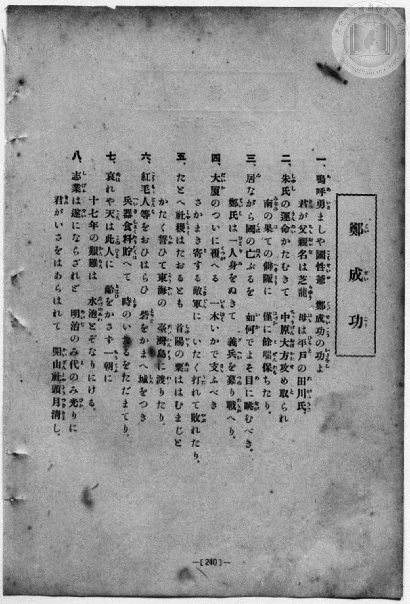
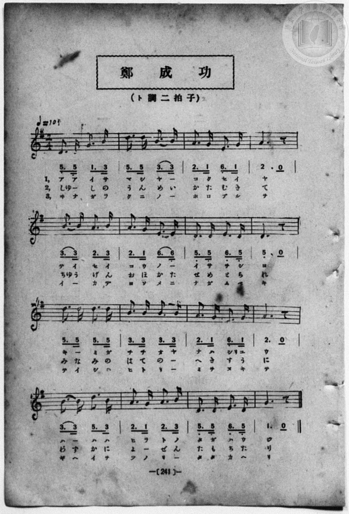

# 鄭成功

> Re:Shōka 使用 AI 協助辨識與重建樂譜，可能會有錯誤。歡迎回報。

<audio controls src="teiseiko.mp3"></audio>

- 一條慎三郎 編《新編 小學校・公學校 唱歌教材集》（大正十二年十二月，索書號 0725-41）
- 臺灣總督府《公學校唱歌》第五學年用（昭和十一年，索書號 523.37 4322-4）

## 說明

原書資訊與歌詞全文（對應 P028.jpg–P031.jpg，原書 pp. 24–27）：
調性與拍號：ト長調（G 大調，1 升記號）2/4 拍，速度 ♩=108


## 跨冊／重複收錄參照

> 同曲（〈鄭成功〉；收錄於《公學校唱歌》第五學年、《新定兒童唱歌》第五學年與《唱歌帖》P217《小公學校唱歌教材集》簡譜草稿）

- **[同曲]** 《公學校唱歌》第五學年用（昭和13年／1938）：[**〈鄭成功〉**](../../../kogakko_shoka/grade_5/10_teiseiko/index.md)（`G` / `2/4` — [原始 TMD](../../../kogakko_shoka/grade_5/10_teiseiko/teiseiko.tmd)）
- **[同曲]** 《新定兒童唱歌》尋常科第五學年用（2020.006.0847.0005）：[**〈鄭成功〉**](../../../shintei_jido_shoka/grade_5_2020.006.0847.0005/4_06_teiseiko/index.md)（`G` / `2/4` — [原始 TMD](../../../shintei_jido_shoka/grade_5_2020.006.0847.0005/4_06_teiseiko/teiseiko.tmd)）
- **[同曲]** 楊金土手抄《唱歌帖》第 10 冊・X（2020.006.0843）：[**〈鄭成功 (鄭成功 - 未完成草稿)〉**](../../../shokacho/vol_10/p217_teiseiko/index.md)（`G` / `2/4` — [原始 TMD](../../../shokacho/vol_10/p217_teiseiko/teiseiko.tmd)）
- 總表：[跨冊重複與同名歌曲總索引](../../../duplicate_songs.md)

## 歌詞

```text
一
あゝ勇ましや、國姓爺（こくせんや）。
鄭成功のいさをしよ。
君が父親名は芝龍（しりゅう）、
母は平戸（ひらど）の田川氏（たがはうぢ）。

二
朱氏（しゅし）の運命かたむきて、
中原（ちゅうげん）大方攻め取られ、
南のはての僻陬（へきすう）に、
僅に餘喘（よぜん）たもちたり。

三
居ながら國のほろぶるを
如何でよそ目にながむべき。
鄭氏はひとり身をぬきて、
義兵をつのり戰へり。

四
大廈（たいか）のつひにくつがへる、
一木いかでさゝふべき。
さかまきよする敵軍（てきぐん）に、
いたく打たれてやぶれたり。

五
たとへ社稷（しゃしょく）はたふるとも、
首陽（しゅやう）の粟（あは）ははむまじと、
かたくちかひて東海の
臺灣島にわたりたり。

六
紅毛人（こうまうじん）らをおひはらひ、
砦（とりで）をかまへ、城をつき、
兵器食料たくはへて、
時のいたるをたゞまてり。

七
あはれや天はこの人に
齡（よはひ）をかさず、一朝に
十七年のかんなんは、
水のあわとぞなりにける。

八
志業（しげふ）はつひにならざれど、
明治の御代の御光に、
君がいさをはあらはれて、
開山社頭（かいざんしゃとう）月きよし。
```

## ABC

```abc
X:1
T:鄭成功
M:2/4
L:1/16
Q:1/4=108
K:G
V:V1 name="Piano" snm="Pia"
[V:V1]
!mf! D3 D G3 B | d3 d B3 B | A3 G E3 G | A6 z2 |
w: 1.~ア ア イ サ | マ シ ヤ _ | コ ク セ ン | ヤ
w: 2.~しゅ _ し の | う ん め い | か た む き | て
w: 3.~ヰ ナ ガ ラ | ク ニ ノ _ | ホ ロ ブ ル | ヲ
w: 4.~た い か の | つ ひ に _ | く つ が へ | る
w: 5.~タ _ ト ヘ | シャ ショ ク ハ | タ フ ル ト | モ
w: 6.~こ う ま う | じ ん ら を | お ひ は ら | ひ
w: 7.~ア ハ レ ヤ | テ ン ハ _ | コ ノ ヒ ト | ニ
w: 8.~し げ ふ は | つ ひ に _ | な ら ざ れ | ど
B3 B A3 B | A3 G E3 E | D3 D E3 D | D6 z2 |
w: 1.~テ イ セ イ | コ ウ ノ _ | イ サ ヲ シ | ヨ
w: 2.~ちゅ う げ ん | お ほ か た | せ め と ら | れ
w: 3.~イ カ デ _ | ヨ ソ メ ニ | ナ ガ ム ベ | キ
w: 4.~い ち ぼ く | い か で _ | さ さ ふ べ | き
w: 5.~シュ ヤ ウ ノ | ア ハ ハ _ | ハ ム マ ジ | ト
w: 6.~と り で を | か ま へ _ | し ろ を つ | き
w: 7.~ヨ ハ ヒ ヲ | カ サ ズ _ | イ ッ テ ウ | ニ
w: 8.~め い ぢ の | み よ の _ | み ひ か り | に
!f! d3 d d3 d | B3 B B3 B | A3 G E3 G | A6 z2 |
w: 1.~キ _ ミ ガ | チ チ オ ヤ | ナ ハ シ リュ | ウ
w: 2.~み な み の | は て の _ | へ き す う | に
w: 3.~テ イ シ ハ | ヒ ト リ _ | ミ ヲ ヌ キ | テ
w: 4.~さ か ま き | よ す る _ | て き ぐ ん | に
w: 5.~カ _ タ ク | チ カ ヒ テ | ト ウ カ イ | ノ
w: 6.~へ _ い き | しょ く れ う | た く は へ | て
w: 7.~ジ フ シ チ | ネ ン ノ _ | カ ン ナ ン | ハ
w: 8.~き _ み が | い さ を は | あ ら は れ | て
!mf! B3 B d3 B | A3 G A3 B | D3 D E3 D | G6 z2 |
w: 1.~ハ _ ハ ハ | ヒ ラ ド ノ | タ ガ ハ ウ | ヂ
w: 2.~わ づ か に | よ _ ぜ ん | た も ち た | り
w: 3.~ギ ヘ イ ヲ | ツ ノ リ _ | タ タ カ ヘ | リ
w: 4.~い た く う | た れ て _ | や ぶ れ た | り
w: 5.~タ イ ワ ン | タ ウ ニ _ | ワ タ リ タ | リ
w: 6.~と _ き の | い た る を | た だ ま て | り
w: 7.~ミ _ ヅ ノ | ア ワ ト ゾ | ナ リ ニ ケ | ル
w: 8.~か い ざ ん | しゃ と う _ | つ き き よ | し
```

## TMD 檔案連結

- [主旋律 TMD 檔案](teiseiko.tmd) [[在 TMD Studio 編輯](https://tmdlang.github.io/Tmd-TS/#tmd=s7IKdvYPcrWy4qpTUCpJTLdSSM7PyUlNLsnMz7MqzsjPTozPrsyvSsyML84ojTe0NDJWgqssy88pzU21Si9KTEmNN403Q8gU55cWJadaFSdn5OfnxJekVpQk5edno8vHFySmp1oFGJlYIGQKivLLUvMS84C6C4oy80pSU8DaEQpSyzJTUkHSqSmZJflFmYk5SA5KLSoGuxtifElRYl5xclFmAcgzCFX5RSUZ-UBHF2RUWmVkFoMMSU7Mic9OzEtEKCrJSAV6DSJdqcSlpaXwsmXts44JT7vmK2hpcSnaKhgaWHDZ2yq4c9kY6ZvYgTQ-2dHwbNHcZ619T3Z0vmzuU3i-fcXjhq5n0zYAGQpPN_Q_Xbvj2YKFj5t3P21dA2ErPJ2y8dnanmdTZz6bO-Hl7LbHDd3v93Q8XbL82drFT3sbn-zqebpzC4TxbE7H-z09z7csejZ7x4uZ8xUMzI1MdU0M3-_pBDv6Rfuu542Ln-_Y-3zu4qe75gDthVsCsQNo9PM1a57smgIUBBr6fMoKoE3PZqx9OqkHZMGOBqAgigWmRsZ6xuYKJsZGRromYGu49LUUbKkFuBQUFJ72zQdZtrn9xYquFx3tQFe-WDnvaeuKZ9PaQcGwofdZe6dCgIGRhV5WQfqjhskBBsaGICbQnRCtCgUFegpGJkApI3OgE9_vmQUy9sWq_c8aloMM7O4F-gQo-ri54-XU7UBxoLHuCsDwBTN7DBWe9gLtngFW1AmMRgWgDqD4y4b5T3ctU3g0c6UtKJZBZgIDCEQ9bmx63DT3aXf748Z9jxunP25qedzQ-HRO99Plk5937AKa_rhx8uPG_seNsx83TQbKAo193NAE0glPPo8b1z1ubHncOPVx0ySwER1QFU8nzH7c2PO8Y9uLZaueTuh93Lj-Rdfcl_uADgKaClTX9bip9XFjG9jIRpCGZ-tBip7u3PysYwdY0abHTZ2PG1eCVDSuez5lw9Ptc59t6AdLAa3tASoG6n_cuAjqKrC_dvWAjZqzEaYSaBPQmukQQ142dj-duPdxYzfIhKaGx41AG5dBrX-yYy0wFsB6FkKc9rhxEtDbQJ2gFDxt57Mpux83NT7tnwZyVhMwBYK1Pe2dDg4CoFuWARlPm3e_nLkGbMoOsPEzoX5sXA3T0Aw0e_XLJTOeTpsBUgcMsMY5EHvArmoC2Q9idME9taMTrHEjUOMqkMebOoFxBLYV6CKgHdseN3UDgx-saFnTk71THzcuB5s79_lsoKLVMG1AD-8EOQoRhRuAcQt0-abHjSuAFr7YtRoci2tQAub5vpVPW7eCJZaALG3qetaxAeQ9hAufzp4NppYsf7obmK8hEQRMFMDsDwp2sEagHUCHAO0DsoFxB9TeDQ_5hmdzVkA0gFwOSktzHzduRXEtSBQkDUynvWC_zQQa8Gzq1he7ISkKGPhAN0-ABSQstMGmAh3T_6wTmJKBoQq0ehkonYMCDchGCeddUyBagOqBztnxfMm-5yu2w1JRM5gE5hRgugJaAAw1oDJgsADdBAy7Jqh9L5dNezlzLyLlgWyCxP-655sgqQsYwethRqwHRwrQTzNApsCcDE6eoKACJgQgGxhyy57N3fhs63agKeASAVw6Pt28DeTPJqA6sC9Q_PK0dS047ra0Pls_-8kueF4GJmqgbUByBjSkQGkZGLNA7UBrgM4BumsTLOIXLANrAyUNYLyAVQOVQiJhB6ikmN8HSxbAaIKk7tatT2eueLl4_rNpwJQP8QXQn8C8AEtOz2YCAwBSZgAdDEq3YMY8sKnAqEFK9s2wMgrkMGD6bXm6ZCXYOKBH1gE9BfQ-OMz3LoRlJFBaRnInMMnMAloLTmDAFAVWDa4emoHVA9gVQPuBhq0Ck-thLtwAkQOWjUDXA1MC0G1AFcAwACbgieB0CwtkiIn7pz9buhYa58Ayo3ErLHrhyR6oHSgCLDmASW4lzJoZfc827QaVGfsWPtm9GMJ42opcVICLUKTiFWgk0FFgsyEJGZropnU_3bgRmFxfLoA4A-h1oB6gdUBfQZIu0BegZAisdmH5Zzo0Y1Fe90GBgpY-F1dIamZxamZ2vlVAZmJevkONQU01yBIFG0MzLTswC1utqwCqy3c0vFjYo6BhAmpbPF_foAOvKjWxaADaBTKsRqE6N61WwTReQRcIgZQhmGEMlDCFCAHZMBEjMMtQwQyi2hAuBIEGQFwDNtXHsEbhcdMisCiIfty0BMreCtTzuHkelLcdyIbIAHUC-Zuh4uuBeDeE3bwZrAOmCgRBtkPtMQLKgcsJqBSQA6XXgbQ1tkENnAzEjVCZFrBMN5Q3HyjTAGX3gmWWYbfKGOSMDVBHdQF1rYGyV4Kdvh7K6wbiPoSXmmdDxdcC8TQoezVYZhN2e0xAbpgPdyvCpRAfQQOycRMQr0bY09gPFV8CxD1Q9g6wyyD6MewxBcnth4VbcweUngHWs_1x82Jo0AGZy5H81w-Wh-h73DwV7BuYCSBfQSIdwzYzkBsnQ93VBsT74GyQzAyoZaB46oSyJ4FlupD8C3UDUAVIBkf4mSMlPaBrHzfD4mkJ2H3QFAFMViBZePjBkh4w7h43T0LxEY7wswAnPajrJgHxVih7Pd54WgX3A7B8gbJ7wDIrMezBn9139ZCT3WG5GZJxseRqIAXM-_DyACoKZMFFIRAtt8MCFpjT4XkXyEbO1ctQswZSmQDLDKASAWTWCuxBDs7toLYlNGxB6QgaV8CUg5xadqPkcJAMNB8CSwFgWQ6PA5AzILkFwzJQfoc7cTXQUe0Ip0Md-LhpL5C9EMIGphOQDNQFwNLhcfMCqMxMsD1rsdsDzu8tULcuBOI9UDY4p8FlgOVK43KECxqnQsWBORCe8naCZXqx2wPO78DMvBTqKFA8QYo6UKygZxqkrAFlg7yDKLnBRQu00MCwCpzZYUEELCqhDodlaVjE7AMXUQgvQTNTUy9YJUQNOAXh8hIoq8OiAuxqWMbdBPYPtGACpa-mXQh7YJHa3IyUapcRyupI1QewxwRlQ4pkaGHY1AEWQfgHKg4uAqB-BoYGSAZWICDsIVCzd2JmdUvCNTuoYgfbYQqnEQUA2dX6Wqj442ZoLQVM66DAgwYQkH7cBC3loGUuNE-AogiYwSHsVaCUCDIOR3ULzuuwEFyFxIaEObQqAFbWqGEOSU-gFAPs4EDZkCoGM8wR1Tpy2QVzIDj7IVUFQCcj7IF5HZjSHjdDq1tgwCDMwrAHnM1hmRaUmWEVILjRAUw7EN5MpAobpAOaQ8H-mQC1B1LU4fAPOJvD5OAVNbD6RooicHEG8xk4dGDVP6iMhucbSOTBSmw0e8B5HJZ7EcUUpAkF6udBBUBxDmuPQCIC1rYBysCjEVyc4Gp5gWt0aMSCWhzwKGoEO7AXygPV6MjVC6xdAhKHpUBIYxJWuKHZA67RIaaB3ARLcJDaGeZBkP2wwglS0zdBgwtUo8NaKBA9mP7Bm82BgwBkZXNQAx6WmyH5HDlXIyp67JU6pMEPgeh1OiygEHUAaq5YCcTQ5hq0DoGlN1D1B9UDLVshwYQR6KB83gRrvC5Fqh3AjWRovgDx50BNg6R-WNHTBGRDK2BIRQ8sYbHaA67OISUFqJGLqAXAdUUzNHrBzT-kfA73z36kBAVuIsNVodmDUp0DOxfwhjlK4gcmEETyANkD07ENKbvg9Q9S8x1cbjXDGujgJA6XAeZneK0GcjUsgQL9A_UBiI3HP0h1OSR_Q2hIKYzkT2ipBavjYZkc2GaAl3TgdIDLP-C6HKIL5AtoEw-tZQLsF8JLqn0oVQuwhoD683HTRrAMjvIRnMlhaQxUl8Ma4ZB0BersQyVXgCMNHnTwFn0vIhiAyROsCcOqWi4uXTsFWF9eAchW5gIA)]
- [鋼琴伴奏 TMD 檔案](teiseiko_piano.tmd) [[在 TMD Studio 編輯](https://tmdlang.github.io/Tmd-TS/#tmd=s7IKdvYPcrWy4qpTUCpJTLdSSM7PyUlNLsnMz7MqzsjPTozPrsyvSsyML84ojTe0NDJWgqssy88pzU21Si9KTEmNN403Q8gU55cWJadaFSdn5OfnxJekVpQk5edno8vHFySmp1oFGJlYIGQKivLLUvMS84C6C4oy80pSU8DaEQpSyzJTUkHSqSmZJflFmYk5SA5KLSoGuxtifElRYl5xclFmAcgzSlxaWgovW9Y-65jwtGv--z0dL2fPfNbZ_bJ7z_MJW57s2fJ0af_7PZ0KWlpcirYKhgYWXPa2Cu5cNkb6JnYg85_saHi2aO6z1r4nOzpfNvcpPN--4nFD17NpG4AMhacb-p-u3fFswcLHzbuftq6BsBWeTtn4bG3Ps6kzn82d8HJ22-OGbqCtT5csf7Z28dPexie7ep7u3AJhPJvT8X5Pz_Mti57N3vFi5nwFA3MjU10TQ6B7wH570b7reePi5zv2Pp-7-OmuOUB74ZZA7AAa_XzNmie7pgAFgYY-n7ICaNOzGWufTuoBWbCjASiIYoGpkbGesbmCibGRka4J2Bouz7ySonyrgMzEvPwgD4cag5pqLgUgsDE007IDs2oUqnPTahVM4xV0gRBIGYIZxkAJU4gQkA0TMQKzDKE0SASiGgINgLiGqxbFUh9kS01Q7TSMV4g2jAUZAmOYxgNZpvFQMQOIaSGpmcWpmdnU94UZRLUhXAjZGyBTfQxrFB43LQKLgujHTUug7K1APY-b50F524FsiAxQJ5C_GSq-Hoh3Q9jNm8E6YKpAEGQ71B4joFzj9MdNrVApIAdKrwNpa2yDGjgZiBuhMi1gmW4obz5QpgHK7gXLLMNulTHIGRugjuoC6loDZa8EO309lNcNxH0ILzXPhoqvBeJpUPZqsMwm7PaYgNwwH-5WhEshPoIGZOMmIF6NsKexHyq-BIh7oOwdYJdB9GPYYwqS2w8Lt-YOKD0DrGf74-bF0KADMpcj-a8fLA_R97h5Ktg3MBNAvoJEOoZtZiA3Toa6qw2I98HZIJkZUMtA8dQJZU8Cy3Qh-RfqBqAKkAyO8DNHSnpA1z5uhsXTErD7oCkCmKxAsvDwgyU9YNw9bp6E4iMc4WcBTnpQ100C4q1Q9nq88bQK7ofHjdD00NQDllmJYQ80h8IyIKLwQMuIQApUBIDZQAoqCmTBRSEQLYPCwgKYOeHZDchGzojLUFMzUjaGpV9QJgaZtQJ7KIEz6EJYBoVEPTR4gZGNHMG7UTIlSAaadYAZ93EjxHho1AMDDKtloCwKd-JqoKPaEU6HOvBx014geyGEDYxakAzUBcAM_bh5AVRmJtietdjtAWfRFqhbFwLxHigbnDngMsCioHE5wgWNU6HiwEwDTyw7wTK92O0BZ1Fg_lsKdRQoniClEyhW0NM5UmqGskHeQRS24NIAms8xrALnT1gQAUs3qMNhuRAWMfvApQrCS9D039QLVglRA05BuLwEyp2wqAC7GpbXNoH9Ay1LQOmraRfCHlikNjcjpdplhHInUon_uBEaUtBSFFp-NXWARRD-gYqDcy3Uz8DQAMnA8jDCHlj9Cao-wcKmcBqRZ8muPNdCxR83Q-sCYPIE-RfqJyD9uAlalkBLNmgyBoUqME9C2KtAiQdkHI5KDZw9YZ5ehcSGBBO0wAVWiajBBEkCoEh-3DgTyoYU5JjBhKg8kYsbmAPBOQapwAU6GWEPzOvAxPG4GVqpAQMGYRaGPeCcCctnoPwHq2bAVTswuiG8mUjVIkgHNFOB_TMBag-kdMLhH3DOhMnBq0NgJYkUReASCOYzcOjAKllQsQpP6pDIgxWyaPaAsyUswyFKFkhDBdjugRRwoIIHVijCIgLWggDKwKMRXALgat-A601oxILqdXgUNYId2AvlgepN5BoBVvuDxGEpENJkg5VHaPaA602IaSA3wRIcpA6EeRBkP6w8gdSnTdDgAtWbsHYARA-mf5BbtrAMCMma2Nvi2KtOzBY6ouaE-Q1R0qIm5JVADG3HQEtqWBIBVTJQPdASDOIzjHACZc0mWKtuKVIZDG49QpMyiD8HahokwcJKiyYgG1rNQapTYDmG1R5wpQnJ3KDWH6KsBZfIzdAYAbeLkLIm3D_7kdIAuO0IV4VmD0qlCWx1w1usKOkVGKeIGAXZA9OxDSmF4_UPUrsWXNQ0w1qu4FQJlwFmQXjdAXI1LE0B_QP1AYiNxz9INSYkS0JoSMGJ5E9oQQOrSWH5ElgzwwsncDrA5R9wjQnRBfIFtCGFVv8DO0zwwmUfSm0ALNSh_nzctBEsg6NIA-dLWBoD1Ziw1ikkXQELm2ao5ApwpMGDDt7U7UUEAzB5gjVhWIXRLSW9n2sGxBAWqJ8LUQ5SAOn-oqpAEkQoBtXYxBuN6hI0QzH63Lp2CuBOvAKQAfNotA9QKwrfCI1vjMY3QeObovHN0PjmaHwLMF-ZCwA)]

## 分析

```text
================================================================================
📊 TMD Song Profile: [ 鄭成功 ]
================================================================================
⏱  Duration:       0:17 (17.8s), 16 measures total
🎼 Key & Tempo:    首調基準 G, != 108.0 BPM, <2/4>
   - 分析範圍：      由實際發聲的音符與和弦推測調性；播放脈絡另行呈現
🎤 人聲音域:    D4 (MIDI 62) – D5 (MIDI 74) [跨度: 12 個半音 / 1.0 個八度, 難度: easy]
   - 最低音:  D4 in [Teiseiko #1 @ m.1, 0:00]
   - 最高音: D5 in [Teiseiko #1 @ m.2, 0:01]
   - 適合: soprano, mezzo-soprano, contralto, tenor, baritone, bass
🏛  結構:      Teiseiko (17.8s)
⚡ 編曲密度:        Peak 1 軌道同時演奏
🗝  調性診斷：       D 大調（純淨自然大調，未偵測到可信轉調）
   - 風格氣質:    純淨自然大調（陽光明朗、易唱易記，無明顯調外色彩）
   - 轉調歷程:    全曲維持單一推測調性（未偵測到可信轉調）
   - 核心骨幹音:  D, A, B, E, G
   - 調性數值:    D 大調 [相關度: 0.85, 穩定度: High, 自然音純度: 100.0%]
   - 候選調性 (K-S): D 大調 (0.85), G 大調 (0.65), B 小調 (0.63)
   - 五度圈歷程:   +2
   - 各段落調性細節:
     • [Teiseiko #1]: D 大調 (r: 0.85, 自然音純度: 100.0%)

  [ 五度圈游移軌跡 ]
               C  
         F            G  
      Bb              [D ]*
      Eb               A  
         Ab           E  
            Db       B  
               F# 
     (* = active key center)

  [ 十二半音累積音高分佈 ]
     C  :                            0.0%
     C# :                            0.0%
     D  : ████████████████████████  29.2%
     D# :                            0.0%
     E  : ███████████               13.3%
     F  :                            0.0%
     F# :                            0.0%
     G  : ██████████                12.5%
     G# :                            0.0%
     A  : █████████████████████     25.0%
     A# :                            0.0%
     B  : ████████████████          20.0%
--------------------------------------------------------------------------------
Assignment 軌道音域：
  - Piano         : D4 – D5 (12 個半音 / 1.0 個八度, 52 個音符)
================================================================================
```


## 原書掃描頁






