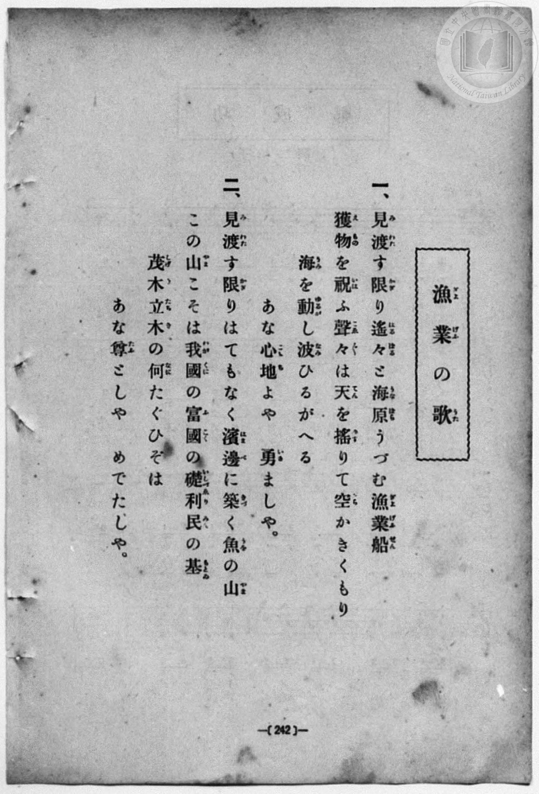
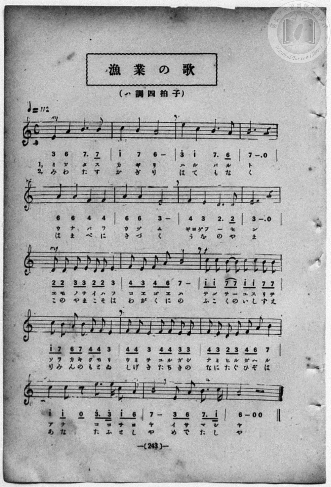

# 漁業の歌

> Re:Shōka 使用 AI 協助辨識與重建樂譜，可能會有錯誤。歡迎回報。

- **NEUTRINO 歌聲合成版**：<br><audio controls src="gyogyo_no_uta_neutrino.mp3"></audio>
- **鋼琴伴奏版**：<br><audio controls src="gyogyo_no_uta.mp3"></audio>


- book: 新編 小學校・公學校 唱歌教材集（尋常科五・六學年用）
- 一條慎三郎 編《新編 小學校・公學校 唱歌教材集》（大正十二年十二月，索書號 0725-41）

## 說明

> [!NOTE]
> **原書資訊與歌詞全文**（對應 `P250.jpg`–`P251.jpg`，原書 p. 242–243，尋常科五・六學年第 10 首）：
> - **調性與拍號**：ハ調四拍子（A 自然小調／羽調式 4/4 拍，譜號無升降記號，終止於 `6` La），速度 ♩= 112
> - **版面校勘**：全 16 小節，五線譜與簡譜逐音核對完全一致。
>
> **一、**
> 見渡（みわた）す限（かぎ）り遙々（はるばる）と　海原（うなばら）うづむ漁業船（ぎよげふせん）
> 獲物（えもの）を祝（いは）ふ聲々（こゑごゑ）は　天（てん）を搖（ゆす）りて空（そら）かきくもり
> 海（うみ）を動（ゆるが）し波（なみ）ひるがへる　あな心地（こゝち）よや　勇（いさ）ましや。
>
> **二、**
> 見渡（みわた）す限（かぎ）りはてもなく　濱邊（はまべ）に築（きづ）く魚（うを）の山（やま）
> この山（やま）こそは我國（わがくに）の　富國（ふこく）の礎（いしずゑ）利民（りみん）の基（もとゐ）
> 茂木立木（しげきたちき）の何（なに）たぐひぞは　あな尊（たふ）としや　めでたしや。


## 歌詞

```text
（TMD 檔案未包含歌詞註解）
```

## ABC

```abc
X:1
T:漁業の歌
M:4/4
L:1/16
Q:1/4=112
K:C
V:V1 name="Piano" snm="Pia"
[V:V1]
!mf! E4 A4 B6 B2 | c4 B4 A8 | e4 c4 B6 A2 | B12 z4 |
w: 1.~み わ た す | か ぎ り | は る ば る | と
w: 2.~み わ た す | か ぎ り | は て も な | く
A4 A4 F4 F4 | A4 A4 E8 | F4 E4 D6 D2 | E12 z4 |
w: 1.~う な ば ら | う づ む | ぎよ げふ _ せ | ん
w: 2.~は ま べ に | き づ く | う を の や | ま
!mf! D2 D2 E2 E2 D2 D2 E4 | F2 E2 F2 A2 B8 | !f! c2 c2 B2 B2 c2 c2 B2 B2 | c2 B2 A2 B2 F2 F2 E4 |
w: 1.~え も の を い は ふ | こ ゑ ご ゑ は | て ん を _ ゆ す り て | そ ら か き く も り
w: 2.~こ の や ま こ そ は | わ が く に の | ふ こ く の い し ず ゑ | り み ん の も と ゐ
F2 F2 E4 F2 F2 E2 E2 | F2 E2 D2 E2 F2 A2 B4 | !f! c4 c2 z2 e3 e c3 A | B8 E2 A2 B3 c |
w: 1.~う み を ゆ る が し | な み ひ る が へ る | あ な こ こ ち よ | や い さ ま し
w: 2.~し げ き た ち き の | な に た ぐ ひ ぞ は | あ な た ふ と し | や め で た し
A8 z4 z4 | !mf! E4 A4 B6 B2 | c4 B4 A8 | e4 c4 B6 A2 |
w: 1.~や | み わ た す | か ぎ り | は る ば る
w: 2.~や | み わ た す | か ぎ り | は て も な
B12 z4 | A4 A4 F4 F4 | A4 A4 E8 | F4 E4 D6 D2 |
w: 1.~と | う な ば ら | う づ む | ぎよ げふ _ せ
w: 2.~く | は ま べ に | き づ く | う を の や
E12 z4 | !mf! D2 D2 E2 E2 D2 D2 E4 | F2 E2 F2 A2 B8 | !f! c2 c2 B2 B2 c2 c2 B2 B2 |
w: 1.~ん | え も の を い は ふ | こ ゑ ご ゑ は | て ん を _ ゆ す り て
w: 2.~ま | こ の や ま こ そ は | わ が く に の | ふ こ く の い し ず ゑ
c2 B2 A2 B2 F2 F2 E4 | F2 F2 E4 F2 F2 E2 E2 | F2 E2 D2 E2 F2 A2 B4 | !f! c4 c2 z2 e3 e c3 A |
w: 1.~そ ら か き く も り | う み を ゆ る が し | な み ひ る が へ る | あ な こ こ ち よ
w: 2.~り み ん の も と ゐ | し げ き た ち き の | な に た ぐ ひ ぞ は | あ な た ふ と し
B8 E2 A2 B3 c | A8 z4 z4 |
w: 1.~や い さ ま し | や
w: 2.~や め で た し | や
```

## TMD 檔案連結

- [主旋律 TMD 檔案](gyogyo_no_uta.tmd) [[在 TMD Studio 編輯](https://tmdlang.github.io/Tmd-TS/#tmd=s7IKdvYPcrWy4qpTUCpJTLdSSM7PyUlNLsnMz7MqzsjPTozPrsyvSsyML84ojTe0NDJWgqssy88pzU21Si9KTEmNN403Q8gU55cWJadaFSdn5OfnxJekVpQk5edno8vHFySmp1oFGJkaIGQKivLLUvMS84C6C4oy80pSU8DaEQpSyzJTUkHSxcmJefFlqUWZaZmpKUiOSi0qBrsdYkVJUWJecXJRZgHIQwhV-UUlGflAhxdkVFplZBaX5BdlJifmxGcn5iUiFJVkpAK9l5-cXFqQiKodIlOeWJJahGxmZnpmnlVpHsiBJVBnaWkpPNvT-Gzp2seN656t7VHQ0uJStFUwNDTisrdVcOayMdE3sQOZAAofK4Vn0zY8375C4emG_qdrdzxbsPBx8-6nrWsgbIWnUzYCTXg2deazuRNezm57v6fj6Ybupzt2PF8-8cmuKWCla4FKn-7c8nzKivd7OsEue7Kj4dmiuc9a-57s6HzZ3KcANP5xQxcp9jxu6AZZtWT5s7WLn_Y2PtnVA7QBwng2p-P9np7nWxY9m73jxcz5CgbmRqa6JoZgu7n0tRRsqQW4FBQU7BSiFf38Q1xjIRwtrad980H2bm5_saLrRUc70M0vVs572rri2bR2LS1w6PQ-a-9USAAlML2sgvSERw2TQRxDMAfocIgBCgV6CkYmRkBJIxNjkCiuQF2zRsHQQOHlsmlA_73fMwviDF2gQ16s2v-sYTnICd29wGAAWT7rcXM_UPjp7NlAsadrJwCd46jwon3V85ZtwEAHyrzf0_98316Qkj39CsBEoABUB7T8xdo5QBOetyx82tv-cmbvixUzgFxQGG9terZ20bNpexQSzBIUfBLBTuh52TD_6a5lCo9mroQkKbiLnnd2vJy7CBiZT7tngJ0DDBYFQzNQhD9f3wDUCfTb8-2zQLZ1tD_fsBDIeNkw4eX8zc8W7AAG29N1PUANwKTzon3L44YmsLmwUAeKPm5oBCZjMP_Fsu5nOxYCffe4cf_jpv7HjUDHdj5unPlyJsjLjxu7Hzf2gUSaul42znzc0AoWXP-4CSi-AUiCFQMTZMOzrduBsQGWbXvcuAosC_QhUBbIXfq4qQGSiV507ASr6XvcBCQnPW7c-rhx9uOmyUCVEPc87930vHMlWE3H46YmYKYD2z7p-dK5YMEWoO1gY7e-aNwEc8_kx00THzdOAZJgqfVA9zxdAjFkGcRwoAnPJgDjHWgm0D0zIT4Cyj5fuQusbC7MtUB_9T5u7AdZ3dQFcRLQazB_AWMdZNTT7qlQo0Dh0APWOP3Z5kVgZUC_g5UBnQeWfdy4A8RoaHjcCPTOqqf7m5_O2QBz9tzHjcDAB5oJNK0F5Ozudpg3gVYADdkHNBkshRaJu3rIikRQ4IDCBOQSkDeBEbd_48umLmi0gqwDRhBQ7-rn64EBAhQEhsZSsEj_y7WzoOHQNAkssu7pxo3gcAC6dh88BkH-wpACCwI9u_5Zx8Snc0DlEdidwMABkqshpoG8v74HKgtKGEAt_RCp50uA7ocEy_THjbMgEf20Y-WzDUAG0Cigv4AeB0c00Or54DgF-XHF4yZgCEAd9qKn6dmcFc9XdwNJsGlAo4ApEOjB-cBYADIg2p_sBUcuKHwgDgPKTgDFZuM8SNKCxuMGSKABZbdCcwE0phoeNzU-blwOlkKKO8oLUShQ0NLn4nKvzE-vzPfLDy1JtArITMzLd6gxqKkG2aNgY2imBU4oCthKcAVgMQgqGBb2KGiYQMsTHQVYqaqJRQPQOpBhNQrVuWm1CsbA8gkEzaC0OZSGsWsUDOPQpGBKYbBGwRimBEMtTH0NiggyNICZAnaVj2ENMMXth4oBExWM1TgfSQ8wL4DNBGYFuEgfXE8XhvuAEQ2XRejYgGwiWBykcgUOd8ajutOIxu5sXAZX14Ri4iqoSpiNuN2JP83s6iEnzcDiHkaboNGYKmAJDOFLmFqYjBGSLIgNTE84_IYtrbRBxSAhA2HBYhZYC8BtRVa5FC7fgOE6SGUGVwqq07C4BFjNQVQ3TcbhVmzpBRG7--CsnXDWaiQ39GK6FSPGUfzUNAmubh2yO5taoCphNuJ2J4EyphOcXozJKGNAkQrCoGgFYWQ-xCOgJAHigWhQwkEvLIAGAc0Bly5gAiQPwpgiyEkDFIuQ7AMJFEggAasdMAmKDETkgtSDohJYF4HFpyCxYdGGHPCg7AmJfKSgbwJFByTTQ7I3RB1yEgDrgLoG4g5QxMDE56LYB0peoEgHVqxgEsIGJRPUSIa5CeQXmEkQtWB7oP6dDiZnwf1FIMKBTWVyIhweGbBoBEUpLHoRkY0sgswHYURygCUS9GSBHMngIAPnc0gpC8k70ACARD68pIXlGEjJjRFx4DoAFtig4AKpB5UqUPWNmzBU7YCLILkLFNHQ6IfYgxzpkOQIqmWAjRkkd0GiB5JAQT6A5GVQbQJszSD5C2QKwl2QxABRBTIN6sbGeWASnpAI1QVTyMrbsCwJgmAGqHyGtgWAFFTODEvlD4pURIQCFSLqDRiElfXYynxYjQgJBVAJBkn2EBoSXqDw7QBnIVDyR4awDDEVTELKRVD4Y1MLKx2xlebYXAGp_UFZEdaSwGUysFUJll2Ooo9YV9RycenaKSC1GhUwucpcAA)]
- [鋼琴伴奏 TMD 檔案](gyogyo_no_uta_piano.tmd) [[在 TMD Studio 編輯](https://tmdlang.github.io/Tmd-TS/#tmd=s7IKdvYPcrWy4qpTUCpJTLdSSM7PyUlNLsnMz7MqzsjPTozPrsyvSsyML84ojTe0NDJWgqssy88pzU21Si9KTEmNN403Q8gU55cWJadaFSdn5OfnxJekVpQk5edno8vHFySmp1oFGJkaIGQKivLLUvMS84C6C4oy80pSU8DaEQpSyzJTUkHSxcmJefFlqUWZaZmpKUiOSi0qBrsdYkVJUWJecXJRZgHIQwhV-UUlGflAhxdkVFplZBaX5BdlJifmxGcn5iUiFCUWATWnp-am5pVYFWQm5uXHJyYn5-cWJOZlgsQQCksygIqs8pOTSwsSUe2ByJQnlqQWKXFpaSk829P4bOnax43rnq3teb-n4-Xsmc86u19273k-YcuTPVueLu1_v6dTQUuLS9FWwdDQiMveVsGZy8ZE38QOZCIoDK0Unk3b8Hz7CoWnG_qfrt3xbMHCx827n7augbAVnk7ZCDT52dSZz-ZOeDm7DWjF0w3dT3fseL584pNdU8BK1wKVPt255fmUFUC7wC59sqPh2aK5z1r7nuzofNncpwA0_nFDFyn2PG7oBlm1ZPmztYuf9jY-2dUDtAHCeDan4_2enudbFj2bvePFzPkKBuZGpromhmC7uTzzSoryrQJAYRvk4VBjUFPNpQAENoZmWnZgVo1CdVqtgmGcgi4YghkGQGwMEQFSUDkzoFJzqCoYNAaL60LFgQprwFxkCDILma7hqkVxlQ-yq0xQHGUWH68QbRafG4vEqlEwBrGN4aJgFtBauAoDIARb4l6Zn16Z75cfWpKILwD0tRRs0YHC8zVrgHH2YmGPgoYJKIKer2_QUQDmI0O9rIJ0TSwatPRhDs8FuhwULpAwg9DI4QZi1yACHCaFHm5Aj6LECboxIPWYEYIe6jVgV_kY1ig8btwPFXvc1A9jNc5H0vO4cSbYzMeN3XCRPrieLgz3PW5cD5dF6NiAbCJYHKRyBQ53xqO604jG7mxcBlfXhGLiKqhKmI243Yk_zezqISfNwOIeRpug0ZgqYAkM4UuYWpiMEZIsiA1MTzj8hi2ttEHFICEDYcFi9nFTJ9xWZJVL4fINGK4DxtDjpg640kmPG7diccnjxtkQ1U2TcbgVW3pBxO4-OGsnnLUayQ29mG7FiHEUPzVNgqtbh-zOphaoSpiNuN1JoIzpBKcXYzLKGFCkgjAoWkEYmQ_xCChJgHggGlFKI3sVXvSDCZA8CGOKICcNUCxCsg8kUCCB9LgRFCSQyEBELkg9KCofN00Ei09BYsOiDTngQdkTEvlIQd8Eig5Ipodkb4g65CQA1gF1DcQdoIiBic9FsQ-UvECR_rixB0xC2KBkghrJMDeB_AIzCaIWbA_Uv9PB5Cy4vwhE-NPZs8mJcHhkwKIRFKWw6EVENrIIMh-EEckBlkjQkwVyJIODDJzPIaUsJO9AAwAS-fCSFpZjICU3RsSB6wBYYIOCC6QeVKpA1TduwlC1Ay6C5C5QREOjH2IPcqRDkiOolnncNAHJXZDogSRQkA8geRlUmzxuXIjkL5ApCHdBEgNEFcg0qBsb54FJeEIiVBdMIStv07k1hohzWI0ICQVQCQZJ9hAaEl6g8O0AZyFQ8keGsAwxFUxCykVQ-GNTCysdsZXm2FwBqf1BWRHWksBl8uOmRrDschR9xLoCW6MRV_sUVAQjGp2IRilyUxS52YpdLYINYoEartAWAVy1EZBhhMcEmDxCHS4zMVXCWMjm4Wx4Y3UZkiPATDQxkOEmcCHqNe117RTAXQgFIAMpxqJ9DGMxhIzAQspcAA)]

## 分析

```text
================================================================================
📊 TMD Song Profile: [ 漁業の歌 ]
================================================================================
⏱  Duration:       1:12 (72.9s), 34 measures total
🎼 Key & Tempo:    首調基準 C, != 112.0 BPM, <4/4>
   - 分析範圍：      由實際發聲的音符與和弦推測調性；播放脈絡另行呈現
🎤 人聲音域:    D4 (MIDI 62) – E5 (MIDI 76) [跨度: 14 個半音 / 1.2 個八度, 難度: moderate]
   - 最低音:  D4 in [GyogyoNoUta #1 @ m.7, 0:13]
   - 最高音: E5 in [GyogyoNoUta #1 @ m.3, 0:04]
   - 適合: soprano, mezzo-soprano, contralto, tenor, baritone, bass
🏛  結構:      GyogyoNoUta (36.4s) -> GyogyoNoUta (36.4s)
⚡ 編曲密度:        Peak 1 軌道同時演奏
🗝  調性診斷：       A 小調（純淨自然小調，未偵測到可信轉調）
   - 風格氣質:    純淨自然小調（陰鬱抒情、旋律集中，無明顯調外色彩）
   - 轉調歷程:    全曲維持單一推測調性（未偵測到可信轉調）
   - 核心骨幹音:  B, E, A, F, C
   - 調性數值:    A 小調 [相關度: 0.67, 穩定度: Moderate, 自然音純度: 100.0%]
   - 候選調性 (K-S): A 小調 (0.67), E 大調 (0.62), E 小調 (0.57)
   - 五度圈歷程:   +3 -> +3
   - 各段落調性細節:
     • [GyogyoNoUta #1]: A 小調 (r: 0.67, 自然音純度: 100.0%)
     • [GyogyoNoUta #2]: A 小調 (r: 0.67, 自然音純度: 100.0%)

  [ 五度圈游移軌跡 ]
               C  
         F            G  
      Bb               D  
      Eb              [A ]*
         Ab           E  
            Db       B  
               F# 
     (* = active key center)

  [ 十二半音累積音高分佈 ]
     C  : ██████████                11.0%
     C# :                            0.0%
     D  : ███████                    7.1%
     D# :                            0.0%
     E  : ████████████████████████  25.2%
     F  : ████████████              12.6%
     F# :                            0.0%
     G  :                            0.0%
     G# :                            0.0%
     A  : █████████████████         18.5%
     A# :                            0.0%
     B  : ████████████████████████  25.6%
--------------------------------------------------------------------------------
Assignment 軌道音域：
  - Piano         : D4 – E5 (14 個半音 / 1.2 個八度, 154 個音符)
================================================================================
```


## 原書掃描頁






