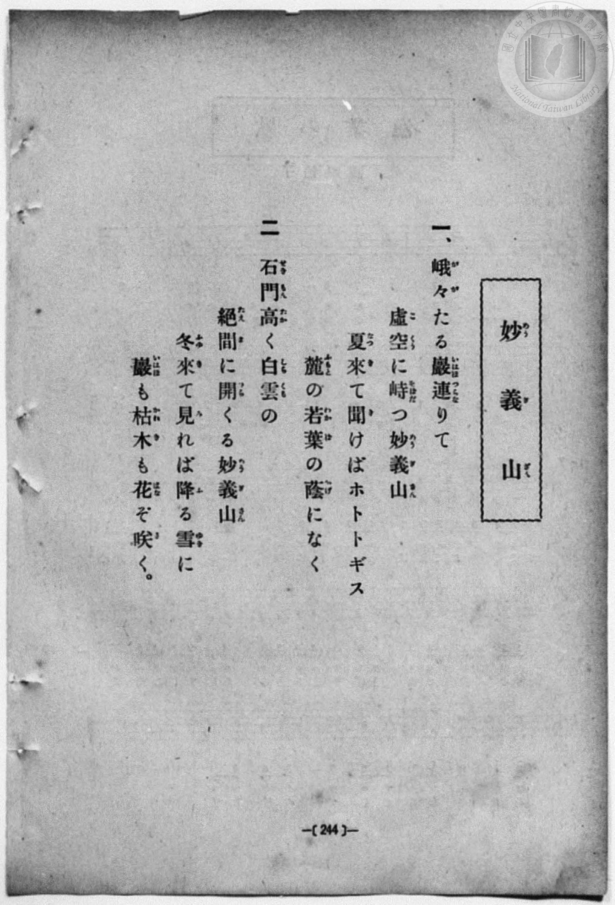
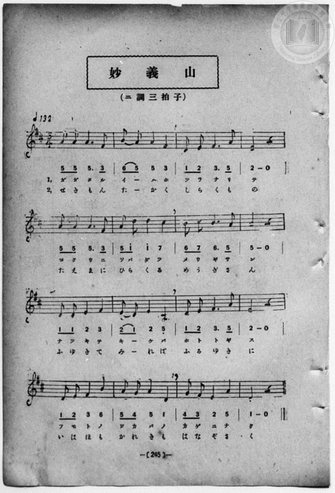

# 妙義山

> Re:Shōka 使用 AI 協助辨識與重建樂譜，可能會有錯誤。歡迎回報。

<audio controls src="myogisan.mp3"></audio>

- 詞：文部省《尋常小學唱歌》
- 曲：文部省《尋常小學唱歌》
- book: 新編 小學校・公學校 唱歌教材集（尋常科五・六學年用）
- 一條慎三郎 編《新編 小學校・公學校 唱歌教材集》（大正十二年十二月，索書號 0725-41）
- 公學校《唱歌帳》第十冊（P216，原標 245 頁，昭和 2 年 2 月 9 日）

## 說明

> [!NOTE]
> **原書資訊與歌詞全文**（對應 `P252.jpg`–`P253.jpg`，原書 p. 244–245，尋常科五・六學年第 11 首）：
> - **調性與拍號**：ニ調三拍子（D 大調 3/4 拍），速度 ♩= 132
> - **版面校勘**：全 16 小節，五線譜與簡譜逐音核對完全一致。
>
> **一、**
> 峨々（がが）たる巖（いはほ）連（つらな）りて
> 虛空（こくう）に峙（そばだ）つ妙義山（めうぎさん）
> 夏（なつ）來（き）て聞（き）けばホトトギス
> 麓（ふもと）の若葉（わかば）の蔭（かげ）になく。
>
> **二、**
> 石門（せきもん）高（たか）く白雲（しらくも）の
> 絕間（たえま）に開（ひら）くる妙義山（めうぎさん）
> 冬（ふゆ）來（き）て見（み）れば降（ふ）る雪（ゆき）に
> 巖（いはほ）も枯木（かれき）も花（はな）ぞ咲（さ）く。


## 歌詞

```text
（TMD 檔案未包含歌詞註解）
```

## ABC

```abc
X:1
T:妙義山
C:曲：文部省《尋常小學唱歌》
M:3/4
L:1/16
Q:1/4=132
K:D
V:V1 name="Piano" snm="Pia"
[V:V1]
!mf! A2 A2 A6 F2 | B2 A2 A4 F4 | D2 E2 F6 A2 | E8 z4 |
w: が が た る | い _ は ほ | つ ら な り | て
A2 A2 A6 F2 | A2 d2 d4 c4 | B2 c2 B6 A2 | A8 z4 |
w: こ く う に | そ ば だ つ | め う ぎ さ | ん
!mp! D2 D2 E4 F4 | E2 D2 E4 A,4 | D2 E2 F6 A2 | E8 z4 |
w: な つ き て | き _ け ば | ホ ト ト ギ | ス
!mf! D2 E2 F4 B4 | A2 G2 A4 D4 | G2 F2 E4 A4 | D8 z4 |
w: ふ も と の | わ か ば の | か げ に な | く
!mf! A2 A2 A6 F2 | B2 A2 A4 F4 | D2 E2 F6 A2 | E8 z4 |
w: せ き も ん | た _ か く | し ら く も | の
A2 A2 A6 F2 | A2 d2 d4 c4 | B2 c2 B6 A2 | A8 z4 |
w: た え ま に | ひ ら く る | め う ぎ さ | ん
!mp! D2 D2 E4 F4 | E2 D2 E4 A,4 | D2 E2 F6 A2 | E8 z4 |
w: ふ ゆ き て | み _ れ ば | ふ る ゆ き | に
!mf! D2 E2 F4 B4 | A2 G2 A4 D4 | G2 F2 E4 A4 | D8 z4 |
w: い は ほ も | か れ き も | は な ぞ さ | く
```

## TMD 檔案連結

- [主旋律 TMD 檔案](myogisan.tmd) [[在 TMD Studio 編輯](https://tmdlang.github.io/Tmd-TS/#tmd=s7IKdvYPcrWy4qpTUCpJTLdSSM7PyUlNLsnMz7MqzsjPTozPrsyvSsyML84ojTe0NDJWgqssy88pzU21Si9KTEmNN403Q8gU55cWJadaFSdn5OfnxJekVpQk5edno8vHFySmp1oFGJkaIWQKivLLUvMS84C6C4oy80pSU8DaEQpSyzJTUkHSxcmJefFlqUWZaZmpKUiOSi0qBrsdYkVJUWJecXJRZgHIQwhV-UUlGflAhxdkVFplZBaX5BdlJifmxGcn5iUiFJVkpAK9l5dYUlqUii5akJOYDBTU0lJ4umzm830rn27cqKClxaVoq2BobMRlb6vgwmVjrG9iB9IG8ruVwrNpG55vX6HwdEP_07U7ni1Y-Lh599PWNRC2wtMpG5-t7Xk2deazuRNezm57v6fj6Ybupzt2PF8-8cmuKWCla4FKn-7c8nzKivd7OsHOebKj4dmiuc9a-57s6HzZ3KcANP5xQxcp9jxu6AZZtWT5s7WLn_Y2PtnVA7QBwng2p-P9np7nWxY9m73jxcz5CgbmRqa6JoYwu1-snPd-z6xn09pfNq94PqcRaC_EwRBrIdYATQerfTZ7E9Fq4U4FqQLLPN2xGSj5fM0aoLuetnUB3RtgZGgGdNvTvvnPVsxUMDIxVXi5oBEo8GzG2qeTehSMFICeAJJAHyhYKjybvhTsZi59LQVbagEuBQUFO4VoRT__ENdYCEdLC-QeYFhtbn-xoutFRzvQ6cBAetq6AuhxLS1wjPY-a-9USAAleL2sgvSERw2TQRxjMAfqodk7FAr0gH4yAUoCfQYSxZUQ1qxRMDRUeLlsGtB_wPCFOEMX6JAXq_Y_a1gOckJ3LzDqQJbPetzcDRQGJhSg2NO1E4DOcVEAxjtQTAGYTBWAomBTel42zH-6a5nCo5krISkZbujzzo6XcxcBI-Zp9wywiUCfKRiagdLZ8_UNQJ1A5z3fPuvF2jlAi59vWAhkvGyY8HL-5mcLgBHd-3RdD1ADMMW-aN_yuKEJbC4s4ICijxsagbkHzH-6GZiKW4EOfNzYA0RAZz1unP-4qfvpdqBHgYItjxvXP27cDRR_2bAYLLLkcRNQzSqQyqaux43LIOa8mDn7-cpdYAWTHzf2P24E5iqgstVPN88EC8593LjhceMCsOASeCYGSTU1AhU_bux73Dj1cdNkoAKow5b0gzWuAqoHCj7ZB8qmjxtBAQe09EUjMEPAuRNBhjfPftzcAUJN6x437YQY8nIX0ECgsq2Pm5oeN4Ky8uPGdS-6l76YCAx9oEqgO7uBeqHiU9aCFQNFJkEcD7a9HyMAdwHzDzwAn8_f_HIaMEaAGmcD3QOyCOyLl6tngAXnAw0Em9b_fObel6C8CRScDg7DfqBiiNVQo7ZOfTkN4mCgLiC5D-KMl9NA5cbjxk1AXRCjQBFETBi2rYF5HxQd6GG4DGLsfnBUAmN_w8uZQCmQerBI98vZwFgGGg40GaJlNdRYjLQB9MizeeufzQGGMDgAQaaBtTQ1vegCuxCkEpxmGuc9nQQJhKlQv0CCl_JiAgoUtPS5uHwr89MzixPzrAIyE_PyHWoMaqpBlijYWGiB41EBW_mkAMzkoDyzsEdBwwSa1XQUYGWGJhYNQKtAhtUoVOem1SqYgqEuEBoDhcygPGMgrlEwBBaRIJYuUKwGyAaxdBUMQHJgI3wMaxSA-Q-K54NlgVEAVAsMZxC7cT2Y3A02DZgngLKdQHoVVGUXWHQZ1Nx4hLlGIPHZQNwLVNUEVT0ZrBpkCzC2wGQ_1NzpUHNBfJDKJrDoOhRz8Qfgrh5yAhA17EwVDONASFfBHOwuMyBtBg89iDrM0JsMdjcwJ0Dc3rga7Pa5QLwBiBeAxZZA_NnUCFYHzDJQtVPBopNxhN98IO4A4n0oJm9CCitQXBFvMoEk2EleEiyoBSYzUEKDJTojKM8UbCuRaXAVJHUB0wvI9aAUBRKF8CaCyQ0QsWZgqmoGhgoQQ9LKOrBPd-IIw61AOVC4oJq7H6yzB9lcsMpusGpICPaCRVcTH4JPZ88mOxPDAgmU3EBJzQSc3AzBPBOgDDg8ocGJPQBBzm8C0ivAjgdlHVCwgBIm0FNgT8JFwSKToJ6DZGaQKCTzYQZhC7gYgBQCkMwMNQMYgNCAhYuC1IGich40EWIzuZaLS9dOAVZWRvsYxiqg8I3AfGUuAA)]
- [鋼琴伴奏 TMD 檔案](myogisan_piano.tmd) [[在 TMD Studio 編輯](https://tmdlang.github.io/Tmd-TS/#tmd=s7IKdvYPcrWy4qpTUCpJTLdSSM7PyUlNLsnMz7MqzsjPTozPrsyvSsyML84ojTe0NDJWgqssy88pzU21Si9KTEmNN403Q8gU55cWJadaFSdn5OfnxJekVpQk5edno8vHFySmp1oFGJkaIWQKivLLUvMS84C6C4oy80pSU8DaEQpSyzJTUkHSxcmJefFlqUWZaZmpKUiOSi0qBrsdYkVJUWJecXJRZgHIQwhV-UUlGflAhxdkVFplZBaX5BdlJifmxGcn5iUiFCUWATWnp-am5pVYFWQm5uXHJyYn5-cWJOZlgsQQCksygIqs8hJLSotS0UULchKTgYJaWgpPl818vm_l040b3-_peDl75rPO7pfde55P2PJkz5anS_vf7-lU0NLiUrRVMDQ24rK3VXDhsjHWN7EDGQcKPCuFZ9M2PN--QuHphv6na3c8W7DwcfPup61rIGyFp1M2Plvb82zqzGdzJ7yc3Qa04umG7qc7djxfPvHJrilgpWuBSp_u3PJ8ygqgXWBnPtnR8GzR3GetfU92dL5s7lMAGv-4oYsUex43dIOsWrL82drFT3sbn-zqAdoAYTyb0_F-T8_zLYuezd7xYuZ8BQNzI1NdE0OY3S9Wznu_Z9azae0vm1c8n9MItBfiYIi1EGuApoPVPpu9iWi1cKeCVIFlnu7YDJR8vmYN0F1P27qA7g0wMjQDuu1p3_xnK2YqGJmYKrxc0AgUeDZj7dNJPQpGCkBPAEmgDxQsFZ5NXwp2M5dnXklRvlUAKCEEeTjUGNRUcykAgY2Flh2YUaNQnZtWq2AI1GmsoKtgBsQ1CqYKJkCsCxQF8UyAMkZAFkikBiwGggYgHlctig0-yDaYoNkQrxBtGKsQbRILMgTKAWKg-VCOaTySlAHEcN_K_PTM4sQ8PD7Q11KwRQcKwIADppMXC3sUNExAieL5-gYdBWCmNdbLKkjXxKJBSx_ZsaZgCPKmMVDIDMoDBRAoACBBBQqQGnDAIIIDZISPYY3C48YeKJ4Pln3c1A1U-7ixBcRuXA8md4NNe9y4BCjbCaRXQVV2gUWXQc2NR5hrBBKfDcS9QFVNUNWTwapBtjxu7AaT_VBzp0PNBfFBKpvAoutQzMUfgLt6yAlA1LAzVTCMAyFdBXOwu8yANCiRQUIPog4z9CaD3f24sQ3i9sbVYLfPBeINQLwALLYE4s-mRrC6x419ULVTwaKTcYTffCDuAOJ9KCZvQgorUFwRbzKBJNhJXhIsAOVIUEKDJTojKM8UbCuRaXAVJHUB0wvI9aAUBRKF8CaCyQ0QsWZgqmoGhgoQQ9LKOrBPd-IIw61AOVC4oJq7H6yzB9lcsMpusGpICPaCRVcTH4JPZ88mOxOTW6YhAhDk_CYgvQLseFDWAQULKGECPQX2JFwULDIJ6jlIZgaJQjIfZhC2gIsBSCEAycxQM4ABCA1YuChIHSgq50ETITaTMYpKYopilNIXzAHJgIphCM80HsoFFcYQ_ShaYRxIwW0E5BkBeUCMVSskVWNagFr047WdgopE104BXFEpABmwkIr2Acqj8IFuB_KVuQA)]

## 分析

```text
================================================================================
📊 TMD Song Profile: [ 妙義山 ]
================================================================================
⏱  Duration:       0:43 (43.6s), 32 measures total
🎼 Key & Tempo:    首調基準 D, != 132.0 BPM, <3/4>
   - 分析範圍：      由實際發聲的音符與和弦推測調性；播放脈絡另行呈現
🎤 人聲音域:    A3 (MIDI 57) – D5 (MIDI 74) [跨度: 17 個半音 / 1.4 個八度, 難度: challenging]
   - 最低音:  A3 in [Myogisan[L1] #1 @ m.10, 0:13]
   - 最高音: D5 in [Myogisan[L1] #1 @ m.6, 0:07]
   - 適合: soprano, mezzo-soprano, contralto, tenor, baritone, bass
🏛  結構:      Myogisan[L1] (21.8s) -> Myogisan[L2] (21.8s)
⚡ 編曲密度:        Peak 1 軌道同時演奏
🗝  調性診斷：       A 大調（純淨自然大調，未偵測到可信轉調）
   - 風格氣質:    純淨自然大調（陽光明朗、易唱易記，無明顯調外色彩）
   - 轉調歷程:    全曲維持單一推測調性（未偵測到可信轉調）
   - 核心骨幹音:  A, E, D, F#, B
   - 調性數值:    A 大調 [相關度: 0.90, 穩定度: High, 自然音純度: 97.7%]
   - 候選調性 (K-S): A 大調 (0.90), D 大調 (0.77), F# 小調 (0.67)
   - 五度圈歷程:   +3 -> +3
   - 各段落調性細節:
     • [Myogisan[L1] #1]: A 大調 (r: 0.90, 自然音純度: 97.7%, 調外音: G)
     • [Myogisan[L2] #1]: A 大調 (r: 0.90, 自然音純度: 97.7%, 調外音: G)

  [ 五度圈游移軌跡 ]
               C  
         F            G  
      Bb               D  
      Eb              [A ]*
         Ab           E  
            Db       B  
               F# 
     (* = active key center)

  [ 十二半音累積音高分佈 ]
     C  :                            0.0%
     C# : ███                        3.4%
     D  : █████████████             17.0%
     D# :                            0.0%
     E  : ███████████████           20.5%
     F  :                            0.0%
     F# : █████████████             17.0%
     G  : ██                         2.3%
     G# :                            0.0%
     A  : ████████████████████████  31.8%
     A# :                            0.0%
     B  : ██████                     8.0%
--------------------------------------------------------------------------------
Assignment 軌道音域：
  - Piano         : A3 – D5 (17 個半音 / 1.4 個八度, 104 個音符)
================================================================================
```


## 原書掃描頁






