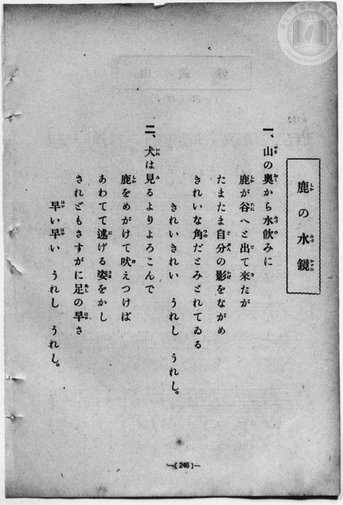
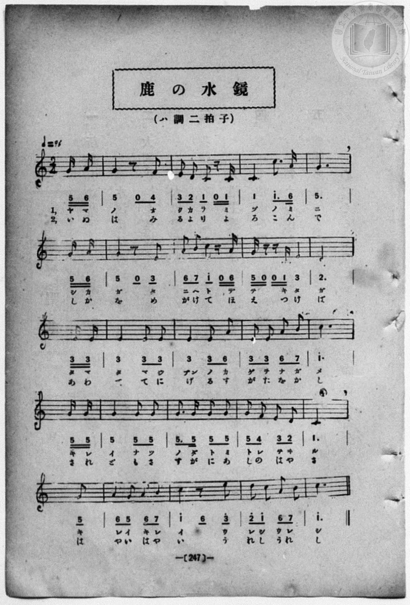

# 鹿の水鏡

> Re:Shōka 使用 AI 協助辨識與重建樂譜，可能會有錯誤。歡迎回報。

- **鋼琴伴奏版**：<br><audio controls src="shika_no_mizukagami.mp3"></audio>
- **NEUTRINO 歌聲合成版**：<br><audio controls src="shika_no_mizukagami_neutrino.mp3"></audio>

- book: 新編 小學校・公學校 唱歌教材集（尋常科五・六學年用）
- 一條慎三郎 編《新編 小學校・公學校 唱歌教材集》（大正十二年十二月，索書號 0725-41）

## 說明

> [!NOTE]
> **原書資訊與歌詞全文**（對應 `P254.jpg`–`P255.jpg`，原書 p. 246–247，尋常科五・六學年第 12 首）：
> - **調性與拍號**：ハ調二拍子（C 大調 2/4 拍），速度 ♩= 96，弱起拍（第 2 拍後半兩個十六分音符起唱）。
> - **版面校勘**：五線譜與簡譜逐音核對一致，僅兩處排版細微差異：
>   1. 第 15 小節（第四行第 3 小節）簡譜作 `5.5 5 5`（第 1 拍附點八分加十六分），五線譜第 1 拍無附點，依歌詞「のだとみ／すがにあ」與簡譜記為 `5 - - 5 5 - 5 -`。
>   2. 第 18 小節（第五行第 2 小節）簡譜作 `1^ 6_ 3^`（五線譜第 2 拍前半為八分休止符加八分音符 `3^`），第一節唱 2 音（「イ　ウ」）、第二節唱 2 音（「い　う」），依五線譜記為 `1^ - - - 0 - 3^ -`。
>
> **一、**
> 山（やま）の奧（おく）から水飲（みづの）みに
> 鹿（しか）が谷（たに）へと出（で）て來（き）たが
> たまたま自分（じぶん）の影（かげ）をながめ
> きれいな角（つの）だとみとれてゐる
> きれいきれい　うれし　うれし。
>
> **二、**
> 犬（いぬ）は見（み）るよりよろこんで
> 鹿（しか）をめがけて吠（ほ）えつけば
> あわてて逃（に）げる姿（さま）をかし
> されどもさすがに足（あし）の早（はや）さ
> 早（はや）い早（はや）い　うれし　うれし。


## 歌詞

```text
（TMD 檔案未包含歌詞註解）
```

## ABC

<div class="abc-score" data-abc-src="shika_no_mizukagami.abc" aria-label="五線譜載入中"></div>

[下載 ABC 原始檔](shika_no_mizukagami.abc)

## TMD 檔案連結

- [主旋律 TMD 檔案](shika_no_mizukagami.tmd) [[在 TMD Studio 編輯](https://tmdlang.github.io/Tmd-TS/#tmd=s7IKdvYPcrWy4qpTUCpJTLdSSM7PyUlNLsnMz7MqzsjPTozPrsyvSsyML84ojTe0NDJWgqssy88pzU21Si9KTEmNN403Q8gU55cWJadaFSdn5OfnxJekVpQk5edno8vHFySmp1oFGJmaIGQKivLLUvMS84C6C4oy80pSU8DaEQpSyzJTUkHSxcmJefFlqUWZaZmpKUiOSi0qBrsdYkVJUWJecXJRZgHIQwhV-UUlGflAhxdkVFplZBaX5BdlJifmxGcn5iUiFJVkpAK9l5iXmZuYgy6alpiUk4psXmZ6Zp5VaR7IcSVQJ2lpKbzcuf9x47pnG7a87F-ooKXFpWirYGnGZW-r4MxlY6RvYgcyABQ0VgrPpm14vn2FwtMN_U_X7ni2YOHj5t1PW9dA2ApPp2x8trbn2dSZz-ZOeDm77f2ejqcbup_u2PF8-cQnu6aAla4FKn26c8vzKSve7-kEO-zJjoZni-Y-a-17sqPzZXOfAtD4xw1dpNjzuKEbZNWS5c_WLn7a2_hkVw_QBgjj2ZyO93t6nm9Z9Gz2jhcz5ysYmBuZ6poYgu3m0tdSsKUW4FJQULBTiFb08w9xjYVwtLSe9s0H2bu5_cWKrhcd7UA3v1g572nrimfT2rW0wKHT-6y9UyEBlLb0sgrSEx41TAZxTMEcoMMhBigU6CkYmZgBJY1MzEGiuAJ1zRoFQyOFl8umAf33fs8siDN0gQ55sWr_s4blICd09wKDAWT5rMfN_UBhUBh19z5dOwHoHGcFYBgCxRSAUa4AFAWb0vOyYf7TXcsUHs1cCUoUIOv3bHyxdTtYvgNkpRFI7dN9PU97u562rnza0A0MepCbOtpezt_8fM0yoGJghAENe9zQhHDS886Ol3MXAWPzafcMsHuAnnm-fdaLtXOAzny-YSGQ8bJhAtCEZwt2AMMJmEpetG8B2d7cCrTlxcypz_omAc14vmXD033rnm5f93zqBriXFRQM9RTAoWEKSkHP1zdAnPp09uwXC3tAEsZw8U6IXU_2zlFIMNUzVQBCYMiDPWYI8tjLmS0vdwMjbTXQP0-7FsD9BgkcuKPh6p-3LIRoAcnumwuJ88cNPcD89bhxwePGFY8b97_f0_-4cebjRqDg6seNTY8beuF-frFixvOmXUCnAANJF-QYMKmbAA87BQUjqN8sUPwGdAnUb0ZY_WYYp2AWr2AcB_Iciqsh0dfZC4w-oM0Qjz7ZM_HZ2kXAuAP5GCwCiUqFBLABIJ-DrNzRALQGGLdAM4DyQINB_mxa8rih4XHTMqCvwHHeCHZcDxaVjS0glY3A_AtNasDwQqQCaEAA3Q0KCV0FAyA2BnLgQQHLZUBnAG0Bllpg_tONwKTW8bip5XHjPpD9jeueLl0OEmnsetzYDxbpftzUCSrrFm8CiwOLvqVAZWApIHs1xBxgkQiWnQ5UD5bqebFhO1hkPlANWGQHMDaftu8CCwKtAIose7IPVOo9bgR7HaSyB2IamL0PQr5oXwVOP0BlMx43bnvcNBnqzr1glwOd1zgJJNI06XHjKlAiaWqEGdL7uAkcbI2rXiwHqgEqXgJzOTRpgUiQmmWPmyY8burG0AhjQAIexJ6OykYL2109SGH7vGsN2FKgOUAG0NL1L5aBil5wkgY6GBiwwJDvApO9jxsnA70GDBns4Qn0XVMjOAtMBLr26YQFYNndYGMh_gKKb4C5v-lxEzDLLAOilw3NYJWQKAAa0v10OcTkqdAYB4UbMAynw_ROBXtt5eOmJrAaaL57sQ2cDIEmN06HhP-z6SvBIuuBiQcsMhViAoZ4C6YIgfCkvH6BAgUtfS6u4IzM7ES_fN_MqtLsxPTE3EyrgMzEvHyHGoOaapBtCjaGZlrgKFTAVsUpQApwUJEDzsPAYkNBA1braGJRD7QTZFYNOAvCsqKpghlQBFJMQURMgLgGWLIaAQtCA7CIIVgERIIgNCcja4OUcUARsAU-hjUK8VBREA0MXWD07QOqB8YOsnhjF9hgYH4G4m6guk6gOERmP1RmKVQ9TCdIBiS-GslmYPyA9UNtN0KzvRFk-xqwrvUo4lA7mkA2dwBxF8x2IA8i0wu3YTKEbpoMNmc5VttxxxSk6ARHkAm0VNdRICqqkCPGGOwqMwVzUBRAYsYMLGQK5hmCFYBgDTDuEA40BkJExABzDUogzIcG9Gog3gHEK-BRAPIkSGYZWARY5EBVQ2xAmAMJhPmQKIZHATD7ItvT1AjXBSwR4KaCdO6GynRA7VkCVoGwZwOKPU1As_oJBvaOTnICGxZ-IBoS2MgikLCGyYF45mAReM0GyQWmKIENCzBQ4IDIGVBPgaoLuBQoaYOSEEQKFG6Q0APWD2ASFNKgEAWFISIkgPHR1IMc4sAwhcmBWJBMAjMRknxBdgALRKg42ElQmyAy08EyCFsgqiH24A1xSJOM7OQNbR7BReANJqgIqEwChTooXSNKIphO5ABvgbsbEnZLoH6FFR8LwGkcuYgB84A-hIdb0wRoeIPCBDm84TaBQ3slPFSbUEJ1JlQ9KKWDYgCUZiEyoNCFxTaoKAIVjBAZkF6ETSA5gsUJqJlIcniDUi0oxLCkXli7DFR6gCiwBI5UDlKLFOjQwAN5BhJMEBHk6IBk9TZowELUQ4IDJIZQDxKDQZAe5AIFYj6ERA0-ym2p5eLStVPAqJEVcAkqcwEA)]
- [鋼琴伴奏 TMD 檔案](shika_no_mizukagami_piano.tmd) [[在 TMD Studio 編輯](https://tmdlang.github.io/Tmd-TS/#tmd=s7IKdvYPcrWy4qpTUCpJTLdSSM7PyUlNLsnMz7MqzsjPTozPrsyvSsyML84ojTe0NDJWgqssy88pzU21Si9KTEmNN403Q8gU55cWJadaFSdn5OfnxJekVpQk5edno8vHFySmp1oFGJmaIGQKivLLUvMS84C6C4oy80pSU8DaEQpSyzJTUkHSxcmJefFlqUWZaZmpKUiOSi0qBrsdYkVJUWJecXJRZgHIQwhV-UUlGflAhxdkVFplZBaX5BdlJifmxGcn5iUiFCUWATWnp-am5pVYFWQm5uXHJyYn5-cWJOZlgsQQCksygIqsQMKJOeiiaYlJOalKXFpaCi937n_cuO7Zhi0v-xe-39PxcvbMZ53dL7v3PJ-w5cmeLU-X9r_f06mgpcWlaKtgacZlb6vgzGVjpG9iBzIQFHxWCs-mbXi-fYXC0w39T9fueLZg4ePm3U9b10DYCk-nbHy2tufZ1JnP5k54ObsNaMPTDd1Pd-x4vnzik11TwErXApU-3bnl-ZQVQKvADn2yo-HZornPWvue7Oh82dynADT-cUMXKfY8bugGWbVk-bO1i5_2Nj7Z1QO0AcJ4Nqfj_Z6e51sWPZu948XM-QoG5kamuiaGYLu5PPNKivKtAkDBGuThUGNQU82lAAQ2Flp2YEaNgpmCKRCbA1mGcQq6CgYKxnFAtlEciIskDpKp4apFMdEHu4km8QrRJrEKpvFA2jQ-FmQCkGUYC6Pwq4BaE5yRmZ3ol--bWVWanZiemJuJxROGZlA79bUUbNGBwtM9G19s3f6io_35mjXACHixsEdBA5gLTPWyCtI1sajX0oe63wDsXZCHdcFhUwMkESImQFyjYKxgpGAI5INEDMEiIBIEoaGFrA0EwQaBLfAxrFGIh4qC6MdNLQqPG_cB1QPTLbJ4YxfY4MeN_UDcDVTXCRSHyOyHyiyFqofpBMmAxFcj2fy4cTpYP9R2IzTbG0G2rwHrWo8iDrWjCWRzBxB3wWwH8iAyvXAbJkPopslgc5ZjtR13TIEiaFcPOIJMQNnh-foGHQWiogo5YozBrgIlWWAUQGLGDCxkCuYZghWAIDB1IznQGAgREfO4sQclEOZDA3o1EO8A4hXwKAB5EiSzDCzyuLEXqhpiA8IcSCDMh0QxPAoeN01CtqepEa7rceNEuKkgnbuhMh1Qe5aAVSDs2YBiTxPQrH6Cgb2jk5zAhoUfiIYENrIIJKxhciCeOVgEmh9gucAUJbBhAQYKHBA5A-qpbaCkhJy0QUkIIgUKN0joPW5cBSZBIQ0KUVAYIkICGB9NPcghDgxTmByIBckkMBMhyRdkx-PGqVBxsJOgNkFkpoNlELZAVEPswRviT2fPpiR5g2gQhomAghFZBFQmgUIdlK4RJRFMJ3KAt8DdDQm7JVC_woqPBeA0jlzEgHlAH8LDrWkCNLxBYYIc3nCbwKG9Eh6qTSihOhOqHpTSQTEASrMQGVDowmIbVBSBCkaIDEgvwiaQHMHiZAo54Q1KtaAQw5J6wSUMiAOuG6HFPI5UDlKLFOjQwAN5BhJMEBHk6IBk9TZowELUQ4IDJIZQDxKDQZAe5AIFYj6ERA0-ym3BXSHjaAPA6lB4zU64NQCl0NsCEPOI1wORh1sHYiCMMQMJm8XnxiKxcIkag9jGcFEwC10tbgfidRDWRg8VG0-6dgrgZpoCkIERb9E-QLXYJYzAEspcAA)]

## 分析

```text
================================================================================
📊 TMD Song Profile: [ 鹿の水鏡 ]
================================================================================
⏱  Duration:       0:52 (52.5s), 42 measures total
🎼 Key & Tempo:    首調基準 C, != 96.0 BPM, <2/4>
   - 分析範圍：      由實際發聲的音符與和弦推測調性；播放脈絡另行呈現
🎤 人聲音域:    C4 (MIDI 60) – E5 (MIDI 76) [跨度: 16 個半音 / 1.3 個八度, 難度: moderate]
   - 最低音:  C4 in [ShikaNoMizukagami #1 @ m.3, 0:02]
   - 最高音: E5 in [ShikaNoMizukagami #1 @ m.19, 0:23]
   - 適合: soprano, mezzo-soprano, contralto, tenor, baritone, bass
🏛  結構:      ShikaNoMizukagami (26.2s) -> ShikaNoMizukagami (26.2s)
⚡ 編曲密度:        Peak 1 軌道同時演奏
🗝  調性診斷：       C 大調（純淨自然大調，未偵測到可信轉調）
   - 風格氣質:    純淨自然大調（陽光明朗、易唱易記，無明顯調外色彩）
   - 轉調歷程:    全曲維持單一推測調性（未偵測到可信轉調）
   - 核心骨幹音:  G, C, E, A, D
   - 調性數值:    C 大調 [相關度: 0.91, 穩定度: High, 自然音純度: 100.0%]
   - 候選調性 (K-S): C 大調 (0.91), E 小調 (0.76), G 大調 (0.74)
   - 五度圈歷程:   +0 -> +0
   - 各段落調性細節:
     • [ShikaNoMizukagami #1]: C 大調 (r: 0.91, 自然音純度: 100.0%)
     • [ShikaNoMizukagami #2]: C 大調 (r: 0.91, 自然音純度: 100.0%)

  [ 五度圈游移軌跡 ]
              [C ]*
         F            G  
      Bb               D  
      Eb               A  
         Ab           E  
            Db       B  
               F# 
     (* = active key center)

  [ 十二半音累積音高分佈 ]
     C  : █████████████████████     24.7%
     C# :                            0.0%
     D  : ██████                     7.5%
     D# :                            0.0%
     E  : ██████████████████        21.2%
     F  : ██                         2.7%
     F# :                            0.0%
     G  : ████████████████████████  28.1%
     G# :                            0.0%
     A  : █████████                 11.0%
     A# :                            0.0%
     B  : ████                       4.8%
--------------------------------------------------------------------------------
Assignment 軌道音域：
  - Piano         : C4 – E5 (16 個半音 / 1.3 個八度, 126 個音符)
================================================================================
```


## 原書掃描頁






