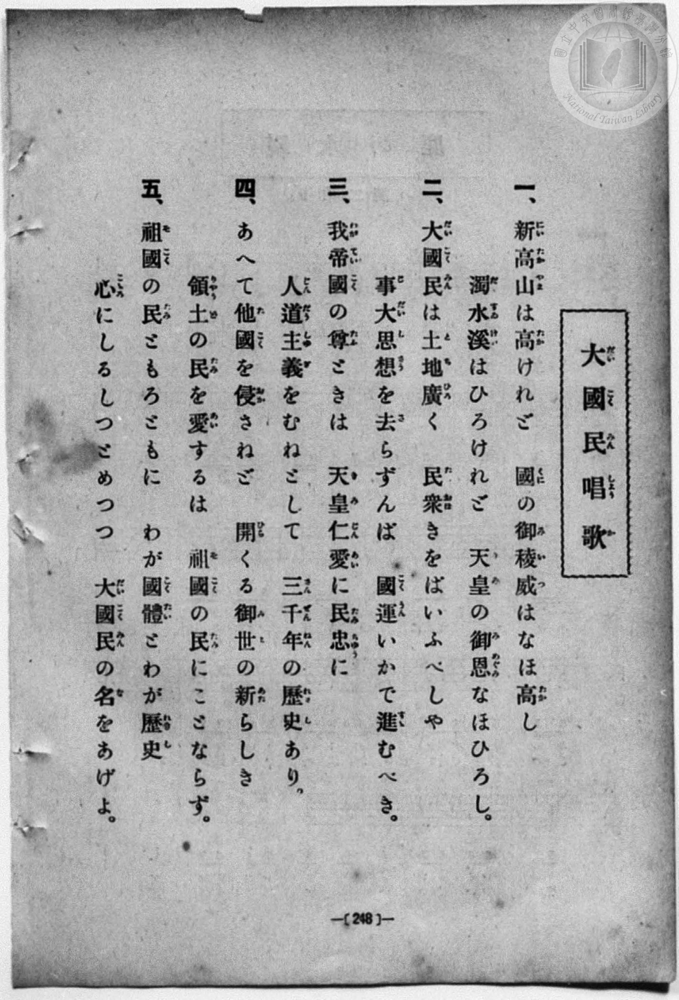
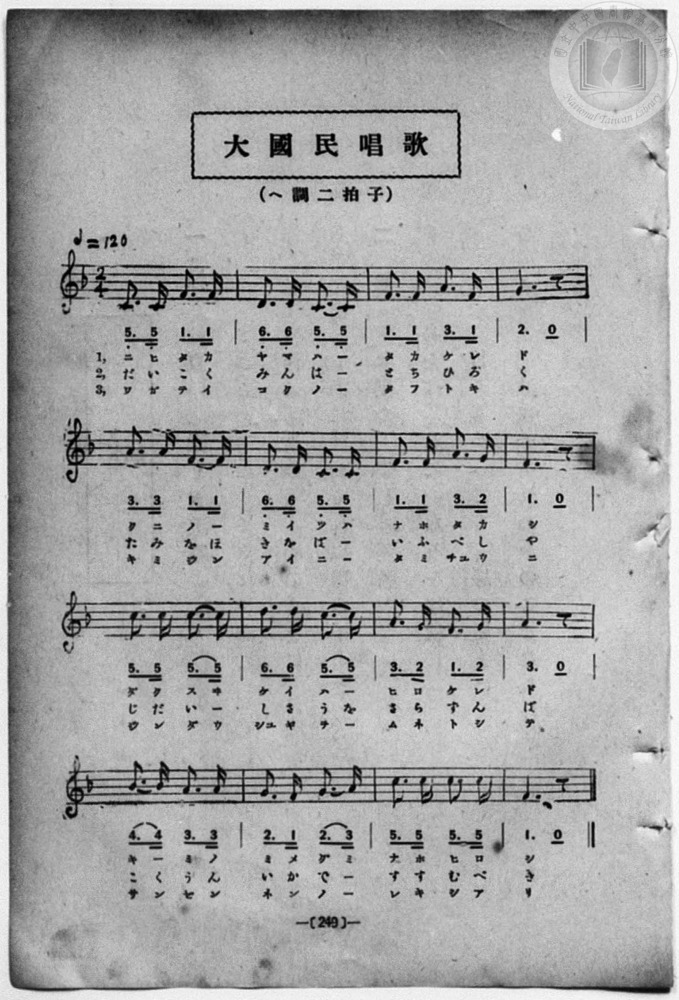

# 大國民

> Re:Shōka 使用 AI 協助辨識與重建樂譜，可能會有錯誤。歡迎回報。

<audio controls src="daikokumin.mp3"></audio>

- 一條慎三郎 編《新編 小學校・公學校 唱歌教材集》（大正十二年十二月，索書號 0725-41）

## 說明


- 出處：一條慎三郎 編《新編 小學校- 公學校 唱歌教材集》（大正十二年十二月，索書號 0725-41）
- 調性與拍號：調號 ?= C，拍號 <2/4>，速度 != 96


## 歌詞

```text
待對照 P256.jpg–P257.jpg（原書 p. 248–249）轉錄校對
```

## ABC

```abc
X:1
T:大國民
M:2/4
L:1/16
Q:1/4=96
K:C
V:V1 name="Piano" snm="Pia"
[V:V1]
C4 D4 | E4 G4 | G4 E4 | D4 C4 |
D4 E4 | G4 E4 | D4 D4 | C4 z4 |
```

## TMD 檔案連結

- [主旋律 TMD 檔案](daikokumin.tmd) [[在 TMD Studio 編輯](https://tmdlang.github.io/Tmd-TS/#tmd=s7IKdvYPcrWy4qpTUCpJTLdSSM7PyUlNLsnMz7MqzsjPTozPrsyvSsyML84ojTe0NDJWgqssy88pzU21Si9KTEmNN403Q8gU55cWJadaFSdn5OfnxJekVpQk5edno8vHFySmp1oFGJki6Swoyi9LzUvMA-ouKMrMK0lNAWtHKEgty0xJBUmnpmSW5BdlJuYgOSi1qBjsbojxJUWJecXJRZkFIM8ocWlpKTxdsvzpnO5nGyYqaGlxKdoqWJpx2dsqOHPZGOmb2IGMebKj4dmiuc9a-57s6HzZ3KfwfPuKxw1dz6ZtADIUnm7of7p2x7MFCx83737augbCVng6ZeOztT3Pps58NnfCy9ltjxu63-_pAFr0bO3ip72NT3b1PN25BcJ4Nqfj_Z6e51sWPZu948XM-QoG5kamuiaG7_d0KnFx6QNdt6_16Ybe563LFUBhopdVkP6oYTKQaQ5iggztmw_UqVCgp2BkYgGUMjKxBOp9sbfzZU8L0CVAvQpa-lxcvomZeVYBmYl5-Q41BjUK1VwKQGBjomUHZtQoGCoYAUljBVMgaQqka4B8QzAJYsNEQGoMFQwUarhqubh07RRApioAaWUuAA)]
- [鋼琴伴奏 TMD 檔案](daikokumin_piano.tmd) [[在 TMD Studio 編輯](https://tmdlang.github.io/Tmd-TS/#tmd=s7IKdvYPcrWy4qpTUCpJTLdSSM7PyUlNLsnMz7MqzsjPTozPrsyvSsyML84ojTe0NDJWgqssy88pzU21Si9KTEmNN403Q8gU55cWJadaFSdn5OfnxJekVpQk5edno8vHFySmp1oFGJki6Swoyi9LzUvMA-ouKMrMK0lNAWtHKEgty0xJBUmnpmSW5BdlJuYgOSi1qBjsbojxJUWJecXJRZkFIM8gVCUWAcXTU3NT80qsCjIT8_LjE5OT83MLEvMyQWJKXFpaCk-XLH86p_vZhonv93S8nD3zWWf3y-49zydsebJny9Ol_e_3dCpoaXEp2ipYmnHZ2yo4c9kY6ZvYgWx4sqPh2aK5z1r7nuzofNncp_B8-4rHDV3Ppm0AMhSebuh_unbHswULHzfvftq6BsJWeDpl47O1Pc-mznw2d8LL2W2PG7qBlgId8Gzt4qe9jU929TzduQXCeDan4_2enudbFj2bvePFzPkKBuZGpromhkDnKHFx6QNdva_16Ybe563LFUCBqpdVkP6oYTKQaQ5iggztmw_UqVCgp2BkYgGUMjKxBOp9sbfzZU8L0CVAvQpa-lxcQZnpGSUeiXkpVgGg4HGoMahRqOZSAAIbEy07MKNGwVDbWMFI2wTIMtY2VTDVNowDMsEUiF8DlgOpgbAgYmjS5vHaRlCTDBRquGq5uHxS0whbHK9gGg-hjUE0kANkYtJASRjfNB6qAWqNrp0C3I8KQI4ySARmN0QAAA)]

## 分析

```text
================================================================================
📊 TMD Song Profile: [ 大國民 ]
================================================================================
⏱  Duration:       0:10 (10.0s), 8 measures total
🎼 Key & Tempo:    首調基準 C, != 96.0 BPM, <2/4>
   - 分析範圍：      由實際發聲的音符與和弦推測調性；播放脈絡另行呈現
🎤 人聲音域:    C4 (MIDI 60) – G4 (MIDI 67) [跨度: 7 個半音 / 0.6 個八度, 難度: easy]
   - 最低音:  C4 in [Main #1 @ m.1, 0:00]
   - 最高音: G4 in [Main #1 @ m.2, 0:01]
   - 適合: soprano, mezzo-soprano, contralto, tenor, baritone, bass
🏛  結構:      Main (10.0s)
⚡ 編曲密度:        Peak 1 軌道同時演奏
🗝  調性診斷：       G 大調（純淨自然大調，未偵測到可信轉調）
   - 風格氣質:    純淨自然大調（陽光明朗、易唱易記，無明顯調外色彩）
   - 轉調歷程:    全曲維持單一推測調性（未偵測到可信轉調）
   - 核心骨幹音:  D, E, C, G
   - 調性數值:    G 大調 [相關度: 0.71, 穩定度: Moderate, 自然音純度: 100.0%]
   - 候選調性 (K-S): G 大調 (0.71), C 大調 (0.62), E 小調 (0.57)
   - 五度圈歷程:   +1
   - 各段落調性細節:
     • [Main #1]: G 大調 (r: 0.71, 自然音純度: 100.0%)

  [ 五度圈游移軌跡 ]
               C  
         F           [G ]*
      Bb               D  
      Eb               A  
         Ab           E  
            Db       B  
               F# 
     (* = active key center)

  [ 十二半音累積音高分佈 ]
     C  : ██████████████            20.0%
     C# :                            0.0%
     D  : ████████████████████████  33.3%
     D# :                            0.0%
     E  : ███████████████████       26.7%
     F  :                            0.0%
     F# :                            0.0%
     G  : ██████████████            20.0%
     G# :                            0.0%
     A  :                            0.0%
     A# :                            0.0%
     B  :                            0.0%
--------------------------------------------------------------------------------
Assignment 軌道音域：
  - Piano         : C4 – G4 (7 個半音 / 0.6 個八度, 15 個音符)
================================================================================
```


## 原書掃描頁






