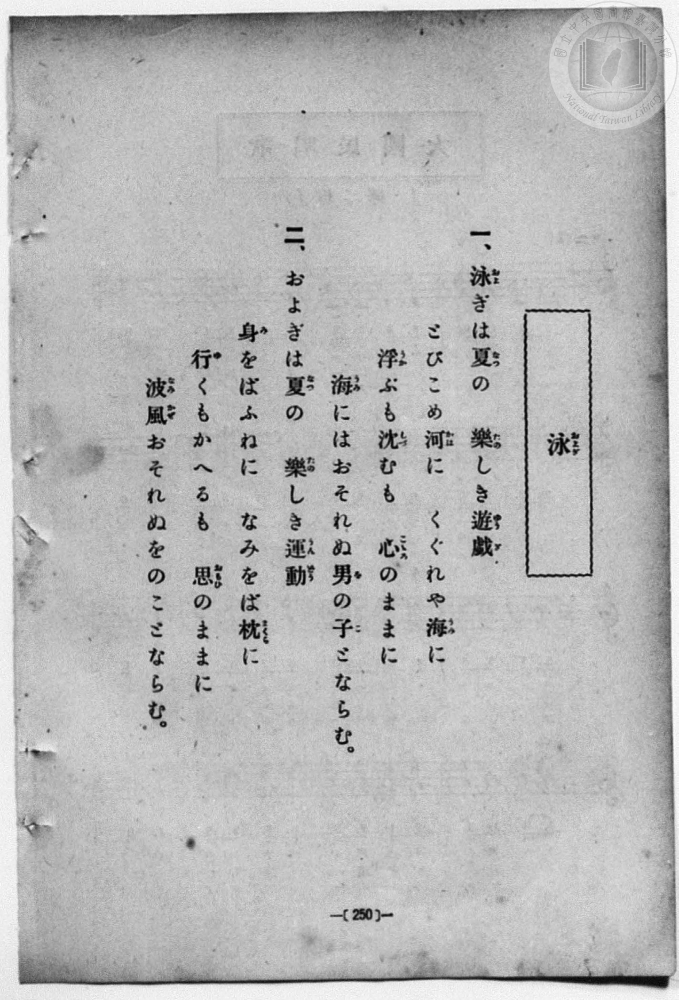
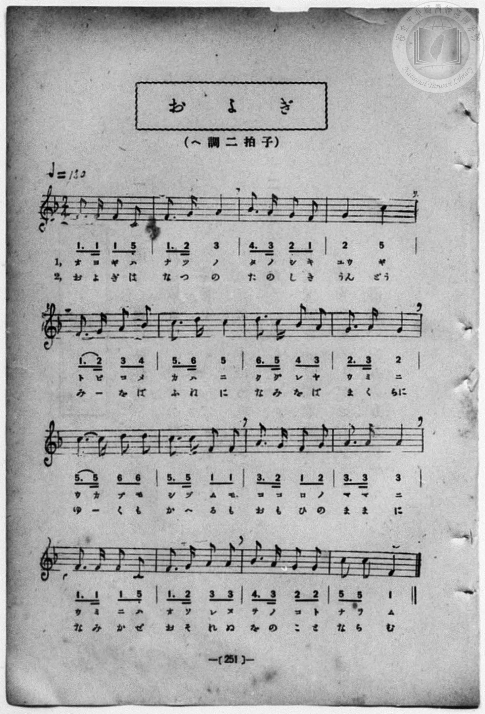

# およぎ

> Re:Shōka 使用 AI 協助辨識與重建樂譜，可能會有錯誤。歡迎回報。

- **NEUTRINO 歌聲合成版**：<br><audio controls src="oyogi_neutrino.mp3"></audio>
- **鋼琴伴奏版**：<br><audio controls src="oyogi.mp3"></audio>


- book: 新編 小學校・公學校 唱歌教材集（尋常科五・六學年用）
- 一條慎三郎 編《新編 小學校・公學校 唱歌教材集》（大正十二年十二月，索書號 0725-41）

## 說明

> [!NOTE]
> **原書資訊與歌詞全文**（對應 `P258.jpg`–`P259.jpg`，原書 p. 250–251，尋常科五・六學年第 14 首）：
> - **調性與拍號**：ヘ調二拍子（F 大調 2/4 拍），♩= 130
> - **樂曲結構**：全曲 16 小節（每行 4 小節，共 4 行），大量運用附點八分音符接十六分音符的輕快節奏，表現夏日跳水與游泳的朝氣。
>
> **一、**
> 泳（およ）ぎは夏（なつ）の　樂（たの）しき遊戲（ゆうぎ）
> とびこめ河（かは）に　くぐれや海（うみ）に
> 浮（うか）ぶも沈（しづ）むも　心（こころ）のままに
> 海（うみ）にはおそれぬ男（を）の子（こ）とならむ。
>
> **二、**
> およぎは夏（なつ）の　樂（たの）しき運動（うんどう）
> 身（み）をばふねに　なみをば枕（まくら）に
> 行（ゆ）くもかへるも　思（おもひ）のままに
> 波風（なみかぜ）おそれぬをのことならむ。


## 歌詞

```text
（TMD 檔案未包含歌詞註解）
```

## ABC

```abc
X:1
T:およぎ
M:2/4
L:1/16
Q:1/4=130
K:F
V:V1 name="Piano" snm="Pia"
[V:V1]
F3 F F2 C2 | F3 G A4 | B3 A G2 F2 | G4 C4 |
w: 1.~オ ヨ ギ ハ | ナ ツ ノ | タ ノ シ キ | ユウ ギ
w: 2.~お よ ぎ は | な つ の | た の し き | うん どう
F3 G A2 B2 | c3 d c4 | d3 c B2 A2 | G3 A G4 |
w: 1.~ト ビ コ メ | カ ハ ニ | ク グ レ ヤ | ウ ミ ニ
w: 2.~み _ を ば | ふ ね に | な み を ば | ま く らに
c3 c d2 d2 | c3 c F2 F2 | A3 G F2 G2 | A3 A A4 |
w: 1.~ウ カ ブ モ | シ ヅ ム モ | コ コ ロ ノ | マ マ ニ
w: 2.~ゆ _ く も | か へ る も | お も ひ の | ま ま に
F3 F F2 C2 | F3 G A2 A2 | B3 A G2 G2 | C2 C2 F4 |
w: 1.~ウ ミ ニ ハ | オ ソ レ ヌ | ヲ ノ コ ト | ナ ラ ム
w: 2.~な み か ぜ | お そ れ ぬ | を の こ と | な ら む
F3 F F2 C2 | F3 G A4 | B3 A G2 F2 | G4 C4 |
w: 1.~オ ヨ ギ ハ | ナ ツ ノ | タ ノ シ キ | ユウ ギ
w: 2.~お よ ぎ は | な つ の | た の し き | うん どう
F3 G A2 B2 | c3 d c4 | d3 c B2 A2 | G3 A G4 |
w: 1.~ト ビ コ メ | カ ハ ニ | ク グ レ ヤ | ウ ミ ニ
w: 2.~み _ を ば | ふ ね に | な み を ば | ま く らに
c3 c d2 d2 | c3 c F2 F2 | A3 G F2 G2 | A3 A A4 |
w: 1.~ウ カ ブ モ | シ ヅ ム モ | コ コ ロ ノ | マ マ ニ
w: 2.~ゆ _ く も | か へ る も | お も ひ の | ま ま に
F3 F F2 C2 | F3 G A2 A2 | B3 A G2 G2 | C2 C2 F4 |
w: 1.~ウ ミ ニ ハ | オ ソ レ ヌ | ヲ ノ コ ト | ナ ラ ム
w: 2.~な み か ぜ | お そ れ ぬ | を の こ と | な ら む
```

## TMD 檔案連結

- [主旋律 TMD 檔案](oyogi.tmd) [[在 TMD Studio 編輯](https://tmdlang.github.io/Tmd-TS/#tmd=s7IKdvYPcrWy4qpTUCpJTLdSSM7PyUlNLsnMz7MqzsjPTozPrsyvSsyML84ojTe0NDJWgqssy88pzU21Si9KTEmNN403Q8gU55cWJadaFSdn5OfnxJekVpQk5edno8vHFySmp1oFGJlaIGQKivLLUvMS84C6C4oy80pSU8DaEQpSyzJTUkHSxcmJefFlqUWZaZmpKUiOSi0qBrsdYkVJUWJecXJRZgHIQwhV-UUlGflAhxdkVFplZBaX5BdlJifmxGcn5iUiFJVkpAK9V1wAVIwhmJpYjGpeZnpmnlVpHshxJVAnaWkpPG7setzU8bixT0FLi0vRVsHQ2IDL3lbBjcvGSN_EDqQdFDBWCs-mbXi-fYXC0w39T9fueLZg4ePm3U9b10DYCk-nbHy2tufZ1JnP5k54Obvt_Z6Opxu6n-7Y8Xz5xCe7poCVrgUqfbpzy_MpK97v6QQ768mOhmeL5j5r7Xuyo_Nlc58C0PjHDV2k2PO4oRtk1ZLlz9Yuftrb-GRXD9AGCOPZnI73e3qeb1n0bPaOFzPnKxiYG5nqmhiC7ebS11KwpRbgUlBQsFOIVvTzD3GNhXC0tJ72zQfZu7n9xYquFx3tQDe_WDnvaeuKZ9PatbTAodP7rL1TIQGUsvSyCtITHjVMBnEswRygwyEGKBToKRiZGgAljUyBTu_BGahr1igYmii8XDYN6L_3e2ZBnKELdMiLVfufNSwHOaG7FxgMIMtnPW6eARQGhVF379O1E4DOcVMAhiFQTAEY5QpAUbApPY9mroQkB7hpz1Y0PZu96fnWCc-Wd4ONAnlp9iYFQzNQfD1f3wA069n6_hcLexRM4CI9T1s3ArlAQYixQKtetve_bOwGJoWXM1te7gYGzOqnHW0v529-vmbZs76lwAgE-Qwm8nxWy4s9U5_uXw007enSfqAJLxaueN6_7-mS_mfTl77YvvnZhi0gD-7Y8WzzZqDiZ3PmPtuw-HFDE9jdsBgBJrbHDY3AJA7mA1UCnQpJ-kBXAVP_48b1QAPBgqseNy4BC6573NAA9DJYcD6QCxac_rix92Vj17OOTSDxprbHjUDUB5SCmPy4ccXjxs2PGyc_bmp8tgliSzfQcLDe1UADHzf2P26c8Lip53FTy7Ot28EKgCbshyiAOm8r0C6IODCBA8W3PW5qerYJ6FSgINABS0GCTQ1AQaCBT_c3g8Ungy0FxR3I5Y37wAhuILpFQCeBvN84F-SSxjXPp4AVNE2CaIckC6CBYC7QR6seN4FtRA_VXT1IoQovSkgMzO6n3VOhzmsC-mIlkAEPzxe7VoOlwM5umvS4ccPjxq2PG9fCAhNo_n6I-LN5EEOAvu4HuhY5PMFpDxRZYEGgbBM4UnY8buqGhOGzhrmw9ACUAsYstjDcvOjlImDhBfHUfrAJc8AqEcEIdglQI9AXGIFGeVEDBQpa-lxc_pX56ZlWAZmJefkONQY1CtUgKxRsDM20wJGjgK2IUwCWE8B8AMqeGrD8qaMAK3Y0sWgA2gQyrEbBEJj_dYEkiDaNBxIwISMFYzANEjEB08ZAMZBSkAiIBYJgLWBFYPN8DGsUHjetAos8bl4BZK8Ds_rBmh43d0FlWoC4D27846b9UPE-IHs7iNW0Fqpj2eOmZVCFEMOQLDMCKmiEGtnUAWSDjAQmUYjWRqgzGpcAMVwnkD0fKr4OiKeDWb1QGVAyhVkGTq1w-_AH_S5gyUVu0EPCGRTCNQqmYBEzKA0SMYOEMlgepA4W8pC4QAv45g5oME4GhsdmMGshNIBXQ2X6gbgbKeBBYQUKvQ1A8TVgFUugMpBQf9w8H1kHUrhDogykdxI4uDZAw3ArNPjWAjHEVtTY2I-hYx9UBug2YLZCaCIQ6Ds6yQl0SNCaggMWhBEioOiAJG5IwjcC80DBDBMxRmQJpNQODShgED9ungYOskXQIASlZBC_FYgXoMiAIgekZzNQDJTSIbkBFIXzoHrmYQ_2JliSBAUXyIQmaCBC1AKLPqAYiI2QgWWQJiB7E1gNKDMgB_w-5KjCH-pPZ8-mQSkDSdnIpQwk2MFKwQRENdaAh6dQeDEDK4Ca9sJTdQ80eEEBACtoIDkElGdgRdPj5pVgEhRZ6OkdKf2CAxtYR6AGcONcoJkge4DVBdQdoHQOK2lABQuw8oDqAZkGTO1gsgFuWy0Xl66dArgGUEBmKHMBAA)]
- [鋼琴伴奏 TMD 檔案](oyogi_piano.tmd) [[在 TMD Studio 編輯](https://tmdlang.github.io/Tmd-TS/#tmd=s7IKdvYPcrWy4qpTUCpJTLdSSM7PyUlNLsnMz7MqzsjPTozPrsyvSsyML84ojTe0NDJWgqssy88pzU21Si9KTEmNN403Q8gU55cWJadaFSdn5OfnxJekVpQk5edno8vHFySmp1oFGJlaIGQKivLLUvMS84C6C4oy80pSU8DaEQpSyzJTUkHSxcmJefFlqUWZaZmpKUiOSi0qBrsdYkVJUWJecXJRZgHIQwhV-UUlGflAhxdkVFplZBaX5BdlJifmxGcn5iUiFCUWATWnp-am5pVYFWQm5uXHJyYn5-cWJOZlgsQQCksygIqsiguApmIIpiYWgyzW0lJ43Nj1uKnjcWPf-z0dL2fPfNbZ_bJ7z_MJW57s2fJ0af_7PZ0KWlpcirYKhsYGXPa2Cm5cNkb6JnYg80CBZ6XwbNqG59tXKDzd0P907Y5nCxY-bt79tHUNhK3wdMrGZ2t7nk2d-WzuhJez24BWPN3Q_XTHjufLJz7ZNQWsdC1Q6dOdW55PWQG0C-zOJzsani2a-6y178mOzpfNfQpA4x83dJFiz-OGbpBVS5Y_W7v4aW_jk109QBsgjGdzOt7v6Xm-ZdGz2TtezJyvYGBuZKprYgi2m8u_Mj890yoAFKhBHg41BjUK1VwKQGBjaKZlB2bpaynYogOF52vWAN38YmGPgoYJyIHP1zfoKAATkKVeVkG6JhYNWvpgw2oUDBV0gdAQTJvGAwmYkJGCMZgGiZiAaWOgGEgpSATEAkGwFrAisHk-hjUKj5tWgUUeN68AsteBWf1gTY-bu6AyLUDcBzf-cdN-qHgfkL0dxGpaC9Wx7HHTMqhCiGFIlhkBFTRCjWzqALJBRj5uXA_R2gh1RuMSIIbrBLLnQ8XXAfF0MKsXKtP2uGkyzLLGlUA-3D78Qb-rh_ygh4QzKIRrFEzBImZQGiRiBgllsDxIHSzkIXGBFvDNHdBgnAwMj81g1kJoAK-GyvQDcTdSwIPCChR6G4Dia8AqlkBlIKH-uHk-sg6kcIdEGUjvJHBwbYCG4VZo8K0FYoitqLGxH0PHPqgM0G1NnUiaCAT6jk5yAh0StKbggAVhhAgoOiCJG5LwjcA8UDDDRIwRWQIptUMDChjEj5ungYNsETQIQSkZxG8F4gUoMqDIAenZDBQDpXRIbgBF4TyonnnYg70JliRBwQUyoQkaiBC1jxt3AMVAbIQMLIM0AdmbwGpAmQE54PchRxX-UH86ezYNShlIykYuZSDBDlYKJiCqsQY8PIXCixlYAdS0F56qe6DBCwoAWEEDySGgPAMrmh43rwSToMhCT-9I6Rcc2I8b56AGcONcoJkgex43guwEuQOUzmElDahgedy4AqoHZBowtYPJBrhttSgVgA9KBWABLf-BIRevEG0YC6Mw-SZAhgkS3zQeyDKNjwUzDKCeorYxUNU4jYXrRlZBsmOMgJRRLoproMYAg07XTgEcetE-QC0IjhGYo8wFAA)]

## 分析

```text
================================================================================
📊 TMD Song Profile: [ およぎ ]
================================================================================
⏱  Duration:       0:29 (29.5s), 32 measures total
🎼 Key & Tempo:    首調基準 F, != 130.0 BPM, <2/4>
   - 分析範圍：      由實際發聲的音符與和弦推測調性；播放脈絡另行呈現
🎤 人聲音域:    C4 (MIDI 60) – D5 (MIDI 74) [跨度: 14 個半音 / 1.2 個八度, 難度: moderate]
   - 最低音:  C4 in [Oyogi #1 @ m.1, 0:00]
   - 最高音: D5 in [Oyogi #1 @ m.6, 0:04]
   - 適合: soprano, mezzo-soprano, contralto, tenor, baritone, bass
🏛  結構:      Oyogi (14.8s) -> Oyogi (14.8s)
⚡ 編曲密度:        Peak 1 軌道同時演奏
🗝  調性診斷：       F 大調（純淨自然大調，未偵測到可信轉調）
   - 風格氣質:    純淨自然大調（陽光明朗、易唱易記，無明顯調外色彩）
   - 轉調歷程:    全曲維持單一推測調性（未偵測到可信轉調）
   - 核心骨幹音:  F, C, A, G, A#
   - 調性數值:    F 大調 [相關度: 0.91, 穩定度: High, 自然音純度: 100.0%]
   - 候選調性 (K-S): F 大調 (0.91), C 大調 (0.70), A 小調 (0.60)
   - 五度圈歷程:   -1 -> -1
   - 各段落調性細節:
     • [Oyogi #1]: F 大調 (r: 0.91, 自然音純度: 100.0%)
     • [Oyogi #2]: F 大調 (r: 0.91, 自然音純度: 100.0%)

  [ 五度圈游移軌跡 ]
               C  
        [F ]*          G  
      Bb               D  
      Eb               A  
         Ab           E  
            Db       B  
               F# 
     (* = active key center)

  [ 十二半音累積音高分佈 ]
     C  : ████████████████████      21.9%
     C# :                            0.0%
     D  : ██████                     6.2%
     D# :                            0.0%
     E  :                            0.0%
     F  : ████████████████████████  25.8%
     F# :                            0.0%
     G  : █████████████████         18.0%
     G# :                            0.0%
     A  : ███████████████████       20.3%
     A# : ███████                    7.8%
     B  :                            0.0%
--------------------------------------------------------------------------------
Assignment 軌道音域：
  - Piano         : C4 – D5 (14 個半音 / 1.2 個八度, 114 個音符)
================================================================================
```


## 原書掃描頁






