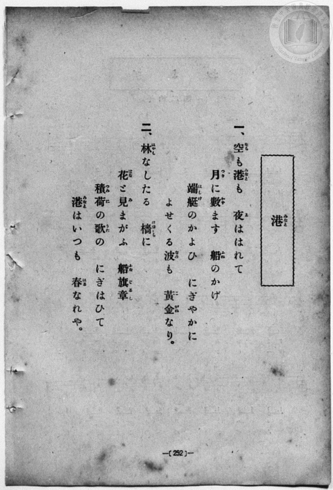
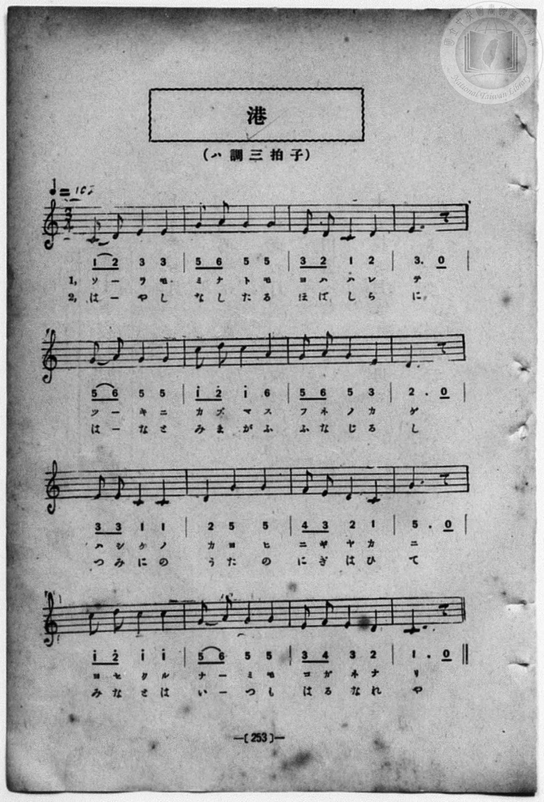

# 港

> Re:Shōka 使用 AI 協助辨識與重建樂譜，可能會有錯誤。歡迎回報。

<audio controls src="minato.mp3"></audio>

- 詞：旗野十一郎（旗野士良）
- 曲：吉田信太
- book: 新編 小學校・公學校 唱歌教材集（尋常科五・六學年用）
- 一條慎三郎 編《新編 小學校・公學校 唱歌教材集》（大正十二年十二月，索書號 0725-41）

## 說明

> [!NOTE]
> **原書資訊與歌詞全文**（對應 `P260.jpg`–`P261.jpg`，原書 p. 252–253，尋常科五・六學年第 15 首）：
> - **詞曲**：旗野十一郎（旗野士良）作詞／吉田信太 作曲（原曲出自 1896 年《新編教育唱歌集》第五集）
> - **調性與拍號**：ハ調三拍子（C 大調 3/4 拍），♩= 105
> - **版本差異**：第 9–10 小節（第三行第 1–2 小節）在本書印為 `| 3 3 1 - 1 - | 2 - 5 - 5 - |`（「ハシケノ｜カヨヒ」／「つみにの｜うたの」，第 10 小節首拍「カ／う」為四分音符），與 1931 年《新定兒童唱歌》版（`| 2 2 1 - 1 - | 2 2 5 - 5 - |`）略有不同；第 4、8、12、16 小節末皆印為附點二分音符接八分休止符，此處按三拍子規範對齊為 5 個八分音符時值加 1 個八分休止符。
>
> **一、**
> 空（そら）も港（みなと）も　夜（よ）ははれて
> 月（つき）に數（かず）ます　船（ふね）のかげ
> 端艇（はしけ）のかよひ　にぎやかに
> よせくる波（なみ）も　黃金（こがね）なり。
>
> **二、**
> 林（はやし）なしたる　檣（ほばしら）に
> 花（はな）と見（み）まがふ　船旗章（ふなじるし）
> 積荷（つみに）の歌（うた）の　にぎはひて
> 港（みなと）はいつも　春（はる）なれや。


## 歌詞

```text
（TMD 檔案未包含歌詞註解）
```

## ABC

```abc
X:1
T:港
C:曲：吉田信太
M:3/4
L:1/16
Q:1/4=105
K:C
V:V1 name="Piano" snm="Pia"
[V:V1]
C2 D2 E4 E4 | G2 A2 G4 G4 | E2 D2 C4 D4 | E10 z2 |
w: ソ _ ラ モ | ミ ナ ト モ | ヨ ハ ハ レ | テ
G2 A2 G4 G4 | c2 d2 c4 A4 | G2 A2 G4 E4 | D10 z2 |
w: ツ _ キ ニ | カ ズ マ ス | フ ネ ノ カ | ゲ
E2 E2 C4 C4 | D4 G4 G4 | F2 E2 D4 C4 | G10 z2 |
w: ハ シ ケ ノ | カ ヨ ヒ | ニ ギ ヤ カ | ニ
c2 d2 c4 c4 | G2 A2 G4 G4 | E2 F2 E4 D4 | C10 z2 |
w: ヨ セ ク ル | ナ _ ミ モ | コ ガ ネ ナ | リ
C2 D2 E4 E4 | G2 A2 G4 G4 | E2 D2 C4 D4 | E10 z2 |
w: は _ や し | な し た る | ほ ば し ら | に
G2 A2 G4 G4 | c2 d2 c4 A4 | G2 A2 G4 E4 | D10 z2 |
w: は _ な と | み ま が ふ | ふ な じ る | し
E2 E2 C4 C4 | D4 G4 G4 | F2 E2 D4 C4 | G10 z2 |
w: つ み に の | う た の | に ぎ は ひ | て
c2 d2 c4 c4 | G2 A2 G4 G4 | E2 F2 E4 D4 | C10 z2 |
w: み な と は | い _ つ も | は る な れ | や
```

## TMD 檔案連結

- [主旋律 TMD 檔案](minato.tmd) [[在 TMD Studio 編輯](https://tmdlang.github.io/Tmd-TS/#tmd=s7IKdvYPcrWy4qpTUCpJTLdSSM7PyUlNLsnMz7MqzsjPTozPrsyvSsyML84ojTe0NDJWgqssy88pzU21Si9KTEmNN403Q8gU55cWJadaFSdn5OfnxJekVpQk5edno8vHFySmp1oFGJkZIGQKivLLUvMS84C6C4oy80pSU8DaEQpSyzJTUkHSxcmJefFlqUWZaZmpKUiOSi0qBrsdYkVJUWJecXJRZgHIQwhV-UUlGflAhxdkVFplZBaX5BdlJifmxGcn5iUiFJVkpAK9l5dYUlqUqsSlpaXwbMd6BS0tLkVbBUMDUy57WwVnLhtjfRM7kA6QB60Unk3b8Hz7CoWnG_qfrt3xbMHCx827n7augbAVnk7Z-Gxtz7OpM5_NnfBydtv7PR1PN3Q_3bHj-fKJT3ZNAStdC1T6dOeW51NWvN_TCXbJkx0NzxbNfdba92RH58vmPgWg8Y8bukix53FDN8iqJcufrV38tLfxya4eoA0QxrM5He_39DzfsujZ7B0vZs5XMDA3MtU1MYTZ_WLlvPd7Zj2bPv1lex9Iw44GoAuAZkFFFq9-0bkepvbZ7E1AtU8ndD6fsuHJ_oVPl6xS4uLS11KwpRbgUlBQsFOIVvTzD3GNhXC0tJ72zQc5fXP7ixVdLzragd4Guvlp64pn09q1tMAB3PusvVMhAZTI9LIK0hMeNUwGcQzBHKDfIQYoFOgpGJkaASWNTI1BorjiZc0aBUNThZfLpgG9DfQuxBm6QIcArQWGAMhOwuH1ZO8ccMj2I4eWAlAUHIYdYCdtetq-60X7KgVDC0szBaDN8DgHRuuLpk2QKIZELtBRQGeCE1QnkoNW7X_WsBwUJt29wKgFu-xxcz9QGJiQgGJP104A2uWsAEwXQDEFYDJWAIqCvdXzaOZKSBKHm_a8s-PZnDVPt697PnUD2ChQSFgCw8vQAJQIn69vABoGcsiOzhcLe8DBBApMuFzn0zkrgAYAg_pp74bnTbsUEmoUjIHQEGg6CNcoGAFJUyiuAcZMx-OGHqB7Hzdtf9y08TEwGPfOedy0-nHzisfNkx43AB3aD1LQuORx4_7HjasfN64DKWhse9w4H8gGK4A4A-Y-YJwB_QfS07QapBmotKEX6JKns2c_7Wh7OX_z8zXLIL4HhpmCoaWxISLYn66b9bR10vPVSyHBDgrzTmDG6QB6wggIkT1hhOKJzudTlz6b0_lkR-_TCT3v98wGucjkcUOjBRAbGoEIYOSCnfdszurns9oggfNyZsvL3fNA-RTmsGd9S5-2rgZyn-yZ-GztIrBTe56tXfJi5tRnPUDjoRH6YhnQqBZgmn-5twsUyKYKTxu6IRqh5sxsetqw52nXAqB74VJwMx83NIFjHJa5gOkX6ERggQfmP1-5CxQrjXMfNwFDqfNxUxOwOASLACNg1eNGUIkFFHzc0PB0yRyQeBMwiDofN64HoSZgVC2DmAMuc4C6gDEHSm7AyHs2dQdYpPtx4yywyL7HjTOB5rzo2AkW3_q4cS1YfB1YzSSoe1avf9HZDlYAtGL648aJCDVNQMFNQBPAKaPvcVMLWONqiEaw7OzHjcC01f1s8yKwCUD374e7_-Xu5pftQNOA4pMfNwJdDrF91eOmLowg2gVMDfAgejZvOtQ9IBuBbLAukNvmA-0Cmvxs1WKwgt2PGzeAxCEhCXPYi66NMO-sAouveLEMVHRD3QYKFqBjtkJCBlimPF-9ABY-QFtmgKwAWwqLr94XvdthQQ3KJJDwASZgsCAoq0BDDB5QIKs3IWIKM35BCoBeWwIJqGczlsL8C3QnJIiA-asFGkqUl_lQoKClz8XlmwmsifOtAjIT8_IdagxqFKpBdijYWGiBY0MBW12jAC6SGoBFkoKGCTSn6SjAyn9NLBqANoEMqwFmECNg-aQLxjXAnGSGyNhAMUimB5VZIJ4uFBoo1IB1-xjWAFPZXqDI4-aVYHIRWOXj5vlA3AXEHSiiK4C4H4xBomugom1wc-Nh5hoBxRvXg1Q1tYDIxukQtY2rwGxgjILluqGiu4F4A1QVMK1BRVejmIs_7Hb1kBN2qKFlGKdgFAcidYHCyIEJCVpQIGIJvmawB5vWgoME6qGm1UC8C8ifB5bbCQ2oqUDcC8R9YFGQ90BqN-ELPmCAgcgV0CDZD8T7gLgHLLoVKroVGrAzUAIVFJjEBh-4NiQ5-PBUjAom4MQHkwOJYQs7YGJq2g7EG8GhBwoXSOiBeCA_A-tQaNh1A8XXAeklyGEHDm9sYbcEGlZgkxrXQUMElFChSQ8uBoypxj54aIPiAiS6jPiwA9bLZGVbRGIDE5hZFxSCsKwLCkVs4QfMkE3AzNMEdn0zLFS6wDywP2FZt2kzEK8Bpz-QKEgFSCUodWELP1DYgVIUOA7AYQMShWRlSAw0QcXWg1McNJ02gdIlyDaQSoS5tVxcunYKkHIx2scwVgGJZwTmKXMBAA)]
- [鋼琴伴奏 TMD 檔案](minato_piano.tmd) [[在 TMD Studio 編輯](https://tmdlang.github.io/Tmd-TS/#tmd=s7IKdvYPcrWy4qpTUCpJTLdSSM7PyUlNLsnMz7MqzsjPTozPrsyvSsyML84ojTe0NDJWgqssy88pzU21Si9KTEmNN403Q8gU55cWJadaFSdn5OfnxJekVpQk5edno8vHFySmp1oFGJkZIGQKivLLUvMS84C6C4oy80pSU8DaEQpSyzJTUkHSxcmJefFlqUWZaZmpKUiOSi0qBrsdYkVJUWJecXJRZgHIQwhV-UUlGflAhxdkVFplZBaX5BdlJifmxGcn5iUiFCUWATWnp-am5pVYFWQm5uXHJyYn5-cWJOZlgsQQCksygIqs8hJLSotSlbi0tBSe7Vj_fk_Hy9kzn3V2v-ze83zClid7tjxd2v9-T6eClhaXoq2CoYEpl72tgjOXjbG-iR3IJFAIWSk8m7bh-fYVCk839D9du-PZgoWPm3c_bV0DYSs8nbLx2dqeZ1NnPps74eXsNqAVTzd0P92x4_nyiU92TQErXQtU-nTnludTVgDtArvwyY6GZ4vmPmvte7Kj82VznwLQ-McNXaTY87ihG2TVkuXP1i5-2tv4ZFcP0AYI49mcjvd7ep5vWfRs9o4XM-crGJgbmeqaGMLsfrFy3vs9s55Nn_6yvQ-kYUcD0AVAs6Aii1e_6AQGFETts9mbgGqfTuh8PmXDk_0Lny5ZpcTF5ZlXUpRvFQAK_CAPhxqDGoVqLgUgsLHQsgMzahQM4xSM4kCkLoSoUTBVMANiXTCuUTBWMAFiXQUjMM8QSEKggUINVy2KDT44bDCJByqPNomFk0BjwEKGYCEwCbQVLGQKFgKTKKoMQAIg-3wzgekEr5f0tRRs0YHC8zVrgKH3YmGPgoYJKNaer2_QUQBmHUO9rIJ0TSwatPRh4QP0Ocj_IIwZNkbgEIGEDUgFImxAun0MaxQeN-0FijxuXgkmF4FVPm6eD8RdQNyBIroCiPvBGCS6BiraBjc3HmauEVC8cT1IVVMLiGycDlHbuArMftw4HyzXDRXdDcQboKoeN3VCRVejmIs_7Hb1kBN2qKGFlNLMUAITErSgQMQSfM1gDzatBQcJ1ENNq4F4F5A_Dyy3ExpQU4G4F4j7wKIg74HUbsIXfMAAA5EroEGyH4j3AXEPWHQrVHQrNGBnoAQqKDCJDb4dneQEnzEQgpIXCEPCBxGYoEwJEoHIgcSwhR0wMTVtB-KN4NADhQsk9EA8kJ8fN0-Chl03UHwdkF6CHHbg8MYWdkugYQU2qXEdNERACRWa9OBiwJhq7IOHNiguQKLLiA-7p7Nnk5VtKSjWEOEHzJBNwMzTBHZ9MyxUusA8sD9hWbdpMxCvAac_kChIBUglKHVhCz9Q2IFSFDgOwGEDEoVkZUgMNEHF1oNTHDSdNoHSJcg2kEqEuWjFIq5yGEuhi0XIDCxklgvigctkLOUwTvOQinqwLDDVgkWMwMaBjUYp6QkYh6VOQDYPbBtO86ha7ejaKYBrOgUgAxLW0T4gFQieEZinzAUA)]

## 分析

```text
================================================================================
📊 TMD Song Profile: [ 港 ]
================================================================================
⏱  Duration:       0:54 (54.9s), 32 measures total
🎼 Key & Tempo:    首調基準 C, != 105.0 BPM, <3/4>
   - 分析範圍：      由實際發聲的音符與和弦推測調性；播放脈絡另行呈現
🎤 人聲音域:    C4 (MIDI 60) – D5 (MIDI 74) [跨度: 14 個半音 / 1.2 個八度, 難度: moderate]
   - 最低音:  C4 in [Minato[L1] #1 @ m.1, 0:00]
   - 最高音: D5 in [Minato[L1] #1 @ m.6, 0:08]
   - 適合: soprano, mezzo-soprano, contralto, tenor, baritone, bass
🏛  結構:      Minato[L1] (27.4s) -> Minato[L2] (27.4s)
⚡ 編曲密度:        Peak 1 軌道同時演奏
🗝  調性診斷：       C 大調（純淨自然大調，未偵測到可信轉調）
   - 風格氣質:    純淨自然大調（陽光明朗、易唱易記，無明顯調外色彩）
   - 轉調歷程:    全曲維持單一推測調性（未偵測到可信轉調）
   - 核心骨幹音:  G, C, E, D, A
   - 調性數值:    C 大調 [相關度: 0.86, 穩定度: Moderate, 自然音純度: 100.0%]
   - 候選調性 (K-S): C 大調 (0.86), G 大調 (0.81), E 小調 (0.65)
   - 五度圈歷程:   +0 -> +0
   - 各段落調性細節:
     • [Minato[L1] #1]: C 大調 (r: 0.86, 自然音純度: 100.0%)
     • [Minato[L2] #1]: C 大調 (r: 0.86, 自然音純度: 100.0%)

  [ 五度圈游移軌跡 ]
              [C ]*
         F            G  
      Bb               D  
      Eb               A  
         Ab           E  
            Db       B  
               F# 
     (* = active key center)

  [ 十二半音累積音高分佈 ]
     C  : ████████████████████      23.9%
     C# :                            0.0%
     D  : ███████████████           18.5%
     D# :                            0.0%
     E  : ████████████████          19.6%
     F  : ██                         2.2%
     F# :                            0.0%
     G  : ████████████████████████  29.3%
     G# :                            0.0%
     A  : █████                      6.5%
     A# :                            0.0%
     B  :                            0.0%
--------------------------------------------------------------------------------
Assignment 軌道音域：
  - Piano         : C4 – D5 (14 個半音 / 1.2 個八度, 102 個音符)
================================================================================
```


## 原書掃描頁






