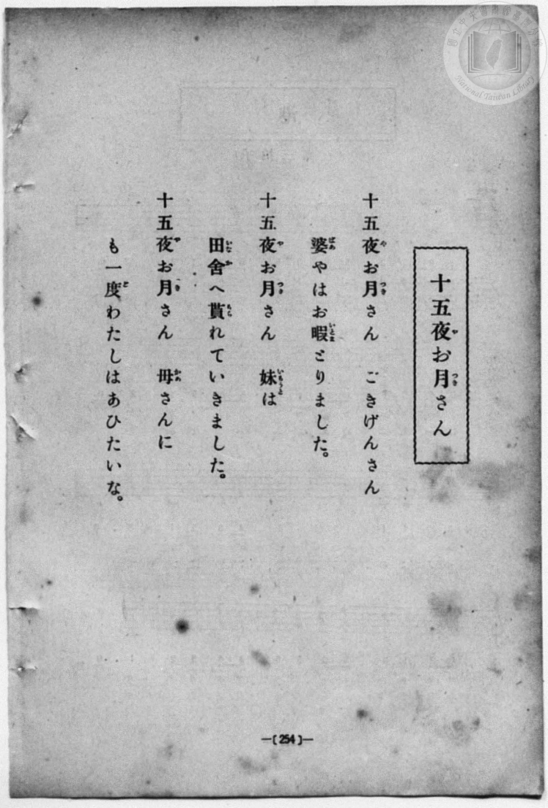
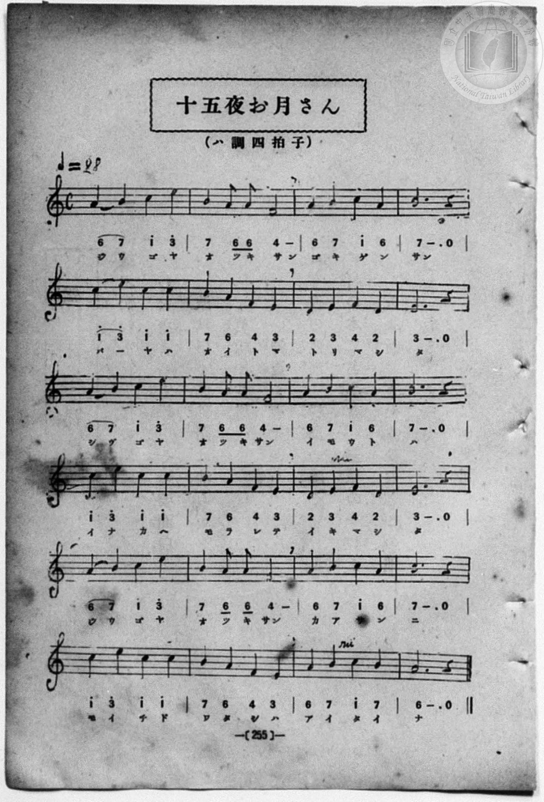

# 十五夜お月さん

> Re:Shōka 使用 AI 協助辨識與重建樂譜，可能會有錯誤。歡迎回報。

- **鋼琴伴奏版**：<br><audio controls src="jugoya_otsukisan.mp3"></audio>
- **NEUTRINO 歌聲合成版**：<br><audio controls src="jugoya_otsukisan_neutrino.mp3"></audio>

- 詞：野口雨情
- 曲：本居長世
- book: 新編 小學校・公學校 唱歌教材集（尋常科五・六學年用）
- 一條慎三郎 編《新編 小學校・公學校 唱歌教材集》（大正十二年十二月，索書號 0725-41）

## 說明

> [!NOTE]
> **原書資訊與歌詞全文**（對應 `P262.jpg`–`P263.jpg`，原書 p. 254–255，尋常科五・六學年第 16 首）：
> - **詞曲**：野口雨情 作詞／本居長世 作曲（大正 9 年〔1920〕發表之日本近代代表童謠）
> - **調性與拍號**：ハ調四拍子（A 小調／都節五聲小調 4/4 拍），♩= 98
> - **樂曲結構**：全曲共 24 小節（6 行，每行 4 小節），三段歌詞通篇貫穿譜出，第 3 段結尾回到主音 `6`（A4）。第 15 小節「マ」與第 23 小節「タ」上方五線譜標有波音記號。
> - **假名表記**：歌詞頁印為「あひたいな」（歷史假名遣），樂譜頁簡譜下方標為「アイタイナ」。
>
> **一、**
> 十五夜（じうごや）お月（つき）さん　ごきげんさん
> 婆（ばあ）やはお暇（いとま）とりました。
>
> **二、**
> 十五夜（じうごや）お月（つき）さん　妹（いもうと）は
> 田舍（いなか）へ貰（もら）れていきました。
>
> **三、**
> 十五夜（じうごや）お月（つき）さん　母（かあ）さんに
> も一度（ど）わたしはあひたいな。


## 歌詞

```text
（TMD 檔案未包含歌詞註解）
```

## ABC

```abc
X:1
T:十五夜お月さん
C:曲：本居長世
M:4/4
L:1/16
Q:1/4=98
K:Am
V:V1 name="Piano" snm="Pia"
[V:V1]
A4 B4 c4 e4 | B4 A2 A2 F8 | A4 B4 c4 A4 | B12 z4 |
w: ジ ウ ゴ ヤ | オ ツ キ サン | ゴ キ ゲ ン | サン
c4 e4 c4 c4 | B4 A4 F4 E4 | D4 E4 F4 D4 | E12 z4 |
w: バ _ ヤ ハ | オ イ ト マ | ト リ マ シ | タ
A4 B4 c4 e4 | B4 A2 A2 F8 | A4 B4 c4 A4 | B12 z4 |
w: ジ ウ ゴ ヤ | オ ツ キ サン | イ モ ウ ト | ハ
c4 e4 c4 c4 | B4 A4 F4 E4 | D4 E4 F4 D4 | E12 z4 |
w: イ ナ カ ヘ | モ ラ レ テ | イ キ マ シ | タ
A4 B4 c4 e4 | B4 A2 A2 F8 | A4 B4 c4 A4 | B12 z4 |
w: ジ ウ ゴ ヤ | オ ツ キ サン | カ ア サ ン | ニ
c4 e4 c4 c4 | B4 A4 F4 E4 | A4 B4 c4 B4 | A12 z4 |
w: モ イ チ ド | ワ タ シ ハ | ア イ タ イ | ナ
```

## TMD 檔案連結

- [主旋律 TMD 檔案](jugoya_otsukisan.tmd) [[在 TMD Studio 編輯](https://tmdlang.github.io/Tmd-TS/#tmd=s7IKdvYPcrWy4qpTUCpJTLdSSM7PyUlNLsnMz7MqzsjPTozPrsyvSsyML84ojTe0NDJWgqssy88pzU21Si9KTEmNN403Q8gU55cWJadaFSdn5OfnxJekVpQk5edno8vHFySmp1oFGJkZIWQKivLLUvMS84C6C4oy80pSU8DaEQpSyzJTUkHSxcmJefFlqUWZaZmpKUiOSi0qBrsdYkVJUWJecXJRZgHIQwhV-UUlGflAhxdkVFplZBaX5BdlJifmxGcn5iUiFJVkpAK9V5yaWJyfV4ysNzM9M8-qJDETGD7AYMkvT4zPTczMy0nMA7pDS0vhaW_jk11Tni6Z87ix69mcjseNUx83TVbQ0uJStFWwtOCyt1Vw5spOrbRVcMzlsjHRN7EDGQ0KICuFZ9M2PN--QuHphv6na3c8W7DwcfPup61rIGyFp1M2Plvb82zqzGdzJ7yc3fZ-T8fTDd1Pd-x4vnwi0D6w0rVApU93bnk-ZcX7PZ1gJz_Z0fBs0dxnrX1PdnS-bO5TABr_uKGLFHseN3SDrFqy_NnaxWCv9QBtgDCAvnu_p-f5lkXPZu94MXO-goG5kamuiSHM7hcr573fM-tle9_T_sUvZ6941twKFn42exNQ-NmcNU83tr6cuv3JjmlKXFz6Wgq21AJcCgoKdgrRin7-Ia6xEI6W1tO--SBXbm5_saLrRUc70IdA5z1tXfFsWruWFjgse5-1dyokgNKjXlZBesKjhskgjjGYA_QmxACFAj0FI1MToKSRqSlIFFcUrFmjYGim8HLZNGBoAL0LcYYu0CFAa4EhALITJWgUnuydAw6wfuSQAYmCwwsaAQqWCkDDHzdMAWZFg8cNU5_P3PNi4YonO7ufTV8K1Pdi_8QnuxcDEVDw-eqlL9YsANqOZPWq_c8aloN8390LjC-wGx439wOFn86eDRR7unYC0CZHULoAigGd8rJ57_P1DUCvvWjcBBFUACZYBaBSsK96Hs1cCU7TcBuerWgCOvf51gnPlneDjQeF8OxNT1s3KhiZgMwFGge0wkzhxcIeoP5n6_uBDAWEDMhQYEp9tm4rJIJeNsx6vr79xabVz1fuf7F2ztP2XaAEBwxbYwWgGqA9Tzfsezp73tOODU927H45f7NCghkwrjocTYBGPW5oAseCKdT0xw09j5vnPW7oBQYASMLIGEmiaT9Q4skOYM7YCfTu8-2zgLY9WzHz2ZzOZ5sXAQ1-sWIGMMSARiL8-rSx_emEXmBIA-XAfoU6eUHj094Nz5t2gYxtbHrcuOlx4_zHjS2PG1cBrQA67tna7U_7N0F0v2xcDPE0MOCANgL1Pt-wEMh4sqMb6BKgA6DmNC163LQE5Egg2dwFNAfmEljyBubzxw2NwEIGzIcXQUDrHjfOeNzY9rhxyuOmFlCogAslsPiSx42geIQUUI8bGkBqGnsfN04CccGCUNNWggqbx40bgN4BqW8C-mU9yJxZ7WBxIHfF48Z9YKNWPG7qArIfN04H-Rrdkbt6KHbk02U7oZY2AcMWqAVU1AHdAzHz-ZQNLzpAgQwN8EZg2QWU3fFi0waQIFBLEzC0gV4ARs0ysBqgf3G5dgcwCVHo2mfrIY7phgYdRLxxNcRMoHuA8fZ01zKwmpVgh_WDUwvQPcAQRks8YOdRXjxCgYKWPheXV2l6fmWif0lxaXZmcWKeVUBmYl6-Q41BjUI1yDIFGwstcHgoYCufFYC5CJLugBELyscaFtAcpaMAKzk1sWgDWgwyskbBDJiPzIHYMA5IGIOIGjDfDAhNgDQIoqkCcSCKYNAAJAI20KcGGKI7gNzHTcvA5BYQ2bwErOVx0yowrwXIWgvEWx83b4ZbAVUKlACRm8AKQbIgGSSFIBgPtg7qAYTDwSwwAfOCLtgLxmARIygLJAJi14B52H3QPAEqDHE5sHxGdn8TRKwDTM6DyEB5EP-BxB43bYfq2Y_d5bhjE5TkgZXBEI9NSCAtQmgGBxEoqECBSbeohLqjC-yO1WD2DKg7wG5rXgkm14DJNmS3Q1IihZEJbJEAI7N17RCPTHDANUEicytYITRrNndjDxDiIxPF_SAGRAhHxoQ4ARKnjWCyE-qQ9WAZUPxAYguRaZH0QOWhfganClTH13Jx6dopoBXJCkAhZS4A)]
- [鋼琴伴奏 TMD 檔案](jugoya_otsukisan_piano.tmd) [[在 TMD Studio 編輯](https://tmdlang.github.io/Tmd-TS/#tmd=s7IKdvYPcrWy4qpTUCpJTLdSSM7PyUlNLsnMz7MqzsjPTozPrsyvSsyML84ojTe0NDJWgqssy88pzU21Si9KTEmNN403Q8gU55cWJadaFSdn5OfnxJekVpQk5edno8vHFySmp1oFGJkZIWQKivLLUvMS84C6C4oy80pSU8DaEQpSyzJTUkHSxcmJefFlqUWZaZmpKUiOSi0qBrsdYkVJUWJecXJRZgHIQwhV-UUlGflAhxdkVFplZBaX5BdlJifmxGcn5iUiFCUWATWnp-am5pVYFWQm5uXHJyYn5-cWJOZlgsQQCksygIqsilMTi_PzipW4tLQUnvY2Ptk15emSOY8bu57N6XjcOPVx0-T3ezpezp75rLP7Zfee5xO2PNmz5enS_vd7OhW0tLgUbRUsLbjsbRWcubJTK20VHHO5bEz0TexAdoDCzkrh2bQNz7evUHi6of_p2h3PFix83Lz7aesaCFvh6ZSNz9b2PJs689ncCS9ntwFterqh--mOHc-XTwS6A6x0LVDp051bnk9ZAbQS7PYnOxqeLZr7rLXvyY7Ol819CkDjHzd0kWLP44ZukFVLlj9buxjs5R6gDRAG0Nfv9_Q837Lo2ewdL2bOVzAwNzLVNTGE2f1i5bz3e2a9bO972r_45ewVz5pbwcLPZm8CCj-bs-bpxtaXU7c_2TFNiYvLM6-kKN8qABQDQR4ONQY1CtVcCkBgY6FlB2bUKBjGKegqGIMIMAtM1CiYA0kzIDYBSYJFQDyQKFgBiAERgkEDkAhXLYqVPihWmsCtNItXiDbLjYXTNQomQJZJrIIxkDIGC8CkMEWAtAHEJq_S9PzKRP-S4tLszOLEPHze1NdSsEUHCs_XrAHG4-MGUJi_WNijoGEBirrn6xt0FIA5y1gvqyBdE4s2LX2YN5BDBByCsHAzA4cbCKKpAnEgilDDDWSgT43C46YdQO7jpmVgcguIbF4C1vK4aRWY1wJkrQXirY-bN8OtgCoFSoDITWCFIFmQDJJCEIwHW0di1BtBWSARELsGzMPug-YJUGGIyx839yO7vwki1gEm50FkoDyI_0Bij5u2Q_Xsx-5y3LHZCYzNp7NnD_HYhATSIoRmcBCBggoUmHSLSqg7usDuWA1mz4C6A-y25pVgcg2YbEN2OyQlUhiZwMIXGJmta4d4ZIIDrgkSmVvBCqFZs7kbe4BQuUiGZ0yIEyBx2ggmO6EOWQ-WAcUPJLYQmRZJD1Qe6mdwqkB1PK4SmeRaAEphUwGrDoA0qBIgujoxArKMgCwYTapJI8NJxFS6unYK4BpeAchAi26QkDIXAA)]

## 分析

```text
================================================================================
📊 TMD Song Profile: [ 十五夜お月さん ]
================================================================================
⏱  Duration:       0:58 (58.8s), 24 measures total
🎼 Key & Tempo:    首調基準 C, != 98.0 BPM, <4/4>
   - 分析範圍：      由實際發聲的音符與和弦推測調性；播放脈絡另行呈現
🎤 人聲音域:    D4 (MIDI 62) – E5 (MIDI 76) [跨度: 14 個半音 / 1.2 個八度, 難度: moderate]
   - 最低音:  D4 in [JugoyaOtsukisan #1 @ m.7, 0:14]
   - 最高音: E5 in [JugoyaOtsukisan #1 @ m.1, 0:01]
   - 適合: soprano, mezzo-soprano, contralto, tenor, baritone, bass
🏛  結構:      JugoyaOtsukisan (58.8s)
⚡ 編曲密度:        Peak 1 軌道同時演奏
🗝  調性診斷：       A 小調（純淨自然小調，未偵測到可信轉調）
   - 風格氣質:    純淨自然小調（陰鬱抒情、旋律集中，無明顯調外色彩）
   - 轉調歷程:    全曲維持單一推測調性（未偵測到可信轉調）
   - 核心骨幹音:  B, A, E, C, F
   - 調性數值:    A 小調 [相關度: 0.77, 穩定度: High, 自然音純度: 100.0%]
   - 候選調性 (K-S): A 小調 (0.77), E 大調 (0.48), E 小調 (0.47)
   - 五度圈歷程:   +3
   - 各段落調性細節:
     • [JugoyaOtsukisan #1]: A 小調 (r: 0.77, 自然音純度: 100.0%)

  [ 五度圈游移軌跡 ]
               C  
         F            G  
      Bb               D  
      Eb              [A ]*
         Ab           E  
            Db       B  
               F# 
     (* = active key center)

  [ 十二半音累積音高分佈 ]
     C  : █████████████████         17.8%
     C# :                            0.0%
     D  : ████                       4.4%
     D# :                            0.0%
     E  : ██████████████████        18.9%
     F  : ███████████               12.2%
     F# :                            0.0%
     G  :                            0.0%
     G# :                            0.0%
     A  : ████████████████████      21.1%
     A# :                            0.0%
     B  : ████████████████████████  25.6%
--------------------------------------------------------------------------------
Assignment 軌道音域：
  - Piano         : D4 – E5 (14 個半音 / 1.2 個八度, 78 個音符)
================================================================================
```


## 原書掃描頁






