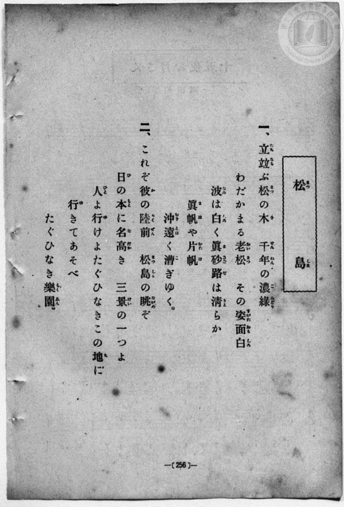
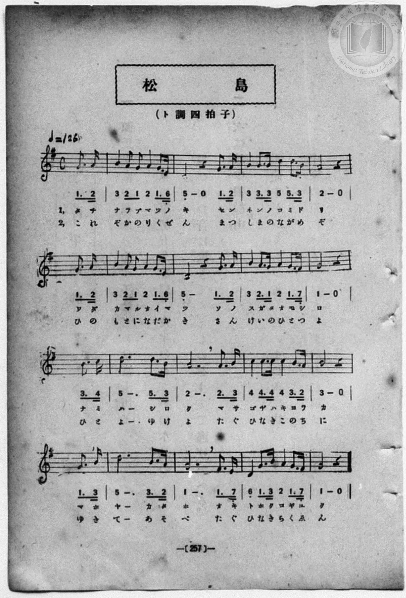

# 松島

> Re:Shōka 使用 AI 協助辨識與重建樂譜，可能會有錯誤。歡迎回報。

<audio controls src="matsushima.mp3"></audio>

- book: 新編 小學校・公學校 唱歌教材集（尋常科五・六學年用）
- 一條慎三郎 編《新編 小學校・公學校 唱歌教材集》（大正十二年十二月，索書號 0725-41）

## 說明

> [!NOTE]
> **原書資訊與歌詞全文**（對應 `P264.jpg`–`P265.jpg`，原書 p. 256–257，尋常科五・六學年第 17 首）：
> - **調性與拍號**：ト調四拍子（G 大調 4/4 拍），♩= 126
> - **樂曲結構**：弱起小節（第 4 拍起唱 `1. 2`）加 16 小節完整樂句。注意原譜每行開頭皆將上一行末拍之弱起拍拆置於行首（不完全小節），此處合併還原為標準 4/4 拍小節結構。
> - **原譜印刷對照**：第 15 小節（第四行倒數第 2 小節）首拍「ト／ひ」，五線譜符頭位於下加二間（D4 / `5_`），下方簡譜誤印為 `6_`（帶下點之 6），此處依五線譜與主和弦分解結構記為 `5_`。
>
> **一、**
> 立竝（たちなら）ぶ松（まつ）の木（き）　千年（せんねん）の濃綠（こみどり）
> わだかまる老松（おいまつ）　その姿面白（すがたおもしろ）
> 波（なみ）は白（しろ）く眞砂路（まさごぢ）は清（きよ）らか
> 眞帆（まほ）や片帆（かたほ）　沖遠（おきとほ）く漕（こ）ぎゆく。
>
> **二、**
> これぞ彼（か）の陸前（りくぜん）　松島（まつしま）の眺（ながめ）ぞ
> 日（ひ）の本（もと）に名高（なだか）き　三景（さんけい）の一（ひと）つよ
> 人（ひと）よ行（ゆ）けよたぐひなきこの地（ち）に
> 行（ゆ）きてあそべ　たぐひなき樂園（らくゑん）。


## 歌詞

```text
（TMD 檔案未包含歌詞註解）
```

## ABC

```abc
X:1
T:松島
M:4/4
L:1/16
Q:1/4=126
K:G
V:V1 name="Piano" snm="Pia"
[V:V1]
z4 z4 z4 G3 A | B4 A2 G2 A4 G3 E | D8 z4 G3 A | B4 B3 B d4 d3 B |
w: 1.~タ チ | ナ ラ ブ マ ツ ノ | キ セ ン | ネ ン ノ コ ミ ド
w: 2.~こ れ | ぞ か の り く ぜ | ん ま つ | し ま の な が め
A8 z4 G3 A | B4 A2 G2 A4 G3 E | D8 z4 G3 A | B4 A3 G A4 G3 F |
w: 1.~リ ワ ダ | カ マ ル オ イ マ | ツ ソ ノ | ス ガ タ オ モ シ
w: 2.~ぞ ひ の | も と に な だ か | き さ ん | け い の ひ と つ
G8 z4 B3 c | d12 d3 B | A12 A3 B | c4 c3 c c4 B3 A |
w: 1.~ロ ナ ミ | ハ シ ロ | ク マ サ | ゴ ヂ ハ キ ヨ ラ
w: 2.~よ ひ と | よ ゆ け | よ た ぐ | ひ な き こ の ち
B8 z4 G3 B | d12 B3 A | G12 G3 F | D4 G3 B A4 G3 F |
w: 1.~カ マ ホ | ヤ カ タ | ホ オ キ | ト ホ ク コ ギ ユ
w: 2.~に ゆ き | て あ そ | べ た ぐ | ひ な き ら く ゑ
G8 z4 z4 | z4 z4 z4 G3 A | B4 A2 G2 A4 G3 E | D8 z4 G3 A |
w: 1.~ク | タ チ | ナ ラ ブ マ ツ ノ | キ セ ン
w: 2.~ん | こ れ | ぞ か の り く ぜ | ん ま つ
B4 B3 B d4 d3 B | A8 z4 G3 A | B4 A2 G2 A4 G3 E | D8 z4 G3 A |
w: 1.~ネ ン ノ コ ミ ド | リ ワ ダ | カ マ ル オ イ マ | ツ ソ ノ
w: 2.~し ま の な が め | ぞ ひ の | も と に な だ か | き さ ん
B4 A3 G A4 G3 F | G8 z4 B3 c | d12 d3 B | A12 A3 B |
w: 1.~ス ガ タ オ モ シ | ロ ナ ミ | ハ シ ロ | ク マ サ
w: 2.~け い の ひ と つ | よ ひ と | よ ゆ け | よ た ぐ
c4 c3 c c4 B3 A | B8 z4 G3 B | d12 B3 A | G12 G3 F |
w: 1.~ゴ ヂ ハ キ ヨ ラ | カ マ ホ | ヤ カ タ | ホ オ キ
w: 2.~ひ な き こ の ち | に ゆ き | て あ そ | べ た ぐ
D4 G3 B A4 G3 F | G8 z4 z4 |
w: 1.~ト ホ ク コ ギ ユ | ク
w: 2.~ひ な き ら く ゑ | ん
```

## TMD 檔案連結

- [主旋律 TMD 檔案](matsushima.tmd) [[在 TMD Studio 編輯](https://tmdlang.github.io/Tmd-TS/#tmd=s7IKdvYPcrWy4qpTUCpJTLdSSM7PyUlNLsnMz7MqzsjPTozPrsyvSsyML84ojTe0NDJWgqssy88pzU21Si9KTEmNN403Q8gU55cWJadaFSdn5OfnxJekVpQk5edno8vHFySmp1oFGJmZIGQKivLLUvMS84C6C4oy80pSU8DaEQpSyzJTUkHSxcmJefFlqUWZaZmpKUiOSi0qBrsdYkVJUWJecXJRZgHIQwhV-UUlGflAhxdkVFplZBaX5BdlJifmxGcn5iUiFJVkpAK9l5dYUlqUii6angrVrsSlpaXwbO6-p5u3KWhpcSnaKhgamXHZ2yq4c9mY6JvYgfSBPG-l8GzahufbVyg83dD_dO2OZwsWPm7e_bR1DYSt8HTKxmdre55Nnfls7oSXs9ve7-l4uqH76Y4dz5dPfLJrCljpWqDSpzu3PJ-y4v2eTrB7nuxoeLZo7rPWvic7Ol829ykAjX_c0EWKPY8bukFWLVn-bO3ip72NT3b1AG2AMJ7N6Xi_p-f5lkXPZu94MXO-goG5kamuiSHYbi59LQVbagEuBQUFO4VoRT__ENdYCEdL62nffJC9m9tfrOh60dEOdPOLlfOetq54Nq1dSwscOr3P2jsVEkCpRy-rID3hUcNkEMcUzAE6HGKAQoGegpGpGVDSyNQcJIorUNesUTA0V3i5bBrQf-_3zII4QxfokBer9j9rWA5yQncvMBhAls963NwBFH46ezZQ7OnaCUDnuCsAwxAopgCMcgWgKNiUnkczV0KSA9y0Zyuans3e9HzrhGfLu8FGPd2z8cXW7cC4er6-AWgOyB1gA0CCUzYqJBgC3Q_0TufTrgUKhmagSAUqfLoOGINbgGY97V_6uKHp2eYVz1r6gR5-sXbOs_X9Lxb2vJzW_XLB2uez2p5uaH-yowuYToCCz-asBhr8ZGc3xE4g-1l32_O9655N2wPSAvJ6x5MdvUDDgeEMcxHIG8_WLnkxc-rTCR1P9m592dQCtOh5065nK2Y-2zUN5l-Icoi_gC5CeBjiqqe9G552AH3Z-7x1Odjb4PA2hXoH4m9gcAKd8bRh0rOpO0DSRnDZTqDbgHY8bugBBvz7Pf2PGzc9bgAGcQ8wEp9vnwU0__maZUD_PtnbC_TLkx3dwMACJuCX0yYDTXYxUdBXSDCNBwUiSMuO7mfTdj7fsBCo68WqJUCHAf2ikGAGku94umMbUP7l7nnAQFIwQ_b8k31z4ZYB08KTHbufTup5umfZ0462F8sXQ_z9YsUMsFlAu2BBAEvNwAh43NAILB7A_Oeru5-vngu073Hj_MeNCx83rnrcBLSq83HjNmBBAhbf97hxCVhk3bM5wOwOFAElqccNDU97m4HJFSwy-3HT5MeNa4EkVOX-5ufbFoClgOL7HzeufNzUBZSCWPq4CRhuCx43doMMb-p-0dAIs6vrcWMLwsaGhseNc4GmPV2-_-XcRc9n7gWrmfm4sQfs2q7HTU2PG6c_bgK5B2Lys82LwGpWAS0Fu2Q9TBdU2ePG_udz5j1f0PRi-3qY76Y-bpzyuBGoEaT-2Y5WiB8fNwHjtxMYGkB3QsNqzrynO0DFIVjXbrBsy_POdpgg0DtAV4HFGxqebZr2shESAkBP9T5uXAGVaux_tmcqJGTA3L7HTW1AQYxo2tWDFE2gYGwC-nre0717IHZBwvnlzB1PO4H-6gAGL8iQxjnQKAA6AFwPwGMQFAKNwEAG6Xo-ZxcslHoeNzWCBedBA3D6UrDUJliMrwEbDgxnUEn_uHH10wm9L1fPgGkHRSJYHJgjGoAl_7OZkFCdCk4PE4GxCTEHmOggxsLMWQIMXoiNT3ZBHAOTauoAZj2wpcBQBaqcCBQBB-wEsBqgpcDABBq-7umcDWCNCyEOg5iGqheoctnjRqDjgaloJzg5oZgDKrXmTAKrB8XL4yagXZDQA8cF5dUJFCho6XNx-SaWFJcWZ2TmJloFZCbm5TvUGNQoVIPsUbAxNNMCR7wCtrpMAVJGArM6sCiCFJ8KGibQEklHAVbRaGLRCbQXZGqNggGwAARBdNoQTBoBVRhDRYygoiAaocIsHqjENB4qBoO4TYHQxgqmUD6ENgaqgJmL0wywi30MaxRgtqHTj5v2Q-jmRqB5j5u7YOLNK8HkNDA5Dy7aAqX7QKqb1qLZjzB1N1TdZrCpvXD9m-H6HzdB2CDefCjdCVa9CpepzeuhdAPMZ0Z4fNY4GeqWHpCpjXA_NHaDyXVgObh_G_uh9BywzyB6sbihcR-UXgI2dTqG-DoghvkAWCRA3QAOXbgbME3dBNddw4U78YLS7K4ectIsdVMkRLchminmIFMgTExDIFpNkJLk46bVMO-DE9jjZhD_cRM88JqWwGVByQKS9LAEXtNeqDpIotwJF18Dpfcjm9q8CCq6HWzqWlymQrMCKHEiEhuw8IbJN64Ak2A3I0X4AijdDY7wXlymN06FumIyWN1EuDg0g4GTESRRwOyCJ7qmDpymwpLRCoLJaEcnOckIVgShQ9xFEgxCxEEqTKAiENoEzoekEORkBoOoCRFoBiINNUOyLSYExS-YBsYwKMwgRQcWddDC7XHTVrC6LXBxSEyDbEAUdI-boTEBLB6RUzAMIlIP1NTm2SipBz3mEK5tg9DAlIBXXSO0qGycAE43iBQCSYGgFAcr-GCFHIheCFaN07Vw23sJpRtIY55q6QYR5-jlBgwiFS3wAgqWDkgofmA0ctKBFC9YAhkaraCCA6RuNk510EAHJg-QOlikwXSAEh1SLdcEjYzmZVgTJHr9hZRsGpfhckEjNJE2zgVHMKzow1RHRLJp6oSLQuvCJkhixFUXIlxay8Wla6eAaJQpYPCUuQA)]
- [鋼琴伴奏 TMD 檔案](matsushima_piano.tmd) [[在 TMD Studio 編輯](https://tmdlang.github.io/Tmd-TS/#tmd=s7IKdvYPcrWy4qpTUCpJTLdSSM7PyUlNLsnMz7MqzsjPTozPrsyvSsyML84ojTe0NDJWgqssy88pzU21Si9KTEmNN403Q8gU55cWJadaFSdn5OfnxJekVpQk5edno8vHFySmp1oFGJmZIGQKivLLUvMS84C6C4oy80pSU8DaEQpSyzJTUkHSxcmJefFlqUWZaZmpKUiOSi0qBrsdYkVJUWJecXJRZgHIQwhV-UUlGflAhxdkVFplZBaX5BdlJifmxGcn5iUiFCUWATWnp-am5pVYFWQm5uXHJyYn5-cWJOZlgsQQCksygIqs8hJLSotS0UXTU6H2KHFpaSk8m7vv6eZt7_d0vJw981ln98vuPc8nbHmyZ8vTpf3v93QqaGlxKdoqGBqZcdnbKrhz2Zjom9iBzAOFnpXCs2kbnm9fofB0Q__TtTueLVj4uHn309Y1ELbC0ykbn63teTZ15rO5E17ObgNa8XRD99MdO54vn_hk1xSw0rVApU93bnk-ZQXQLrA7n-xoeLZo7rPWvic7Ol829ykAjX_c0EWKPY8bukFWLVn-bO3ip72NT3b1AG2AMJ7N6Xi_p-f5lkXPZu94MXO-goG5kamuiSHYbi7fxJLi0uKMzNxEqwBQ0AZ5ONQY1ChUcykAgY2hmZYdmKWvpWCLDhSe7tn4Yuv2Fx3tz9esAfrgxcIeBQ0TkHOfr2_QUQCmJ1O9rIJ0TSw6tfTBptYoGCjogiE6bQgmjYAqjKEiRlBREI1QYRYPVGIaDxWDQdymQGhjBVMoH0IbA1XAzMVpBtjFPoY1CjDb0OnHTfshdHMj0LzHzV0w8eaVYHIamJwHF22B0n0g1U1r0exHmLobqm4z2NReuP7NcP2PmyBsEG8-lO4Eq16Fy9Tm9VC6AeYzIzw-a5wMdUsPyNRGuB8au8HkOrAc3L-N_VB6DthnEL1Y3NC4D0ovAZs6HUN8HRDDfPC4sQfqBnDowt2AaeomuO4aLtyJF5Rmd_WQk2apmyIhug3RTDEHmQJhYhoC0WqClCQfN62GeR-cwB43g_iPm-CB17QELgtKFpCkhyXwmvZC1UES5U64-BoovR_Z1OZFUNHtYFPX4jIVmhVAiROR2B43NcHkG1eASbCbkSJ8AZTuBkd4Ly7TG6dCXTEZrG4iXByawcDJCJIoYHbBE11TB05TYcloBcFktKOTnGQEK4LQIe4iCQYh4iAVJlARCG0C50NSCHIyg0HUhAg0A5GGmiHZFhOC4hdMA2MYFGaQogOLOmjh9rhpK1jdFrg4JKZBNiAKusfN0JgAFo_IKRgGEakHamrzbJTUgx5zCNe2QWhgSsCrrhFaVDZOAKcbRAqBpEBQioMVfLBCDkQvBKvG6Vq47b2E0s3T2bOpmW4QcY5ebsAgUtECL6Bg6YCE4gdGIycdSPGCJZCh0QoqOEDqZuNUBw10YPIAqYNFGkwHKNEh1XJN0MhoXoY1QaLXX0jJpnEZLhc0QhNp41xwBMOKPkx1RCSbpk64KLQubIIkRlx1IcKltZhtMh-UNpkJtEkGajyBoCE4ruIVog1jFUzigbRJfCxCBEph8k1BSk2BSsEMkBDUVKKNgpuAoQLVJBxWQnRiEyPONLgDMV2KaRYozYLDVtdOARG80T5AKTQRI7CIMhcA)]

## 分析

```text
================================================================================
📊 TMD Song Profile: [ 松島 ]
================================================================================
⏱  Duration:       1:04 (64.8s), 34 measures total
🎼 Key & Tempo:    首調基準 G, != 126.0 BPM, <4/4>
   - 分析範圍：      由實際發聲的音符與和弦推測調性；播放脈絡另行呈現
🎤 人聲音域:    D4 (MIDI 62) – D5 (MIDI 74) [跨度: 12 個半音 / 1.0 個八度, 難度: easy]
   - 最低音:  D4 in [Matsushima #1 @ m.3, 0:03]
   - 最高音: D5 in [Matsushima #1 @ m.4, 0:06]
   - 適合: soprano, mezzo-soprano, contralto, tenor, baritone, bass
🏛  結構:      Matsushima (32.4s) -> Matsushima (32.4s)
⚡ 編曲密度:        Peak 1 軌道同時演奏
🗝  調性診斷：       G 大調（純淨自然大調，未偵測到可信轉調）
   - 風格氣質:    純淨自然大調（陽光明朗、易唱易記，無明顯調外色彩）
   - 轉調歷程:    全曲維持單一推測調性（未偵測到可信轉調）
   - 核心骨幹音:  G, D, A, B, C
   - 調性數值:    G 大調 [相關度: 0.86, 穩定度: High, 自然音純度: 100.0%]
   - 候選調性 (K-S): G 大調 (0.86), D 大調 (0.74), B 小調 (0.55)
   - 五度圈歷程:   +1 -> +1
   - 各段落調性細節:
     • [Matsushima #1]: G 大調 (r: 0.86, 自然音純度: 100.0%)
     • [Matsushima #2]: G 大調 (r: 0.86, 自然音純度: 100.0%)

  [ 五度圈游移軌跡 ]
               C  
         F           [G ]*
      Bb               D  
      Eb               A  
         Ab           E  
            Db       B  
               F# 
     (* = active key center)

  [ 十二半音累積音高分佈 ]
     C  : █████                      5.6%
     C# :                            0.0%
     D  : ████████████████████      23.3%
     D# :                            0.0%
     E  : █                          0.9%
     F  :                            0.0%
     F# : █                          1.3%
     G  : ████████████████████████  28.4%
     G# :                            0.0%
     A  : ███████████████████       22.4%
     A# :                            0.0%
     B  : ███████████████           18.1%
--------------------------------------------------------------------------------
Assignment 軌道音域：
  - Piano         : D4 – D5 (12 個半音 / 1.0 個八度, 132 個音符)
================================================================================
```


## 原書掃描頁






