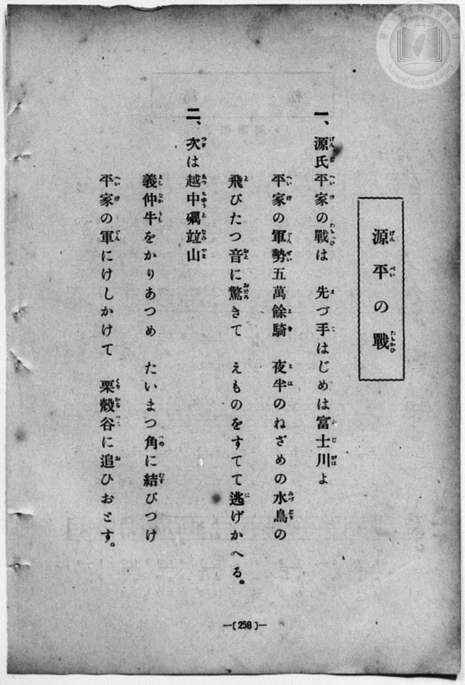
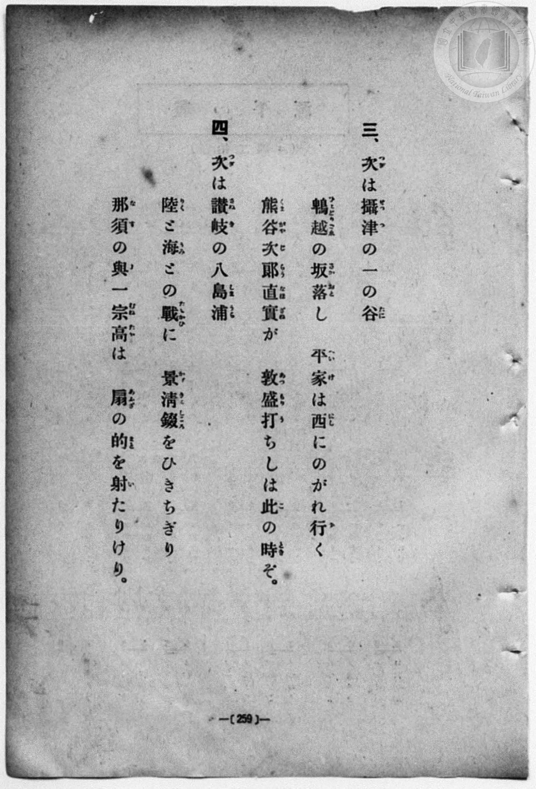
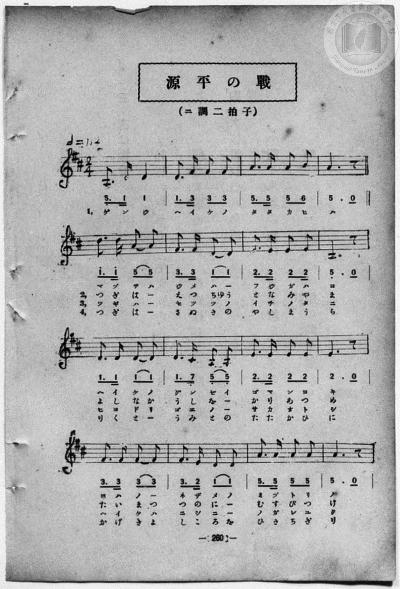
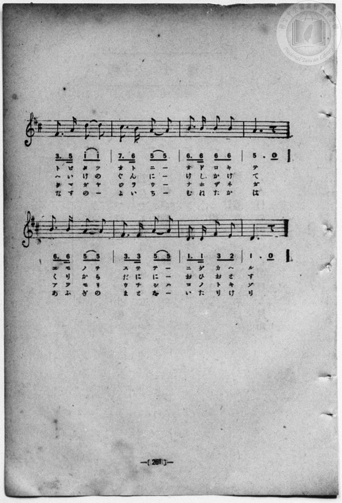

# 源平の戰

> Re:Shōka 使用 AI 協助辨識與重建樂譜，可能會有錯誤。歡迎回報。

- **鋼琴伴奏版**：<br><audio controls src="genpei_no_tatakai.mp3"></audio>
- **NEUTRINO 歌聲合成版**：<br><audio controls src="genpei_no_tatakai_neutrino.mp3"></audio>

- book: 新編 小學校・公學校 唱歌教材集（尋常科五・六學年用）
- 一條慎三郎 編《新編 小學校・公學校 唱歌教材集》（大正十二年十二月，索書號 0725-41）

## 說明

> [!NOTE]
> **原書資訊與歌詞全文**（對應 `P266.jpg`–`P269.jpg`，原書 p. 258–261，尋常科五・六學年第 18 首）：
> - **調性與拍號**：ニ調二拍子（D 大調 2/4 拍），♩= 114
> - **樂曲結構**：此曲採獨特之「序唱（4 小節，僅第 1 段演唱「源氏平家の戰は」）＋主體（20 小節，第 1～4 段反覆演唱）」形式。第 1 段共 24 小節，第 2～4 段則直接由第 5 小節（第二行「つぎは…」）起唱，各 20 小節。
>
> **一、**
> 源氏平家（げんじへいけ）の戰（たたかひ）は　先（ま）づ手（て）はじめは富士川（ふじがは）よ
> 平家（へいけ）の軍勢五萬餘騎（ぐんぜいごまんよき）　夜半（よは）のねざめの水鳥（みづとり）の
> 飛（と）びたつ音（おと）に驚（おどろ）きて　えものをすてて逃（に）げかへる。
>
> **二、**
> 次（つぎ）は越中礪竝山（ゑつちゆうとなみやま）
> 義仲牛（よしなかうし）をかりあつめ　たいまつ角（つの）に結（むす）びつけ
> 平家（へいけ）の軍（ぐん）にけしかけて　俱利伽羅谷（くりからだに）に追（お）ひおとす。
>
> **三、**
> 次（つぎ）は攝津（せつつ）の一（いち）の谷（たに）
> 鵯越（ひよどりごゑ）の坂落（さかおと）し　平家（へいけ）は西（にし）にのがれ行（ゆ）く
> 熊谷次郎直實（くまがやじらうなほざね）が　敦盛打（あつもりう）ちしは此（こ）の時（とき）ぞ。
>
> **四、**
> 次（つぎ）は讚岐（さぬき）の八島浦（やしまうら）
> 陸（りく）と海（うみ）との戰（たたかひ）に　景清錣（かげきよしころ）をひきちぎり
> 那須（なす）の與一宗高（よいちむねたか）は　扇（あふぎ）の的（まと）を射（い）たりけり。


## 歌詞

```text
（TMD 檔案未包含歌詞註解）
```

## ABC

```abc
X:1
T:源平の戰
M:2/4
L:1/16
Q:1/4=114
K:D
V:V1 name="Piano" snm="Pia"
[V:V1]
A,3 D D4 | D3 F F2 F2 | A3 A A2 B2 | A6 z2 |
w: ゲ ン ジ | ヘ イ ケ ノ | タ タ カ ヒ | ハ
d3 d A2 A2 | F3 F D2 D2 | E3 E E2 E2 | A,6 z2 |
w: 1.~マ ヅ テ ハ | ジ メ ハ _ | フ ジ ガ ハ | ヨ
w: 2.~つ ぎ は _ | ゑ つ ちゆ う | と な み や | ま
w: 3.~ツ ギ ハ _ | セ ツ ツ ノ | イ チ ノ タ | ニ
w: 4.~つ ぎ は _ | さ ぬ き の | や し ま う | ら
D3 D D2 D2 | D3 C A,2 A,2 | E3 E E2 E2 | E6 z2 |
w: 1.~ヘ イ ケ ノ | グ ン ゼ イ | ゴ マ ン ヨ | キ
w: 2.~よ し な か | う し を _ | か り あ つ | め
w: 3.~ヒ ヨ ド リ | ゴ ヱ ノ _ | サ カ オ ト | シ
w: 4.~り く と _ | う み と の | た た か ひ | に
F3 F F2 F2 | F3 E D2 D2 | A3 A A2 A2 | A6 z2 |
w: 1.~ヨ ハ ノ _ | ネ ザ メ ノ | ミ ヅ ト リ | ノ
w: 2.~た い ま つ | つ の に _ | む す び つ | け
w: 3.~ヘ イ ケ ハ | ニ シ ニ _ | ノ ガ レ ユ | ク
w: 4.~か げ き よ | し こ ろ を | ひ き ち ぎ | り
F3 A d2 d2 | c3 B A2 A2 | B3 B B2 B2 | A6 z2 |
w: 1.~ト ビ タ ツ | オ ト ニ _ | オ ド ロ キ | テ
w: 2.~へ い け の | ぐ ん に _ | け し か け | て
w: 3.~ク マ ガ ヤ | ジ ラ ウ _ | ナ ホ ザ ネ | ガ
w: 4.~な す の _ | よ い ち _ | む ね た か | は
B3 B A2 A2 | F3 F A2 A2 | D3 D F2 E2 | D6 z2 |
w: 1.~エ モ ノ ヲ | ス テ テ _ | ニ ゲ カ ヘ | ル
w: 2.~く り か ら | だ に に _ | お ひ お と | す
w: 3.~ア ツ モ リ | ウ チ シ ハ | コ ノ ト キ | ゾ
w: 4.~あ ふ ぎ の | ま と を _ | い た り け | り
```

## TMD 檔案連結

- [主旋律 TMD 檔案](genpei_no_tatakai.tmd) [[在 TMD Studio 編輯](https://tmdlang.github.io/Tmd-TS/#tmd=s7IKdvYPcrWy4qpTUCpJTLdSSM7PyUlNLsnMz7MqzsjPTozPrsyvSsyML84ojTe0NDJWgqssy88pzU21Si9KTEmNN403Q8gU55cWJadaFSdn5OfnxJekVpQk5edno8vHFySmp1oFGJkh6Swoyi9LzUvMA-ouKMrMK0lNAWtHKEgty0xJBUkXJyfmxZelFmWmZaamIDkqtagY7HaIFSVFiXnFyUWZBSAPIVTlF5Vk5AMdXpBRaZWRWVySX5SZnJgTn52Yl4hQVJKRCvQeRLoSXTg3MyezJBFZHGhGemaeVWkeyIElUGdpaSk82zXh6c7NjxvXPevYoKClxaVoq2BoaMJlb6vgwmVjpG9iBzIBFD5WCs-mbXi-fYXC0w39T9fueLZg4ePm3U9b10DYCk-nbHy2tufZ1JnP5k54Obvt_Z6Opxu6n-7Y8Xz5xCe7poCVrgUqfbpzy_MpK97v6QS77MmOhmeL5j5r7Xuyo_Nlc58C0PjHDV2k2PO4oRtk1ZLlz9Yuftrb-GRXD9AGCOPZnI73e3qeb1n0bPaOFzPnKxiYG5nqmhiC7ebS11KwpRbgUlBQsFOIVvTzD3GNhXC0tJ72zQfZu7n9xYquFx3tQDe_WDnvaeuKZ9PatbTAodP7rL1TIQGUwPSyCtITHjVMBnEswRygwyEGKBToKRiZWgAljcyATu_BGahr1igYWii8XDYN6L_3e2ZBnKELdMiLVfufNSwHOaG7FxgMIMtnPW7uBgqDwqi79-naCUDnuCgAwxAopgCMcgWgKNiUnkczV0KSA9y0Zyuans3e9HzrhGfLu8FGPVu7BCjwrG_h894Vzzt3PtnZ_bih5-mufmA8AY01AcXi8_UNIJc3t4IdqfBs3dZne6YA5YEKganvGTCad25-um4bJA0-blz_uAFiffeTHbtfrp4CNMbIAGEO2JD3e-cBnblu69P-3hfL2iDGAfUAdT7du-jpnv7HDU1wy562blQwQnIISMIIbkBn-_PZW571LX0-ZSNIwhSurgPIBYbQi4U9QHc-blzyuLEP6LZHDcsgznuxdTvYzp6nE1oU4O4D2gsOK1gqACbwxw2NwGwF5iP7FmjB48ZJj5smP26c8bhxx-PGlseNE0FeAIcCWHY-GHU_btwEFgeGS8PTVmCaBkrtA4ssfdYJSv2PG5dBFQCNamoEMp6u73m6ePXT7XPBslvBVgD9sB6krKkD4hgkZ6DY_mJ379PuRcDk9WLCmpdLZrxc0QdWMwHs1DlglVOADgBxm4DioLAAOWzJnKe9XSCVIEGwRY3rHjeufdw4Deykdc82bHm5eSnYqP1Alz9uXPG4CagepAzinpeLZ4NlQYXD40ZgiQT0-5KX8zeDBbtg4qtfrpwFE1n5uAlse2MvMASAbnjcCLS9CWRv06THjTNBgo3LXjY0g9WvBqsEigPDc8fjJmAqRYupXcB4RsTUmoVgXaBYh4Tti21dT3asfb5k1fPVc59uBKXtx00TwQoWPm5qe9wIRCseN64C-a4JGESgCIIY9Xzfyie7Nz3vBPsOFDjTwcqAzgBqmQ6OEbCrmoA-Ajp-CSi4QH4Beh9kDlDkxfJJMMesgwQCMP-BTQMqmwkLLqDsRIIxC49KiDlAKbB7gI4BMkBh-GT_xqcdK5_s2ft8X-uLDdvB6vvBbgO6EKhlASwkV7_YvxcSEWDuJkgcgYIdIwsA0weegH02Ze6zLZCEMRssvgTiWmDWAQsC3Q_UAnY_1D3AkAG5AZpstoKiBiy-CRy8wFQBdMkUYOxAdD2d2_RiAsSpU8E-hael6aB0iz2s1r9Yuh-SbKBxBGIA03PP4yZQiQAOfGAdBxTvh8ZyWxfQeUDfAasxYIHydD0wS4KDDhSDQF1Ak4F5E6geGOnA2N8NyheNa8EmANNdw7Opy57Pnv2sExgvQF2QZNAE9gjEloXgaFoPLGzBCiDRt-7ZzCZIloFmw8Z56IH_dPZs_Kl63aynm8BpCRQ4a2DmrHvauvrp5m3PtoJ9AXI80HagR9qAXkCE_MwdYFmgI_vBulY82wqJIKAfgaEHEsFdmq0G-Xrm-mc7Wl_2LAYrAEoBM0IvLI8AixewY0C5A5i6gHkcGAh9QOugtjctfrkAUhgCwxOSC9YBazlgsnm6bvrL1TNg2Q2UfsA5BVgWgRwAL0ufdbbDQhtYQkICZN3zWS2QAhaaSJomPd0AEQGSQAXzwf6dCCIhQU158wEKFLT0ubgCivJz8tNLge3OzMS8fIcagxqFapAtCjaGZlrgWFXA1nJRANVVOxrAKXMWouID1sL9SxU0YHWfjgKwfWEBal9oYjECaD3I-BoF03hgTa8LNMIQTOsChSAsYyAEkSARU7CIKZg2QxKBQAOQCNg4nxqFx02bwIKPmzcD2Tvghj5ungERb1oCxBvBKvogMk37oTL7gXg1WGYSVE8_kjUgh9Zw1XJxhQGb1WSFGbh-JzmEDOMgIRQH9jQI14CDBRQ4oKAC4RoFI7CIEZgGYXjIYoSRIchj86CB1ArEbWAWyKugwIAE2ePmhUjeB-mYCg2kHUC8BllH8wqMQALbYwSUa1wC0dXYB8TrEaY1TYSKAyMDXKWBOSASpAliIDCrATEoboBlAlRmH3arjEHOAKkBqV2H6vCm3VAPtUDVIOId6rjmRqgYJCWAzOrGbo8JHi81QgOocQ0Q94JZ66D2QF3WOB3qA7hPmzox7CGQ6zrJSkFg8yFZDJJaICLm8ZBEAiawJSGICPYUhDs7bYAGKygD7oGqgchsgcrMA8uCWKCoBsmsxR7goDTU1IEUfKvALFD0gIIcFIxQmSZQloVFBST6gMUmkN0EVgFzQSN2e8AJCGICyE2Pm0ER87gZZBuyuzdCfQlLWluh9qwGYrDLmkFuBclsx24PKAEBXQVxdT88qaP6BlgMgcXhCahxPlRmPtRvwDoKKgMqrkhIQMAampwEBCtuECUyRMQIKUkhl9GQQgpHGQ1OPdAsDsyoKCHaDMo4oBDdBi6BkFJVMzQMwCUWKJThsQPXjyXtwEMOmPmhWQ-aEuDZGFhcwEMRFDsNUPGZQAxOo3AdkDILe9rBzA2w0hGWFrcjFSsIV4PK0sfNkPJ0GdQFsEIFS9qBpezGSbBCBpw7QDLToTKTgWIQGWglBk4rIJleUFkLZsFyKiQlEp16QN00jNQDHkIgIvWYQioyMFGjYA4WM0NKLaB6HSQCovHW8eD0Ay0TmkG-BVcR4KId5CdQqoDkRJTwhot3AvFacPiASJBZkHyHPf1Aa0Nw-gHFPyJPToDINAFdgJx-oKkEUlpB8ipIBCQDil8c6Qca5-CSEVq7wkosWH28EsiGmQByNbQUaZ4Nzi0gFijWQTpA-nGlH2gogFM3yCew0IGVsSB_gtIITByWG9ZC8xKi7MVMpfhLnta15KQdWKrAbPogRGDVG0gGUm_B2pJYUk4TrORZBKv0m6FladNOqEwbUppAzsGb4M1DUG4HyWCWvoiUA2mCQOogcDoAV_YgmQXQMAXWGigpB1YvAO0BsyG1AEhmJnZ7wClnEdTVoOYNiI2otSCp5TGoeQOujxBtPFC5BilboWUpLC804WhggdMOqCYFuWortARB5AWILpB7UethWMMHWG-Byxp4XsBS8gAb1rp2CrAuiQKQDW5ngxjKXAA)]
- [鋼琴伴奏 TMD 檔案](genpei_no_tatakai_piano.tmd) [[在 TMD Studio 編輯](https://tmdlang.github.io/Tmd-TS/#tmd=s7IKdvYPcrWy4qpTUCpJTLdSSM7PyUlNLsnMz7MqzsjPTozPrsyvSsyML84ojTe0NDJWgqssy88pzU21Si9KTEmNN403Q8gU55cWJadaFSdn5OfnxJekVpQk5edno8vHFySmp1oFGJkh6Swoyi9LzUvMA-ouKMrMK0lNAWtHKEgty0xJBUkXJyfmxZelFmWmZaamIDkqtagY7HaIFSVFiXnFyUWZBSAPIVTlF5Vk5AMdXpBRaZWRWVySX5SZnJgTn52Yl4hQlFgE1JyempuaV2JVkJmYlx-fmJycn1uQmJcJEkMoLMkAKoKaU4kunJuZk1mSCBLX0lJ4tmvC052bHzeue9ax4f2ejpezZz7r7H7Zvef5hC1P9mx5urT__Z5OBS0tLkVbBUNDEy57WwUXLhsjfRM7kKGgMLRSeDZtw_PtKxSebuh_unbHswULHzfvftq6BsJWeDpl47O1Pc-mznw2d8LL2W1AK55u6H66Y8fz5ROf7JoCVroWqPTpzi3Pp6wA2gV27JMdDc8WzX3W2vdkR-fL5j4FoPGPG7pIsedxQzfIqiXLn61d_LS38cmuHqANEMazOR3v9_Q837Lo2ewdL2bOVzAwNzLVNTEE280VUJSfk59eCkwEoOAN8nCoMahRqOZSAAIbQzMtOzBLX0vBFh0oPF-zBujsFwt73u-ZBWQrGCo8W7f16a7-p_1LFTRMQK5-vr5BRwGYuCz0sgrSNbEYoaUPNr5GwTReQRcIDYEQROsChSAsYyAEkSARU7CIKZg2QxKBQAOQCNg4nxqFx02bwIKPmzcD2Tvghj5ungERb1oCxBvBKvogMk37oTL7gXg1WGYSVE8_kjUgh9Zw1aIHnA9KwFlAww3oi3iFaMNYGIWTbwKkTEB803ggyzQ-FswwgNgUBsxPZMbPrh5g_JAcG4ZxkNiIAwcwCNeAowAUEaBoAeEaBSOwiBGYBmF4LGLEhyEoEOdBI6QViNvALFCwggIeEj2PmxciBTVIx1RohOwA4jXIOppXYEQI2B4joFzjEoiuxj4gXo8wrWkiVBwY8Y0LHzeBndAIIkGaIAY-blwFxKB08LipBSqzD7tVxiBngNSA1K5DdXjTbqiHWqBqEGkM6rjmRqgYJNWBzOrGbo8JHi81QgOocQ0Q94JZ66D2QF3WOB3qA7hPmzox7CGQwzvJSkFg8yHZGZJaICLm8ZBEAiawJSGICPYUhDvrboAGKyiz74GqgchsgcrMA8uCWKCoBsmsxR7goDTU1IEUfKvALFD0gIIcFIxQmSZQ8QCLCkj0PW7qArKbwCpgLmjEbg84AUFMALnpcTMoYh43g2xDdvdGqC9hSWsr1J7VQAx2WTPIrSCZ7djtASUgoKsgru6HJ3VU3wCLPLA4PAE1zofKzIf67XEjqEAFyYCKRhIS0NPZs8lJQLDiBlH6Q0SMkJIUcn0AKaRw1Afg1APN4sCMihKizaCMAwrRbeASCClVNUPDAFxigUIZHjtw_VjSDjzkgJkfmvWgKQGejYHFBTwUQbHTABWfCcTgNArXASmzsKcdzNwAKx1haXE7UrGCcDWoLH3cDClPl0FdACtUsKQdWMpunAQrZMC5AyQzHSozGSgGkYFWmOC0ApLpBZW1YBYsp0JSItGpB9hiwkw9lkSmHlNIRQYmahTMwWJmSKkF1IYAiYBovO0JcPqBlgnNIN-Cqwhw0Q7yEyhVQHIiSnjDxTuBeC04fEAkyCxIvsOefqC1ITj9gOIfkScnQGSagC5ATj_QVAIprSB5FSQCkgHFL470A41zcMkIrV1hJRasPl4JZMNMALkaWoo0zwbnFhALFOsgHSD9uNIPNBTAqRvkE1jowMpYkD9BaQQmDssNa6F5CVH2YqZS_CVP61py0g4sVWA2fRAisOoNJAOpt2DtViwppwlW8iyCVfrN0LK0aSdUpg0pTSDn4E3wpigot4NkMEtfRMqBNEEgdRA4HYAre5DMAmiYAmsNlJQDqxeA9oDZkFoAJDMTuz3glLMI6mpQ8wbERtRakNTyGNS8AddHiDYeqFyDlK3QshSWF5pwNLDAaQdUk4JctRVagiDyAkQXyL2o9TCs4QOst8BlDTwvYCl5UJvW5LbgUVrsYAaWVjx2owhqJc04klxKhKvgItDeCbyTApVANQYqS8g1SN5CqIB2dHTtFGC9KgUgGxw50T5AJQiOETLHGJkDtBvIUeYCAA)]

## 分析

```text
================================================================================
📊 TMD Song Profile: [ 源平の戰 ]
================================================================================
⏱  Duration:       0:25 (25.3s), 24 measures total
🎼 Key & Tempo:    首調基準 D, != 114.0 BPM, <2/4>
   - 分析範圍：      由實際發聲的音符與和弦推測調性；播放脈絡另行呈現
🎤 人聲音域:    A3 (MIDI 57) – D5 (MIDI 74) [跨度: 17 個半音 / 1.4 個八度, 難度: challenging]
   - 最低音:  A3 in [Prologue #1 @ m.1, 0:00]
   - 最高音: D5 in [Prologue #1 @ m.5, 0:04]
   - 適合: soprano, mezzo-soprano, contralto, tenor, baritone, bass
🏛  結構:      Prologue (4.2s) -> Verse (21.1s)
⚡ 編曲密度:        Peak 1 軌道同時演奏
🗝  調性診斷：       D 調性不明確（純淨自然大調，未偵測到可信轉調）
   - 風格氣質:    純淨自然大調（陽光明朗、易唱易記，無明顯調外色彩）
   - 轉調歷程:    全曲維持單一推測調性（未偵測到可信轉調）
   - 核心骨幹音:  A, D, F#, E, B
   - 調性數值:    D 調性不明確 [相關度: 0.85, 穩定度: Ambiguous, 自然音純度: 100.0%]
   - 候選調性 (K-S): D 大調 (0.85), A 大調 (0.84), F# 小調 (0.66)
   - 五度圈歷程:   +2 -> +3
   - 各段落調性細節:
     • [Prologue #1]: D 大調 (r: 0.78, 自然音純度: 100.0%)
     • [Verse #1]: A 調性不明確 (r: 0.85, 自然音純度: 100.0%)

  [ 五度圈游移軌跡 ]
               C  
         F            G  
      Bb              [D ]*
      Eb              [A ]*
         Ab           E  
            Db       B  
               F# 
     (* = active key center)

  [ 十二半音累積音高分佈 ]
     C  :                            0.0%
     C# : ██                         2.2%
     D  : █████████████████         25.0%
     D# :                            0.0%
     E  : ██████████                13.9%
     F  :                            0.0%
     F# : ███████████               16.1%
     G  :                            0.0%
     G# :                            0.0%
     A  : ████████████████████████  34.4%
     A# :                            0.0%
     B  : ██████                     8.3%
--------------------------------------------------------------------------------
Assignment 軌道音域：
  - Piano         : A3 – D5 (17 個半音 / 1.4 個八度, 77 個音符)
================================================================================
```


## 原書掃描頁










