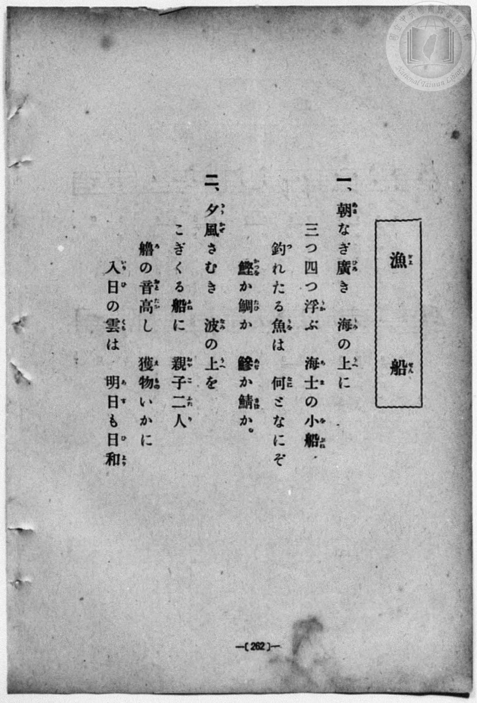
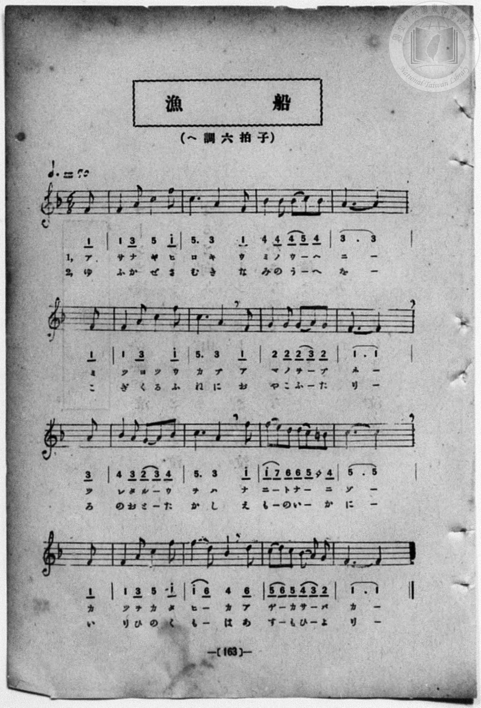

# 漁船

> Re:Shōka 使用 AI 協助辨識與重建樂譜，可能會有錯誤。歡迎回報。

<audio controls src="gyosen.mp3"></audio>

- book: 新編 小學校・公學校 唱歌教材集（尋常科五・六學年用）
- 一條慎三郎 編《新編 小學校・公學校 唱歌教材集》（大正十二年十二月，索書號 0725-41）

## 說明

> [!NOTE]
> **原書資訊與歌詞全文**（對應 `P270.jpg`–`P271.jpg`，原書 p. 262–263〔P271 頁碼誤印為 163〕，尋常科五・六學年第 19 首）：
> - **調性與拍號**：ヘ調六拍子（F 大調 6/8 拍），附點四分音符 ♩. = 70（相當於八分音符 ♪ = 210，TMD 四分音符基準 `!= 140`）
> - **樂曲結構**：弱起小節（第 6 拍八分音符起唱）加 16 小節完整樂句。注意本曲（「朝なぎ廣き海の上に」）與文部省《尋常小學唱歌》2/4 拍〈漁船〉（「えんやらえんやら艪拍子そろへて」）為同名異曲。
> - **原譜印刷勘誤**：
>   1. 第 5 小節（第二行第 1 完整小節）第 2 組拍子「ヨツ／くる」，五線譜 jelas 印為四分音符 C5（`5`）接八分音符 F5（`1^`），下方簡譜漏印 `5`，此處依五線譜與字數補回 `5`。
>   2. 第 11 小節（第三行第 3 完整小節）第 5 個八分音符處，五線譜為升記號 ♯F4（`4'`），下方簡譜誤將升記號印作八分休止符，此處依五線譜校正為 `4'`。
>
> **一、**
> 朝（あさ）なぎ廣（ひろ）き　海（うみ）の上（うへ）に
> 三つ四つ浮（うか）ぶ　海士（あま）の小船（をぶね）
> 釣（つ）れたる魚（うを）は　何（なに）となにぞ
> 鰹（かつを）か鯛（たひ）か　鰺（あぢ）か鯖（さば）か。
>
> **二、**
> 夕風（ゆふかぜ）さむき　波（なみ）の上（うへ）を
> こぎくる船（ふね）に　親子二人（おやこふたり）
> 艪（ろ）の音高（おとたか）し　獲物（えもの）いかに
> 入日（いりひ）の雲（くも）は　明日（あす）も日和（ひより）。


## 歌詞

```text
（TMD 檔案未包含歌詞註解）
```

## ABC

```abc
X:1
T:漁船
M:6/8
L:1/16
Q:3/8=93
K:F
V:V1 name="Piano" snm="Pia"
[V:V1]
z2 z2 z2 z2 z2 F2 | F4 A2 c4 f2 | c6 A4 F2 | B4 B2 B2 c2 B2 |
w: 1.~ア | サ ナ ギ ヒ | ロ キ ウ | ミ ノ ウ _ ヘ
w: 2.~ゆ | ふ か ぜ さ | む き な | み の う _ へ
A10 F2 | F4 A2 c4 f2 | c6 A4 F2 | G4 G2 G2 A2 G2 |
w: 1.~ニ ミ | ツ ヨ ツ ウ | カ ブ ア | マ ノ ヲ _ ブ
w: 2.~を こ | ぎ く る ふ | ね に お | や こ ふ _ た
F10 A2 | B4 A2 G2 A2 B2 | c6 A4 f2 | f2 e2 d2 d2 =B2 _B2 |
w: 1.~ネ ツ | レ タ ル _ ウ | ヲ ハ ナ | ニ _ ト ナ _ ニ
w: 2.~り ろ | の お と _ た | か し え | も _ の い _ か
c10 F2 | F4 A2 c4 f2 | f2 d4 B4 d2 | c2 d2 c2 B2 A2 G2 |
w: 1.~ゾ カ | ツ ヲ カ タ | ヒ _ カ ア | ヂ _ カ サ _ バ
w: 2.~に い | り ひ の く | も _ は あ | す _ も ひ _ よ
F10 z2 | z2 z2 z2 z2 z2 F2 | F4 A2 c4 f2 | c6 A4 F2 |
w: 1.~カ | ア | サ ナ ギ ヒ | ロ キ ウ
w: 2.~り | ゆ | ふ か ぜ さ | む き な
B4 B2 B2 c2 B2 | A10 F2 | F4 A2 c4 f2 | c6 A4 F2 |
w: 1.~ミ ノ ウ _ ヘ | ニ ミ | ツ ヨ ツ ウ | カ ブ ア
w: 2.~み の う _ へ | を こ | ぎ く る ふ | ね に お
G4 G2 G2 A2 G2 | F10 A2 | B4 A2 G2 A2 B2 | c6 A4 f2 |
w: 1.~マ ノ ヲ _ ブ | ネ ツ | レ タ ル _ ウ | ヲ ハ ナ
w: 2.~や こ ふ _ た | り ろ | の お と _ た | か し え
f2 e2 d2 d2 =B2 _B2 | c10 F2 | F4 A2 c4 f2 | f2 d4 B4 d2 |
w: 1.~ニ _ ト ナ _ ニ | ゾ カ | ツ ヲ カ タ | ヒ _ カ ア
w: 2.~も _ の い _ か | に い | り ひ の く | も _ は あ
c2 d2 c2 B2 A2 G2 | F10 z2 |
w: 1.~ヂ _ カ サ _ バ | カ
w: 2.~す _ も ひ _ よ | り
```

## TMD 檔案連結

- [主旋律 TMD 檔案](gyosen.tmd) [[在 TMD Studio 編輯](https://tmdlang.github.io/Tmd-TS/#tmd=s7IKdvYPcrWy4qpTUCpJTLdSSM7PyUlNLsnMz7MqzsjPTozPrsyvSsyML84ojTe0NDJWgqssy88pzU21Si9KTEmNN403Q8gU55cWJadaFSdn5OfnxJekVpQk5edno8vHFySmp1oFGJkbIGQKivLLUvMS84C6C4oy80pSU8DaEQpSyzJTUkHSxcmJefFlqUWZaZmpKUiOSi0qBrsdYkVJUWJecXJRZgHIQwhV-UUlGflAhxdkVFplZBaX5BdlJifmxGcn5iUiFJVkpAK9BzahAKgBXSIzL6W0uKSoUolLS0vh2Z7GFx07FbS0uBRtFQxNDLjsbRXcuGzM9C3sQNpA3rdSeDZtw_PtKxSebuh_unbHswULHzfvftq6BsJWeDpl47O1Pc-mznw2d8LL2W3v93Q83dD9dMeO58snPtk1Bax0LVDp051bnk9Z8X5PJ9g5T3Y0PFs091lr35MdnS-b-xSAxj9u6CLFnscN3SCrlix_tnbx097GJ7t6gDZAGM_mdLzf0_N8y6Jns3e8mDlfwcDcyFTXxBBsN5e-loIttQCXgoKCnUK0op9_iGsshKOl9bRvPsjeze0vVnS96GgHuvnFynlPW1c8m9aupQUOnd5n7Z0KCaD0o5dVkJ7wqGEyiGMI5gAdDjFAoUBPwcjMCChpZGb8uGEKSIXCywWNzxftebFqydPeDc-bdikYgqSmgvTgCvI1axQMLRVeLpsG9P37PbMgjtQFOvPFqv3PGpaDHNjdCwwkkNNmPW6eARQGagaKPV07AehYNwVgCAPFFIAJQgEoCjal5-XMlpe75z2dPftpR9vL-Zufr1mm8GjmSj0FWwVzA6Cm57N3PJ-67dm0PU9bVyOrWAVUYGQIVNET4uuigKz96fxdz3ZNU0iApEFgIHQiHPpsRdOz2Zueb53wbHk32JVP92x8sXU7MJE8X98Asg3oRTOQ25BtAymYshFoztOuBcBQAiUpoOqn64DpZwvQwKf9Sx83ND3bvOJZS_-zOWuA5gMNetwATDlzHzeuetzY93T34seNvc-2bn_cuO7Jjq7HjasfN4A8Dwqvae0vm1c8n9MITLCQYIekV0j6BCZLI30TkHMeN3RAMtfjBmCYgUx_3NjxuGny46aWx02dyOwXnasgAf64ce7jpt7HjTseNy6D2AeM5KcTep5O6H0-dQPQlUBHIwIGmE5erJ0DTAlPO7Y_7QbG3BJw8EAUKCgY6imAgsYU6ndISAFzx4uFPeBUoQAJDZhsJ0jQSOH51haoW4DubV7xuLnl_Z7-x439j5u6wS7qASaw59tnAS1WyErNSSxWgKRElLTgbAq0LMEUFI3P-paiJAI3sJRhHEgOZNiO7mfTdj7fsBBo3rM9_UCzFMD6ep6tXfJi5tQn--bCrQOG_NO1059N3fFi8Zyns-eB1MFDQ0HBCOJZQ6CvkH27oxPqW2NsvgUGTUM3SqqZCcpLcCtB_uoFZuMZoELk0cz1biYgx5uoY3E8KEtuaIerBnrkyd45EKOf7Jn4bO0ioOlYvQUs2YAFGCgvgwyG-QhWlgCLyccNjcDCGcwHpk5QQmpsetwIdCcwCUFTKlhwEzDlgAWBCa8BmHDBgm2PG_eDBUGJGCayAyyyGmImMIgeNy4BRh-QfLZ1HUwNsGwFim-DGPV08WqYvfsgpgGDEZiwQYJNk0DKGtfCs-zLdoh7loBUNgHT_Hxg0nm5dhbU5KZJYBPWA01-shfoC6Ag0BdA84GCKyDsx43zoEZtAFvR2A00Daax--X62WDB-UAvQ0SARr3csAvmwkUwZcASDygy9XHjBpgytLDdBcys8LB9umTqy0XA6gnoI6D3t4ItnQPWOPVxUwM0VDcDDYc4GEeoNk2CmPa4cTIwaiDZBhpQIDNBoQQuShpeLFsFzGNAJzzZBXF5F6goAOkCKgOGGNBYaHgCCwewqyCRuw6YUF-ungHVAgoxYDhAIms60NjnvZued64EywK1AEMDGKFAKaDJQO9AY_xp69Jn05eC1QALH6AhkGBc9xJSCILc3ASPo2cz-mCKgabNBPuxCSjydFIPLNUBLQK5Fhq8lFeqUKCgpc_F5V6ZX5yaZxWQmZiX71BjUKNQDbJDwcZCCxyNCtgqcwVI_QAsL8AlQAOwBFDQMIGWCzoKsJpWE4tOoJUgU2sUDODQEMgzBBa3xsDSQlfBMA7IBTFAAkAukGcCpE2A0BSIa8CiEAiUAxvmY1ijEA-Hj5sWAVU9btoKVPG4uQvIWgdmTQKJNq8F63zcBKIfNy0Di80Hy_eB-SDWDLBoN9wekAqoTUaoNrWBVDaCbWrsBuI5YNZUsP0NEL2NvWByFVjlfjB7HRC3gVk7wConIWxqnAy0CXe4w6sXkoMbbwAbAWkjIDQGYohSCDRGCmBgNQUOihUwFiTwmlZDg2gaWAwc9M3zYAHavAkqBxIFBQQsQFuQAhSYjcFe7wfqBwU6KEBBotCoagTZAMyKYNvANgMDCRbowIgBinYhTG7qJRiA4BqL5AAEJUJQ-BiDEyFS-IGCE0iYA1tIZgom6kjS6Gn0cfMasBP3A1lgT0HTHyiQQIHSDybBHgWnvsfNHWA-iNUN9ug-JI-uRglCcBoHBhKwwEIEDDBNQoJwOpjsAJvRBE-DkMAEmwwOZFgaBEUO3iAE1mVUSINAwgzIBgWsGTjMzMA5HD0RGmBJhJugCQ8UliBRSA6CiUESIdifQBFYSTABKbmCYDxy-IGTELCshYdkPzysQLz1YLIJHFIzweY2gVWDWJBQRSRBkLm1XFy6dgqQolUBhaXMBQA)]
- [鋼琴伴奏 TMD 檔案](gyosen_piano.tmd) [[在 TMD Studio 編輯](https://tmdlang.github.io/Tmd-TS/#tmd=s7IKdvYPcrWy4qpTUCpJTLdSSM7PyUlNLsnMz7MqzsjPTozPrsyvSsyML84ojTe0NDJWgqssy88pzU21Si9KTEmNN403Q8gU55cWJadaFSdn5OfnxJekVpQk5edno8vHFySmp1oFGJkbIGQKivLLUvMS84C6C4oy80pSU8DaEQpSyzJTUkHSxcmJefFlqUWZaZmpKUiOSi0qBrsdYkVJUWJecXJRZgHIQwhV-UUlGflAhxdkVFplZBaX5BdlJifmxGcn5iUiFCUWATWnp-am5pVYFWQm5uXHJyYn5-cWJOZlgsQQCksygIqswFYVAE1Gl8jMSyktLimqVOLS0lJ4tqfxRcfO93s6Xs6e-ayz-2X3nucTtjzZs-Xp0v73ezoVtLS4FG0VDE0MuOxtFdy4bMz0LexAxoHCz0rh2bQNz7evUHi6of_p2h3PFix83Lz7aesaCFvh6ZSNz9b2PJs689ncCS9ntwGteLqh--mOHc-XT3yyawpY6Vqg0qc7tzyfsgJoF9iZT3Y0PFs091lr35MdnS-b-xSAxj9u6CLFnscN3SCrlix_tnbx097GJ7t6gDZAGM_mdLzf0_N8y6Jns3e8mDlfwcDcyFTXxBBsN5d7ZX5xap5VAChggzwcagxqFKq5FIDAxkLLDszQ11KwRQcKT_dsfLF1-4uO9udr1gAd_2Jhj4KGCcilz9c36CgAE5OhXlZBuiYWnVr6YFNrFAzg0BDIM1TQVTBWMAWShnFALogBEgBygTwTIG0ChKZAXAMWhUCgHNgwH8MahXg4fNy0CKjqcdNWoIrHzV1A1jowaxJItHktWOfjJhD9uGkZWGw-WL4PzAexZoBFu-H2gFRAbTJCtakNpLIRbFNjNxDPAbOmgu1vgOht7AWTq8Aq94PZ64C4DczaAVY5CWFT42SgTbjDHRTcu3rICW68AWwEpI2A0BiIIUoh0BgpgB83t4CDYgWMBQm8ptXQIJoGFgMHffM8WIA2b4LKgURBAQEL0BakAH3c2Af2ej9QPyjQQQEKEoVGVSPIhseNXWDbwDYDAwkW6MCIAYp2IUxu6iUYgDs6yQlAUCIEhY8xOBEihR8oOIGEuYIZEJqoI0mjp9HHzWvATtwPZIE9BU1_oEACBUo_mAR7FJz6Hjd3gPkgVjfYo_uQPLoaJQjBaRwYSI8bVyACBpgmIUE4HUx2gM1ogqdBSGCCTQYHMiwNgiIHbxA-nT2bCmkQSJgB2aCANQOHmRk4h6MnQgMsiXATNOGBwhIkCslBMDFIIgT7EygCKwkmICVXEIxHDj9wEnrcCDQXGpL98LAC8daDySZwSM0Em9sEVg1iQUIVkQRB5tailqw-WEtW5DIQ6EkFw3ig7mjDWAQDu5gJmGkSi2Cgq4MFGfFmmsaD2abxschM3OYSpx5ithGYaRSLYGDRj9_J2LxMvJOBsaFrpwCJkGgfoAwSD-gaIE-ZCwA)]

## 分析

```text
================================================================================
📊 TMD Song Profile: [ 漁船 ]
================================================================================
⏱  Duration:       0:43 (43.7s), 34 measures total
🎼 Key & Tempo:    首調基準 F, != 140.0 BPM, <6/8>
   - 分析範圍：      由實際發聲的音符與和弦推測調性；播放脈絡另行呈現
🎤 人聲音域:    F4 (MIDI 65) – F5 (MIDI 77) [跨度: 12 個半音 / 1.0 個八度, 難度: easy]
   - 最低音:  F4 in [Gyosen #1 @ m.1, 0:01]
   - 最高音: F5 in [Gyosen #1 @ m.2, 0:02]
   - 適合: soprano, mezzo-soprano, contralto, tenor, baritone, bass
🏛  結構:      Gyosen (21.9s) -> Gyosen (21.9s)
⚡ 編曲密度:        Peak 1 軌道同時演奏
🗝  調性診斷：       F 大調（純淨自然大調，未偵測到可信轉調）
   - 風格氣質:    純淨自然大調（陽光明朗、易唱易記，無明顯調外色彩）
   - 轉調歷程:    全曲維持單一推測調性（未偵測到可信轉調）
   - 核心骨幹音:  F, C, A, A#, G
   - 調性數值:    F 大調 [相關度: 0.98, 穩定度: High, 自然音純度: 99.0%]
   - 候選調性 (K-S): F 大調 (0.98), A 小調 (0.61), C 大調 (0.58)
   - 五度圈歷程:   -1 -> -1
   - 各段落調性細節:
     • [Gyosen #1]: F 大調 (r: 0.98, 自然音純度: 99.0%, 調外音: B)
     • [Gyosen #2]: F 大調 (r: 0.98, 自然音純度: 99.0%, 調外音: B)

  [ 五度圈游移軌跡 ]
               C  
        [F ]*          G  
      Bb               D  
      Eb               A  
         Ab           E  
            Db       B  
               F# 
     (* = active key center)

  [ 十二半音累積音高分佈 ]
     C  : ████████████████████      24.0%
     C# :                            0.0%
     D  : █████                      6.2%
     D# :                            0.0%
     E  : █                          1.0%
     F  : ████████████████████████  28.1%
     F# :                            0.0%
     G  : ██████                     7.3%
     G# :                            0.0%
     A  : █████████████████         19.8%
     A# : ███████████               12.5%
     B  : █                          1.0%
--------------------------------------------------------------------------------
Assignment 軌道音域：
  - Piano         : F4 – F5 (12 個半音 / 1.0 個八度, 120 個音符)
================================================================================
```


## 原書掃描頁






