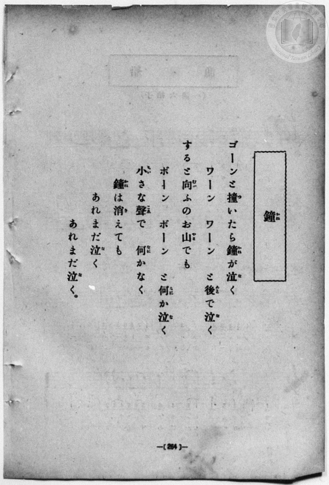
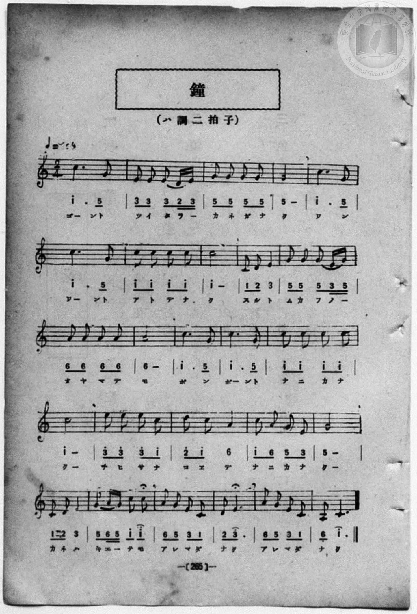

# 鏡

> Re:Shōka 使用 AI 協助辨識與重建樂譜，可能會有錯誤。歡迎回報。

<audio controls src="kagami.mp3"></audio>

- 一條慎三郎 編《新編 小學校・公學校 唱歌教材集》（大正十二年十二月，索書號 0725-41）
- 出處：共益商社樂器店《唱歌教科書 教師用 巻三》第三十六～三十七頁（女生徒專用曲第一曲）
- NDL Digital Collections PID 854864（https://dl.ndl.go.jp/pid/854864）掃描 P024.jpg

## 說明

原書資訊與歌詞全文（NDL PID 854864《唱歌教科書 教師用 巻三》第三十六～三十七頁，掃描 P024.jpg）：
調性與拍號：ト調四分ノ四拍子（G 大調 4/4 拍），♩=100，「柔和ニ」
註記：單聲部，二節分節歌，標題下附註「（女子用）」。第八小節第二拍為 #4（C#5，4'），第三、四拍「5」附延長記號（𝄐）。
原典演奏注意：預習曲可用二學年〈親の惠み〉；第一段末節（第四小節）之上行八度音程（5_ - 5 -）須圓滑歌唱，如前出〈秋景〉之下行八度音程；第二段末節（第八小節）稍放緩速度，第三段再返原速度歌唱，如前出〈和氣清麿〉。
原典語釋：「かゞみのこゝろ」：鏡の本性といふほどの意。


## 跨冊／重複收錄參照

> 同曲（《共益商社唱歌教科書》、《新編 小學校・公學校 唱歌教材集》共同收錄教材）

- **[同曲]** 《共益商社唱歌教科書》卷三・教師用（明治33年／1900）：[**〈鏡〉**](../../../kyoeki_shoka/kan_3_854864/16_kagami/index.md)（`G` / `4/4` — [原始 TMD](../../../kyoeki_shoka/kan_3_854864/16_kagami/kagami.tmd)）
- 總表：[跨冊重複與同名歌曲總索引](../../../duplicate_songs.md)

## 歌詞

```text
一、
むすぶ氷か、てる月影か、
玉の光も、なに及ぶべき、
清くすゞしき、かゞみの姿。

二、
黒きしろきを、つゆ僞はらず、
ありのまゝにぞ、かげうつしける、
直くたゞしき、かゞみのこゝろ。
```

## ABC

```abc
X:1
T:鏡
M:4/4
L:1/16
Q:1/4=100
K:G
V:V1 name="Voice" snm="Voi"
[V:V1]
D8 G4 B4 | d6 e2 d4 B4 | A4 G4 B6 G2 | A4 D4 d8 |
w: 1.~む す ぶ | こ ほ り か | て る つ き | か げ か
w: 2.~く ろ き | し ろ き を | つ ゆ い つ | は ら ず
G8 B4 A4 | G6 A2 B4 B4 | d4 B4 A6 A2 | B4 ^c4 d8 |
w: 1.~た ま の | ひ か り も | な に お よ | ぶ べ き
w: 2.~あ り の | ま ま に ぞ | か げ う つ | し け る
D8 G4 B4 | d6 e2 d4 B4 | G4 A4 B6 A2 | d4 d4 G8 |
w: 1.~き よ く | す ず し き | か が み の | す が た
w: 2.~な ほ く | た だ し き | か が み の | こ こ ろ
```

## TMD 檔案連結

- [主旋律 TMD 檔案](kagami.tmd) [[在 TMD Studio 編輯](https://tmdlang.github.io/Tmd-TS/#tmd=s7IKdvYPcrWy4qpTUCpJTLdSSM7PyUlNLsnMz7MqzsjPTozPrsyvSsyML84ojTe0NDJWgqssy88pzU21Si9KTEmNN403Q8gU55cWJadaFSdn5OfnxJekVpQk5edno8vHFySmp1oFGJkbIWQKivLLUvMS84C6C4oy80pSU8DaEQpSyzJTUkHSqSmZJflFmYk5SA5KLSoGuxtifElRYl5xclFmAcgzCFUlGalAV6fm5mMTTkvMzcypVOLS0lJ42b9QQUuLS9FWwdDAgMveVsGdy8ZE38QOpOPJjoZni-Y-a-17sqPzZXOfwvPtKx43dD2btgHIUHi6of_p2h3PFix83Lz7aesaCFvh6ZSNz9b2PJs689ncCS9ntz1u6H6_p-PpkuXP1i5-2tv4ZFfP051bIIxnczre7-l5vmXRs9k7Xsycr2BgbmSqa2L4fk8n2LVP23e9mDn1_Z5ZT1s3Pp_d9XRq2_Ml-56taHo6c8XTXdOBzoDb9Hz5RKARCkDW0x2rn08Bumz7bqCDgVY_X7MGyABa97R17fu98yDsJzuaXy5oBLlq6ebnU-Y_3Tfp6YYOoLZnszeB1TcAGTBH-Ln4KLhkpmeWJOYoOMNTTLFCgKeLgoWpiYWZCdCcjJKSgmIrff2UHL08IE7P18sq0C_ITNGHqeh81tf8rL9fIcDAyAQol67ExaWvpWBLLcCloKDwtG8-KBg3t79Y0fWiox0YMC9WznvauuLZtHagC0HeQDiZCmHXg-YjoB-BMQVyyItV-581LAc5obsXGKtA0cfNHUDBp7NnP-1oe9zcB2QApZ6unQB0l7sCMGUAJRWACU4BKAo2pufRzJW2wLQIZD1u6Hk2f8rTST2Pm7sfN_SCzV-x-8WKGaBkMW3di8ZNL5tXANUBU9Pz9Q1A84Ek0F8g962Y-XJhz5Md3S9ntgC1AA2CRDjQXqAvgfYAjXvc0AT05NPW1cCUDNQI8jAwVXb3Pm_apaAMilhnZVOgUSbqEGdBAuRxQyPEB0AjTYGGAM1_unvby6nbga4C-7fjw9wWoN-ACpugEfO0dcezPVOeLu1_tnnFs5Z-oNtfLpjwfP8kYDp72r8e6BxQrli7A5gxHjd0vFi26nHjumfNCx437n_cALR3NjRRrtv6bM5qoDOBNoBcDQxOsKuBNj3Z2f1kR9eLhT0gr-xa9nL-5ucrQLnONF5BV8FUQReo5OWCjqdzJj_bPREYOsC4B_rm6bKmp529wEwGtPP58u5nM9cDbQOb1I1hEtgJwKBBcwIs4IDmP1_R-2zKvufbV75smA_UCA8toJanbb0v9k8BBgNECqsDgDH8bMPiZztaX-4CeRol6F6smveyHeiIWcAAf9zY_bhpHihkGtc9bpz8uGnu4yZgRADTzSxgMQYKtzlrgKnvceOKx40tjxu3Pm7c_bhxJUi8pR9kKMhUYFgC4xDEetzU8Lhx5uPGbc82bAeZ3ND4uHHZ46ZuYMH0dO9GiAhI3fO-TqART1s7Hzc1gRUBY2j10_4uoM7HjTsfNwJdAFYHdP_jxn6QkSA3TodIIDv56XKg76Cu2AVM3GBdL3dPAqkEqgd6BchomgTWteRxU9vTZqDG9Y-bgNYDfQ9xc2PT4yagzUDv7wN5v3H148Z5UGsagQa1gXSC7J4I9AjM_bO3gN01H5e7kIISHPCUF0lQoKClz8XlnZgOrG2swvIzk1MdagxqqkFWKNgYmmnZgVnAovBx8wJgbOwE0tMUaoCszUDWbCBeBWSvBok0twHxaiBuAYqsBasB8po2gWmgJSBzahTACR4ZGkJpYygNVIIkawbJHmgqjHDohYkhVMCtQzYUbAjYPT6GIGc2oMkBkwectQ1uKTAGUNTsBpFNXXB-N5LKZTDRJpgoMM5RdPdCVSLkJ2GYhOZWI5D6fnS3NoFMQpgJc8F0DDUIeWD6RVIJcxcwMcNNakFxK0gFSOV6uMpOuNwsrG4FpZem_cC0MA-I-8CpYxIkPYDSS_MisEgXEHcDRUEiK8Ai04B4Jjj1wNMLLIphEBbVsAhGVQEShanATFDoemHsGriMiTqUgSe5NM5HkwNmczhrHdzSx42bUNSAIhUpuTQ1IalcBVe1Gs6CqYSo7oCqhCVHYKEGZ_Vidys4ucBsQZiESLDIboX5AOEfZLfMQ1KJLcHCEg6EB0susCQILOjgtmNP2uDkshacDB43rQcXHcCCBljFP27ajlKYrAGqmQ9LUmA1QBFgQqNu8QLTA0snyMULJL3A9MBo9FSKnFx60eQgkQkJGFhuBqmDlTkQGVC-Qg5CmCmoUdADZ-1H0Q2KWmQzkVWiJ1_k5AJLiAiTQKUcpluRzXjcuIAqboWVrkgseNmGcGstF5eunQKkvlIAspS5AA)]
- [鋼琴伴奏 TMD 檔案](kagami_piano.tmd) [[在 TMD Studio 編輯](https://tmdlang.github.io/Tmd-TS/#tmd=s7IKdvYPcrWy4qpTUCpJTLdSSM7PyUlNLsnMz7MqzsjPTozPrsyvSsyML84ojTe0NDJWgqssy88pzU21Si9KTEmNN403Q8gU55cWJadaFSdn5OfnxJekVpQk5edno8vHFySmp1oFGJkbIWQKivLLUvMS84C6C4oy80pSU8DaEQpSyzJTUkHSqSmZJflFmYk5SA5KLSoGuxtifElRYl5xclFmAcgzSlxaWgov-xe-39PxcvbMZ53dL7v3PJ-w5cmeLU-X9r_f06mgpcWlaKtgaGDAZW-r4M5lY6JvYgcy-cmOhmeL5j5r7Xuyo_Nlc5_C8-0rHjd0PZu2AchQeLqh_-naHc8WLHzcvPtp6xoIW-HplI3P1vY8mzrz2dwJL2e3PW7oBtr6dMnyZ2sXP-1tfLKr5-nOLRDGszkd7_f0PN-y6NnsHS9mzlcwMDcy1TUxBLoH7Kun7btezJz6fs-sp60bn8_uejq17fmSfc9WND2dueLprulAZ8Bter58ItAIBSDr6Y7Vz6cAXbZ9N9DBQKufr1kDZACte9q69v3eeRD2kx3NLxc0gly1dPPzKfOf7pv0dEMHUNuz2ZvA6huADJgj_Fx8FFwy0zNLEnMUnOGJo1ghwNNFwcLUxMLMBGhORklJQbGVvn5Kjl4eEKfn62UV6BdkpujDVHQ-62t-1t-vEGBgZAKUS1fi4vJOTE_MzbQKyEzMyw_ycKgxqKnmUgACG0MzLTswS19L4XHzAoXHTTuB9DSFGiBrM5A1G4hXAdmrQSLNbUC8GohbgCJrwWqAvKZNYFpLH2xOjYJpvIIuCjSE0sZQGqgESdYMiGF8hAojHHphYggVcOuQDQUbAnaPjyHImQ1oco8bZ8JZ2-CWPm6cjKJmN4hs6oLzu5FULoOJNsFEHzcuQdHdC1WJkJ-EYRKaW41A6vvR3doEMglhJswF0zHUIOQfN8HsAqmEuetxUxvcpBYUt4JUgFSuh6vshMvNwupWUHpp2g9MC_OAuA-cOiZB0gMovTQvAot0AXE3UBQksgIsMg2IZ4JTDzy9wKIYBmFRDYtgVBUgUZgKzASFrhfGroHLmKhDGXiSS-N8NLnHjfvgrHVwSx83bkJRA4pUpOTS1ISkchVc1Wo4C6YSoroDqhKWHB837oSzerG7FZxcYLYgTEIkWGS3wnyA8A-yW-YhqcSWYGEJB8KDJRdYEnzcOBFuO_akDU4ua8HJ4HHTenDRASxomnYB8XaUwmQNUM18WJICqwGKABMadYsXmB5YOkEuXiDpBaYHRqOnUuTk0osmB4lMSMDAcjNIHazMgciA8hVyEMJMQY2CHjhrP4puUNQim4msEj35IicXWEJEmAQq5TDdimzG48YFVHErrHRFYsHLNoRba1GrKx_k6soEUVu96Ot62d77tHXHy9mtkKYFUpESrxBtGAujaoDQBMg0QYjA0xKQbxqPohJDDNVMuDSpaqFiUIegqSTepdjMBFIGkIDTtVOAhF20D1AciWcE5ilzAQA)]

## 分析

```text
================================================================================
📊 TMD Song Profile: [ 鏡 ]
================================================================================
⏱  Duration:       0:28 (28.8s), 12 measures total
🎼 Key & Tempo:    首調基準 G, != 100.0 BPM, <4/4>
   - 分析範圍：      由實際發聲的音符與和弦推測調性；播放脈絡另行呈現
🎤 人聲音域:    D4 (MIDI 62) – E5 (MIDI 76) [跨度: 14 個半音 / 1.2 個八度, 難度: moderate]
   - 最低音:  D4 in [Kagami #1 @ m.1, 0:00]
   - 最高音: E5 in [Kagami #1 @ m.2, 0:03]
   - 適合: soprano, mezzo-soprano, contralto, tenor, baritone, bass
🏛  結構:      Kagami (28.8s)
⚡ 編曲密度:        Peak 1 軌道同時演奏
🗝  調性診斷：       D 調性不明確（純淨自然大調，未偵測到可信轉調）
   - 風格氣質:    純淨自然大調（陽光明朗、易唱易記，無明顯調外色彩）
   - 轉調歷程:    全曲維持單一推測調性（未偵測到可信轉調）
   - 核心骨幹音:  D, B, G, A, C#
   - 調性數值:    D 調性不明確 [相關度: 0.79, 穩定度: Ambiguous, 自然音純度: 100.0%]
   - 候選調性 (K-S): D 大調 (0.79), G 大調 (0.78), B 小調 (0.75)
   - 五度圈歷程:   +2
   - 各段落調性細節:
     • [Kagami #1]: D 調性不明確 (r: 0.79, 自然音純度: 100.0%)

  [ 五度圈游移軌跡 ]
               C  
         F            G  
      Bb              [D ]*
      Eb               A  
         Ab           E  
            Db       B  
               F# 
     (* = active key center)

  [ 十二半音累積音高分佈 ]
     C  :                            0.0%
     C# : █                          2.1%
     D  : ████████████████████████  35.4%
     D# :                            0.0%
     E  : █                          2.1%
     F  :                            0.0%
     F# :                            0.0%
     G  : ██████████████            20.8%
     G# :                            0.0%
     A  : ██████████                14.6%
     A# :                            0.0%
     B  : █████████████████         25.0%
--------------------------------------------------------------------------------
Assignment 軌道音域：
  - Voice         : D4 – E5 (14 個半音 / 1.2 個八度, 42 個音符)
================================================================================
```


## 原書掃描頁






