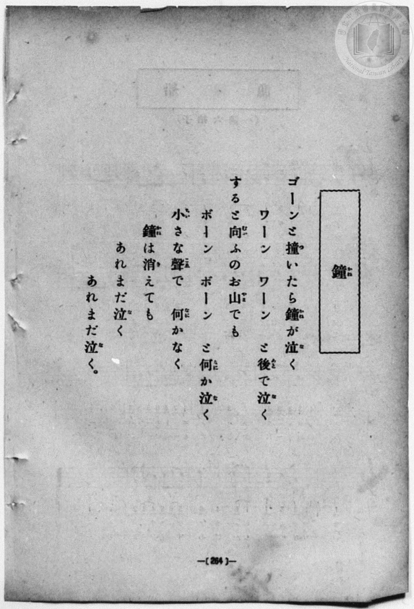
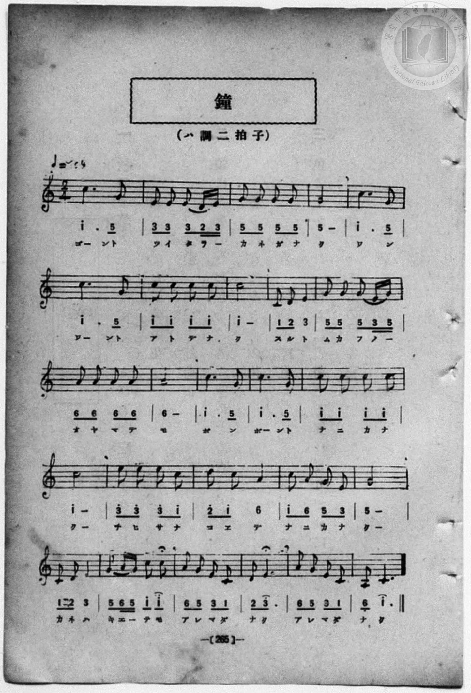

# 鐘

> Re:Shōka 使用 AI 協助辨識與重建樂譜，可能會有錯誤。歡迎回報。

- **NEUTRINO 歌聲合成版**：<br><audio controls src="kane_neutrino.mp3"></audio>
- **鋼琴伴奏版**：<br><audio controls src="kane.mp3"></audio>


- book: 新編 小學校・公學校 唱歌教材集（尋常科五・六學年用）
- 一條慎三郎 編《新編 小學校・公學校 唱歌教材集》（大正十二年十二月，索書號 0725-41）

## 說明

> [!NOTE]
> **原書資訊與歌詞全文**（對應 `P272.jpg`–`P273.jpg`，原書 p. 264–265，尋常科五・六學年第 20 首）：
> - **曲名補正**：原書標題為〈鐘（かね）〉（舊版目錄或轉錄曾因「鐘／鏡」字形相近誤植為〈鏡〉）。
> - **調性與拍號**：ハ調二拍子（C 大調 2/4 拍），♩= 64
> - **樂曲結構**：全曲共 26 小節（第一～四行各 5 小節、第五行 6 小節），以附點四分音符 `1^ . 5` 模擬撞鐘聲「ゴーン」「ワーン」與遠山回音「ボーン」，結尾第 22、24、26 小節標有延長記號（𝄐），表現餘音裊裊。
> - **原譜印刷勘誤**：第 26 小節（末小節）五線譜印為下加一間八分音符 B3（`7_`）接下加一線附點四分音符 C4（`1.`），下方簡譜誤將低音點與上點印反為 `6_ 1^.`，此處依五線譜導音解決至主音之終止式校正為 `7_ 1.`。
>
> ゴーンと撞（つ）いたら鐘（かね）が泣（な）く
> ワーン　ワーン　と後（あと）で泣（な）く
> すると向（むか）ふのお山（やま）でも
> ボーン　ボーン　と何（なに）か泣（な）く
> 小（ちい）さな聲（こゑ）で　何（なに）かなく
> 鐘（かね）は消（き）えても
> あれまだ泣（な）く
> あれまだ泣（な）く。


## 歌詞

```text
（TMD 檔案未包含歌詞註解）
```

## ABC

```abc
X:1
T:鐘
M:2/4
L:1/16
Q:1/4=64
K:C
V:V1 name="Piano" snm="Pia"
[V:V1]
c6 G2 | E2 E2 E2 D E | G2 G2 G2 G2 | G8 |
w: ゴ ント | ツ イ タ ラ _ | カ ネ ガ ナ | ク
c6 G2 | c6 G2 | c2 c2 c2 c2 | c8 |
w: ワ ン | ワ ント | ア ト デ ナ | ク
C2 D2 E4 | G2 G2 G2 E G | A2 A2 A2 A2 | A8 |
w: ス ル ト | ム カ フ ノ _ | オ ヤ マ デ | モ
c6 G2 | c6 G2 | c2 c2 c2 c2 | c8 |
w: ボ ン | ボ ント | ナ ニ カ ナ | ク
e2 e2 e2 c2 | d2 c2 A4 | c2 A2 G2 E2 | G8 |
w: チ ヒ サ ナ | コ ヱ デ | ナ ニ カ ナ | ク
C2 D2 E4 | G2 A G c2 c2 | A2 G2 E2 C2 | D2 E6 |
w: カ ネ ハ | キ エ _ テ モ | ア レ マ ダ | ナ ク
A2 G2 E2 C2 | B,2 C6 |
w: ア レ マ ダ | ナ ク
```

## TMD 檔案連結

- [主旋律 TMD 檔案](kane.tmd) [[在 TMD Studio 編輯](https://tmdlang.github.io/Tmd-TS/#tmd=s7IKdvYPcrWy4qpTUCpJTLdSSM7PyUlNLsnMz7MqzsjPTozPrsyvSsyML84ojTe0NDJWgqssy88pzU21Si9KTEmNN403Q8gU55cWJadaFSdn5OfnxJekVpQk5edno8vHFySmp1oFGJkbIWQKivLLUvMS84C6C4oy80pSU8DaEQpSyzJTUkHSxcmJefFlqUWZaZmpKUiOSi0qBrsdYkVJUWJecXJRZgHIQwhV-UUlGflAhxdkVFplZBaX5BdlJifmxGcn5iUiFJVkpAK9l5dYUlqUii6akpiZUxmfk5mGJAM0JD0zz6o0D-TCEqi7tLQUXk6YoaClxaVoq2BmwmVvq-DMZWOkb2IH0gcKFiuFZ9M2PN--QuHphv6na3c8W7DwcfPup61rIGyFp1M2Plvb82zqzGdzJ7yc3fZ-T8fTDd1Pd-x4vnzik11TwErXApU-3bnl-ZQV7_d0gt3zZEfDs0Vzn7X2PdnR-bK5TwFo_OOGLlLsedzQDbJqyfJnaxc_7W18sqsHaAOE8WxOx_s9Pc-3LHo2e8eLmfMVDMyNTHVNDMF2c-lrKdhSC3ApKCjYKUQr-vmHuMZCOFpaT_vmg-zd3P5iRdeLjnagm1-snPe0dcWzae1aWuDQ6X3W3qmQAEpXelkF6QmPGiaDOMZgDtDhEAMUCvQUjMxMgJJGZqYgUVyBumaNgpGBwstl04D-e79nFsQZukCHPJu96emE3heL5wBDCGTzLIjBz1bMfLmw53nTrscNHcCYB7rocWP348a1QO2PG4AmdLzo6Hre2fF89rqXPS3POqa92NsJYsze93T2gscNPWAt_S_7Fz5u6H26dvrTvYueA327f-KLVUueLemFGguSBRoFNLAJ4Z4Xq_Y_a1gOCpLuXmC0gJ30uLkfKAyKs26gaROAtjsrAOMUKKYATIIKQFGwr3oezVwJTp0Iz61oAvrv-dYJz5Z3QzwHDGGgh1s3AkMNlIKer28AmgYMHWBSe7933tPZs18s7Hk6oUXBFCr7uKERJLtrClBcAaEFZNuT3Utfzmx5uRuk62lH28v5m5-vWaaQYBinoKdgmqDwbMXCZ5PXPJs0DxgWLxo3AQPlcdOWx817HjdvBgYKiNu8Hs4F-vdl44KnGzc-nT0PaBBYdg5cFpROt054umEfOBqNgG4yMgERMPcAI-vZnM6nu7e9nLr9xYoZwGADeurD3BZgSIEc-mLhiuf9-14umQE0-cXiLiBCCXFghL9YO-dp74anHdufds8ARhE4qMB2IQXSszmr4b4Hhsfz7bMguoCR-WRH99OuBcAgfDlt8tPW1YjAcDIGakwwjwcm2M5nfUvh6oCasQSdswlItaEeSDUofHd0P5u28_mGhUB7gI56uqH9yd4-oFKgNmBwPdnRBdIPdHU_KD0pJJjFKxjGgfT2PFu75MXMqU_2zUU4cwNI44vli59t3PWiffOTHbuB3Cc7u59vbXq2dtHTPf3AogOY_sHmmAPN0UuAhRAkmBAx17gCGKPg3LAElHIbWx43zn_c1ImeRRp7nm1eDBZZBeb2Q81BRHkDCrtxxdN9PWD1TUA2WMty7CY0znzcBLRlxdMJE0GyTUC9wCIOqGDr48Z1jxu7gGkILA502D6IOY-boJGNlKSAtiOxG1c82TsVYtfjxtVgXd1YbQcmALDgQqDHweJTgQqAiRssOPlxE9BJYBsbGjANBLOh5mAE1_pn24ClMVAElJMfNwIZyxDOBoZJUw_QO48bF-AIE5wKoNFIeSEOBQpa-lxc3ol5wAo_MzEv36HGoEahGmSDgo2hmRY4tShgqzsUIEUMqBDRgBUtOgqw8lwTiwagRSDDaoCJGphLYdAUiGsUjIEkDBsByRqwODKGiCBDbAaBbfCpASVvJClQomjuAGt53NwCEmhaAib3gyVXQmSaVoN5vWCZNWB2F1RmPYbVwLSOagHYdvyhtQtYblEltMBCaASaQmgAgYMTEqwQEeQgNQaSiBBD9xA8xJoWgQVAvMfN7YTCpWknWAUkLEF6YOG1AByuEPGpYLKPiDDb0UlOmJkBTUbGEBFCiYfooEakslVgj4ATU_M8eACBvAsKNPQkMwc1hLGLIlIqKJQfN3cjhRs43PGHGKTCpyyVQdxrDBJCENBUZgRnw4IUqhnEhaQqrJkVEWbYMlMj2HuTwF7divAqkAcKpcfNG-FhC9OBI3CwmU8oW4JbQhqwhgGxAQY0GTNrmQFJ5DyJHCggHcDwQ9ID0YepBlhhQ5hYQg-pkGruR4RH01pwSKwAi7eBSVAKRGRfSIEGSaMNyGGIEl4kq-eq5eLStVMAVSAKQFqZCwA)]
- [鋼琴伴奏 TMD 檔案](kane_piano.tmd) [[在 TMD Studio 編輯](https://tmdlang.github.io/Tmd-TS/#tmd=s7IKdvYPcrWy4qpTUCpJTLdSSM7PyUlNLsnMz7MqzsjPTozPrsyvSsyML84ojTe0NDJWgqssy88pzU21Si9KTEmNN403Q8gU55cWJadaFSdn5OfnxJekVpQk5edno8vHFySmp1oFGJkbIWQKivLLUvMS84C6C4oy80pSU8DaEQpSyzJTUkHSxcmJefFlqUWZaZmpKUiOSi0qBrsdYkVJUWJecXJRZgHIQwhV-UUlGflAhxdkVFplZBaX5BdlJifmxGcn5iUiFCUWATWnp-am5pVYFWQm5uXHJyYn5-cWJOZlgsQQCksygIqs8hJLSotS0UVTEjNzKuNzMtOAMlpaCi8nzHi_p-Pl7JnPOrtfdu95PmHLkz1bni7tf7-nU0FLi0vRVsHMhMveVsGZy8ZI38QOZBgo6KwUnk3b8Hz7CoWnG_qfrt3xbMHCx827n7augbAVnk7Z-Gxtz7OpM5_NnfBydhvQhqcbup_u2PF8-cQnu6aAla4FKn26c8vzKSuAVoEd-WRHw7NFc5-19j3Z0fmyuU8BaPzjhi5S7Hnc0A2yasnyZ2sXP-1tfLKrB2gDhPFsTsf7PT3Ptyx6NnvHi5nzFQzMjUx1TQzBdnN5J-YB4x0UokEeDjUGNQrVXApAYGNopmUHZulrKdiiA4Xna9YAnfxiYY-ChinIfc_XN-goAFOPsV5WQbomFg1a-mDDahQM4xR04dAUiGsUjIEkDBsByRqwODKGiCBDbAaBbfCpUXjctAVJ6nHz5sfNHWAtj5tbQAJNS8DkfrDkSohM02owrxcsswbM7oLKrMew-nEzshjQArDt-ENrVw-VQgsshEagKYQGEDg4IcEKEUEOUmMgiQgxdA_BQ6xpEVgAxHvc3E4oXJp2glVAwhKkBxZeC8DhChGfCib7iAizHZ3khJkZ0GRkDBEhlHiIDmpEKlsF9gg4MTXPgwcQyLugQENPMnNQQxi7KCKlgkL5cXM3UriBwx1_iD2dPZviVAZxrzFICEFAU5kRnA0LUqhmEBeSqrBmVkSYYctMjWDvTQJ7dSvCq0AeKJQeN2-Ehy1MB47AwWY-oWw5BRxgZiQGGNBkzKxlBiSR8yRyoIB0AMMPSQ9EH6Ya83goE0voIRVSzf2I8GhaCw6JFWDxNjAJSoGI7Asp0CBptAE5DFHCi2T1XLXI9YcPSv1hAq0-gIEVr20K8hOIpRBtGAsKrXggyzQexjRAVoVbF5ABUYnggxlQHSZArglIHMhAMRGLWXBLUE2EG4HiUqAShHpUq8E6EF7CIQQKJ107BVBQKQBpZS4A)]

## 分析

```text
================================================================================
📊 TMD Song Profile: [ 鐘 ]
================================================================================
⏱  Duration:       0:48 (48.8s), 26 measures total
🎼 Key & Tempo:    首調基準 C, != 64.0 BPM, <2/4>
   - 分析範圍：      由實際發聲的音符與和弦推測調性；播放脈絡另行呈現
🎤 人聲音域:    B3 (MIDI 59) – E5 (MIDI 76) [跨度: 17 個半音 / 1.4 個八度, 難度: challenging]
   - 最低音:  B3 in [Kane #1 @ m.26, 0:46]
   - 最高音: E5 in [Kane #1 @ m.17, 0:30]
   - 適合: soprano, mezzo-soprano, contralto, tenor, baritone, bass
🏛  結構:      Kane (48.8s)
⚡ 編曲密度:        Peak 1 軌道同時演奏
🗝  調性診斷：       C 大調（純淨自然大調，未偵測到可信轉調）
   - 風格氣質:    純淨自然大調（陽光明朗、易唱易記，無明顯調外色彩）
   - 轉調歷程:    全曲維持單一推測調性（未偵測到可信轉調）
   - 核心骨幹音:  C, G, E, A, D
   - 調性數值:    C 大調 [相關度: 0.92, 穩定度: High, 自然音純度: 100.0%]
   - 候選調性 (K-S): C 大調 (0.92), A 小調 (0.63), C 小調 (0.58)
   - 五度圈歷程:   +0
   - 各段落調性細節:
     • [Kane #1]: C 大調 (r: 0.92, 自然音純度: 100.0%)

  [ 五度圈游移軌跡 ]
              [C ]*
         F            G  
      Bb               D  
      Eb               A  
         Ab           E  
            Db       B  
               F# 
     (* = active key center)

  [ 十二半音累積音高分佈 ]
     C  : ████████████████████████  41.3%
     C# :                            0.0%
     D  : ███                        4.3%
     D# :                            0.0%
     E  : █████████                 16.3%
     F  :                            0.0%
     F# :                            0.0%
     G  : ██████████████            24.0%
     G# :                            0.0%
     A  : ████████                  13.0%
     A# :                            0.0%
     B  : █                          1.0%
--------------------------------------------------------------------------------
Assignment 軌道音域：
  - Piano         : B3 – E5 (17 個半音 / 1.4 個八度, 75 個音符)
================================================================================
```


## 原書掃描頁






