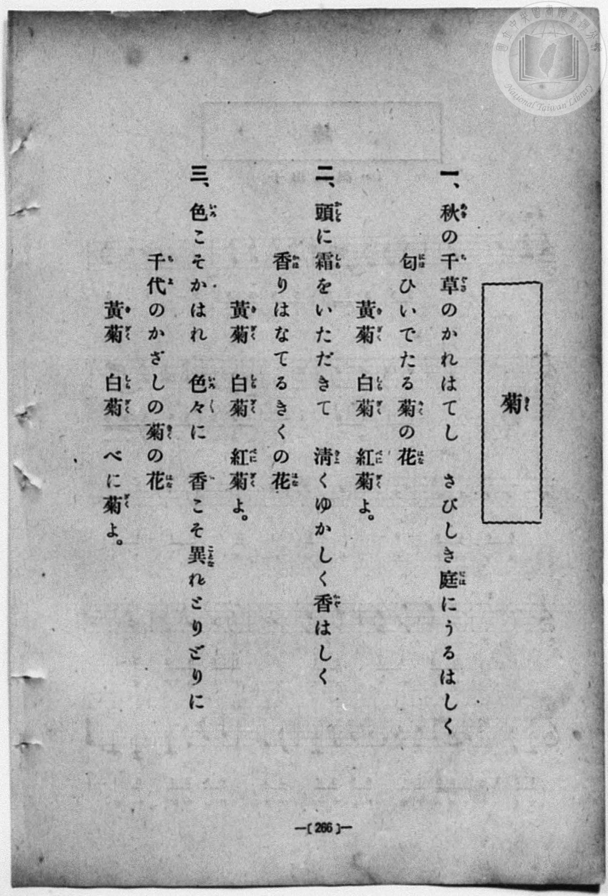
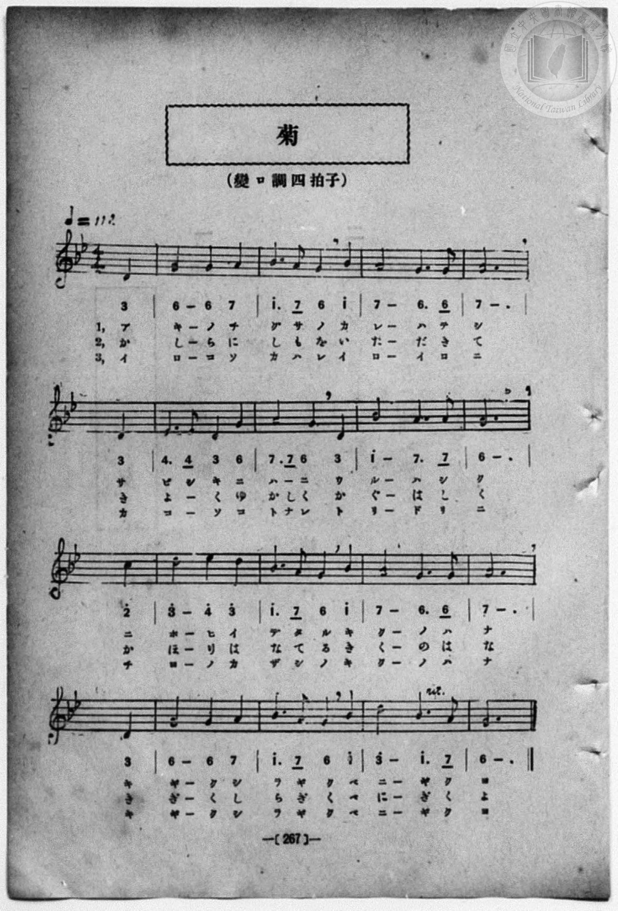

# 菊

> Re:Shōka 使用 AI 協助辨識與重建樂譜，可能會有錯誤。歡迎回報。

- **鋼琴伴奏版**：<br><audio controls src="kiku.mp3"></audio>
- **NEUTRINO 歌聲合成版**：<br><audio controls src="kiku_neutrino.mp3"></audio>

- book: 新編 小學校・公學校 唱歌教材集（尋常科五・六學年用）
- 一條慎三郎 編《新編 小學校・公學校 唱歌教材集》（大正十二年十二月，索書號 0725-41）

## 說明

> [!NOTE]
> **原書資訊與歌詞全文**（對應 `P274.jpg`–`P275.jpg`，原書 p. 266–267，尋常科五・六學年第 21 首）：
> - **調性與拍號**：變ロ調四拍子（關係小調為ト短調／G minor，都節五聲小調 4/4 拍），♩= 112
> - **樂曲結構**：弱起小節（第 4 拍起唱）加 16 小節完整樂句，第 15 小節上方標有漸慢（`rit.`）。注意本曲（「秋の千草のかれはてし」）與臺灣總督府《公學校唱歌集》第四學年〈菊〉（「高砂の島にも菊の花咲きぬ」）為同名異曲。
>
> **一、**
> 秋（あき）の千草（ちぐさ）のかれはてし　さびしき庭（には）にうるはしく
> 匂（にほ）ひいでたる菊（きく）の花（はな）
> 黃菊（きぎく）　白菊（しらぎく）　紅菊（べにぎく）よ。
>
> **二、**
> 頭（かしら）に霜（しも）をいただきて　清（きよ）くゆかしく香（かぐ）はしく
> 香（かほ）りはなてるきくの花（はな）
> 黃菊（きぎく）　白菊（しらぎく）　紅菊（べにぎく）よ。
>
> **三、**
> 色（いろ）こそかはれ　色々（いろいろ）に　香（か）こそ異（ことな）れとりどりに
> 千代（ちよ）のかざしの菊（きく）の花（はな）
> 黃菊（きぎく）　白菊（しらぎく）　べに菊（ぎく）よ。


## 歌詞

```text
（TMD 檔案未包含歌詞註解）
```

## ABC

```abc
X:1
T:菊
M:4/4
L:1/16
Q:1/4=112
K:Gm
V:V1 name="Piano" snm="Pia"
[V:V1]
z4 z4 z4 d4 | g8 g4 a4 | b6 a2 g4 b4 | a8 g6 g2 |
w: 1.~ア | キ ノ チ | グ サ ノ カ | レ ハ テ
w: 2.~か | し ら に | し も を い | た だ き
w: 3.~イ | ロ コ ソ | カ ハ レ イ | ロ イ ロ
a12 d4 | e6 e2 d4 g4 | a6 a2 g4 d4 | b8 a6 a2 |
w: 1.~シ サ | ビ シ キ ニ | ハ ニ _ ウ | ル ハ シ
w: 2.~て き | よ _ く ゆ | か し く か | ぐ は し
w: 3.~ニ カ | コ _ ソ コ | ト ナ レ ト | リ ド リ
g12 c'4 | d'8 e'4 d'4 | b6 a2 g4 b4 | a8 g6 g2 |
w: 1.~ク ニ | ホ ヒ イ | デ タ ル キ | ク ノ ハ
w: 2.~く か | ほ り は | な て る き | く の は
w: 3.~ニ チ | ヨ ノ カ | ザ シ ノ キ | ク ノ ハ
a12 d4 | g8 g4 a4 | b6 a2 g4 c'4 | d'8 b6 a2 |
w: 1.~ナ キ | ギ ク シ | ラ ギ ク ベ | ニ ギ ク
w: 2.~な き | ぎ く し | ら ぎ く べ | に ぎ く
w: 3.~ナ キ | ギ ク シ | ラ ギ ク ベ | ニ ギ ク
g12 z4 | z4 z4 z4 d4 | g8 g4 a4 | b6 a2 g4 b4 |
w: 1.~ヨ | ア | キ ノ チ | グ サ ノ カ
w: 2.~よ | か | し ら に | し も を い
w: 3.~ヨ | イ | ロ コ ソ | カ ハ レ イ
a8 g6 g2 | a12 d4 | e6 e2 d4 g4 | a6 a2 g4 d4 |
w: 1.~レ ハ テ | シ サ | ビ シ キ ニ | ハ ニ _ ウ
w: 2.~た だ き | て き | よ _ く ゆ | か し く か
w: 3.~ロ イ ロ | ニ カ | コ _ ソ コ | ト ナ レ ト
b8 a6 a2 | g12 c'4 | d'8 e'4 d'4 | b6 a2 g4 b4 |
w: 1.~ル ハ シ | ク ニ | ホ ヒ イ | デ タ ル キ
w: 2.~ぐ は し | く か | ほ り は | な て る き
w: 3.~リ ド リ | ニ チ | ヨ ノ カ | ザ シ ノ キ
a8 g6 g2 | a12 d4 | g8 g4 a4 | b6 a2 g4 c'4 |
w: 1.~ク ノ ハ | ナ キ | ギ ク シ | ラ ギ ク ベ
w: 2.~く の は | な き | ぎ く し | ら ぎ く べ
w: 3.~ク ノ ハ | ナ キ | ギ ク シ | ラ ギ ク ベ
d'8 b6 a2 | g12 z4 |
w: 1.~ニ ギ ク | ヨ
w: 2.~に ぎ く | よ
w: 3.~ニ ギ ク | ヨ
```

## TMD 檔案連結

- [主旋律 TMD 檔案](kiku.tmd) [[在 TMD Studio 編輯](https://tmdlang.github.io/Tmd-TS/#tmd=s7IKdvYPcrWy4qpTUCpJTLdSSM7PyUlNLsnMz7MqzsjPTozPrsyvSsyML84ojTe0NDJWgqssy88pzU21Si9KTEmNN403Q8gU55cWJadaFSdn5OfnxJekVpQk5edno8vHFySmp1oFGJmbIGQKivLLUvMS84C6C4oy80pSU8DaEQpSyzJTUkHSxcmJefFlqUWZaZmpKUiOSi0qBrsdYkVJUWJecXJRZgHIQwhV-UUlGflAhxdkVFplZBaX5BdlJifmxGcn5iUiFJVkpAK9l5dYUloEdGtOYl5JMbpkcWpiMaq5memZeValeSBHlkCdpqWl8KK_S0FLi0vRVsHQ0IjL3lbBSYcrO7XSVsE9l8vGRN_EDmQCKIysFJ5N2_B8-wqFpxv6n67d8WzBwsfNu5-2roGwFZ5O2fhsbc-zqTOfzZ3wcnbb-z0dTzd0P92x4_nyiU92TQErXQtU-nTnludTVrzf0wl22ZMdDc8WzX3W2vdkR-fL5j4FoPGPG7pIsedxQzfIqiXLn61d_LS38cmuHqANEMazOR3v9_Q837Lo2ewdL2bOVzAwNzLVNTEE282lr6VgSy3ApaCgYKcQrejnH-IaC-FoaT3tmw-yd3P7ixVdLzragW5-sXLe09YVz6a1a2mBQ6f3WXunQgIokellFaQnPGqYDOKYgjlAh0MMUCjQUzAyMwNKGpmZg0RxBeqaNQpGhgovl00D-u_9nlkQZ-gCHfJi1f5nDctBTujuBQYDyPJZL9Z1PW5eC5R5Ons2UPjp2glAF72cPufJ_iZgqAPFnzftetzc8Xw-SM37Pf3uCrmZeflFQPtfNu99vr4BaPmLxk0QpQrARKIANARsb8-jmSshKQlu_7MVTc9mb3q-dcKz5d1gy5_u2fhi63agZqBBQGtBLgcbABKcshFozNOuBQqGZqD4B6p4ug4Y2VuAhjztXwqKTqBqQ1Oo3JMdwLSy89mKmc_mdD7bs-NZ6yKgeQlFmSV6wADsfNzQ9Gzzimct_c_mrAG6ACj1uKHn-fLux43rnvY2v-jtBDIeN3Y_bup53Lj-ceOyx43THzeAvAEMqxftu543Ln6-Y-_zuYuf7poDTJTwFAhJgJCkB3QNMAQhMfC4oQOYlx43AEMBZNHL1TOeL2gC2bV52-PG1Y-bmkCyjetedG18OmnT48bex41rINYBw_rphJ6nE3qfT90AdCfQ2eDAgyUkYB553NAIzKJgPtD9IPMbgSaD9ML9AhZc-LhxwuPGqRBxDK81AKUeN24GsRt7n-5aC9ayGqgArB7IaHvcBAwcoHqggn6IdU97mmDKdoOVAV3e8rhx-ePG-UDFQB-BZYF-6YdYCvQdWARoyCqgCMSQl7ubkVT2QRU3NDyfuRcmPv1xE1A7ktSWVpjUTrDtMKkmYNiihc-uHqTwebkA4i-gR0BmQrz2cs4cmC1A7wANmQT2xfzHjQvATloGtPHZjlaoC5uAxQZQV__jpjaoOY39L5fNhBkLzCpAWZRQQpIFh1ITMKJBIQAyGRSkoPAZoMDZAdQAD5wXneBcAPR7EyTxTH7cOBfs7PWgpNLQAFTwuAESDiA1SCpXA2Xh3oTrBaZYsAiQvQLiKXCSWwEOgZVgcjU0IfU2P9m9GJpKoSEMTqKN08AhuY52aQkSSjBZjLCivPyHAgUtfS4u78zsUquAzMS8fIcagxqFapANCjYWWuAYUcBW6yhAykNgoQMsTYCZ_cXCHgUNE2gJp6MAqxI0segEWggytUbBAFjSwrAxENcomAFJEATR5mARwziwgDlYCMypAcvAVIFIhAgIgk0C2-BjWKMQD-TB8OOmRWD9j5vWQtU-BtbeILIRKr4BItq0FSbTtBoi07wGrqMfSreBdWxHshmkD263EZrdjd0Qkxqnw1V3gsWhNkDFgXkdiCeBZVqgMvNhOhoXQOlesPgyZLuBYnC7jdH9vQTqC7i_mzaDyb1Qf4PcAPEbxKfYdIBEQGrWgsVBvkH4G-wHLtyJBZRGdvWQk0ZMwDaYgGMVFN-wuIYkCEiqgaYRSJIBkYiEBIJG4FQDTxGPmydDXb0dmhIgvgHJwOIW4rvHTaAQBolDwgcp9oF6QeG2HjkUIKbAYx-YV2EyjSBdwIIZYho4JYBEp8Nk4GljAlwHxGSQGpA4xFaYHJI9wJiGxCXEVaD4hPBBrobY_7i5CxarYBGQzCq4m0FpEESvwoxVSK4gEKs7OsmJVWNYjJmAGGAe5Vn9cfNsuNPBGQieiNuhwbMfGpWQaEeOQEh2h0QwSEcXckBAVCMitnE3XAakDhJZIHFIsIIyJrACBbN6oTKwCARWEFB6PZIOmBxYNSJim1eguA5eGDVtg9oOTMBQGXL8gzdigQ1EciKWQAEOyYqI6IdLouZYUIWAFK9NkDADuRzkP0ihC_LVSqjoOphM80yoDCwhw_SC5JFDFARBRSNyrEJCDJ5dwQUyyHZoFgHKw2R2QmTARTdMDqYTOeOj2QLOrLT0Sy0Xl66dAqgyV0CilbkA)]
- [鋼琴伴奏 TMD 檔案](kiku_piano.tmd) [[在 TMD Studio 編輯](https://tmdlang.github.io/Tmd-TS/#tmd=s7IKdvYPcrWy4qpTUCpJTLdSSM7PyUlNLsnMz7MqzsjPTozPrsyvSsyML84ojTe0NDJWgqssy88pzU21Si9KTEmNN403Q8gU55cWJadaFSdn5OfnxJekVpQk5edno8vHFySmp1oFGJmbIGQKivLLUvMS84C6C4oy80pSU8DaEQpSyzJTUkHSxcmJefFlqUWZaZmpKUiOSi0qBrsdYkVJUWJecXJRZgHIQwhV-UUlGflAhxdkVFplZBaX5BdlJifmxGcn5iUiFCUWATWnp-am5pVYFWQm5uXHJyYn5-cWJOZlgsQQCksygIqs8hJLSouAnspJzCspRpcsTk0sBjlAS0vhRX_X-z0dL2fPfNbZ_bJ7z_MJW57s2fJ0af_7PZ0KWlpcirYKhoZGXPa2Ck46XNmplbYK7rlcNib6JnYgI0HhaKXwbNqG59tXKDzd0P907Y5nCxY-bt79tHUNhK3wdMrGZ2t7nk2d-WzuhJez24B2Pd3Q_XTHjufLJz7ZNQWsdC1Q6dOdW55PWQG0FOzUJzsani2a-6y178mOzpfNfQpA4x83dJFiz-OGbpBVS5Y_W7v4aW_jk109QBsgjGdzOt7v6Xm-ZdGz2TtezJyvYGBuZKprYgi2m8s7M7vUKgAUvEEeDjUGNQrVXApAYGOhZQdm6Gsp2KIDhad7Nr7Yuv1FR_vzNWuATn-xsEdBwwTkzufrG3QUgEnKVC-rIF0Ti04tfbCpNQoGCrpwbAzENQpmQBIEQbQ5WMQwDixgDhYCc2rAMjBVIBIhAoJgk8A2-BjWKMQDeTD8uGkRWP_jprVQtY-B4QwiG6HiGyCiTVthMk2rITLNa-A6-qF0G1jHdiSbQfrgdhuh2d3YDTGpcTpcdSdYHGoDVPxxUxMQTwLLtEBl5sN0NC6A0r1g8WXIdgPF4HYbo_t7CdQXcH83bQaTe6H-BrkB4jeIT7HpAImA1KwFi4N8g_A32A9cuBMLKI3s6iEnjZiAbTABxyoovmFxDUkQkFQDTSOQJAMiEQkJBI3AqQaeIh43T4a6ejs0JUB8A5KBxS3Ed4-bQCEMEoeED1LsA_WCwm09cihATIHH_uOmDphMI0jX46Y2iGnglAASnQ6TgaeNCXAdEJNBakDiEFthckj2AGMaEpcQV4HiE8IHuRpi_-PmLlisgkVAMqvgbgalQRC9CjNWIbmCQKzu6CQnVo1hMWYCYoB5lGf1x82z4U4HZyB4Im6HBs9-aFRCoh05AiHZHRLBIB1dyAEBUY2I2MbdcBmQOkhkgcQhwQrKmI-bQEEJzZRIEfi4cR2UXo-kAyYHVo2I2OYVKK6DF0ZN26C2AxMwVIYc_-CN2KezZ5MTsQQKcEhWREQ_XBI1x4IqBKR4bYKEGcjlIP9BCl2Qr1ZCRdfBZJpnQmVgCRmmFySPHKIgCCoakWMVEmLw7AoukEG2Q7MIUB4msxMiAy66YXIwncgZH80WcGalpV9qketyH5S63ARal4NqXQgEBnl8vEK0WXxuLBILl6gxiG2MWxTEApoJK7VB4ibxxBiBYCPk0R2BMBjVQuyqyXMyocAwAjKMoCYADSDoXmBc6NopgKIj2scwVgHONkJiG4PZylwA)]

## 分析

```text
================================================================================
📊 TMD Song Profile: [ 菊 ]
================================================================================
⏱  Duration:       1:12 (72.9s), 34 measures total
🎼 Key & Tempo:    首調基準 B,, != 112.0 BPM, <4/4>
   - 分析範圍：      由實際發聲的音符與和弦推測調性；播放脈絡另行呈現
🎤 人聲音域:    D5 (MIDI 74) – D#6 (MIDI 87) [跨度: 13 個半音 / 1.1 個八度, 難度: moderate]
   - 最低音:  D5 in [Kiku #1 @ m.1, 0:01]
   - 最高音: D#6 in [Kiku #1 @ m.10, 0:20]
🏛  結構:      Kiku (36.4s) -> Kiku (36.4s)
⚡ 編曲密度:        Peak 1 軌道同時演奏
🗝  調性診斷：       G 小調（純淨自然小調，未偵測到可信轉調）
   - 風格氣質:    純淨自然小調（陰鬱抒情、旋律集中，無明顯調外色彩）
   - 轉調歷程:    全曲維持單一推測調性（未偵測到可信轉調）
   - 核心骨幹音:  G, A, D, A#, D#
   - 調性數值:    G 小調 [相關度: 0.78, 穩定度: High, 自然音純度: 100.0%]
   - 候選調性 (K-S): G 小調 (0.78), G 大調 (0.58), D 大調 (0.50)
   - 五度圈歷程:   +1 -> +1
   - 各段落調性細節:
     • [Kiku #1]: G 小調 (r: 0.78, 自然音純度: 100.0%)
     • [Kiku #2]: G 小調 (r: 0.78, 自然音純度: 100.0%)

  [ 五度圈游移軌跡 ]
               C  
         F           [G ]*
      Bb               D  
      Eb               A  
         Ab           E  
            Db       B  
               F# 
     (* = active key center)

  [ 十二半音累積音高分佈 ]
     C  : ██                         3.1%
     C# :                            0.0%
     D  : ███████████               15.6%
     D# : ███                        4.7%
     E  :                            0.0%
     F  :                            0.0%
     F# :                            0.0%
     G  : ████████████████████████  32.8%
     G# :                            0.0%
     A  : █████████████████████     28.1%
     A# : ███████████               15.6%
     B  :                            0.0%
--------------------------------------------------------------------------------
Assignment 軌道音域：
  - Piano         : D5 – D#6 (13 個半音 / 1.1 個八度, 98 個音符)
================================================================================
```


## 原書掃描頁






