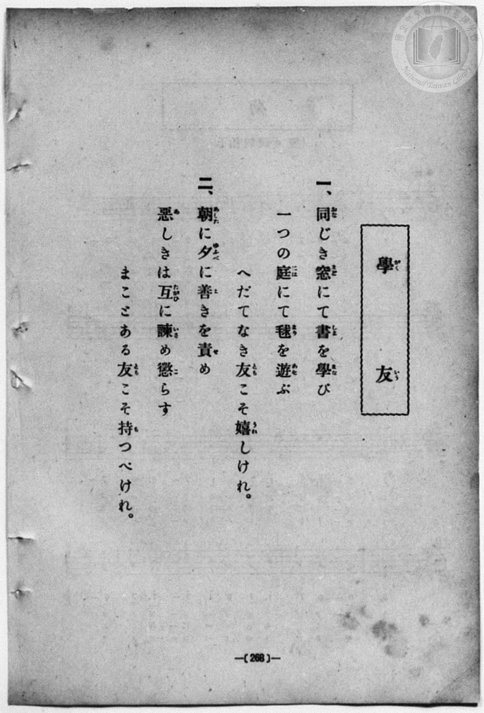
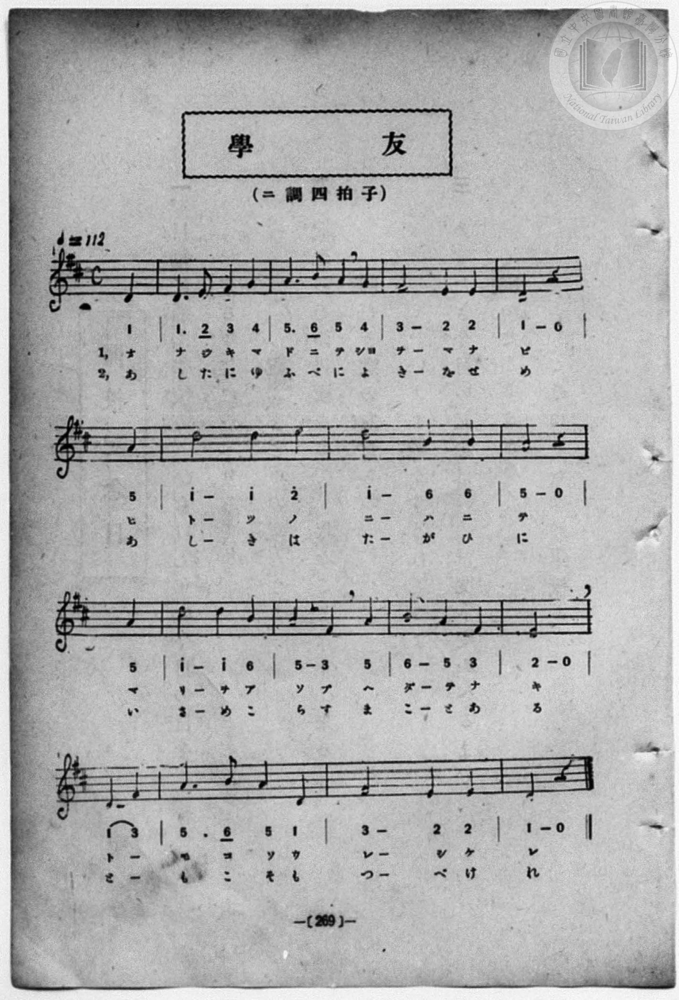

# 學友

> Re:Shōka 使用 AI 協助辨識與重建樂譜，可能會有錯誤。歡迎回報。

- **鋼琴伴奏版**：<br><audio controls src="gakuyu.mp3"></audio>
- **NEUTRINO 歌聲合成版**：<br><audio controls src="gakuyu_neutrino.mp3"></audio>

- 詞：大和田建樹
- book: 新編 小學校・公學校 唱歌教材集（尋常科五・六學年用）
- 一條慎三郎 編《新編 小學校・公學校 唱歌教材集》（大正十二年十二月，索書號 0725-41）

## 說明

> [!NOTE]
> **原書資訊與歌詞全文**（對應 `P276.jpg`–`P277.jpg`，原書 p. 268–269，尋常科五・六學年第 22 首）：
> - **作詞**：大和田建樹
> - **調性與拍號**：ニ調四拍子（D 大調 4/4 拍），♩= 112
> - **樂曲結構**：弱起小節（第 4 拍起唱）加 14 小節完整樂句。注意本曲歌詞雖與 1931 年《新定兒童唱歌》高等科男子用之〈學友〉（C 大調 12 小節）相同，但譜曲旋律與小節數完全不同（同名同詞異曲）。原譜每行開頭皆將上一行末拍之弱起拍拆置於行首，此處合併還原為標準 4/4 拍小節結構。
>
> **一、**
> 同（おな）じき窓（まど）にて書（しよ）を學（まな）び
> 一つの庭（には）にて毬（まり）を遊（あそ）ぶ
> へだてなき友（とも）こそ嬉（うれ）しけれ。
>
> **二、**
> 朝（あした）に夕（ゆふべ）に善（よ）きを責（せ）め
> 惡（あ）しきは互（たがひ）に諫（いさ）め懲（こ）らす
> まことある友（とも）こそ持（も）つべけれ。


## 歌詞

```text
（TMD 檔案未包含歌詞註解）
```

## ABC

<div class="abc-score" data-abc-src="gakuyu.abc" aria-label="五線譜載入中"></div>

[下載 ABC 原始檔](gakuyu.abc)

## TMD 檔案連結

- [主旋律 TMD 檔案](gakuyu.tmd) [[在 TMD Studio 編輯](https://tmdlang.github.io/Tmd-TS/#tmd=s7IKdvYPcrWy4qpTUCpJTLdSSM7PyUlNLsnMz7MqzsjPTozPrsyvSsyML84ojTe0NDJWgqssy88pzU21Si9KTEmNN403Q8gU55cWJadaFSdn5OfnxJekVpQk5edno8vHFySmp1oFGJkj6Swoyi9LzUvMA-ouKMrMK0lNAWtHKEgty0xJBUkXJyfmxZelFmWmZaamIDkqtagY7HaIFSVFiXnFyUWZBSAPIVTlF5Vk5AMdXpBRaZWRWVySX5SZnJgTn52Yl4hQVJKRCvQe1BM5mWmp6FJpRZmpeSnFGZkFyCZnpmfmWeWmZmZlIvlcS0vh6dodT_u7FbS0uBRtFQwNjbjsbRVcuGxM9E3sQLpB6qwUnk3b8Hz7CoWnG_qByp8tWPi4effT1jUQtsLTKRufre15NnXms7kTXs5ue7-n4-mG7qc7djxfPvHJrilgpWtBtuzc8nzKivd7OsGuerKj4dmiuc9a-57s6HzZ3KcANP5xQxcp9jxu6AZZtWT5s7WLn_Y2PtnVA7QBwng2p-P9np7nWxY9m73jxcz5CgbmRqa6JoYwu1-snPd-zyygzqeTep5P2fB0965nK3YqcXHpaynYUgtwKSgo2ClEK_r5h7jGQjhaWk_75oNctLn9xYquFx3tQN8AnfK0dcWzae1aWuBw633W3qmQAEp8elkF6QmPGiaDOOZgDtBLEAMUCvQUjMwsgJJGZpYgUVzBvWaNgpGRwstl04A-B_oY4gxdoEOe7J0DtBlkJ3owINS8WLX_WcNykDO7e4GBCFb8uLkbKPx09myg2NO1E4BOdlEAGgAUUwAmGAWgKNimnkczV0ISE9y0Zyuans3e9HzrhGfLuyH27tn4Yut2YEw_X98ANAfkVrABIMEpG4HGPO1aoGBoAkoLQBVP1wEjfgvQkKf9Sx83ND3bvOJZS_-zOWuAZkJC8eXsaUCnKhhaGhsqAL0OSUtP18162jrp-eqlkKQDTDEvV894vrYTGFTPp2wHegCYIJ_s7H7c0AHJBY8bgI7vcIZ5ydAIajvQNc9n73g6oQfotSd7216snQOyd3r3033dQEshap5N3QF0JDAyn-zoBavsAJJPJ4DYQOc9n7oBqAVoDtDxwEgEmbC-_8XCnpfTul8uWPt8VtvTDe1PdnQBcwVQ8Nmc1cCAADoMEkZA9rPutud71z2btgekBRSdPc_WLnkxc-rTCR1P9m592dQCNPN5EzD-Zj7bNQ0WFRB3QYIcaC04LmApEWjR44ZGYKYH8yHufdzY9bhxFciNjTMeN_Y-XzUZLLjvceNKsODqx43LgKkPLDj9cRMwi3U-bpoEDDmYMojezRAzQTY0LnncuO7prrVgBUDt6xHmrF8D1dXUBTHnZSOQARRpetw4F6xsG8Scx407HjcuAGoBmg90FTCWwMpWPG5qAiubDFT_dA0o3h43tj1uAnoEKDj9ceNEIBvD17uAQnBfP5sDtAhiI1D9fIjbni6ZChJsanvcuPVx406o4LQWsCDYy429QNe-2ARx_2yw4xuhBjYvhBgIc0Mv0MtPdk0CC85_3NjzuBGcBBpXv1i9GizY8rgRaB3IhGftQCmgCDDMgVygmpkw7wMDFujHFSB3NnVj9f6znkaw8yAiwDDfieJ9ygszKFDQ0ufick_MLq0stQrITMzLd6gxqKkGWaFgY6EFDmUFbGWoAiQdA7MKMJdDkriCBixn6yjACjhNLDqBNoJMrVEwAJYiMGwIxDVgUlfBSMEYSJqARUzBImZgGiICkoOogmCYLog5IHU1YPN9DGsU4oE8GH7ctAqs-nFzF1j146YdQLwWxGqeB5XphMg0dwNxG1jN9sfNK6CSm6DWQJRDjAGJT4aKgy1pnoRwgBGaAxqbIDoap0PMaZwPxKvB1oAsA8lshcrshMt0QGV6YbY3gWwAplKIeFMjsu0QG7hwxxoosnb1gCPLmLTIMoyDWgRmGIEIJEEzKIZFGLbIeNwM8gskBFvAZB80BLvh4v3Q4IeIg0IFEbLgSIKHLCwUQb4GhQ0wW0JDaj5cvAdMguINJA4KT0RIgVxAKKR2dJKTrFFDCjVUQIkXHCpgcRAE8UCiNeDEDAs5Q6AYcsiBki4khEC-edy0COKnpr1w8WlgcgY05Brg4uBkDEur4OSOCFFw2kIK0akwXeBUBSyIoLog2QIkMhNM7oOGKCzlA8suMAlN302w-ISENDj_4A9pYOuDnDSJXDhAChD8hQMII4cqKBRBvt0MDcnHTcug4bcGHhLbweRGNHFYnkYKvSaQ7yGhBiy_wbpg-X0JPJx2gsmJ0HACpU9U02q5uHTtFCDlsQIKS5kLAA)]
- [鋼琴伴奏 TMD 檔案](gakuyu_piano.tmd) [[在 TMD Studio 編輯](https://tmdlang.github.io/Tmd-TS/#tmd=s7IKdvYPcrWy4qpTUCpJTLdSSM7PyUlNLsnMz7MqzsjPTozPrsyvSsyML84ojTe0NDJWgqssy88pzU21Si9KTEmNN403Q8gU55cWJadaFSdn5OfnxJekVpQk5edno8vHFySmp1oFGJkj6Swoyi9LzUvMA-ouKMrMK0lNAWtHKEgty0xJBUkXJyfmxZelFmWmZaamIDkqtagY7HaIFSVFiXnFyUWZBSAPIVTlF5Vk5AMdXpBRaZWRWVySX5SZnJgTn52Yl4hQlFgE1JyempuaV2JVkJmYlx-fmJycn1uQmJcJEkMoLMkAKoL5NiczLRVdKq0oMzUvpTgjs0CJS0tL4enaHU_7u9_v6Xg5e-azzu6X3XueT9jyZM-Wp0v73-_pVNDS4lK0VTA0NOKyt1Vw4bIx0TexAxkICkMrhWfTNjzfvkLh6YZ-oDHPFix83Lz7aesaCFvh6ZSNz9b2PJs689ncCS9ntwGteLqh--mOHc-XT3yyawpY6VqQ7Tu3PJ-yAmgX2KFPdjQ8WzT3WWvfkx2dL5v7FIDGP27oIsWexw0g3zxdsvzZ2sVPexuf7OoB2gBhPJvT8X5Pz_Mti57N3vFi5nwFA3MjU10TQ5jdL1bOe79nFlDn00k9z6dseLp717MVO5W4uNwTs0srS60CQMEe5OFQY1BTzaUABDYWWnZghr6Wgi06UHi6Z-OLrdtfdLQ_X7MG6KsXC3sUNExAXni-vkFHAZjSzPWyCtI1sejU0gebWqNgoKALx4ZAXAMmdRWMFIyBpAlYxBQsYgamISIgOYgqCIbpgpgDUlcDNt_HsEYhHsiD4cdNq8CqHzd3gVU_btoBxGtBrOZ5UJlOiExzNxC3gdVsf9y8Aiq5CWoNRDnEGJD4ZKg42JLmSQgHGKE5oLEJoqNxOsScxvlAvBpsDcgykMxWqMxOuEwHVKYXZnsTyIbHjbMh4k2NyLZDbODCHWugyNrVA44sY9IiyzAOahGYYQQikATNoBgWYdgi43EzyC-QEGwBk33QEOyGi_dDgx8iDgoVRMiCIwkesrBQBPkaFDaPG9dDQ2o-XLwHTILiDSQOCk9ESIFcQCikdnSSk6xRQwo1VECJFxwqYHEQBPFAojXgxAwLOUOgGHLIgZIuJIRAvnnctAjip6a9cPFpYHIGNOQa4OLgZAxLq-DkjghRcNpCCtGpMF3gVPW4EZSyQbog2QIkMhNM7oOGKCzlP24E5RF4-m6CxSckpMH5B39IP509m5w0iVw4QAoQ_IUDCCOHKigUQb7dDA3Jx03LoOG3Bh4S28HkRjRxWJ5GCr0mkO8hofa4cS5YFyy_L4GH004wOREaTqD0iWpaLWpx7INcHJtAi2NQwQmBQN_FK0QbxsIonHzTeCBtGo-qAqgflmLRdJkAGSaxMArFFAxN6IrQDYHz4W7AagzRLgaGkK6dAiSQon2A4kg8IzBPmQsA)]

## 分析

```text
================================================================================
📊 TMD Song Profile: [ 學友 ]
================================================================================
⏱  Duration:       1:04 (64.3s), 30 measures total
🎼 Key & Tempo:    首調基準 D, != 112.0 BPM, <4/4>
   - 分析範圍：      由實際發聲的音符與和弦推測調性；播放脈絡另行呈現
🎤 人聲音域:    D4 (MIDI 62) – E5 (MIDI 76) [跨度: 14 個半音 / 1.2 個八度, 難度: moderate]
   - 最低音:  D4 in [Gakuyu #1 @ m.1, 0:01]
   - 最高音: E5 in [Gakuyu #1 @ m.6, 0:12]
   - 適合: soprano, mezzo-soprano, contralto, tenor, baritone, bass
🏛  結構:      Gakuyu (32.1s) -> Gakuyu (32.1s)
⚡ 編曲密度:        Peak 1 軌道同時演奏
🗝  調性診斷：       D 大調（純淨自然大調，未偵測到可信轉調）
   - 風格氣質:    純淨自然大調（陽光明朗、易唱易記，無明顯調外色彩）
   - 轉調歷程:    全曲維持單一推測調性（未偵測到可信轉調）
   - 核心骨幹音:  D, A, E, F#, B
   - 調性數值:    D 大調 [相關度: 0.94, 穩定度: High, 自然音純度: 100.0%]
   - 候選調性 (K-S): D 大調 (0.94), A 大調 (0.72), B 小調 (0.59)
   - 五度圈歷程:   +2 -> +2
   - 各段落調性細節:
     • [Gakuyu #1]: D 大調 (r: 0.94, 自然音純度: 100.0%)
     • [Gakuyu #2]: D 大調 (r: 0.94, 自然音純度: 100.0%)

  [ 五度圈游移軌跡 ]
               C  
         F            G  
      Bb              [D ]*
      Eb               A  
         Ab           E  
            Db       B  
               F# 
     (* = active key center)

  [ 十二半音累積音高分佈 ]
     C  :                            0.0%
     C# :                            0.0%
     D  : ████████████████████████  30.8%
     D# :                            0.0%
     E  : ███████████               14.4%
     F  :                            0.0%
     F# : ███████████               14.4%
     G  : ███                        3.8%
     G# :                            0.0%
     A  : ████████████████████      25.0%
     A# :                            0.0%
     B  : █████████                 11.5%
--------------------------------------------------------------------------------
Assignment 軌道音域：
  - Piano         : D4 – E5 (14 個半音 / 1.2 個八度, 84 個音符)
================================================================================
```


## 原書掃描頁






