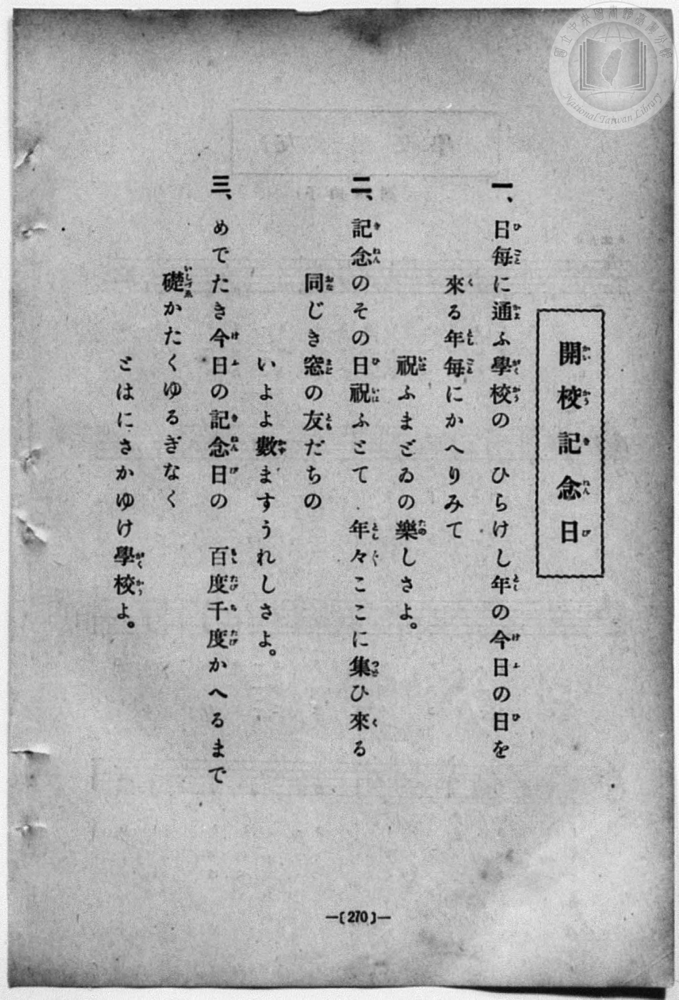
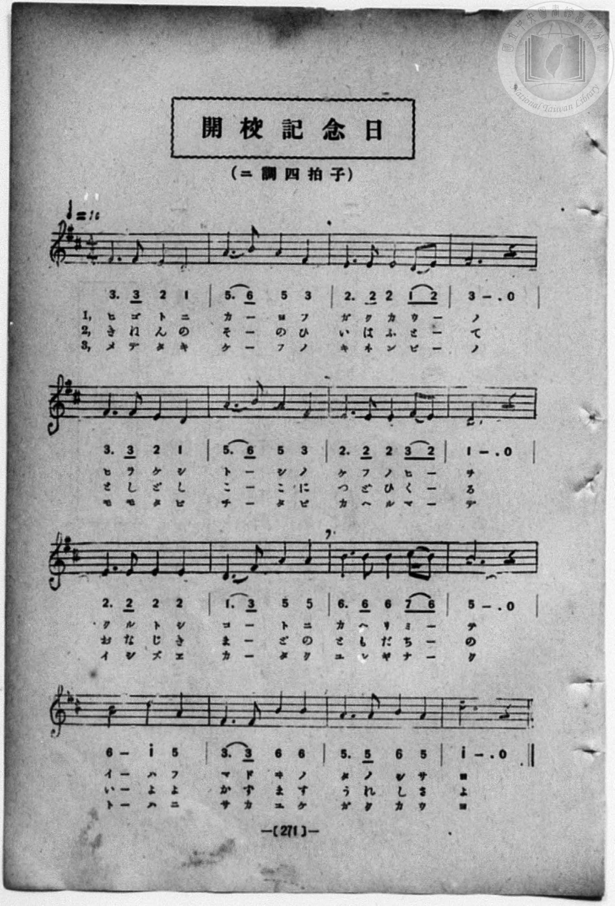

# 開校記念日

> Re:Shōka 使用 AI 協助辨識與重建樂譜，可能會有錯誤。歡迎回報。

<audio controls src="kaiko_kinenbi.mp3"></audio>

- book: 新編 小學校・公學校 唱歌教材集（尋常科五・六學年用）
- 一條慎三郎 編《新編 小學校・公學校 唱歌教材集》（大正十二年十二月，索書號 0725-41）
- 文部省《尋常小學唱歌》

## 說明

> [!NOTE]
> **原書資訊與歌詞全文**（對應 `P278.jpg`–`P279.jpg`，原書 p. 270–271，尋常科五・六學年第 23 首）：
> - **出處**：原載文部省《尋常小學唱歌》第六學年（亦收錄於大正四年臺灣總督府《公學校唱歌集》）
> - **調性與拍號**：ニ調四拍子（D 大調 4/4 拍），♩= 86
> - **假名表記**：第 3 段第 9 小節「礎」，歌詞頁振假名印為「いしづゑ」（歷史假名遣），樂譜頁簡譜下方標為「イシズエ」。
>
> **一、**
> 日每（ひごと）に通（かよ）ふ學校（がくかう）の　ひらけし年（とし）の今日（けふ）の日（ひ）を
> 來（く）る年每（としごと）にかへりみて　祝（いは）ふまどゐの樂（たの）しさよ。
>
> **二、**
> 記念（きねん）のその日祝（ひいは）ふとて　年々（としどし）ここに集（つど）ひ來（く）る
> 同（おな）じき窓（まど）の友（とも）だちの　いよよ數（かず）ますうれしさよ。
>
> **三、**
> めでたき今日（けふ）の記念日（きねんび）の　百度千度（ももたびちたび）かへるまで
> 礎（いしづゑ）かたくゆるぎなく　とはにさかゆけ學校（がくかう）よ。


## 歌詞

```text
（TMD 檔案未包含歌詞註解）
```

## ABC

```abc
X:1
T:開校記念日
M:4/4
L:1/16
Q:1/4=86
K:D
V:V1 name="Piano" snm="Pia"
[V:V1]
F6 F2 E4 D4 | A6 B2 A4 F4 | E6 E2 E4 D2 E2 | F12 z4 |
w: ヒ ゴ ト ニ | カ _ ヨ フ | ガ ク カ ウ _ | ノ
F6 F2 E4 D4 | A6 B2 A4 F4 | E6 E2 E4 F2 E2 | D12 z4 |
w: ヒ ラ ケ シ | ト _ シ ノ | ケ フ ノ ヒ _ | ヲ
E6 E2 E4 E4 | D6 F2 A4 A4 | B6 B2 B4 c2 B2 | A12 z4 |
w: ク ル ト シ | ゴ _ ト ニ | カ ヘ リ ミ _ | テ
B8 d4 A4 | F6 F2 B4 B4 | A6 A2 B4 A4 | d12 z4 |
w: イ ハ フ | マ ド ヰ ノ | タ ノ シ サ | ヨ
F6 F2 E4 D4 | A6 B2 A4 F4 | E6 E2 E4 D2 E2 | F12 z4 |
w: き ね ん の | そ _ の ひ | い は ふ と _ | て
F6 F2 E4 D4 | A6 B2 A4 F4 | E6 E2 E4 F2 E2 | D12 z4 |
w: と し ど し | こ _ こ に | つ ど ひ く _ | る
E6 E2 E4 E4 | D6 F2 A4 A4 | B6 B2 B4 c2 B2 | A12 z4 |
w: お な じ き | ま _ ど の | と も だ ち _ | の
B8 d4 A4 | F6 F2 B4 B4 | A6 A2 B4 A4 | d12 z4 |
w: い よ よ | か ず ま す | う れ し さ | よ
F6 F2 E4 D4 | A6 B2 A4 F4 | E6 E2 E4 D2 E2 | F12 z4 |
w: メ デ タ キ | ケ _ フ ノ | キ ネ ン ビ _ | ノ
F6 F2 E4 D4 | A6 B2 A4 F4 | E6 E2 E4 F2 E2 | D12 z4 |
w: モ モ タ ビ | チ _ タ ビ | カ ヘ ル マ _ | デ
E6 E2 E4 E4 | D6 F2 A4 A4 | B6 B2 B4 c2 B2 | A12 z4 |
w: イ シ ズ エ | カ _ タ ク | ユ ル ギ ナ _ | ク
B8 d4 A4 | F6 F2 B4 B4 | A6 A2 B4 A4 | d12 z4 |
w: ト ハ ニ | サ カ ユ ケ | ガ ク カ ウ | ヨ
```

## TMD 檔案連結

- [主旋律 TMD 檔案](kaiko_kinenbi.tmd) [[在 TMD Studio 編輯](https://tmdlang.github.io/Tmd-TS/#tmd=s7IKdvYPcrWy4qpTUCpJTLdSSM7PyUlNLsnMz7MqzsjPTozPrsyvSsyML84ojTe0NDJWgqssy88pzU21Si9KTEmNN403Q8gU55cWJadaFSdn5OfnxJekVpQk5edno8vHFySmp1oFGJlbIGQKivLLUvMS84C6C4oy80pSU8DaEQpSyzJTUkHSxcmJefFlqUWZaZmpKUiOSi0qBrsdYkVJUWJecXJRZgHIQwhV-UUlGflAhxdkVFplZBaX5BdlJifmxGcn5iUiFJVkpAK9B_VETmZaKrpUWmpxSWZZYg66eHJqUWpufl4mSEZLS-HltO5nCxa-WDHj6f6tz6YvVdDS4lK0VbAw47K3VXDhsjHRN7EDGQAKIiuFZ9M2PN--QuHphv6na3cAtT1u3v20dQ2ErfB0ysZna3ueTZ35bO6El7Pb3u_peLqh--mOHc-XT3yyawpY6Vqg0qc7tzyfsuL9nk6ww57saHi2aO6z1r4nOzpfNvcpAI1_3NBFij2PG7pBVi1Z_mzt4qe9jU929QBtgDCezel4v6fn-ZZFz2bveDFzvoKBuZGprokhzO5n09pfNq94PqcRaCPEqRALIRYAzVXi4tLXUrClFuBSUFCwU4hW9PMPcY2FcLS0nvbNB7luc_uLFV0vOtqBFr9YOe9p6wqg47S0wGHY-6y9UyEBlBL1sgrSEx41TAZxLMEcoPcgBigU6CkYmRsAJY3MgR7swRn0a9YoGBkrvFw2DRgK7_fMgjhDF-SQ9l0vZk4F2TkLaOSLPZ0EgwdoFtxcoEuf7Fr2bMq2lz0tz6btgUbH7NlAqRftu543Ln6-Y-_zuYuf7poDMg0WlxCjYJHYiXDMi1X7nzUsB4VHdy8w5sCuetzcDRQGmgkUe7p2AtBGFwWgPUAxBWAqVQCKgr3U82jmSnACRvissf3phN4XC1cAUznYJFAgGCs8W7cVxLAEJbPn6xseN_Q8X9L3uAFoSg8kFl4uaHzWsx6i-2nvhudNu4BqHje2PG6c_rhx6eOmiWDFHc_Wbn_avwmi7GXjYogjnq1oerF2DtCE5xsWAhlPdnQ_m7bz2YqZUEOaljxu2v4YyG4CJvfexw1NYNfC0gQwUzxuaATmRDAfmCufre8HWvS4cdPjximPG0GZ53Hj6pcNs8CC3Y-bgMkcKLIVEqhgQaA7-0FSjcB8CJRa97ihAaS9CcieCHQ_JMaARgHZEAVPdncBLQILAhVshQjCRDaBuE2TIO55sg-Ut4HmgwW7gUbBnAcyDdmFYAfseNzU9bhx_-PGZUA3PF86F6wSGIbrIW5-3LjvcePKx00TQNataALLzgeywbJA06YCfYcRPruAyQ8ePpCyC6yx93Hj2sdNk6FebpwL8QLMUmDoIdsLdC3ISUD3P25oRXL_SliYTAaj1ZCy7HHjEqAUWHwTWghAnPF0Qg9YEOjZVWBlM4Dueb4K6BigIMiPEFc97QcVVyC7moCeBYoseNy4EBZBLSDPNnU8m7oDGrONwCgGqgFqnwmMysdNwGjFFSY7OpHC5HFT4-PG5eCQ7MUas_ACHzncHjduhqeW5zP3Pd217GlvM5AEqWlqAiGQgZvBDgYxwIohUQwkgY5cDrEdmI9gsQzNKTCVQF39j5uAHgGy-4ABBeKCPA4M-fXgBDMVnJ7bgE7FmZjhfqe8RIYCBS19Li7vxMzsfO_MvNS8pEyrgMzEvHyHGoMahWqQTQo2FlrgkFbAVh8oAIsRYJZ9sbBHQcMEWproKMDKaE0sGoD2gQyrAZZCukBorGAEJA2BuEbBFCxiBqZBsjVgOV0gCVFjBNcFgQYgNWDTfAxrFB43TwKLPm7aAmR3gFjN3WBTHjethup43LwCTE6Fiq-B6lgPVfO4aRlEBlgdI-yJR9hjBJRr7IXoalwLVD8ZzFoH0dU4F2YPWASYXaDiLVBRoD2NW8EskDtAMiD7sNhjDHLDQqib24H27Ae7bi3U3Rvh_gH5BOJakDhIHsTvBeLNYBbIfdj9gz9Od_XQI05BKmvAKgnEafNKqK-BdQfUR6AYhsQeSAQRBpCwAYUMRAxiBkgHKDZwxSkoPkDxMh2IV0JZkBgChSBEDhLXoHQCEl8CFQW6DBzPwIwKdQEo1eGK00VQ1y2CxSk8hhrh_kERh6bdx80zgBicRpvnQXW0Y9hDIJ92khOnyPEFwrD4MgbHKQjXAOMXEssg2hxIwuIda5wCcxvER6th-RQWp8CcC0vX2PIvJAxWgVnzoWHQhj2swXHaBdHVuAqIZ4BZvRBdjftg9kDjGpZ_oamgqQnIXgCWAeVBkAxIBY44bYKmBKAvgM0aMAuauxHlDjT_gnwOcjUk14NDoAlcUjSD3IoIG6LjFNgkJCdOIfEFzKNxQAIShbCsC5ICYVgUmoJ5EDVg5bhiFRIKIL-A8gG8jAWnVhC_E4g3gFmwnAoKEwgfmoebQGUjSA8kHrDHKqQsBamGpB0QCRKH5DpgswEav8B2A1QGkkaALQhorgZWtVAXwMoQbDkVXr5A_QNLiyA3gkwDpV5QPEJKHPy1CaZ_arm4dO0UkCveaB_DWAUMMSMsYsZgMWUuAA)]
- [鋼琴伴奏 TMD 檔案](kaiko_kinenbi_piano.tmd) [[在 TMD Studio 編輯](https://tmdlang.github.io/Tmd-TS/#tmd=s7IKdvYPcrWy4qpTUCpJTLdSSM7PyUlNLsnMz7MqzsjPTozPrsyvSsyML84ojTe0NDJWgqssy88pzU21Si9KTEmNN403Q8gU55cWJadaFSdn5OfnxJekVpQk5edno8vHFySmp1oFGJlbIGQKivLLUvMS84C6C4oy80pSU8DaEQpSyzJTUkHSxcmJefFlqUWZaZmpKUiOSi0qBrsdYkVJUWJecXJRZgHIQwhV-UUlGflAhxdkVFplZBaX5BdlJifmxGcn5iUiFCUWATWnp-am5pVYFWQm5uXHJyYn5-cWJOZlgsQQCksygIpgvs3JTEtFl0pLLS7JLEvMQRdPTi1Kzc3PywTJaGkpvJzW_WzBwhcrZjzdv_XZ9KXv93S8nD3zWWf3y-49zydsebJny9Ol_e_3dCpoaXEp2ipYmHHZ2yq4cNmY6JvYgQwGhbGVwrNpG55vX6HwdEP_07U7gMY9bt79tHUNhK3wdMrGZ2t7nk2d-WzuhJez24A2PN3Q_XTHjufLJz7ZNQWsdC1Q6dOdW55PWQG0CuzgJzsani2a-6y178mOzpfNfQpA4x83dJFiz-OGbpBVS5Y_W7v4aW_jk109QBsgjGdzOt7v6Xm-ZdGz2TtezJyvYGBuZKprYgiz-9m09pfNK57PaQTaCHEqxEKIBUBzlbi4vBMzs_O9M_NS85IyrQJAERXk4VBjUKNQzaUABDYWWnZghr6Wgi06UHi-Zg3Qfy8W9ihomIA883x9g44CME1a6mUVpGti0aClDzasRsFYQRcIjRWMgKQhENcomIJFzMA0SLYGLKcLJCFqjOC6INAApAZsmo9hjcLj5klg0cdNW4DsDhCruRtsyuOm1VAdj5tXgMmpUPE1UB3roWoeNy2DyACjCWFPPMIeI6BcYy9EV-NaoPrJYNY6iK7GuTB7wCKPGzdBxVugokB7GreCWSB3gGRA9mGxxxjkhoVQN7cD7dkPdt1aqLs3wv0D8gnEtSBxkDyI3wvEm8EskPuw-wd_nO7qoUecglTWgFUSiNPmlVBfP27aDvURKIYhsQcSQYQBJGxAIQMRg5gB0gGKDVxxCooPULxMB-KVUBYkhkAhCJGDxDUonYDEl0BFgS4Dx_Pjxn6oC0CpDlecLoK6bhEsTuEx1Aj3D4o4NO0-bp4BxOA02jwPqqMdwx4C-bSTnDhFji8QhsWXMThOQbgGGL-QWAbR5kASFu9Y4xSY2yA-Wg3Lp7A4BeZcWLrGln8hYbAKzJoPDYM27GENjtMuiK7GVUA8A8zqhehq3AezBxrXsPwLTQVNTUD2ArAMKA-CZEAqcMRpEzQlAH3xuGkXmAXN3YhyB5p_QT4HuRqS68Eh0AQuKZpBbkWEDdFx-nT2bHLiFBJfwDwaByQgUQjLuiApEIZFoSmYB1EDVo4rViGhAPILKB_Ay1hwagXxO4F4A5gFy6mgMIHwoXm4CVQ2gvRA4gF7rELKUpBqSNoBkSBxSK573DgLGr-PG2dCZSBp5HFTDzRXP26Elf-wMgRbToWXL1D_wNIiyI0g00CpFxSPkBIHf22C6Z9abPWuD0q9awKtd4HhHq8QbRirYBoPoSECJrEwcWBUgWRM4yFKQBiuB0gZQL1FqjlgBnaD8KuDmGUCMRtIARGK3QhzEGoQ7gEyoMIofGyOAQairp0CcjhG-wBlMcSMsIgZg8WUuQA)]

## 分析

```text
================================================================================
📊 TMD Song Profile: [ 開校記念日 ]
================================================================================
⏱  Duration:       2:13 (134.0s), 48 measures total
🎼 Key & Tempo:    首調基準 D, != 86.0 BPM, <4/4>
   - 分析範圍：      由實際發聲的音符與和弦推測調性；播放脈絡另行呈現
🎤 人聲音域:    D4 (MIDI 62) – D5 (MIDI 74) [跨度: 12 個半音 / 1.0 個八度, 難度: easy]
   - 最低音:  D4 in [KaikoKinenbi[L1] #1 @ m.1, 0:02]
   - 最高音: D5 in [KaikoKinenbi[L1] #1 @ m.13, 0:34]
   - 適合: soprano, mezzo-soprano, contralto, tenor, baritone, bass
🏛  結構:      KaikoKinenbi[L1] (44.7s) -> KaikoKinenbi[L2] (44.7s) -> KaikoKinenbi[L3] (44.7s)
⚡ 編曲密度:        Peak 1 軌道同時演奏
🗝  調性診斷：       A 大調（純淨自然大調，未偵測到可信轉調）
   - 風格氣質:    純淨自然大調（陽光明朗、易唱易記，無明顯調外色彩）
   - 轉調歷程:    全曲維持單一推測調性（未偵測到可信轉調）
   - 核心骨幹音:  A, E, F#, D, B
   - 調性數值:    A 大調 [相關度: 0.80, 穩定度: Moderate, 自然音純度: 100.0%]
   - 候選調性 (K-S): A 大調 (0.80), D 大調 (0.75), F# 小調 (0.63)
   - 五度圈歷程:   +3 -> +3 -> +3
   - 各段落調性細節:
     • [KaikoKinenbi[L1] #1]: A 大調 (r: 0.80, 自然音純度: 100.0%)
     • [KaikoKinenbi[L2] #1]: A 大調 (r: 0.80, 自然音純度: 100.0%)
     • [KaikoKinenbi[L3] #1]: A 大調 (r: 0.80, 自然音純度: 100.0%)

  [ 五度圈游移軌跡 ]
               C  
         F            G  
      Bb               D  
      Eb              [A ]*
         Ab           E  
            Db       B  
               F# 
     (* = active key center)

  [ 十二半音累積音高分佈 ]
     C  :                            0.0%
     C# : █                          0.8%
     D  : ███████████████████       18.3%
     D# :                            0.0%
     E  : ██████████████████████    21.7%
     F  :                            0.0%
     F# : █████████████████████     20.0%
     G  :                            0.0%
     G# :                            0.0%
     A  : ████████████████████████  23.3%
     A# :                            0.0%
     B  : ████████████████          15.8%
--------------------------------------------------------------------------------
Assignment 軌道音域：
  - Piano         : D4 – D5 (12 個半音 / 1.0 個八度, 162 個音符)
================================================================================
```


## 原書掃描頁






