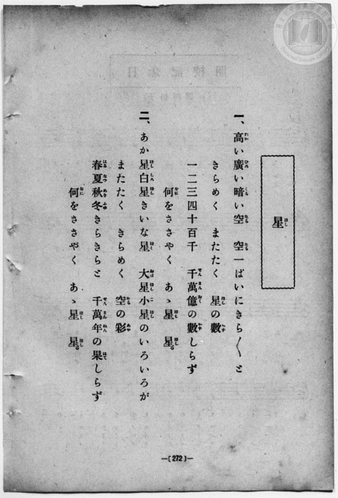
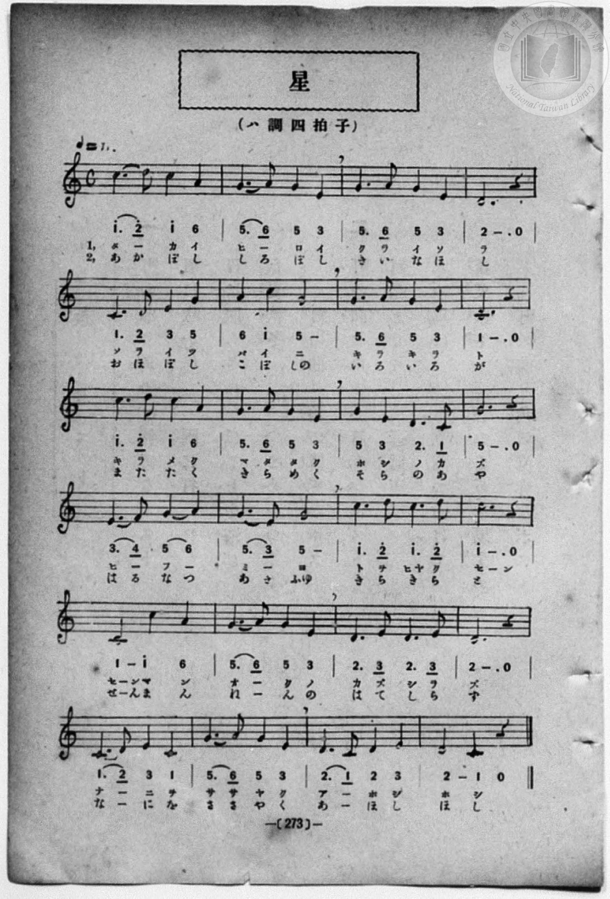

# 星

> Re:Shōka 使用 AI 協助辨識與重建樂譜，可能會有錯誤。歡迎回報。

<audio controls src="hoshi.mp3"></audio>

- book: 新編 小學校・公學校 唱歌教材集（尋常科五・六學年用）
- 一條慎三郎 編《新編 小學校・公學校 唱歌教材集》（大正十二年十二月，索書號 0725-41）

## 說明

> [!NOTE]
> **原書資訊與歌詞全文**（對應 `P280.jpg`–`P281.jpg`，原書 p. 272–273，尋常科五・六學年第 24 首）：
> - **調性與拍號**：ハ調四拍子（C 大調 4/4 拍），♩= 86
> - **樂曲結構**：全曲共 24 小節（6 行，每行 4 小節），描寫仰望繁星閃爍、數不盡的千萬億星辰與永恆時光。
> - **原譜印刷對照**：第 24 小節（末小節）五線譜印為四分音符 D4（`2`）接二分音符 C4（`1 -`）與四分休止符（`0`），下方簡譜誤將 `2 -` 連寫為二分音符，此處依五線譜校正為 `| 2 - 1 - - - 0 - |`。
>
> **一、**
> 高（たか）い廣（ひろ）い暗（くら）い空（そら）　空一（そらいつ）ぱいにきらきらと
> きらめく　またたく　星（ほし）の數（かず）
> 一二三四（ひふみよ）十百千（とをひやくせん）　千萬億（せんまんおく）の數（かず）しらず
> 何（なに）をささやく　ああ星（ほし）　星（ほし）。
>
> **二、**
> あか星白星（ぼししろぼし）きいな星（ほし）　大星小星（おほぼしこぼし）のいろいろが
> またたく　きらめく　空（そら）の彩（あや）
> 春夏秋冬（はるなつあきふゆ）きらきらと　千萬年（せんまんねん）の果（はて）しらず
> 何（なに）をささやく　ああ星（ほし）　星（ほし）。


## 歌詞

```text
（TMD 檔案未包含歌詞註解）
```

## ABC

```abc
X:1
T:星
M:4/4
L:1/16
Q:1/4=86
K:C
V:V1 name="Piano" snm="Pia"
[V:V1]
c6 d2 c4 A4 | G6 A2 G4 E4 | G6 A2 G4 E4 | D12 z4 |
w: 1.~タ _ カ イ | ヒ _ ロ イ | ク ラ イ ソ | ラ
w: 2.~あ か ぼ し | し ろ ぼ し | き い な ほ | し
C6 D2 E4 G4 | A4 c4 G8 | G6 A2 G4 E4 | C12 z4 |
w: 1.~ソ ラ イ ツ | パ イ ニ | キ ラ キ ラ | ト
w: 2.~お ほ ぼ し | こ ぼ しの | い ろ い ろ | が
c6 d2 c4 A4 | G6 A2 G4 E4 | G4 E4 D6 C2 | G12 z4 |
w: 1.~キ ラ メ ク | マ タ タ ク | ホ シ ノ カ | ズ
w: 2.~ま た た く | き ら め く | そ ら の あ | や
E6 F2 G4 A4 | G6 E2 G8 | c6 d2 c6 d2 | c12 z4 |
w: 1.~ヒ _ フ _ | ミ _ ヨ | ト ヲ ヒヤ ク | セ
w: 2.~は る な つ | あ き ふゆ | き ら き ら | と
C8 c4 A4 | G6 A2 G4 E4 | D6 E2 D6 E2 | D12 z4 |
w: 1.~セ ンマ ン | オ _ ク ノ | カ ズ シ ラ | ズ
w: 2.~せ んま ん | ね _ ん の | は て し ら | ず
C6 D2 E4 C4 | G6 A2 G4 E4 | D6 C2 D4 E4 | D4 C8 z4 |
w: 1.~ナ _ ニ ヲ | サ サ ヤ ク | ア _ ホ シ | ホ シ
w: 2.~な _ に を | さ さ や く | あ _ ほ し | ほ し
c6 d2 c4 A4 | G6 A2 G4 E4 | G6 A2 G4 E4 | D12 z4 |
w: 1.~タ _ カ イ | ヒ _ ロ イ | ク ラ イ ソ | ラ
w: 2.~あ か ぼ し | し ろ ぼ し | き い な ほ | し
C6 D2 E4 G4 | A4 c4 G8 | G6 A2 G4 E4 | C12 z4 |
w: 1.~ソ ラ イ ツ | パ イ ニ | キ ラ キ ラ | ト
w: 2.~お ほ ぼ し | こ ぼ しの | い ろ い ろ | が
c6 d2 c4 A4 | G6 A2 G4 E4 | G4 E4 D6 C2 | G12 z4 |
w: 1.~キ ラ メ ク | マ タ タ ク | ホ シ ノ カ | ズ
w: 2.~ま た た く | き ら め く | そ ら の あ | や
E6 F2 G4 A4 | G6 E2 G8 | c6 d2 c6 d2 | c12 z4 |
w: 1.~ヒ _ フ _ | ミ _ ヨ | ト ヲ ヒヤ ク | セ
w: 2.~は る な つ | あ き ふゆ | き ら き ら | と
C8 c4 A4 | G6 A2 G4 E4 | D6 E2 D6 E2 | D12 z4 |
w: 1.~セ ンマ ン | オ _ ク ノ | カ ズ シ ラ | ズ
w: 2.~せ んま ん | ね _ ん の | は て し ら | ず
C6 D2 E4 C4 | G6 A2 G4 E4 | D6 C2 D4 E4 | D4 C8 z4 |
w: 1.~ナ _ ニ ヲ | サ サ ヤ ク | ア _ ホ シ | ホ シ
w: 2.~な _ に を | さ さ や く | あ _ ほ し | ほ し
```

## TMD 檔案連結

- [主旋律 TMD 檔案](hoshi.tmd) [[在 TMD Studio 編輯](https://tmdlang.github.io/Tmd-TS/#tmd=s7IKdvYPcrWy4qpTUCpJTLdSSM7PyUlNLsnMz7MqzsjPTozPrsyvSsyML84ojTe0NDJWgqssy88pzU21Si9KTEmNN403Q8gU55cWJadaFSdn5OfnxJekVpQk5edno8vHFySmp1oFGFkYIGQKivLLUvMS84C6C4oy80pSU8DaEQpSyzJTUkHSxcmJefFlqUWZaZmpKUiOSi0qBrsdYkVJUWJecXJRZgHIQwhV-UUlGflAhxdkVFplZBaX5BdlJifmxGcn5iUiFJVkpAK9l5dYUlqUii6aWFxSlJ-Xn1upxKWlpfBsxnwFLS0uRVsFCzMue1sFZy4bE30TO5AekMetFJ5N2_B8-wqFpxv6n67d8WzBwsfNu5-2roGwFZ5O2fhsbc-zqTOfzZ3wcnbb-z0dTzd0P92x4_nyiU92TQErXQtU-nTnludTVrzf0wl2y5MdDc8WzX3W2vdkR-fL5j4FoPGPG7pIsedxQzfIqiXLn61d_LS38cmuHqANEMazOR3v9_Q837Lo2ewdL2bOVzAwNzLVNTEE282lr6VgSy3ApaCgYKcQrejnH-IaC-FoaT3tmw-yd3P7ixVdLzragW5-sXLe09YVz6a1a2mBQ6f3WXunQgIo5ehlFaQnPGqYDOIYgjlAh0MMUCjQUzAyNwJKGpkbg0RxBeqaNQpGJgovl00D-u_9nlkQZ-gCHfJi1f5nDctBTujuBQYDyPJZj5v7gcJPZ88Gij1dOwHoHGcFYBgCxRSAUa4AFAWb0vNo5kpwaoAb9mxF07PZm55vnfBseTfYJJCPZm962roRZDswxp6vbwCaZqbwYmEPUP-z9f1AhgJCBmTos_7-p-tXP9m94dmc2c93NgKT3ctpzc87eh83ND6buuPJjt7nsxc-n9XytLf5xYQ1T1tagApe7NsA8sCGHc8a257NbHra2vm4oQnhKmBQvVg752nvhqcd24Hh-rx1Odht0DCBu-rZnNVwdwCD7_n2WRBdz5t2AYPiaUfby_mbn69ZpuBiAlScYASMhM5nfUtBSQou5QyWMlTQBUkCnQTR92TPxGdrFwHlQZIGICmgN5_s6H42befzDQuBlrxYteTphnaFBCOgRoWXDYuB_gdaimwyKFzWLnkxc-qTfXPhbgOmd2CyBqpUSKhRAOpVAFoMhgZAXJMACwNYkgPmJmAYArMwmP9y9Qygcx43zn_cCMwinY8bW57uXgwW2fS4CRS_QJFns6aDRfofNwGdDBJ5vnIXWGQuVKShASgCNBguCFTzuHEJWPFGMHv148ZesDiEXAGxHcptagQZ3tDwuHEf2CVABOICoxRs4O7HjUAHAHWtA8Y8WKT7ceMsoAjEEKC9wDAClg3AYIa6vHHr48b9j5uAObsTmMufz9wHTCZgqRWPmyaBvQZ0Uv_jxtmPmyZD3A9PR2BlIHGQY0BkF1AlVtuBrgL7BZqLnuydCpZdBfQsSBZk0VQQgtgF8l0TEKF7CtOb6PG1qwcpvsCGdAO1PJ-5F6ZxD8glIMf0QthgtwHZQHtXYVoHKgVnzAcmcZgU0INAWYghQP_CTVgHMgFkJoTsgTkAJY7QYhA9YTSue7p3JVikCRgO8Ch7NmPp0yX9z5d3P21bA5Zd_7gJGKrAoFsC9iDQuq2Pm4DVAzzBQJMNIqZ2bsGIqbXQ2ATG1Lw5UGMbgXmGxjFFedUABQpa-lxcHvnFGZlWAZmJefkONQY1CtUgKxRsLLTACUIBW42kACzCgJkAVIZqwAoyHQVYLaGJRQPQIpBhNQqGceCSwigOwjIDlRgKpmAxMzBtjEMEVM7AILicARvoY1ij8LhpP1T8cdNqMLkErONx8ySYePNaZPGm9VDRlVCxx017oTpWItkSj7DFCCjX2ATR1dgNxHvArOkQXWAaZEovhkwvVE8LEK8Cs3aj6EG2CX9w7-ohK7ghoQ0OQ1BY1oBDHBz0kCDGHtiwAh1bYIOCCiXwmluggTcRHsiPm7vhpj9uAgU-TAc4IsDBDNLRgSe4u6BBtxsjUCeDeVAxYOZDWAUMZ0RMgNggFkSmh8Tw3tFJ4-QNYkEStSFcDfYQRwq_5oVgT4ESMCj85kG9ux-aCRAys8G87WB9fVBVq8GxsQtPmO-Dhvl8MAax-qHBB03ITZ1A3IgiMxcqDhKDRAUoq4BsgkQG0UEOrE3JCXJQOOoC23KgEEQOb2OkFI4WLWAWXBRroCOVHVPhxjxuBgUKRHQFkigkGT9u3gTS97gZlAMgcQEKBVCGxxXe0IKoCVSkQIoHaBEFL2xACRlUMyFsQ44KJDZIBuYmYtP4rinklynQUgRXCoekbGM4jb8Ah4XR4-bNkEQNZEB82wQKFlhwwhIzSBxU0oNEd0GTOSSDEErgoGwB0QeqxCEMaLCuRUiBQx6UlpHiqHEZUkEPCe5ZpAU3sFNEaREOYuMObUMwjRBBaZYjJW1IyQorpUHJFhKkW6G-2woUg1SL0NKkaRFcB6JcQS1lsAU2POoaIdUyKEuBxCEZCkRDyghEWQJJ9bBqElHiI3gIe2q5uHTtFMCtFwVkhjIXAA)]
- [鋼琴伴奏 TMD 檔案](hoshi_piano.tmd) [[在 TMD Studio 編輯](https://tmdlang.github.io/Tmd-TS/#tmd=s7IKdvYPcrWy4qpTUCpJTLdSSM7PyUlNLsnMz7MqzsjPTozPrsyvSsyML84ojTe0NDJWgqssy88pzU21Si9KTEmNN403Q8gU55cWJadaFSdn5OfnxJekVpQk5edno8vHFySmp1oFGFkYIGQKivLLUvMS84C6C4oy80pSU8DaEQpSyzJTUkHSxcmJefFlqUWZaZmpKUiOSi0qBrsdYkVJUWJecXJRZgHIQwhV-UUlGflAhxdkVFplZBaX5BdlJifmxGcn5iUiFCUWATWnp-am5pVYFWQm5uXHJyYn5-cWJOZlgsQQCksygIqs8hJLSotS0UUTi0uK8vPycyuVuLS0FJ7NmP9-T8fL2TOfdXa_7N7zfMKWJ3u2PF3a_35Pp4KWFpeirYKFGZe9rYIzl42JvokdyCxQyFkpPJu24fn2FQpPN_Q_Xbvj2YKFj5t3P21dA2ErPJ2y8dnanmdTZz6bO-Hl7DagDU83dD_dseP58olPdk0BK10LVPp055bnU1YArQK78cmOhmeL5j5r7Xuyo_Nlc58C0PjHDV2k2PO4oRtk1ZLlz9Yuftrb-GRXD9AGCOPZnI73e3qeb1n0bPaOFzPnKxiYG5nqmhiC7ebyyC_OyLQKAIVokIdDjUGNQjWXAhDYWGjZgRn6Wgq26EDh-Zo1QCe_WNijoGECct_z9Q06CsDEY6iXVZCuiUWDlj7YsBoFwzgFXSA0ioOwzIC4RsEULGYGpo1xiBiBRSDQACQCNtDHsEbhcdN-qPjjptVgcglYx-PmSTDx5rXI4k3roaIroWKPm_ZCdaxEsiUeYYsRUK6xCaKrsRuI94BZ0yG6wDTIlF4MmV6onhYgXgVm7UbRg2wT_uDe1UNWcENCGxyGoLCsAYc4OOghQYw9sCHasAc2KKhQAq-5BRp4E-GB_Li5G2764yZQ4MN0gCMCHMwgHR14grsLGnS7MQJ1MpgHFXvcuA5hFTCcETEBYoNYEJkeEsN7RyeNkzeIBUnUhnA12EMcKfyaF4I9BUrAoPCbB_XufmgmQMjMBvO2g_X1QVWtBsfGLjxhvg8a5vPBGMTqhwYfNCE3dQJxI4rMXKg4SAwSFaCsArIJEhlEB_nT2bPJCXJQOOoqmIBDEDm8jZFSOFq0gFlwUayBjlR2TIUb87gZFCgQ0RVIopBk_Lh5E0jf42ZQDoDEBSgUQBkeV3hDC6ImUJECKR6gRRS8sAEl5K2Pm9oQtiFHBRIbJANzE7FpfNcU8ssUaCmCK4VDUrYxnMZfgMPC6HHzZkiiBjIgvm0CBQssOGGJGSQOKulBorugyRySQQglcFC2gOibDEntQAY0WNcipMAhD0rLSHHUuAypoIcE9yzSghtY8VNahIPYuEPbEEwjRGARhZ60ISUrrJQGJVtIkG6F-m4rUAxSLUJLk6ZFcB2IcgW1lMEW2PCoa4RUy6AsBRKHZCgQDSkjEGUJJNXDqklEiY_gIeypRWm8-KA0XkygjRdg6MUrRBvGKpgAKZNYBB9KYfJN44Es0_hYMMMA6h1MZVDz0I2B60bWgWEKIccgmUKkcwgbRI5zUCynzEG4jIIqABkEjE9dOwVwlEb7AMUQHCMwR5kLAA)]

## 分析

```text
================================================================================
📊 TMD Song Profile: [ 星 ]
================================================================================
⏱  Duration:       2:13 (134.0s), 48 measures total
🎼 Key & Tempo:    首調基準 C, != 86.0 BPM, <4/4>
   - 分析範圍：      由實際發聲的音符與和弦推測調性；播放脈絡另行呈現
🎤 人聲音域:    C4 (MIDI 60) – D5 (MIDI 74) [跨度: 14 個半音 / 1.2 個八度, 難度: moderate]
   - 最低音:  C4 in [Hoshi #1 @ m.5, 0:11]
   - 最高音: D5 in [Hoshi #1 @ m.1, 0:01]
   - 適合: soprano, mezzo-soprano, contralto, tenor, baritone, bass
🏛  結構:      Hoshi (67.0s) -> Hoshi (67.0s)
⚡ 編曲密度:        Peak 1 軌道同時演奏
🗝  調性診斷：       C 大調（純淨自然大調，未偵測到可信轉調）
   - 風格氣質:    純淨自然大調（陽光明朗、易唱易記，無明顯調外色彩）
   - 轉調歷程:    全曲維持單一推測調性（未偵測到可信轉調）
   - 核心骨幹音:  G, C, D, E, A
   - 調性數值:    C 大調 [相關度: 0.87, 穩定度: Moderate, 自然音純度: 100.0%]
   - 候選調性 (K-S): C 大調 (0.87), G 大調 (0.81), E 小調 (0.56)
   - 五度圈歷程:   +0 -> +0
   - 各段落調性細節:
     • [Hoshi #1]: C 大調 (r: 0.87, 自然音純度: 100.0%)
     • [Hoshi #2]: C 大調 (r: 0.87, 自然音純度: 100.0%)

  [ 五度圈游移軌跡 ]
              [C ]*
         F            G  
      Bb               D  
      Eb               A  
         Ab           E  
            Db       B  
               F# 
     (* = active key center)

  [ 十二半音累積音高分佈 ]
     C  : ███████████████████████   27.8%
     C# :                            0.0%
     D  : ███████████████           18.9%
     D# :                            0.0%
     E  : ████████████              14.4%
     F  :                            0.6%
     F# :                            0.0%
     G  : ████████████████████████  29.4%
     G# :                            0.0%
     A  : ███████                    8.9%
     A# :                            0.0%
     B  :                            0.0%
--------------------------------------------------------------------------------
Assignment 軌道音域：
  - Piano         : C4 – D5 (14 個半音 / 1.2 個八度, 152 個音符)
================================================================================
```


## 原書掃描頁






